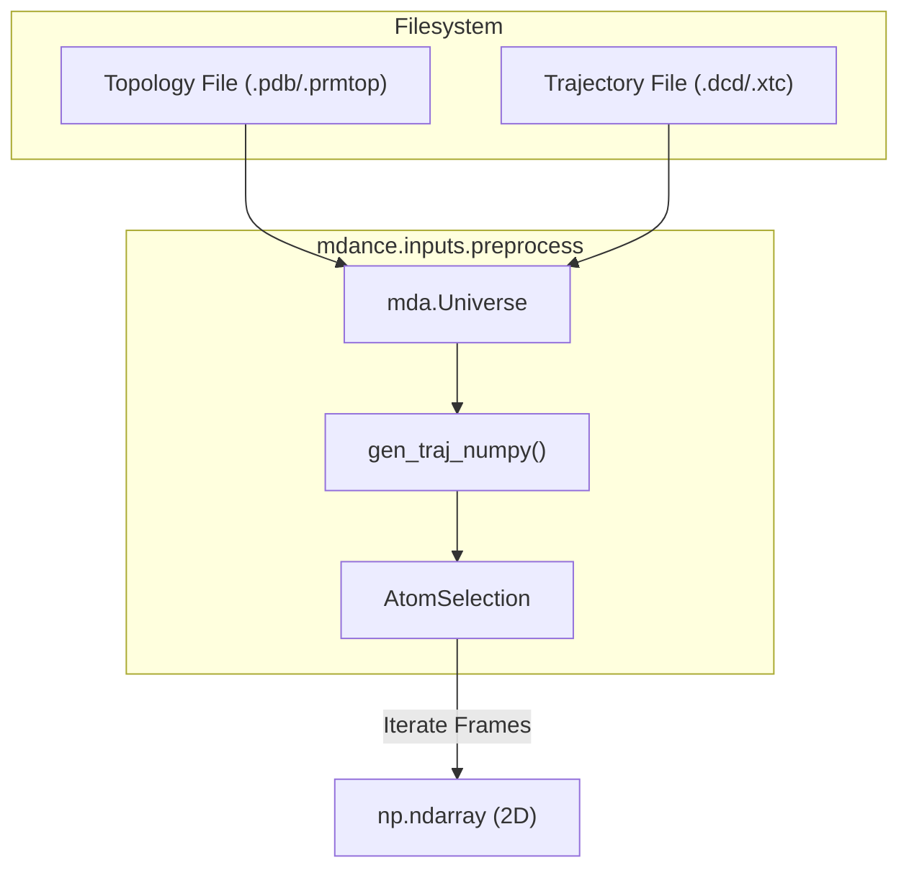
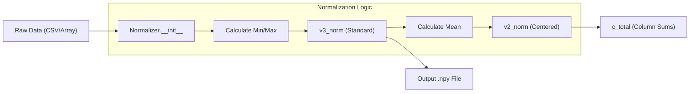

# Trajectory Preprocessing

Relevant source files

The following files were used as context for generating this wiki page:

- [CITATION.bib](CITATION.bib)
- [scripts/inputs/normalize.py](scripts/inputs/normalize.py)
- [scripts/inputs/preprocessing.ipynb](scripts/inputs/preprocessing.ipynb)
- [scripts/nani/analysis_db.ipynb](scripts/nani/analysis_db.ipynb)
- [src/mdance/data/README.rst](src/mdance/data/README.rst)
- [src/mdance/data/__init__.py](src/mdance/data/__init__.py)
- [src/mdance/data/aligned_1000_tau.dcd](src/mdance/data/aligned_1000_tau.dcd)
- [src/mdance/data/aligned_original_tau_6K.dcd](src/mdance/data/aligned_original_tau_6K.dcd)
- [src/mdance/data/aligned_tau.pdb](src/mdance/data/aligned_tau.pdb)
- [src/mdance/data/backbone.npy](src/mdance/data/backbone.npy)
- [src/mdance/data/blob_disk.csv](src/mdance/data/blob_disk.csv)
- [src/mdance/data/cc_sim.npy](src/mdance/data/cc_sim.npy)
- [src/mdance/data/diamond9.csv](src/mdance/data/diamond9.csv)
- [src/mdance/data/labels_6.csv](src/mdance/data/labels_6.csv)
- [src/mdance/inputs/preprocess.py](src/mdance/inputs/preprocess.py)

Trajectory preprocessing is the initial phase of the MDANCE pipeline, responsible for converting raw Molecular Dynamics (MD) data into a standardized format suitable for n-ary similarity analysis and clustering. This stage involves reading various trajectory formats, performing atom selection, and optionally normalizing the data.

## Trajectory to NumPy Conversion

The primary entry point for MD data is the `gen_traj_numpy` function. It leverages the **MDAnalysis** library to parse topology and trajectory files, extracting coordinate data into a flattened 2D NumPy array [src/mdance/inputs/preprocess.py:9-51]().

### Implementation and Data Flow
The function creates an `mda.Universe` from the provided topology and trajectory paths. It applies an atom selection string to filter the system (e.g., extracting only backbone atoms) [src/mdance/inputs/preprocess.py:38-39]().

1.  **Input**: Topology file (e.g., `.pdb`, `.prmtop`) and Trajectory file (e.g., `.dcd`, `.xtc`).
2.  **Selection**: Uses MDAnalysis Atom Selection Language [src/mdance/inputs/preprocess.py:19-21]().
3.  **Extraction**: Iterates through each frame, storing coordinates in a 3D array of shape `(n_frames, n_atoms, 3)` [src/mdance/inputs/preprocess.py:45-48]().
4.  **Transformation**: Flattens the 3D array into a 2D array of shape `(n_frames, n_atoms * 3)` [src/mdance/inputs/preprocess.py:50]().

**Entity Mapping: Trajectory Processing**
Title: Trajectory Extraction Logic

Sources: [src/mdance/inputs/preprocess.py:9-51](), [scripts/inputs/preprocessing.ipynb:44-51]()

## Normalization and Non-MD Data

For non-molecular dynamics data (e.g., synthetic datasets or pre-processed descriptors), MDANCE provides the `Normalizer` class and the `normalize.py` script. These tools implement Min-Max normalization and calculate specific metrics used by the clustering engines [src/mdance/inputs/preprocess.py:54-102]().

### The Normalizer Class
The `Normalizer` class supports two primary normalization types, referred to in the code as `v2` and `v3` [src/mdance/inputs/preprocess.py:128-134]().

| Attribute/Method | Description | Implementation |
| :--- | :--- | :--- |
| `v3_norm` | Standard Min-Max normalization. | `(data - min) / (max - min)` [src/mdance/inputs/preprocess.py:116]() |
| `v2_norm` | Centered normalization relative to the mean. | `1 - abs(v3_norm - avg)` [src/mdance/inputs/preprocess.py:121]() |
| `c_total` | Column-wise sum of centered normalized data. | `np.sum(1 - abs(v3_norm - mean), axis=0)` [src/mdance/inputs/preprocess.py:122]() |

### normalize.py Script
The `scripts/inputs/normalize.py` script provides a CLI-like interface to process CSV-based datasets (like the bundled `blob_disk.csv`). It utilizes `normalize_file` to produce a `.npy` output [scripts/inputs/normalize.py:1-16]().

Sources: [src/mdance/inputs/preprocess.py:54-140](), [scripts/inputs/normalize.py:1-16]()

## Atom Selection and Downsampling

### Selection Syntax
MDANCE relies on the MDAnalysis selection syntax. Common selections used in the examples include:
*   **Backbone Only**: `'resid 3 to 12 and name N CA C O H'` [scripts/inputs/preprocessing.ipynb:83]()
*   **Heavy Atoms**: `'resid 3:12 and name N CA C'` [src/mdance/inputs/preprocess.py:33]()

### Sieve-based Downsampling
While `gen_traj_numpy` iterates through all frames by default, users can manage large trajectories by pre-aligning and centering the data before conversion [scripts/inputs/preprocessing.ipynb:47](). The `read_cpptraj` function also exists for handling legacy AMBER CRD files, though it is noted as inefficient compared to the NumPy-based workflow [src/mdance/inputs/preprocess.py:141-172]().

**Entity Mapping: Normalization Pipeline**
Title: Data Normalization Flow

Sources: [src/mdance/inputs/preprocess.py:103-123](), [scripts/inputs/normalize.py:13-16]()

## Bundled Reference Datasets

MDANCE includes several reference datasets within `src/mdance/data/` for testing and tutorials. These are accessible via the `mdance.data` module [src/mdance/data/__init__.py:1-20]().

| File Name | Description | Source/Usage |
| :--- | :--- | :--- |
| `aligned_tau.pdb` | Topology for a Tau protein fragment. | [src/mdance/data/aligned_tau.pdb]() |
| `aligned_1000_tau.dcd` | Trajectory aligned to the 1000th frame. | [src/mdance/data/README.rst:7]() |
| `backbone.npy` | Pre-converted NumPy array of Tau backbone atoms. | [src/mdance/data/README.rst:9]() |
| `blob_disk.csv` | Synthetic 2D dataset for clustering validation. | [src/mdance/data/blob_disk.csv]() |
| `diamond9.csv` | Synthetic "Diamond" dataset from ICTAI 2004. | [src/mdance/data/diamond9.csv]() |
| `labels_6.csv` | Reference cluster labels for the Tau dataset. | [src/mdance/data/labels_6.csv]() |

Sources: [src/mdance/data/__init__.py:1-20](), [src/mdance/data/README.rst:1-11]()

---