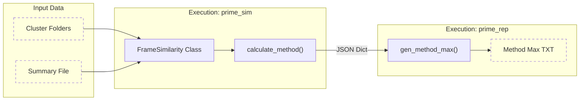

# Postprocessing and Output Extraction

<details>
<summary>Relevant source files</summary>

The following files were used as context for generating this wiki page:

- [examples/analysis_db.py](examples/analysis_db.py)
- [examples/postprocessing.py](examples/postprocessing.py)
- [examples/preprocessing.py](examples/preprocessing.py)
- [scripts/outputs/postprocessing.ipynb](scripts/outputs/postprocessing.ipynb)
- [src/mdance/cli/prime_rep.py](src/mdance/cli/prime_rep.py)
- [src/mdance/cli/prime_sim.py](src/mdance/cli/prime_sim.py)
- [src/mdance/outputs/postprocess.py](src/mdance/outputs/postprocess.py)

</details>


Postprocessing in MDANCE involves transforming clustering results and normalized data back into usable Molecular Dynamics (MD) formats. This phase bridges the gap between the mathematical clustering space (numpy arrays, labels, and similarity indices) and the physical trajectory space (DCD, PDB, or CRD files) used in visualization and further simulation.

## Core Postprocessing Utilities

The `mdance.outputs.postprocess` module provides low-level functions for data restoration and format conversion.

### Data Unnormalization
Clustering is often performed on normalized data. To restore physical coordinates, the `unnormalize_data` function reverses Min-Max scaling.
- **Function**: `unnormalize_data(norm_data, min, max)` [src/mdance/outputs/postprocess.py:1-19]()
- **Implementation**: It applies the inverse transformation: $unnorm\_data = norm\_data \times (max - min) + min$ [src/mdance/outputs/postprocess.py:18]().

### CRD Format Export
For workflows involving AMBER-style coordinates, MDANCE can convert numpy arrays back to CRD strings.
- **Function**: `numpy_array_to_crd_traj(matrix, num_columns=10)` [src/mdance/outputs/postprocess.py:22-42]()
- **Behavior**: It iterates through the coordinate matrix and formats values into 7-character right-justified strings with 3 decimal places, organized into the specified number of columns per line [src/mdance/outputs/postprocess.py:37-41]().

**Sources:**
- [src/mdance/outputs/postprocess.py:1-42]()

## Extracting Representative Frames

A primary goal of postprocessing is to extract specific frames identified by clustering (e.g., medoids or best-scoring frames) into new trajectory files. This is typically achieved using the `MDAnalysis` library.

### Workflow: Trajectory Reconstruction
The process follows these steps:
1. Load the original topology and trajectory into an `MDAnalysis.Universe` [examples/postprocessing.py:26-29]().
2. Load cluster assignments or best-frame indices from CSV files (e.g., `best_frames_indices_6.csv`) [examples/postprocessing.py:38-45]().
3. Group frame indices by their cluster ID [examples/postprocessing.py:48]().
4. Iterate through clusters and use an `mda.Writer` to save the selected frames into separate files (e.g., `.dcd` format) [examples/postprocessing.py:50-54]().

### Trajectory Extraction Logic
| Entity | Role | Source |
| :--- | :--- | :--- |
| `mda.Universe` | Container for topology and trajectory data | [examples/postprocessing.py:29]() |
| `cluster_assignment` | CSV containing `frame_index` and `cluster_id` | [examples/postprocessing.py:38]() |
| `mda.Writer` | Handles writing selected frames to disk | [examples/postprocessing.py:52]() |

**Data Flow: From Cluster Labels to DCD Trajectories**

```mermaid
graph TD
    subgraph "Natural Language Space"
        "Clustering Results"
        "Original Trajectory"
        "Per-Cluster Files"
    end

    subgraph "Code Entity Space"
        CSV["best_frames_indices.csv"]
        MDA_U["MDAnalysis.Universe"]
        NP_LOAD["np.loadtxt"]
        MDA_W["MDAnalysis.Writer"]
    end

    CSV -->|"Parse labels"| NP_LOAD
    NP_LOAD -->|"Indices (x, y)"| MDA_W
    MDA_U -->|"Coordinates"| MDA_W
    MDA_W -->|"Write frames"| DCD[".dcd Files"]

    style CSV fill:none,stroke-dasharray: 5 5
    style DCD fill:none,stroke-dasharray: 5 5
```

**Sources:**
- [examples/postprocessing.py:16-54]()
- [scripts/outputs/postprocessing.ipynb:34-124]()

## PRIME Output Extraction

The PRIME (Protein Retrieval via Integrative Molecular Ensembles) subsystem uses specialized CLI tools to extract similarity-based representative frames.

### Representative Selection (prime_rep)
The `prime_rep` tool identifies frames that maximize similarity across different ensemble definitions.
- **Core Functions**: `gen_one_method_max` and `gen_all_methods_max` [src/mdance/cli/prime_rep.py:3]().
- **Parameters**:
    - `--method`: The similarity method (e.g., `union`, `medoid`) [src/mdance/cli/prime_rep.py:19-21]().
    - `--trim_frac`: Fraction of outliers to exclude [src/mdance/cli/prime_rep.py:24-28]().
    - `--index`: The n-ary similarity index (e.g., `RR`, `SM`) [src/mdance/cli/prime_rep.py:29-33]().

### Similarity Extraction (prime_sim)
Before extraction, `prime_sim` generates a similarity dictionary.
- **Class**: `FrameSimilarity` [src/mdance/cli/prime_sim.py:6]().
- **Output**: A JSON-formatted `.txt` file containing the calculated similarity values for the ensemble [src/mdance/cli/prime_sim.py:77-87]().

**PRIME Data Flow**



**Sources:**
- [src/mdance/cli/prime_rep.py:1-55]()
- [src/mdance/cli/prime_sim.py:1-91]()

## Analysis and Plotting

Postprocessing often includes visual validation of cluster quality to ensure the extracted frames are representative.

### Davies-Bouldin Index (DBI) Analysis
The `plot_scores` function in `examples/analysis_db.py` is used to visualize the optimal number of clusters before extraction.
- **Metric**: Uses the minimum DBI or the maximum of the second derivative of the DBI to suggest the optimal cluster count [examples/analysis_db.py:22-23]().
- **Plotting**: Generates plots showing the DBI curve and vertical lines for "Optimal" and "Second Optimal" cluster counts [examples/analysis_db.py:51-77]().

**Sources:**
- [examples/analysis_db.py:27-80]()

---