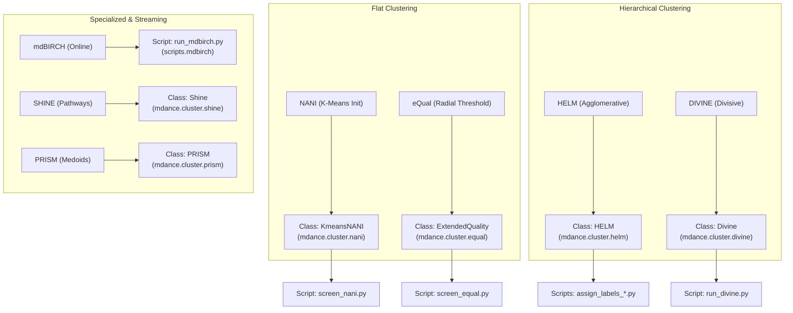
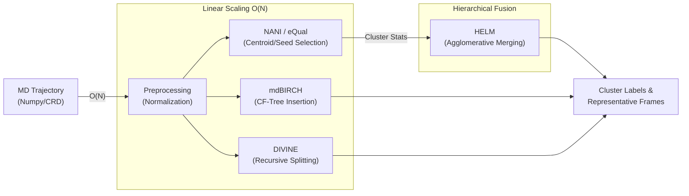

# Clustering Algorithms

Relevant source files

The following files were used as context for generating this wiki page:

- [README.md](README.md)
- [src/mdance/cluster/__init__.py](src/mdance/cluster/__init__.py)
- [src/mdance/prime/__init__.py](src/mdance/prime/__init__.py)
- [tutorials/prime.md](tutorials/prime.md)

MDANCE provides a comprehensive suite of clustering algorithms designed specifically for the challenges of Molecular Dynamics (MD) data, such as high dimensionality, massive frame counts, and the need for biological interpretability. The framework shifts from traditional $O(N^2)$ pairwise distance calculations to $O(N)$ **n-ary similarity** operations, enabling the analysis of millions of frames in minutes [README.md:34-41]().

The algorithms are categorized into flat clustering (NANI, eQual), hierarchical methods (HELM, DIVINE), online streaming (mdBIRCH), and specialized pathway analysis (SHINE, PRISM).

### Algorithm Taxonomy and Code Entities

The following diagram maps the conceptual clustering families to their primary implementation classes and entry-point scripts within the MDANCE codebase.

**Clustering Family to Code Entity Map**

**Sources:** [README.md:131-141](), [tutorials/prime.md:16-19]()

---

### Algorithm Overview

#### [3.1 NANI: K-Means with N-ary Initialization](#)
NANI (N-ary Initialization) addresses the stochastic nature of $k$-means by providing deterministic centroid selection. It uses $n$-ary comparisons to identify high-density regions and diverse conformations before the refinement stage [README.md:44-52]().
*   **Best Use Case:** Improving $k$-means reproducibility and speed for large datasets.
*   **Key Class:** `KmeansNANI`

#### [3.2 eQual: Radial Threshold Clustering](#)
eQual transforms the traditionally $O(N^2)$ Radial Threshold Clustering (RTC) into an $O(N)$ algorithm. It employs $k$-means++ for seed selection and extended similarity indices for deterministic label assignment [README.md:96-103]().
*   **Best Use Case:** General purpose flat clustering without pre-defining the number of clusters.
*   **Key Class:** `ExtendedQuality`

#### [3.3 HELM: Hierarchical Extended Linkage Method](#)
HELM is a hybrid approach that combines $k$-means efficiency with hierarchical flexibility. It merges pre-existing clusters using $n$-ary difference functions, building a hierarchy without expensive pairwise distance matrices [README.md:54-62]().
*   **Best Use Case:** Large-scale hierarchical analysis (e.g., 1.5M+ frames).
*   **Key Class:** `HELM`

#### [3.4 DIVINE: Divisive Hierarchical Clustering](#)
DIVINE is a top-down framework that recursively splits clusters based on $n$-ary similarity. It avoids distance matrices entirely and uses NANI for deterministic anchor initialization during splits [README.md:63-72]().
*   **Best Use Case:** Multi-resolution analysis and exploring cluster sub-structures.
*   **Key Class:** `Divine`

#### [3.5 mdBIRCH: Online Streaming Clustering](#)
mdBIRCH adapts the BIRCH CF-tree algorithm for MD data. It processes frames as they arrive (online) and uses a merge test calibrated directly to RMSD for physical interpretability [README.md:73-83]().
*   **Best Use Case:** Extremely large trajectories that do not fit in memory or streaming data.
*   **Workflow:** `run_mdbirch.py`

#### [3.6 SHINE: Pathway Clustering](#)
SHINE focuses on hierarchical clustering of MD pathways (ensembles of trajectories) rather than individual frames. It integrates $n$-ary similarity with cheminformatics tools to identify dominant biological mechanisms [README.md:84-94]().
*   **Best Use Case:** Analyzing enhanced sampling data and pathway ensembles.
*   **Key Class:** `Shine`

#### [3.7 PRISM: Pathway Representation via Structural Medoids](#)
PRISM utilizes structural medoids to represent pathways, employing weighted average Hausdorff dissimilarity for hierarchical clustering. It provides strategies for global and per-pathway medoid construction [README.md:131-141]().
*   **Best Use Case:** Structural refinement of pathway classes.
*   **Key Class:** `PRISM`

---

### Comparison of Computational Characteristics

The following diagram illustrates how the different algorithms interact with the core data representations and their relative computational complexity.

**Data Flow and Complexity Architecture**

**Sources:** [README.md:36-41](), [README.md:131-141](), [tutorials/prime.md:21-29]()

### Summary Table

| Algorithm | Type | Complexity | Key Code Entity |
| :--- | :--- | :--- | :--- |
| **NANI** | Flat / Init | $O(N)$ | `mdance.cluster.nani.KmeansNANI` |
| **eQual** | Flat | $O(N)$ | `mdance.cluster.equal.ExtendedQuality` |
| **HELM** | Hierarchical | $O(N)$ | `mdance.cluster.helm.HELM` |
| **DIVINE** | Hierarchical | $O(N)$ | `mdance.cluster.divine.Divine` |
| **mdBIRCH**| Online | $O(N)$ | `scripts/mdbirch/run_mdbirch.py` |
| **SHINE** | Pathway | $O(N)$ | `mdance.cluster.shine.Shine` |
| **PRISM** | Pathway | $O(N)$ | `mdance.cluster.prism.PRISM` |

**Sources:** [README.md:131-141]()

---