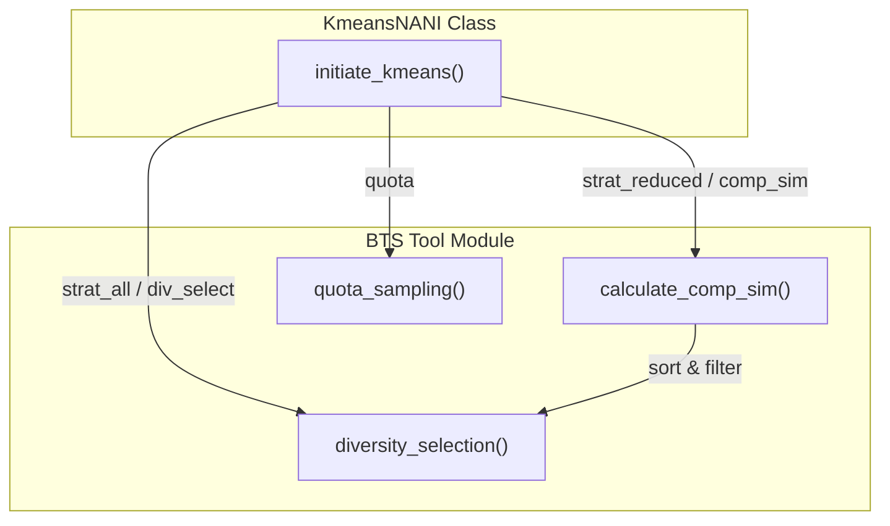
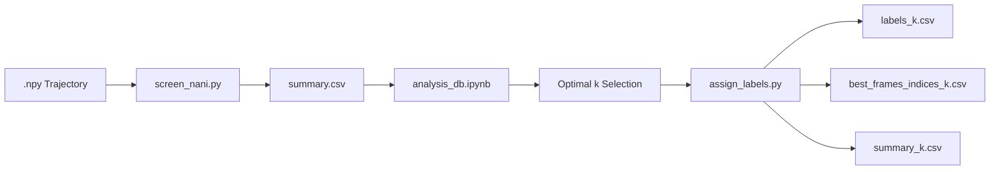

# NANI: K-Means with N-ary Initialization

Relevant source files

The following files were used as context for generating this wiki page:

- [CITATION.bib](CITATION.bib)
- [docs/getting_started.rst](docs/getting_started.rst)
- [docs/tutorials/equal.rst](docs/tutorials/equal.rst)
- [docs/tutorials/helm.rst](docs/tutorials/helm.rst)
- [docs/tutorials/nani.rst](docs/tutorials/nani.rst)
- [examples/nani101.py](examples/nani101.py)
- [scripts/inputs/preprocessing.ipynb](scripts/inputs/preprocessing.ipynb)
- [scripts/nani/analysis_db.ipynb](scripts/nani/analysis_db.ipynb)
- [scripts/nani/assign_labels.py](scripts/nani/assign_labels.py)
- [scripts/nani/outputs/10strat_all_summary.csv](scripts/nani/outputs/10strat_all_summary.csv)
- [scripts/nani/outputs/best_frames_indices_6.csv](scripts/nani/outputs/best_frames_indices_6.csv)
- [scripts/nani/outputs/labels_6.csv](scripts/nani/outputs/labels_6.csv)
- [scripts/nani/outputs/summary_6.csv](scripts/nani/outputs/summary_6.csv)
- [scripts/nani/screen_nani.py](scripts/nani/screen_nani.py)
- [src/mdance/cluster/nani.py](src/mdance/cluster/nani.py)
- [tutorials/eQual.md](tutorials/eQual.md)
- [tutorials/nani.md](tutorials/nani.md)

N-Ary Natural Initialization (NANI) is a deterministic initialization strategy for *k*-means clustering designed to overcome the stochastic nature and local-optima sensitivity of traditional methods like *k*-means++. By utilizing $n$-ary similarity metrics and density-based sampling, NANI provides consistent, high-quality starting centroids for Molecular Dynamics (MD) trajectories and general datasets [src/mdance/cluster/nani.py:8-19]().

## The KmeansNANI Framework

The `KmeansNANI` class serves as the primary interface for executing NANI-initialized clustering. It integrates several density-aware and diversity-aware initialization strategies before delegating the final clustering to a standard *k*-means implementation [src/mdance/cluster/nani.py:51-61]().

### Initialization Strategies

| Strategy | Description | Implementation |
| :--- | :--- | :--- |
| `strat_all` | Computes bins based on a data percentage, applies stratified sampling, and selects the first $k$ points. | [src/mdance/cluster/nani.py:126-129]() |
| `strat_reduced` | Identifies high-density regions via complementary similarity, then applies stratified sampling to that subset. | [src/mdance/cluster/nani.py:110-125]() |
| `comp_sim` | Selects a subset of high-density points and uses diversity selection to find the first $k$ centers. | [src/mdance/cluster/nani.py:110-125]() |
| `div_select` | Applies diversity selection using complementary similarity directly on a percentage of the dataset. | [src/mdance/cluster/nani.py:131-134]() |
| `quota` | Uses quota sampling to select centers based on complementary similarity values divided into bins. | [src/mdance/cluster/nani.py:136-142]() |
| `vanilla_kmeans++` | Wrapper for the standard scikit-learn `kmeans_plusplus` algorithm. | [src/mdance/cluster/nani.py:144-146]() |

**Sources:** [src/mdance/cluster/nani.py:11-20](), [src/mdance/cluster/nani.py:97-151]()

### Code Entity Space: NANI Initialization Logic
This diagram bridges the natural language strategy names to the underlying functions in `mdance.tools.bts`.

**Sources:** [src/mdance/cluster/nani.py:97-143](), [src/mdance/cluster/nani.py:5-5]()

## Screening and Optimal Cluster Selection

The NANI workflow typically follows a screening process to determine the optimal number of clusters ($k$) using the Davies-Bouldin Index (DBI) and Calinski-Harabasz (CH) scores.

### Screening Workflow (`screen_nani.py`)
The `screen_nani.py` script automates the execution of `KmeansNANI` across a range of $k$ values [scripts/nani/screen_nani.py:39-69]().
1. **Load Data**: Loads a `.npy` file (optionally sieved) [scripts/nani/screen_nani.py:27-27]().
2. **Iterative Clustering**: Runs `KmeansNANI` for each $k$ from `start_n_clusters` to `end_n_clusters` [scripts/nani/screen_nani.py:39-55]().
3. **Scoring**: Computes CH and DBI scores for each result [scripts/nani/screen_nani.py:58-58]().
4. **Output**: Generates a summary CSV containing cluster counts, iterations, and quality metrics [scripts/nani/screen_nani.py:71-75]().

### Analysis Workflow (`analysis_db.ipynb`)
The `analysis_db.ipynb` notebook processes the summary CSVs to identify the optimal $k$ based on two criteria [docs/tutorials/nani.rst:172-178]():
* **Lowest DBI**: The point where clusters are most compact and well-separated [scripts/nani/analysis_db.ipynb:61-64]().
* **Maximum 2nd Derivative of DBI**: Identifies the "elbow" or significant change in cluster quality [scripts/nani/analysis_db.ipynb:76-94]().

**Sources:** [scripts/nani/screen_nani.py:10-75](), [scripts/nani/analysis_db.ipynb:57-104](), [docs/tutorials/nani.rst:109-182]()

## Label Assignment and Frame Extraction

Once the optimal $k$ is determined, `assign_labels.py` is used to finalize cluster memberships and identify representative structures.

### Execution Steps
1. **Execute K-Means**: Runs the final clustering with the chosen $k$ and `init_type` [scripts/nani/assign_labels.py:28-30]().
2. **Sort by Population**: Clusters are re-indexed based on size (descending) [scripts/nani/assign_labels.py:31-32]().
3. **Medoid Identification**: For each cluster, the medoid (the frame most similar to all others in the cluster) is calculated using `calculate_medoid` [scripts/nani/assign_labels.py:40-41]().
4. **Representative Selection**: The $n$ frames closest to the medoid are identified [scripts/nani/assign_labels.py:42-49]().

### System Data Flow: From Screening to Representatives

**Sources:** [scripts/nani/screen_nani.py:74-75](), [scripts/nani/assign_labels.py:59-75](), [docs/tutorials/nani.rst:184-246]()

## Implementation Details

### Data Representation
NANI expects input data in a NumPy array of shape `(n_frames, n_atoms * 3)` for MD trajectories or `(n_samples, n_features)` for general data [src/mdance/cluster/nani.py:23-24](). For MD systems, the `N_atoms` parameter must be specified to ensure correct metric calculations [src/mdance/cluster/nani.py:30-32]().

### Metric Support
The similarity is calculated via `mdance.tools.bts.extended_comparison`. The default metric for structural data is Mean-Square Deviation (`MSD`) [src/mdance/cluster/nani.py:27-29]().

### Determinism
Unlike standard $k$-means which requires multiple restarts (`n_init > 1`) and a `random_state` to find a good solution, NANI is 100% deterministic. This is because the initialization is based on the inherent density and diversity of the dataset rather than random selection [examples/nani101.py:69-70]().

**Sources:** [src/mdance/cluster/nani.py:21-39](), [examples/nani101.py:50-74](), [docs/tutorials/nani.rst:140-152]()

---