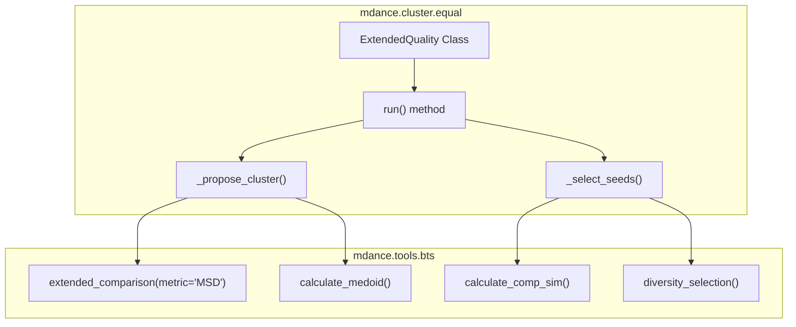
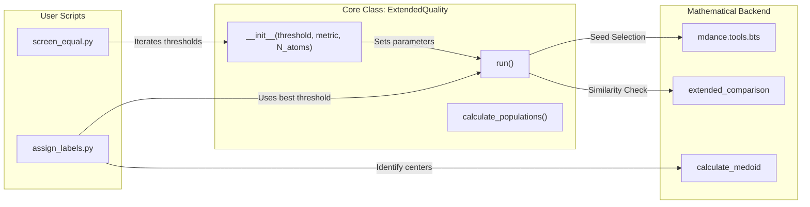

# eQual: Radial Threshold Clustering

Relevant source files

The following files were used as context for generating this wiki page:

- [docs/tutorials/equal.rst](docs/tutorials/equal.rst)
- [docs/tutorials/helm.rst](docs/tutorials/helm.rst)
- [docs/tutorials/nani.rst](docs/tutorials/nani.rst)
- [scripts/equal/assign_labels.py](scripts/equal/assign_labels.py)
- [scripts/equal/best_frames_indices_5.8.csv](scripts/equal/best_frames_indices_5.8.csv)
- [scripts/equal/cluster_labels_5.8.csv](scripts/equal/cluster_labels_5.8.csv)
- [scripts/equal/equal_screening.csv](scripts/equal/equal_screening.csv)
- [scripts/equal/equal_screening_nclusters.png](scripts/equal/equal_screening_nclusters.png)
- [scripts/equal/equal_screening_scores.csv](scripts/equal/equal_screening_scores.csv)
- [scripts/equal/equal_screening_scores_db.png](scripts/equal/equal_screening_scores_db.png)
- [scripts/equal/screen_equal.py](scripts/equal/screen_equal.py)
- [src/mdance/cluster/equal.py](src/mdance/cluster/equal.py)
- [tutorials/eQual.md](tutorials/eQual.md)
- [tutorials/nani.md](tutorials/nani.md)

eQual is a quality-based clustering algorithm that extends the traditional Radial Threshold Clustering method. It grows clusters from seeds based on a distance threshold and incorporates advanced seed selection strategies, similarity validation, and low-density cluster rejection. The algorithm is designed to maximize similarity between members within a cluster and provides improved tie-breaking criteria compared to its predecessors.

## Overview and Core Logic

The `ExtendedQuality` class implements the clustering logic by iteratively growing clusters around selected seeds. In each iteration, the algorithm selects a set of potential seeds from the available dataset. Neighbors within a specified radial threshold (calculated using metrics like Mean-Square Deviation) are added to the cluster. If multiple seeds are used, eQual evaluates the proposed clusters and selects the one that is densest and most similar. Once a cluster is finalized, its members are removed from the dataset, and the process repeats until no samples remain.

### Key Features
*   **Radial Growth**: Clusters are defined by a distance threshold from a central seed [src/mdance/cluster/equal.py:12-14]().
*   **Seed Selection**: Supports multiple methods including `greedy`, `medoid`, `comp_sim`, and `mini_batch_kmeans` [src/mdance/cluster/equal.py:37-38]().
*   **Density Filtering**: Optional rejection of clusters that do not meet a minimum sample count (`min_samples`) or a similarity threshold (`sim_threshold`) [src/mdance/cluster/equal.py:42-43]().
*   **N-ary Integration**: Uses the `mdance.tools.bts` module for efficient similarity and medoid calculations [src/mdance/cluster/equal.py:7-11]().

**Sources:** [src/mdance/cluster/equal.py:14-58](), [docs/tutorials/equal.rst:10-12]().

---

## Implementation Detail: ExtendedQuality Class

The `ExtendedQuality` class manages the data state and clustering parameters. It uses a condensed representation of the trajectory data to maintain $O(N)$ scaling during similarity checks.

### Class Architecture and Data Flow

The following diagram illustrates the relationship between the `ExtendedQuality` class, its internal methods, and the external utility functions in `bts.py`.

**Clustering Logic and External Tool Integration**

**Sources:** [src/mdance/cluster/equal.py:14-112](), [src/mdance/cluster/equal.py:180-250]().

### Parameters and Constraints
| Parameter | Type | Description |
| :--- | :--- | :--- |
| `threshold` | float | Radial distance limit for cluster inclusion. |
| `seed_method` | str | Method to pick seeds (`greedy`, `comp_sim`, `medoid`, etc.). |
| `n_seeds` | int/float | Number of seeds evaluated per iteration to find the best cluster. |
| `check_sim` | bool | If True, validates cluster compactness against `sim_threshold`. |
| `reject_lowd` | bool | If True, discards clusters smaller than `min_samples`. |

**Sources:** [src/mdance/cluster/equal.py:22-58]().

---

## Seed Selection Methods

eQual provides several strategies for choosing the starting point of a cluster growth iteration:

1.  **greedy**: Selects the first available point in the current dataset.
2.  **medoid**: Calculates the medoid of the remaining dataset using `calculate_medoid` [src/mdance/cluster/equal.py:236-237]().
3.  **comp_sim**: Uses complementary similarity to find representative points [src/mdance/cluster/equal.py:228-231]().
4.  **mini_batch_kmeans**: Uses Scikit-learn's `MiniBatchKMeans` to find centroids as seeds [src/mdance/cluster/equal.py:238-241]().
5.  **vanilla**: Uses `kmeans_plusplus` for seed initialization [src/mdance/cluster/equal.py:242-245]().

**Sources:** [src/mdance/cluster/equal.py:220-250]().

---

## Screening and Label Assignment Workflow

The eQual workflow typically involves two stages: screening to find the optimal radial threshold and assignment to generate final labels.

### Screening (screen_equal.py)
The screening script iterates through a range of thresholds (`start_threshold` to `end_threshold`) and calculates cluster quality metrics for each [scripts/equal/screen_equal.py:48-57]().
*   **Metrics**: Calinski-Harabasz (CH) and Davies-Bouldin (DB) scores are computed for every threshold [scripts/equal/screen_equal.py:56-57]().
*   **Outputs**: 
    *   `equal_screening.csv`: Summary of cluster populations.
    *   `equal_screening_scores.csv`: CH and DB scores per threshold.

### Label Assignment (assign_labels.py)
Once the optimal threshold is identified (often via the minimum DB index), labels are assigned to the full trajectory.
*   **Medoid Extraction**: The script identifies the most representative frame for each cluster using `calculate_medoid` [scripts/equal/assign_labels.py:45-47]().
*   **Outputs**:
    *   `cluster_labels_[threshold].csv`: Mapping of every frame to a cluster ID [scripts/equal/assign_labels.py:82-84]().
    *   `best_frames_indices_[threshold].csv`: Indices of the top `n_structures` closest to the medoid [scripts/equal/assign_labels.py:67-69]().

**Sources:** [scripts/equal/screen_equal.py:10-80](), [scripts/equal/assign_labels.py:10-85]().

---

## Code Entity Map: Workflow to Implementation

The following diagram maps the user-facing scripts and parameters to the underlying class implementation and mathematical tools.

**Workflow Mapping**

**Sources:** [src/mdance/cluster/equal.py:14-70](), [scripts/equal/screen_equal.py:30-55](), [scripts/equal/assign_labels.py:37-46]().

## Analysis of Results
Users are encouraged to use the `analysis_db.ipynb` notebook to visualize the screening results. The optimal number of clusters is typically chosen based on:
1.  The **lowest Davies-Bouldin (DB)** index.
2.  The **maximum 2nd derivative** of the DB index (the "elbow" method).

**Sources:** [docs/tutorials/equal.rst:174-181](), [scripts/equal/equal_screening_scores.csv:1-12]().

---