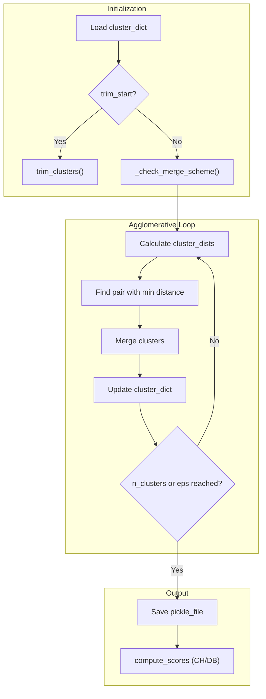
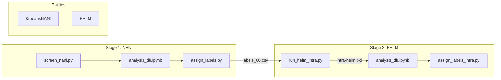

# HELM: Hierarchical Extended Linkage Method

Relevant source files

The following files were used as context for generating this wiki page:

- [docs/tutorials/equal.rst](docs/tutorials/equal.rst)
- [docs/tutorials/helm.rst](docs/tutorials/helm.rst)
- [docs/tutorials/nani.rst](docs/tutorials/nani.rst)
- [scripts/helm/inter/analysis_db.ipynb](scripts/helm/inter/analysis_db.ipynb)
- [scripts/helm/inter/assign_labels_inter.py](scripts/helm/inter/assign_labels_inter.py)
- [scripts/helm/inter/run_helm_inter.py](scripts/helm/inter/run_helm_inter.py)
- [scripts/helm/intra/analysis_db.ipynb](scripts/helm/intra/analysis_db.ipynb)
- [scripts/helm/intra/assign_labels_intra.py](scripts/helm/intra/assign_labels_intra.py)
- [scripts/helm/intra/run_helm_intra.py](scripts/helm/intra/run_helm_intra.py)
- [scripts/helm/ward/run_helm_ward.py](scripts/helm/ward/run_helm_ward.py)
- [src/mdance/cluster/helm.py](src/mdance/cluster/helm.py)
- [tutorials/HELM.md](tutorials/HELM.md)

The Hierarchical Extended Linkage Method (HELM) is an agglomerative clustering algorithm designed to merge pre-existing clusters using the $n$-ary similarity framework [src/mdance/cluster/helm.py:15-19](). By leveraging the condensed data representation (column-wise sums and squared sums), HELM achieves $O(N)$ scaling, making it significantly more efficient than traditional $O(N^2)$ hierarchical methods [docs/tutorials/helm.rst:10](). It is typically used as the second stage in a hybrid workflow, following an initial partitioning by algorithms like NANI [tutorials/HELM.md:15]().

## Implementation and Core Logic

The `HELM` class operates on a `cluster_dict` which stores the state of the hierarchy at each iteration [src/mdance/cluster/helm.py:23-24](). It uses $n$-ary similarity to calculate distances between clusters based on their aggregate statistics rather than pairwise frame comparisons [src/mdance/cluster/helm.py:17-19]().

### The HELM Workflow
The algorithm follows a standard agglomerative loop but uses specialized merge schemes and condensed data to maintain efficiency.

Title: HELM Agglomeration Process

Sources: [src/mdance/cluster/helm.py:150-176](), [src/mdance/cluster/helm.py:79-104]()

### Merge Schemes
HELM supports three primary schemes for determining which clusters to merge [src/mdance/cluster/helm.py:31-33]():
*   **Inter**: Merges clusters based on the lowest inter-cluster distance [tutorials/HELM.md:90]().
*   **Intra**: Merges clusters based on the lowest intra-cluster distance (compactness) [tutorials/HELM.md:90]().
*   **Half**: A hybrid scheme for distance calculation [src/mdance/cluster/helm.py:33]().
*   **Ward**: A variant that uses the Ward linkage criterion via `scipy.cluster.hierarchy.linkage` [src/mdance/cluster/helm.py:53-54](), [scripts/helm/ward/run_helm_ward.py:18]().

### Data Representation
The algorithm relies on a specific dictionary structure where each cluster is represented by its indices, population, and aggregate sums:
`Cik = [Indicesik, (c_sumik, sq_sumik), Nik]` [src/mdance/cluster/helm.py:64-66]().
*   `c_sum`: Column-wise sum of features [src/mdance/cluster/helm.py:70-71]().
*   `sq_sum`: Column-wise sum of squared features [src/mdance/cluster/helm.py:72-73]().

## Two-Stage NANI+HELM Hybrid Workflow

HELM is designed to refine the output of a primary clustering algorithm. A common use case is starting with a high-resolution NANI partition (e.g., 60 clusters) and using HELM to merge them into a few dominant conformations [tutorials/HELM.md:15](), [tutorials/HELM.md:70]().

Title: NANI+HELM Hybrid Pipeline

Sources: [tutorials/HELM.md:49-60](), [scripts/helm/intra/run_helm_intra.py:11-13](), [scripts/helm/intra/assign_labels_intra.py:14-16]()

## Label Assignment and Post-Clustering

Because HELM merges existing clusters, label assignment involves mapping original trajectory frames through the hierarchy defined in the output pickle file [scripts/helm/intra/assign_labels_intra.py:25-29]().

### Assignment Scripts
*   `assign_labels_intra.py`: Handles labels for the 'intra' merge scheme [scripts/helm/intra/assign_labels_intra.py:1-105]().
*   `assign_labels_inter.py`: Handles labels for the 'inter' merge scheme [scripts/helm/inter/assign_labels_inter.py:1-105]().

### Key Assignment Functions
1.  **Medoid Calculation**: The scripts identify the medoid of the newly merged clusters using `calculate_medoid` [scripts/helm/intra/assign_labels_intra.py:67]().
2.  **Representative Extraction**: Frames closest to the medoid are identified via `extended_comparison` to provide representative structures [scripts/helm/intra/assign_labels_intra.py:74-79]().
3.  **Output Generation**:
    *   `helm_cluster_labels_{n}.csv`: Mapping of every frame to a cluster [scripts/helm/intra/assign_labels_intra.py:84-89]().
    *   `helm_best_frames_indices_{n}.csv`: Indices of the `n_structures` closest to each medoid [scripts/helm/intra/assign_labels_intra.py:92-97]().
    *   `helm_summary_{n}.csv`: Population statistics for the clusters [scripts/helm/intra/assign_labels_intra.py:101-105]().

## Analysis and Scoring

HELM outputs are evaluated using the Davies-Bouldin Index (DBI) and Calinski-Harabasz (CH) scores [src/mdance/cluster/helm.py:5-6]().

| Script/Notebook | Purpose |
| :--- | :--- |
| `compute_scores` | Function in `helm.py` used to calculate CH and DB metrics for a given cluster level [scripts/helm/intra/run_helm_intra.py:6-7](). |
| `analysis_db.ipynb` | Visualizes DBI across different cluster counts to find the "elbow" or minimum [scripts/helm/inter/analysis_db.ipynb:41-44](). |
| `plot_scores` | Internal function in the notebook that calculates the 2nd derivative of DBI to identify optimal clustering [scripts/helm/inter/analysis_db.ipynb:82-90](). |

Sources: [scripts/helm/intra/run_helm_intra.py:64-82](), [scripts/helm/inter/analysis_db.ipynb:57-114]()

---