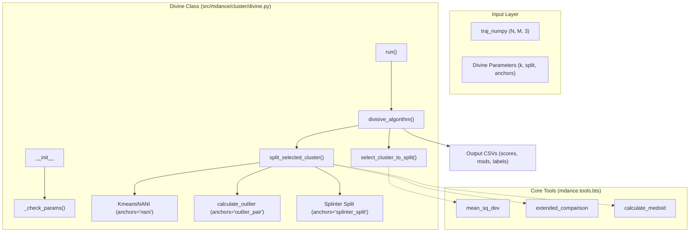
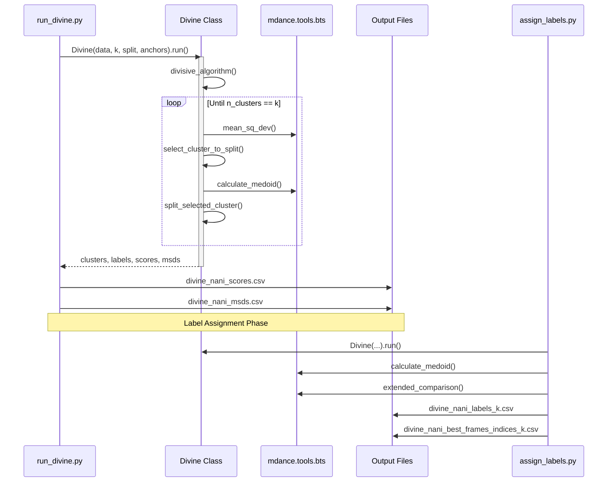

# DIVINE: Divisive Hierarchical Clustering

Relevant source files

The following files were used as context for generating this wiki page:

- [scripts/divine/analysis_db.ipynb](scripts/divine/analysis_db.ipynb)
- [scripts/divine/assign_labels.py](scripts/divine/assign_labels.py)
- [scripts/divine/divine_nani_best_frames_indices_6.csv](scripts/divine/divine_nani_best_frames_indices_6.csv)
- [scripts/divine/divine_nani_labels_6.csv](scripts/divine/divine_nani_labels_6.csv)
- [scripts/divine/divine_nani_msds.csv](scripts/divine/divine_nani_msds.csv)
- [scripts/divine/divine_nani_scores.csv](scripts/divine/divine_nani_scores.csv)
- [scripts/divine/run_divine.py](scripts/divine/run_divine.py)
- [src/mdance/cluster/divine.py](src/mdance/cluster/divine.py)
- [tests/test_divine.py](tests/test_divine.py)

The `Divine` class provides a top-down, divisive hierarchical clustering algorithm specifically optimized for Molecular Dynamics (MD) trajectories. Unlike agglomerative methods that merge small clusters, DIVINE starts with the entire dataset as a single cluster and recursively partitions it into smaller sub-clusters based on structural variance and spatial distribution.

## Core Implementation: The Divine Class

The algorithm is implemented in `src/mdance/cluster/divine.py` and follows a recursive splitting workflow. It supports multiple strategies for selecting which cluster to split, how to identify "anchor" points for the split, and when to terminate the process.

### Recursive Splitting Logic
The main execution loop in `divisive_algorithm()` manages the hierarchy by maintaining a list of active clusters. In each iteration, it:
1.  Evaluates all current clusters to select the best candidate for splitting [src/mdance/cluster/divine.py:143]().
2.  Determines two "anchor" frames within that cluster to act as seeds for the split [src/mdance/cluster/divine.py:150]().
3.  Partitions the data points between the two anchors [src/mdance/cluster/divine.py:150]().
4.  Optionally refines the resulting sub-clusters using a local K-Means step [src/mdance/cluster/divine.py:26]().
5.  Validates the split against a `threshold` (minimum population size) [src/mdance/cluster/divine.py:153]().

### Divine Architecture and Data Flow
The following diagram illustrates the relationship between the `Divine` class, its parameters, and the underlying utility functions used for structural comparison.

**DIVINE System Architecture**

Sources: [src/mdance/cluster/divine.py:8-107](), [src/mdance/tools/bts.py:1-100]()

---

## Configuration Strategies

### Split Selection Strategies
The `split` parameter determines which cluster is chosen for the next partitioning step [src/mdance/cluster/divine.py:15]():
| Strategy | Description |
| :--- | :--- |
| `MSD` | Selects the cluster with the highest Mean Square Deviation (structural variance). |
| `radius` | Selects the cluster with the largest maximum distance from its medoid. |
| `weighted_MSD` | Selects the cluster based on MSD weighted by the cluster population. |

### Anchor Methods
Anchors are the initial seeds used to divide a cluster into two sub-clusters [src/mdance/cluster/divine.py:17]():
*   **nani**: Uses the `KmeansNANI` algorithm to find the two most representative initiators [src/mdance/cluster/divine.py:58]().
*   **outlier_pair**: Identifies the most structurally distant frame (outlier) relative to the medoid and uses the medoid and outlier as seeds [src/mdance/cluster/divine.py:5]().
*   **splinter_split**: Selects the frame with the highest average distance to all other points in the cluster as the first seed.

### Stopping Criteria
The algorithm terminates based on the `end` parameter [src/mdance/cluster/divine.py:21]():
1.  **'k'**: Stops when the number of clusters reaches the user-defined value `k` [src/mdance/cluster/divine.py:135-137]().
2.  **'points'**: Continues splitting until every data point is in its own singleton cluster [src/mdance/cluster/divine.py:138-140]().

Sources: [src/mdance/cluster/divine.py:15-33](), [src/mdance/cluster/divine.py:133-160]()

---

## Execution and Workflow

### CLI Scripts
Two primary scripts facilitate the DIVINE workflow:
1.  **run_divine.py**: Executes the clustering and generates structural statistics (MSD) and validity scores (DBI/CH) [scripts/divine/run_divine.py:26-33]().
2.  **assign_labels.py**: Generates the final frame-to-cluster mapping and identifies representative "best frames" (medoids) for each cluster [scripts/divine/assign_labels.py:29-57]().

### Script Interaction Diagram
This diagram maps the CLI scripts to the specific methods and outputs within the `Divine` implementation.

**DIVINE Workflow Mapping**

Sources: [scripts/divine/run_divine.py:1-35](), [scripts/divine/assign_labels.py:1-59](), [src/mdance/cluster/divine.py:109-165]()

---

## Output Files and Analysis

DIVINE produces several CSV files to assist in determining the optimal cluster count and understanding the hierarchy.

### Output CSV Reference
| File Name | Content | Description |
| :--- | :--- | :--- |
| `divine_[anchors]_scores.csv` | `n_clusters, CH_score, DB_score` | Contains Davies-Bouldin and Calinski-Harabasz indices for each level of the hierarchy [scripts/divine/divine_nani_scores.csv:1-10](). |
| `divine_[anchors]_msds.csv` | `level, cluster_index, population, msd` | Tracks the structural variance (MSD) of every cluster created during the process [scripts/divine/divine_nani_msds.csv:1-10](). |
| `divine_[anchors]_labels_[k].csv` | `frame_index, label` | The final cluster assignment for every frame in the trajectory [scripts/divine/divine_nani_labels_6.csv:1-15](). |
| `divine_[anchors]_best_frames_indices_[k].csv` | `Frame Index, Cluster Index` | Lists the indices of frames closest to the medoid for each cluster [scripts/divine/divine_nani_best_frames_indices_6.csv:1-15](). |

### DBI Analysis
The `analysis_db.ipynb` notebook is used to plot the Davies-Bouldin Index (DBI) against the number of clusters. It calculates the first and second derivatives of the DBI to identify "elbows" or local minima, which indicate structurally distinct states in the MD simulation [scripts/divine/analysis_db.ipynb:57-108]().

Sources: [scripts/divine/run_divine.py:32-33](), [scripts/divine/assign_labels.py:35-57](), [scripts/divine/analysis_db.ipynb:57-108]()

---