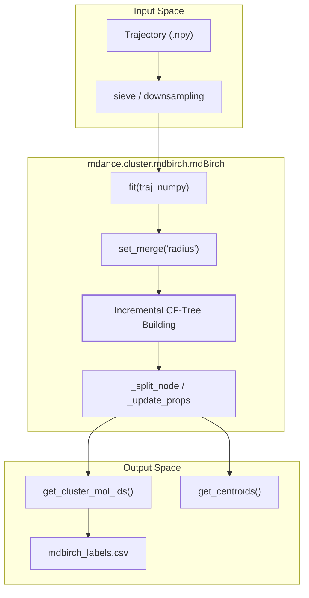
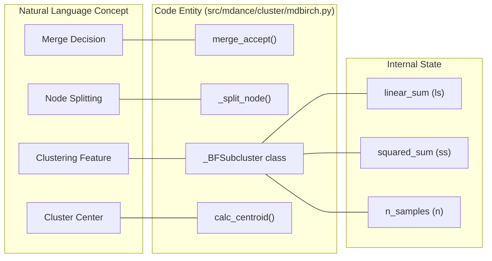

# mdBIRCH: Online Streaming Clustering

Relevant source files

The following files were used as context for generating this wiki page:

- [scripts/mdbirch/mdbirch_labels_3.06.csv](scripts/mdbirch/mdbirch_labels_3.06.csv)
- [scripts/mdbirch/run_mdbirch.py](scripts/mdbirch/run_mdbirch.py)
- [src/mdance/cluster/mdbirch.py](src/mdance/cluster/mdbirch.py)
- [tests/test_mdbirch.py](tests/test_mdbirch.py)
- [tutorials/mdBIRCH.md](tutorials/mdBIRCH.md)

mdBIRCH is an online clustering algorithm that incrementally builds a **CF-tree** (Clustering Feature tree) in a single pass over trajectory frames. Each incoming frame is either merged into its closest existing subcluster, provided a threshold criterion is satisfied, or it initiates a new subcluster [tutorials/mdBIRCH.md:14-16]().

## Overview and Purpose

The mdBIRCH implementation in MDANCE is adapted from the BIRCH algorithm to suit Molecular Dynamics (MD) data [src/mdance/cluster/mdbirch.py:20-23](). It is specifically designed to be:
*   **Memory-bounded:** By maintaining a tree structure of Clustering Features (CF) rather than storing all raw data points [tutorials/mdBIRCH.md:22-22]().
*   **One-pass:** The algorithm processes frames sequentially, making it suitable for streaming or very large trajectories where $O(N^2)$ pairwise comparisons are prohibitive [tutorials/mdBIRCH.md:15-15]().
*   **Physically Interpretable:** The merge decision is calibrated to a user-provided `threshold` that corresponds to structural deviation (e.g., RMSD-like radius) [tutorials/mdBIRCH.md:18-19]().

### Data Flow: From Trajectory to CF-Tree
The following diagram illustrates how raw trajectory data is processed by the `mdBirch` class to produce cluster assignments.

**mdBIRCH System Data Flow**

**Sources:** [src/mdance/cluster/mdbirch.py:34-61](), [scripts/mdbirch/run_mdbirch.py:12-42](), [tutorials/mdBIRCH.md:45-54]()

---

## Technical Implementation

### The Merge Criterion
The core of mdBIRCH's decision-making is the `merge_accept` function. Currently, MDANCE supports the **radius-based** merge criterion [src/mdance/cluster/mdbirch.py:34-43]().

A subcluster is accepted for merging if the post-merge average distance from the centroid to the points in the cluster (the radius) is less than the threshold. The mathematical check is implemented as:
$$\text{radius\_sq} = \frac{\sum new\_ss}{new\_n} - \frac{\sum new\_ls^2}{new\_n^2}$$
The merge is accepted if `radius_sq <= threshold**2 / 4 * D`, where $D$ is the number of features [src/mdance/cluster/mdbirch.py:53-57]().

### Core Classes and Functions
| Entity | Role | Location |
| :--- | :--- | :--- |
| `mdBirch` | Main class for fitting the model and managing the CF-tree. | [src/mdance/cluster/mdbirch.py:20-20]() |
| `set_merge` | Configures the `merge_accept` logic (e.g., 'radius'). | [src/mdance/cluster/mdbirch.py:34-51]() |
| `msd_condensed` | Calculates Mean Square Deviation using $O(N)$ sums and squared sums. | [src/mdance/cluster/mdbirch.py:63-98]() |
| `max_separation` | Robust $O(N)$ implementation to find distant objects for node splitting. | [src/mdance/cluster/mdbirch.py:100-121]() |
| `_split_node` | Handles node overflow when the branching factor is exceeded. | [src/mdance/cluster/mdbirch.py:183-192]() |

### Code-to-Entity Mapping
This diagram bridges the conceptual BIRCH components with their specific implementations in `src/mdance/cluster/mdbirch.py`.

**BIRCH Logic to Code Mapping**

**Sources:** [src/mdance/cluster/mdbirch.py:34-182](), [src/mdance/cluster/mdbirch.py:183-198]()

---

## Usage: run_mdbirch.py

The `run_mdbirch.py` script provides a standardized entry point for clustering finished simulations [tutorials/mdBIRCH.md:48-54]().

### Execution Workflow
1.  **Data Loading:** The trajectory is loaded as a numpy array and sieved if necessary [scripts/mdbirch/run_mdbirch.py:13-13]().
2.  **Configuration:** The merge criterion is set to 'radius' based on the feature dimension $D$ [scripts/mdbirch/run_mdbirch.py:16-17]().
3.  **Model Fitting:** The `mdBirch` object is initialized with a `threshold` and fitted to the data [scripts/mdbirch/run_mdbirch.py:20-21]().
4.  **Labeling:** Frame indices are mapped to their respective cluster IDs [scripts/mdbirch/run_mdbirch.py:27-32]().

### Script Parameters
*   `input_traj_numpy`: Path to the `.npy` file containing reference-aligned coordinates [scripts/mdbirch/run_mdbirch.py:7-7]().
*   `sieve`: Integer factor for downsampling (e.g., `sieve=10` takes every 10th frame) [scripts/mdbirch/run_mdbirch.py:8-8]().
*   `threshold`: The structural tolerance (granularity) of the clustering [scripts/mdbirch/run_mdbirch.py:9-9]().

**Sources:** [scripts/mdbirch/run_mdbirch.py:1-42](), [tutorials/mdBIRCH.md:56-65]()

---

## Validation and Testing

The implementation is validated through `tests/test_mdbirch.py`, which ensures consistency and performance scaling.

### Key Test Cases
*   **Basic Functionality:** Ensures all frames are assigned and centroids match the cluster count [tests/test_mdbirch.py:39-58]().
*   **Threshold Sensitivity:** Verifies that smaller thresholds result in finer clusters (more clusters) and vice-versa [tests/test_mdbirch.py:71-83]().
*   **Edge Cases:** Handles single data points and identical data points correctly [tests/test_mdbirch.py:96-117]().
*   **Performance:** Asserts that the $O(N)$ implementation scales efficiently with data size [tests/test_mdbirch.py:155-171]().

**Sources:** [tests/test_mdbirch.py:1-191]()

---