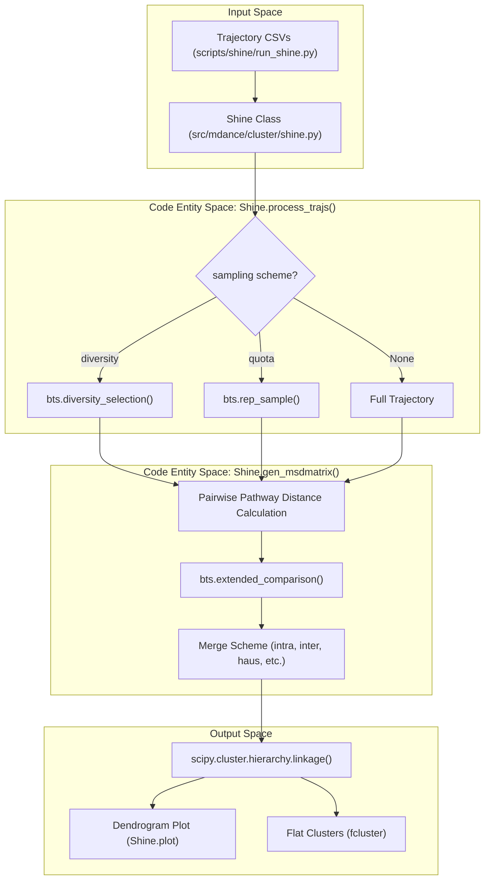
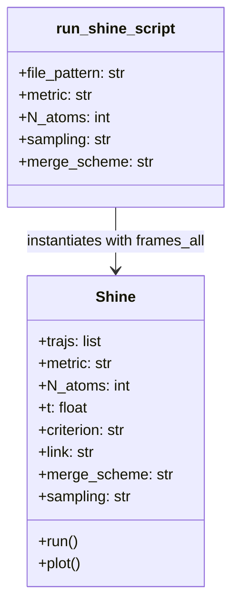

# SHINE: Pathway Clustering

<details>
<summary>Relevant source files</summary>

The following files were used as context for generating this wiki page:

- [docs/tutorials/shine.rst](docs/tutorials/shine.rst)
- [scripts/shine/run_shine.py](scripts/shine/run_shine.py)
- [src/mdance/cluster/shine.py](src/mdance/cluster/shine.py)
- [tutorials/SHINE.ipynb](tutorials/SHINE.ipynb)

</details>


SHINE (Sampling Hierarchical Intrinsic *N*-ary Ensembles) is a hierarchical clustering framework designed specifically for molecular dynamics (MD) pathway analysis [src/mdance/cluster/shine.py:19-23](). It leverages the *n*-ary similarity framework to identify dominant pathways in ensembles generated by enhanced sampling simulations [tutorials/SHINE.ipynb:14-15](). By representing trajectories as objects and calculating distances between them using various merge schemes, SHINE allows for the identification of structural similarities across entire temporal sequences rather than individual frames.

### Core Architecture and Data Flow

The `Shine` class handles the end-to-end workflow: from trajectory sampling to the generation of a distance matrix and hierarchical linkage.

#### Shine Workflow Diagram
The following diagram illustrates the data flow from raw trajectory files to the final dendrogram output.

Title: SHINE Data Processing Pipeline

Sources: [src/mdance/cluster/shine.py:126-147](), [src/mdance/cluster/shine.py:159-180](), [scripts/shine/run_shine.py:24-37]()

---

### Implementation Details

#### 1. Pathway Sampling
To reduce computational overhead when dealing with long trajectories, SHINE provides two sampling strategies within `process_trajs()` [src/mdance/cluster/shine.py:117-147]():
*   **Diversity Sampling**: Uses `mdance.tools.bts.diversity_selection` to pick frames that maximize structural coverage based on `comp_sim` and `medoid` strategies [src/mdance/cluster/shine.py:131-133]().
*   **Quota Sampling**: Uses `mdance.tools.bts.rep_sample` to select representative frames via binning [src/mdance/cluster/shine.py:140-142]().

#### 2. Merge Schemes
The distance between two pathways (sets of frames) is determined by the `merge_scheme` parameter in `gen_msdmatrix()` [src/mdance/cluster/shine.py:149-180]().

| Scheme | Implementation Logic | Use Case |
| :--- | :--- | :--- |
| `intra` | Calculates *n*-ary similarity of the combined trajectory (Path A + Path B) [src/mdance/cluster/shine.py:168](). | General structural overlap. |
| `inter` | Subtracts the internal similarities of A and B from the combined similarity [src/mdance/cluster/shine.py:170-171](). | Isolating cross-pathway variance. |
| `haus` | Uses `scipy.spatial.distance.directed_hausdorff` [src/mdance/cluster/shine.py:177](). | Strict shape/pathway boundary comparison. |
| `max` / `min` | Maximum or minimum distance between frame sets [src/mdance/cluster/shine.py:174-175](). | Extreme structural bounds. |

#### 3. Clustering and Linkage
SHINE uses `scipy.cluster.hierarchy.linkage` to build the hierarchy, typically defaulting to the 'ward' linkage [src/mdance/cluster/shine.py:65-72](). The final clusters are formed using `fcluster` based on a user-defined threshold `t` and `criterion` (e.g., 'maxclust' or 'distance') [src/mdance/cluster/shine.py:38-48]().

Sources: [src/mdance/cluster/shine.py:17-76](), [src/mdance/cluster/shine.py:149-185]()

---

### Scripting and Usage

The `run_shine.py` script provides a template for executing the clustering on a set of CSV files representing different pathways.

#### System and SHINE Parameters
The script defines parameters such as `file_pattern` for data ingestion and `N_atoms` for the system size [scripts/shine/run_shine.py:10-12]().

Title: Mapping run_shine.py to Shine Class

Sources: [scripts/shine/run_shine.py:9-37](), [src/mdance/cluster/shine.py:65-76]()

#### Execution Example
```python
# From scripts/shine/run_shine.py
mod = Shine(frames_all, 'MSD', N_atoms=1, t=t, criterion='maxclust', 
            link='ward', merge_scheme=merge_scheme, 
            sampling=sampling, frac=frac)
link, clusters = mod.run()
ax = mod.plot()
```
The `run()` method sequentially calls `process_trajs()`, `gen_msdmatrix()`, and the scipy linkage functions to return the linkage matrix and cluster assignments [src/mdance/cluster/shine.py:182-198]().

### Visualization
The `plot()` method in the `Shine` class generates a dendrogram. It uses `scipy.cluster.hierarchy.dendrogram` and applies custom styling, including a color palette from `cycler` and a horizontal line indicating the threshold `t` if the criterion is 'distance' [src/mdance/cluster/shine.py:200-244]().

Sources: [src/mdance/cluster/shine.py:1-9](), [src/mdance/cluster/shine.py:200-244](), [scripts/shine/run_shine.py:35-38]()

---