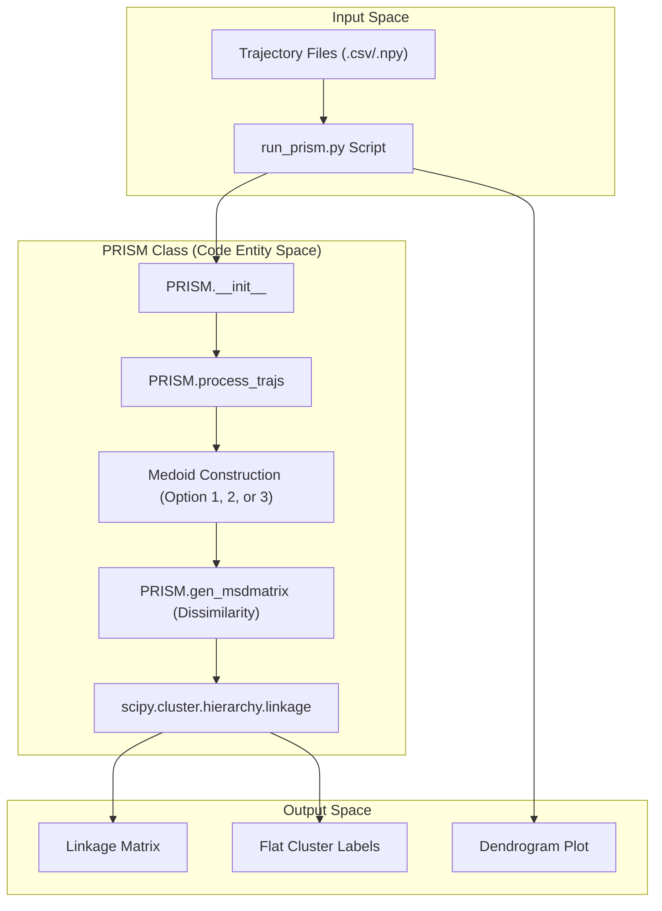
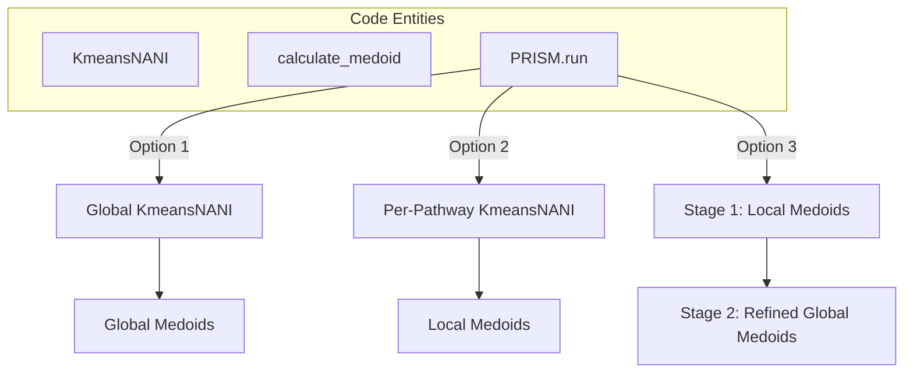

# PRISM: Pathway Representation via Structural Medoids

Relevant source files

The following files were used as context for generating this wiki page:

- [scripts/prism/run_prism.py](scripts/prism/run_prism.py)
- [src/mdance/cluster/prism.py](src/mdance/cluster/prism.py)
- [tests/test_prism.py](tests/test_prism.py)

Pathway Representation via Intrinsic Structural Medoids (PRISM) is a state-aware pathway clustering framework designed to handle ensembles of molecular dynamics (MD) trajectories. Unlike standard clustering which operates on individual frames, PRISM treats each trajectory as a "pathway" and summarizes it using a compact set of representative conformations called **structural medoids**. These sets are then compared using a weighted average Hausdorff dissimilarity metric to perform Hierarchical Agglomerative Clustering (HAC).

## 1. System Architecture and Data Flow

PRISM bridges the gap between high-dimensional frame data and pathway-level relationships. The process involves reducing each pathway to a set of medoids, calculating a pathway-pathway dissimilarity matrix, and performing hierarchical linkage.

### Logic Flow Diagram
The following diagram illustrates the transformation from raw trajectory data to clustered pathways.

"PRISM Data Flow"

Sources: `[src/mdance/cluster/prism.py:12-57]()`, `[scripts/prism/run_prism.py:45-67]()`

---

## 2. Medoid-Set Construction Strategies

PRISM provides three distinct options for representing pathways as sets of medoids. This reduction is critical for computing the dissimilarity between trajectories of varying lengths or temporal resolutions.

| Option | Name | Implementation Logic | Use Case |
| :--- | :--- | :--- | :--- |
| **1** | **Global Sharing** | Pool all frames from all pathways, cluster into `k` global clusters using `KmeansNANI`, then assign to each pathway the medoids of clusters containing at least one of its frames. | Best when pathways share a common metastable state space. |
| **2** | **Independent Per-Pathway** | Each pathway is clustered independently into `k` clusters. Representatives are specific to that trajectory. | Best for highly divergent pathways or different protein systems. |
| **3** | **Two-Stage Refinement** | Perform Option 2 to get local medoids, pool all local medoids, cluster into `k_final` clusters to find global representatives, then map pathways to these refined global medoids. | Balances local trajectory features with global state definitions. |

### Medoid Construction Logic
"Medoid Construction and Refinement"

Sources: `[src/mdance/cluster/prism.py:25-44]()`, `[src/mdance/cluster/prism.py:110-113]()`

---

## 3. Pathway Dissimilarity: Weighted Average Hausdorff

The core of PRISM's comparison engine is the **Weighted Average Hausdorff** distance. Given two sets of medoids $A$ (pathway 1) and $B$ (pathway 2), PRISM calculates the mismatch between them.

### Dissimilarity Schemes
The `weight_scheme` parameter in the `PRISM` class `[src/mdance/cluster/prism.py:89-92]()` controls how the nearest-neighbor distances are normalized:
*   `unnormalized`: Raw sum of nearest neighbor distances.
*   `weighted_avg`: Normalizes the distance by the number of medoids in each set.
*   `sym_avg`: A symmetric average approach.
*   `product_avg`: Normalization based on the product of set sizes.

The calculation is implemented within `PRISM.gen_msdmatrix` and utilizes `scipy.spatial.distance.cdist` to compute the frame-to-frame distances between medoid sets.

Sources: `[src/mdance/cluster/prism.py:136-141]()`, `[src/mdance/cluster/prism.py:169-170]()`

---

## 4. Hierarchical Agglomerative Clustering (HAC)

Once the pathway-pathway dissimilarity matrix is constructed, PRISM uses standard hierarchical clustering techniques to group the trajectories.

*   **Linkage**: Controlled by the `link` parameter (default is `'ward'`). It utilizes `scipy.cluster.hierarchy.linkage` `[src/mdance/cluster/prism.py:73-75]()`.
*   **Flat Clustering**: The `fcluster` function is used to extract labels based on the user-provided `t` (threshold) and `criterion` (e.g., `'maxclust'` or `'distance'`) `[src/mdance/cluster/prism.py:66-72]()`.
*   **Visualization**: The `PRISM.plot()` method generates a dendrogram representing the pathway hierarchy `[src/mdance/cluster/prism.py:176-193]()`.

---

## 5. Script Reference: `run_prism.py`

The `scripts/prism/run_prism.py` script provides a template for executing the PRISM workflow.

### Key Parameters
| Variable | Description |
| :--- | :--- |
| `file_pattern` | Glob pattern for trajectory files (each file is one pathway) `[scripts/prism/run_prism.py:11]()`. |
| `option` | Medoid construction strategy (1, 2, or 3) `[scripts/prism/run_prism.py:15]()`. |
| `k` | Number of clusters for initial medoid construction `[scripts/prism/run_prism.py:16]()`. |
| `weight_scheme` | The Hausdorff normalization scheme `[scripts/prism/run_prism.py:18]()`. |

### Execution Logic
1.  **Data Loading**: The script iterates through files matching `file_pattern`, loading them as `(unique_id, numpy_array)` tuples `[scripts/prism/run_prism.py:38-42]()`.
2.  **Instantiation**: The `PRISM` class is initialized with trajectory data and clustering parameters `[scripts/prism/run_prism.py:45-55]()`.
3.  **Run**: `mod.run()` executes the medoid construction, dissimilarity calculation, and linkage `[scripts/prism/run_prism.py:57]()`.
4.  **Output**: A dendrogram is saved as a PNG file `[scripts/prism/run_prism.py:60-67]()`.

Sources: `[scripts/prism/run_prism.py:1-68]()`

---

## 6. Implementation Details

### Class Definition: `PRISM`
The class is defined in `src/mdance/cluster/prism.py`.

**Key Methods:**
*   `__init__`: Validates inputs and sets hyperparameters like `k`, `k_final`, and `weight_scheme` `[src/mdance/cluster/prism.py:100-117]()`.
*   `_validate_inputs`: Ensures that `option` is within `{1, 2, 3}` and that trajectory IDs are numeric `[src/mdance/cluster/prism.py:119-142]()`.
*   `process_trajs`: Converts input tuples into an internal dictionary mapping numeric IDs to frame arrays `[src/mdance/cluster/prism.py:143-167]()`.
*   `run`: The main execution hook that orchestrates the construction of medoids and the final clustering `[tests/test_prism.py:167]()`.

### Validation and Testing
The PRISM implementation includes rigorous validation to ensure feature consistency across pathways. If trajectories have different numbers of features (columns), `PRISM.run()` will raise a `ValueError` `[tests/test_prism.py:195-217]()`. Numeric trajectory IDs are enforced to facilitate matrix indexing `[tests/test_prism.py:114-131]()`.

Sources: `[src/mdance/cluster/prism.py:12-167]()`, `[tests/test_prism.py:1-217]()`

---