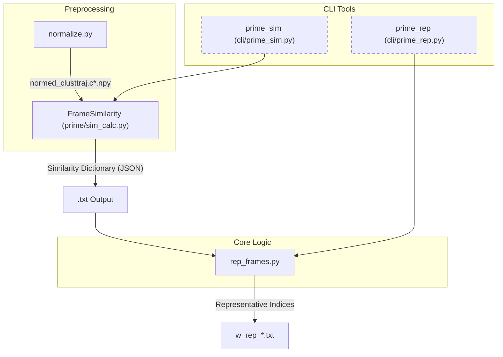

# PRIME: Native Structure Prediction

<details>
<summary>Relevant source files</summary>

The following files were used as context for generating this wiki page:

- [README.md](README.md)
- [docs/tutorials/prime.rst](docs/tutorials/prime.rst)
- [src/mdance/cli/prime_rep.py](src/mdance/cli/prime_rep.py)
- [src/mdance/cli/prime_sim.py](src/mdance/cli/prime_sim.py)
- [src/mdance/outputs/postprocess.py](src/mdance/outputs/postprocess.py)
- [tutorials/prime.md](tutorials/prime.md)

</details>


PRIME (Protein Retrieval via Integrative Molecular Ensembles) is a specialized post-processing subsystem in MDANCE designed to predict the native protein structure from molecular dynamics (MD) simulation data or pre-clustered ensembles [README.md:113-118](). It leverages the $n$-ary similarity framework to identify conformations that best represent the biologically relevant state, consistently identifying native structures within 2Å RMSD of experimental data [README.md:118]().

The PRIME workflow operates on the principle that the native state can be retrieved by analyzing the similarity of individual frames against representative ensembles (clusters) using extended similarity indices like Russell-Rao (RR) or Sokal-Michener (SM) [tutorials/prime.md:53-55]().

### PRIME Pipeline Overview

The PRIME process is divided into four distinct stages that transform raw trajectory data into a set of predicted native structure candidates.

| Stage | Process | Tool/Script | Description |
| :--- | :--- | :--- | :--- |
| **1** | **Clustering** | `NANI`, `eQual`, etc. | Generate initial cluster ensembles and assignment files [tutorials/prime.md:18-20](). |
| **2** | **Normalization** | `normalize.py` | Min-Max normalization of trajectory coordinates to $[0, 1]$ [tutorials/prime.md:21-22](). |
| **3** | **Similarity** | `prime_sim` | Calculate similarity between frames and clusters using $n$-ary indices [tutorials/prime.md:49-50](). |
| **4** | **Selection** | `prime_rep` | Identify representative frames with maximum similarity across methods [tutorials/prime.md:73-74](). |

#### Data Flow and Code Entity Map

The following diagram illustrates how the CLI tools interact with the underlying PRIME logic and the data structures they produce.

**PRIME Execution Architecture**

Sources: [src/mdance/cli/prime_sim.py:6-63](), [src/mdance/cli/prime_rep.py:3-54](), [tutorials/prime.md:41-89]()

---

### Cluster Normalization

Before similarity calculation, trajectory data must be normalized. The `normalize.py` script applies Min-Max normalization to the coordinates [tutorials/prime.md:22](). This ensures that the binary-based $n$-ary similarity indices can be applied effectively to continuous coordinate data.

**Key Parameters:**
- `atomSelection`: Defines the subset of atoms (e.g., backbone `N CA C O`) used for the analysis [tutorials/prime.md:29]().
- `n_clusters`: The number of top clusters to include in the PRIME ensemble [tutorials/prime.md:39]().

Sources: [tutorials/prime.md:21-48](), [docs/tutorials/prime.rst:42-86]()

---

### Similarity Calculation (`prime_sim`)

The `prime_sim` tool calculates how similar each frame in the trajectory is to the defined cluster ensembles. It supports several $n$-ary comparison techniques: `pairwise`, `union`, `medoid`, and `outlier` [src/mdance/cli/prime_sim.py:33-35]().

For detailed information on the similarity methods, index types (RR/SM), and outlier trimming, see the child page:
**[Similarity Calculation (prime_sim)](#4.1)**

**CLI Example:**
```bash
prime_sim -m union -n 6 -i SM -t 0.1 -d normed_clusters -s summary_6.csv
```
[src/mdance/cli/prime_sim.py:25]()

Sources: [src/mdance/cli/prime_sim.py:9-91](), [tutorials/prime.md:49-72]()

---

### Representative Frame Selection (`prime_rep`)

The final stage uses the similarity dictionary generated by `prime_sim` to identify the "Native Structure" candidates. The `prime_rep` tool parses the similarities to find frames that maximize the similarity across different clusters or methods [src/mdance/cli/prime_rep.py:44-54]().

For details on the selection logic, validation against experimental RMSD, and the `gen_all_methods_max` function, see the child page:
**[Representative Frame Selection (prime_rep)](#4.2)**

**CLI Example:**
```bash
prime_rep -m union -s outputs -d normed_clusters -t 0.1 -i SM
```
[src/mdance/cli/prime_rep.py:16]()

Sources: [src/mdance/cli/prime_rep.py:3-58](), [tutorials/prime.md:73-90]()

---

### Scientific Validation
PRIME has been validated against benchmark protein systems, demonstrating that the ensemble-based $n$-ary similarity approach can retrieve native-like states even from complex, high-dimensional MD trajectories [README.md:118]().

**PRIME Component Relationship**

Sources: [src/mdance/cli/prime_sim.py:61-65](), [src/mdance/cli/prime_rep.py:44-49](), [docs/tutorials/prime.rst:120-134]()

---