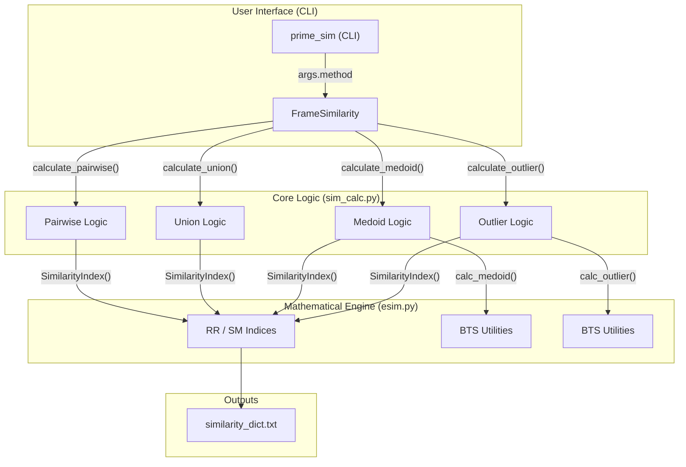
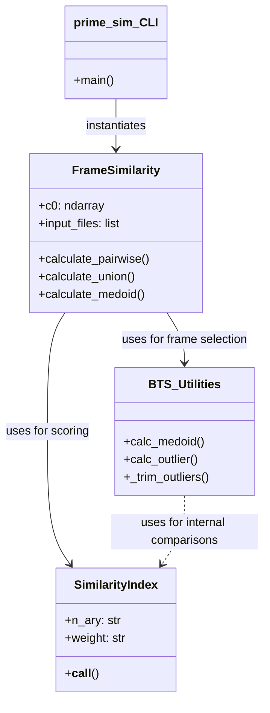

# Similarity Calculation (prime_sim)

<details>
<summary>Relevant source files</summary>

The following files were used as context for generating this wiki page:

- [scripts/prime/exec_rep_frames.py](scripts/prime/exec_rep_frames.py)
- [scripts/prime/exec_similarity.py](scripts/prime/exec_similarity.py)
- [scripts/prime/normalize.py](scripts/prime/normalize.py)
- [src/mdance/cli/prime_rep.py](src/mdance/cli/prime_rep.py)
- [src/mdance/cli/prime_sim.py](src/mdance/cli/prime_sim.py)
- [src/mdance/outputs/postprocess.py](src/mdance/outputs/postprocess.py)
- [src/mdance/prime/sim_calc.py](src/mdance/prime/sim_calc.py)

</details>


The **PRIME** (Protein Retrieval via Integrative Molecular Ensembles) subsystem uses n-ary similarity indices to identify native-like structures from molecular dynamics ensembles. The `prime_sim` component is responsible for calculating the similarity between a reference cluster (usually the top-populated cluster, $c_0$) and all other clusters in the dataset. This stage bridges the gap between raw clustering results and the final representative frame selection.

## Overview of FrameSimilarity

The core logic for similarity calculation resides in the `FrameSimilarity` class [src/mdance/prime/sim_calc.py:10-10](). This class processes normalized cluster files (typically generated by `scripts/prime/normalize.py` [scripts/prime/normalize.py:19-35]()) and computes similarity scores using various comparison methods.

### System Architecture and Data Flow

The following diagram illustrates the transition from the command-line interface to the underlying mathematical engines.

**Diagram 1: prime_sim Execution Flow**

Sources: [src/mdance/cli/prime_sim.py:9-65](), [src/mdance/prime/sim_calc.py:68-175](), [src/mdance/tools/esim.py:7-7]()

## Similarity Calculation Methods

`FrameSimilarity` provides four primary methods for comparing cluster $c_k$ against the reference cluster $c_0$:

| Method | Description | Implementation |
| :--- | :--- | :--- |
| **Pairwise** | Averages similarity between each frame in $c_k$ and every frame in $c_0$. | `calculate_pairwise` [src/mdance/prime/sim_calc.py:68-101]() |
| **Union** | Calculates the extended similarity between a frame in $c_0$ and the entire ensemble of $c_k$. | `calculate_union` [src/mdance/prime/sim_calc.py:102-133]() |
| **Medoid** | Compares each frame in $c_0$ specifically to the medoid of cluster $c_k$. | `calculate_medoid` [src/mdance/prime/sim_calc.py:162-175]() |
| **Outlier** | Compares each frame in $c_0$ specifically to the most outlying frame of cluster $c_k$. | `calculate_outlier` [src/mdance/prime/sim_calc.py:177-190]() |

### N-ary Indices: RR and SM
Calculations rely on the `SimilarityIndex` class [src/mdance/tools/esim.py:7-7](). The two primary indices supported are:
*   **RR (Russel-Rao):** Focuses on global structural overlap.
*   **SM (Simple Matching):** Accounts for both presence and absence of features, often used for binary structural fingerprints.

Sources: [src/mdance/prime/sim_calc.py:25-26](), [src/mdance/prime/sim_calc.py:87-88]()

## Data Preprocessing and Outlier Trimming

Before similarity calculation, clusters must be normalized. The `normalize.py` script uses `gen_traj_numpy` and the `Normalizer` class to scale coordinates into a 0-1 range [scripts/prime/normalize.py:27-35]().

### Outlier Trimming (`trim_frac`)
To improve the robustness of the reference ensemble, `FrameSimilarity` can trim a fraction of outliers from the $c_0$ cluster during initialization [src/mdance/prime/sim_calc.py:57-58](). This uses the `_trim_outliers` utility to remove frames that are most dissimilar to the rest of the reference ensemble [src/mdance/prime/sim_calc.py:214-233]().

### Frame Weighting
If `weighted_by_frames` is set to `True`, the similarity scores are adjusted based on the population of the clusters as recorded in the `summary_file` [src/mdance/prime/sim_calc.py:98-100](). This ensures that larger, more statistically significant clusters have a proportional impact on the final retrieval score.

Sources: [src/mdance/prime/sim_calc.py:54-65](), [scripts/prime/normalize.py:19-35]()

## CLI Usage and Output Format

The `prime_sim` CLI provides a wrapper around the `FrameSimilarity` class.

**Example Command:**
```bash
prime_sim -m union -n 6 -i SM -t 0.1 -d normed_clusters -s summary_6.csv
```
[src/mdance/cli/prime_sim.py:25-25]()

### Input Arguments
*   `-m`, `--method`: The calculation method (`pairwise`, `union`, `medoid`, `outlier`) [src/mdance/cli/prime_sim.py:33-35]().
*   `-n`, `--n_clusters`: Total number of clusters to analyze [src/mdance/cli/prime_sim.py:36-38]().
*   `-i`, `--index`: The similarity index, e.g., `RR` or `SM` [src/mdance/cli/prime_sim.py:39-41]().
*   `-t`, `--trim_frac`: Decimal fraction of outliers to remove from $c_0$ [src/mdance/cli/prime_sim.py:42-44]().

### Output Dictionary Format
The results are saved as a JSON-formatted dictionary in the `outputs/` directory [src/mdance/cli/prime_sim.py:72-87](). The structure maps cluster indices to frame-specific similarity scores:

```json
{
    "0": {
        "f0": 0.854,
        "f1": 0.821
    },
    "1": {
        "f0": 0.765,
        "f1": 0.742
    }
}
```
Sources: [src/mdance/cli/prime_sim.py:31-57](), [src/mdance/prime/sim_calc.py:192-212]()

## Implementation Mapping

The following diagram maps the high-level similarity concepts to specific code entities within the `mdance` package.

**Diagram 2: Code Entity Mapping**

Sources: [src/mdance/cli/prime_sim.py:6-6](), [src/mdance/prime/sim_calc.py:7-7](), [src/mdance/prime/sim_calc.py:10-10](), [src/mdance/tools/esim.py:7-7]()

---