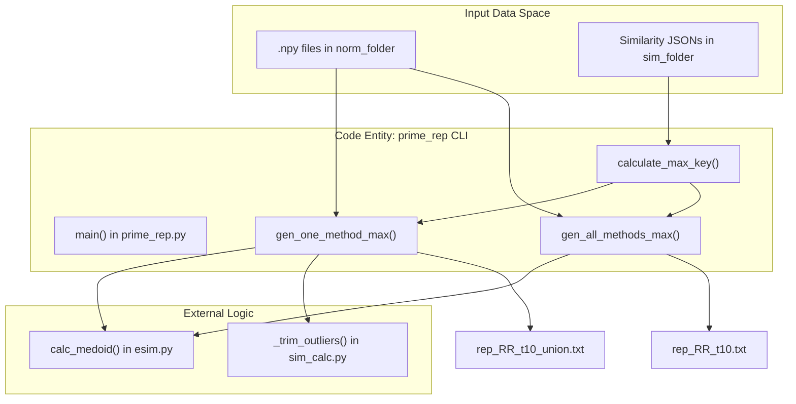
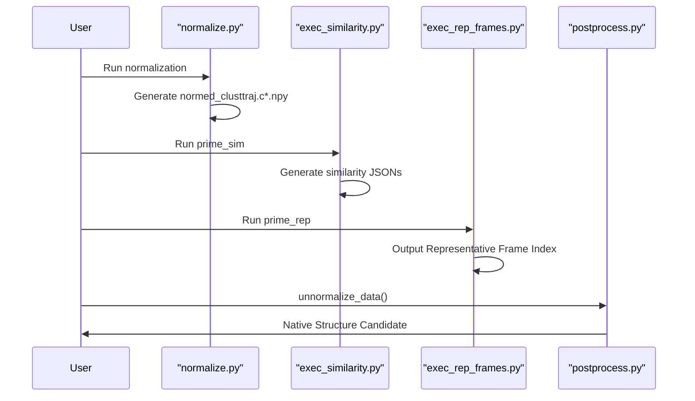

# Representative Frame Selection (prime_rep)

<details>
<summary>Relevant source files</summary>

The following files were used as context for generating this wiki page:

- [scripts/prime/exec_rep_frames.py](scripts/prime/exec_rep_frames.py)
- [scripts/prime/exec_similarity.py](scripts/prime/exec_similarity.py)
- [scripts/prime/normalize.py](scripts/prime/normalize.py)
- [src/mdance/cli/prime_rep.py](src/mdance/cli/prime_rep.py)
- [src/mdance/cli/prime_sim.py](src/mdance/cli/prime_sim.py)
- [src/mdance/outputs/postprocess.py](src/mdance/outputs/postprocess.py)
- [src/mdance/prime/rep_frames.py](src/mdance/prime/rep_frames.py)

</details>


The **PRIME** (Protein Retrieval via Integrative Molecular Ensembles) subsystem concludes with the selection of representative frames. This stage uses the similarity metrics calculated during the `prime_sim` phase to identify the specific structure (frame) that most accurately represents the native state of the molecular system. The `prime_rep` tool facilitates this by parsing similarity dictionaries and evaluating multiple selection methods.

## Core Logic and Implementation

The primary logic for representative selection resides in `rep_frames.py`. It provides functions to identify frames with the highest similarity values across various cluster-based metrics.

### Similarity Parsing
The function `calculate_max_key` is a utility used to parse the JSON-formatted similarity dictionaries produced by `prime_sim`. It iterates through the dictionary, identifies the maximum similarity value, and extracts the corresponding frame index using regular expressions [src/mdance/prime/rep_frames.py:10-33]().

### Selection Methods
MDANCE supports several methods for determining the "native" candidate:

| Method | Description | Implementation |
| :--- | :--- | :--- |
| `medoid_all` | The medoid of the entire normalized dataset. | `calc_medoid(c_all)` |
| `medoid_c0` | The medoid of the largest cluster (Cluster 0). | `calc_medoid(c0)` |
| `medoid_c0(trimmed)` | Medoid of Cluster 0 after removing structural outliers. | `_trim_outliers` then `calc_medoid` |
| `pairwise` | Frame with max similarity based on pairwise comparisons. | `calculate_max_key` on pairwise dict |
| `union` | Frame with max similarity based on the union of cluster properties. | `calculate_max_key` on union dict |
| `medoid` | Frame with max similarity to cluster medoids. | `calculate_max_key` on medoid dict |
| `outlier` | Frame with max similarity after cluster outlier trimming. | `calculate_max_key` on outlier dict |

Sources: [src/mdance/prime/rep_frames.py:60-110](), [src/mdance/prime/rep_frames.py:148-187]()

## Data Flow: From Similarity to Representative

The following diagram illustrates how the `prime_rep` CLI interacts with the data generated by previous PRIME stages to output the final representative frame indices.

**Figure 1: PRIME Representative Selection Data Flow**

Sources: [src/mdance/cli/prime_rep.py:6-54](), [src/mdance/prime/rep_frames.py:36-111](), [src/mdance/prime/rep_frames.py:113-187]()

## Command Line Interface (prime_rep)

The `prime_rep` CLI is the user interface for executing these selection routines. It supports both single-method extraction and batch extraction for all methods.

### Key Arguments
* `-m`, `--method`: The specific method to run (e.g., `union`, `medoid`, `pairwise`). If omitted in the code logic, it defaults to all methods [src/mdance/cli/prime_rep.py:19-21]().
* `-s`, `--sim_folder`: Directory containing the similarity JSON files generated by `prime_sim` [src/mdance/cli/prime_rep.py:22-23]().
* `-d`, `--norm_folder`: Directory containing the normalized `.npy` files for the clusters [src/mdance/cli/prime_rep.py:34-36]().
* `-t`, `--trim_frac`: The fraction of outliers that were trimmed during similarity calculation (used to locate the correct input files) [src/mdance/cli/prime_rep.py:24-28]().
* `-i`, `--index`: The n-ary similarity index used (e.g., `RR` or `SM`) [src/mdance/cli/prime_rep.py:29-33]().

### Execution Examples
To generate the representative frame for the `union` method using the `SM` index and 10% trimming:
```bash
prime_rep -m union -s outputs -d normed_clusters -t 0.1 -i SM
```
Sources: [src/mdance/cli/prime_rep.py:16](), [src/mdance/cli/prime_rep.py:44-54]()

## Validation and Execution Scripts

The `scripts/prime/` directory contains automation scripts to streamline the PRIME workflow and validate results.

### Workflow Automation
* **`exec_similarity.py`**: A wrapper script that calls `prime_sim` with pre-defined parameters for a specific system [scripts/prime/exec_similarity.py:21-23]().
* **`exec_rep_frames.py`**: A wrapper script for `prime_rep`. It outputs the index of the representative frame. Note that these indices are **0-based**, meaning the value is 1 less than the actual trajectory frame number [scripts/prime/exec_rep_frames.py:1-19]().

### Normalization for Validation
The `scripts/prime/normalize.py` script is critical for preparing cluster data for PRIME. It performs the following:
1. Loads cluster trajectories using `gen_traj_numpy` [scripts/prime/normalize.py:27]().
2. Concatenates all cluster data to find global Min/Max values [scripts/prime/normalize.py:29-30]().
3. Normalizes each individual cluster file (`.c0.npy`, `.c1.npy`, etc.) using the `Normalizer` class to ensure they are in the same feature space [scripts/prime/normalize.py:32-35]().

**Figure 2: PRIME Script Execution Logic**

Sources: [scripts/prime/normalize.py:19-35](), [scripts/prime/exec_similarity.py:21-23](), [scripts/prime/exec_rep_frames.py:18-19](), [src/mdance/outputs/postprocess.py:1-19]()

## Validation Against Experimental Data
While the `prime_rep` tool identifies the representative index, the final validation typically involves:
1. **Unnormalization**: Using `unnormalize_data` in `postprocess.py` to return the frame to Cartesian coordinates [src/mdance/outputs/postprocess.py:1-19]().
2. **RMSD Calculation**: Comparing the selected representative frame against a known experimental structure (e.g., from the PDB) to calculate the Root Mean Square Deviation (RMSD). A lower RMSD indicates a more successful native structure prediction.

Sources: [src/mdance/outputs/postprocess.py:1-19](), [scripts/prime/normalize.py:11-15]()

---