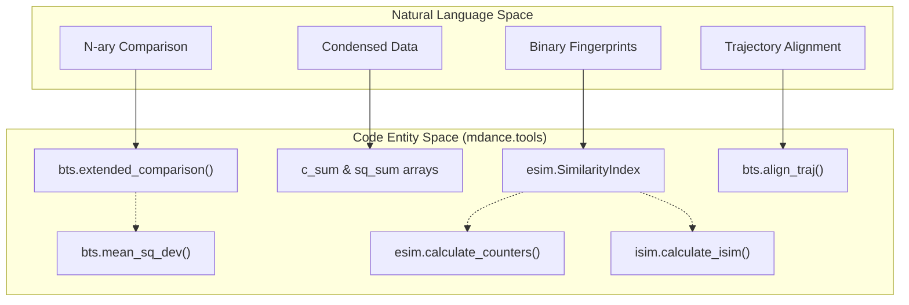
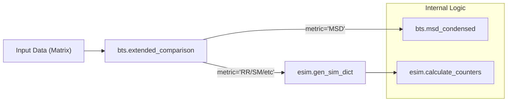

# Core Tools and Utilities

Relevant source files

The following files were used as context for generating this wiki page:

- [src/mdance/tools/bts.py](src/mdance/tools/bts.py)
- [src/mdance/tools/esim.py](src/mdance/tools/esim.py)
- [src/mdance/tools/isim.py](src/mdance/tools/isim.py)

The `mdance.tools` package provides the fundamental mathematical and computational utilities that power the MDANCE clustering suite. These tools implement the $O(N)$ n-ary similarity framework, allowing for the comparison of multiple objects simultaneously without the quadratic scaling of traditional pairwise methods.

The core of the package is divided into three primary modules:
*   **`bts` (Binary/Trajectory Statistics)**: General utilities for trajectory alignment, Mean Square Deviation (MSD) calculations, and sampling strategies [src/mdance/tools/bts.py:1-13]().
*   **`esim` (Extended Similarity)**: Implementation of n-ary similarity indices for binary fingerprints, featuring coincidence thresholds and weighting factors [src/mdance/tools/esim.py:1-11]().
*   **`isim` (Instant Similarity)**: Optimized similarity calculations designed for large-scale datasets, focusing on rapid computation of counters [src/mdance/tools/isim.py:1-9]().

## System Architecture and Code Mapping

The following diagram illustrates how the abstract n-ary similarity concepts are mapped to specific code entities within the `mdance.tools` package.

### Diagram: N-ary Framework to Code Entity Mapping

**Sources:** [src/mdance/tools/bts.py:96-98](), [src/mdance/tools/bts.py:14-15](), [src/mdance/tools/esim.py:18-19](), [src/mdance/tools/isim.py:71-72]().

## bts: N-ary Comparison and Sampling Utilities

The `bts` module is the workhorse for continuous data (trajectories) and general sampling logic. It introduces the "condensed" data representation, where a cluster of $N$ frames is represented solely by its column-wise sum (`c_sum`) and squared sum (`sq_sum`). This allows the Mean Square Deviation (MSD) of an entire cluster to be calculated in $O(1)$ time once these sums are known [src/mdance/tools/bts.py:54-93]().

Key functionalities include:
*   **Trajectory Alignment**: Interfaces with `shapeGMMTorch` for structural alignment [src/mdance/tools/bts.py:7-8]().
*   **Complementary Similarity**: Calculating how much a specific object contributes to the overall diversity of a set [src/mdance/tools/bts.py:190-191]().
*   **Diversity Selection**: Methods for picking representative frames, including `strat_all`, `comp_sim`, and `quota_sampling`.

For details, see [bts: N-ary Comparison and Sampling Utilities](#5.1).

**Sources:** [src/mdance/tools/bts.py:14-51](), [src/mdance/tools/bts.py:190-210]().

## esim and isim: Similarity Indices

These modules handle n-ary similarity for binary data (fingerprints). While `esim` provides a highly configurable framework with various weighting factors (`fraction`, `power_n`) and thresholds [src/mdance/tools/esim.py:37-43](), `isim` is streamlined for performance on massive datasets [src/mdance/tools/isim.py:1-9]().

### Feature Comparison: esim vs isim

| Feature | `esim.py` | `isim.py` |
| :--- | :--- | :--- |
| **Primary Use** | Configurable n-ary indices | High-speed large-scale similarity |
| **Weighting** | `w_factor` (fraction, power) | Fixed weighting (k-power) |
| **Thresholds** | `c_threshold` (int, float, 'dissimilar') | N/A |
| **Indices** | Jaccard, RR, SM, RT, BUB, etc. | RR, JT, SM (Optimized) |

For details, see [esim and isim: Extended and Instant Similarity Indices](#5.2).

**Sources:** [src/mdance/tools/esim.py:122-136](), [src/mdance/tools/isim.py:134-151]().

## Tool Integration Workflow

The tools in `mdance.tools` are designed to be used hierarchically. The `bts` module often acts as a wrapper that calls into `esim` or `isim` depending on the requested metric.

### Diagram: Tool Execution Flow

**Sources:** [src/mdance/tools/bts.py:173-187](), [src/mdance/tools/esim.py:155-156]().

---