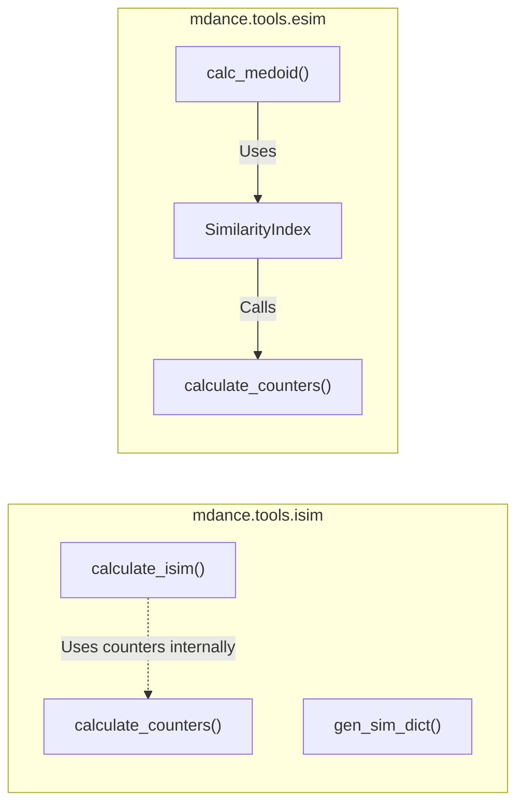

# esim and isim: Extended and Instant Similarity Indices

<details>
<summary>Relevant source files</summary>

The following files were used as context for generating this wiki page:

- [src/mdance/tools/esim.py](src/mdance/tools/esim.py)
- [src/mdance/tools/isim.py](src/mdance/tools/isim.py)

</details>


The `mdance.tools.esim` and `mdance.tools.isim` modules provide the mathematical foundation for $N$-ary similarity comparisons within MDANCE. While traditional similarity measures are pairwise ($O(N^2)$), these modules implement algorithms that scale linearly ($O(N)$) by operating on column-wise sums of binary fingerprints. This enables the comparison of massive datasets that would be computationally prohibitive using standard methods.

## Overview of N-ary Similarity Logic

The core innovation in both modules is the use of a "condensed" representation of the data. Instead of comparing every pair of objects, the system calculates a column-wise sum of the binary fingerprint matrix.

### Data Flow: From Fingerprints to Indices

The following diagram illustrates how raw binary data is transformed into similarity indices using the logic found in `esim.py` and `isim.py`.

**N-ary Similarity Calculation Pipeline**
```mermaid
graph TD
    subgraph "Natural Language Space"
        A["Binary Fingerprint Set"]
        B["Coincidence Counters"]
        C["Similarity Indices"]
    end

    subgraph "Code Entity Space"
        A1["np.ndarray (Binary Matrix)"]
        B1["calculate_counters()"]
        C1["gen_sim_dict()"]
        D1["SimilarityIndex Class"]
    end

    A1 -->|"np.sum(axis=0)"| B1
    B1 -->|"Returns dict (a, d, total_dis)"| C1
    C1 -->|"Calculates AC, JT, RR, SM, etc."| E1["Resulting Indices"]
    D1 -->|"Wraps logic"| B1
end
```
Sources: [src/mdance/tools/esim.py:18-49](), [src/mdance/tools/isim.py:14-34]()

---

## esim: Extended Similarity Indices

The `esim` module implements the Extended Similarity Indices ($eSIM$). These indices are designed for sets of binary fingerprints and utilize a coincidence threshold to determine similarity or dissimilarity across the ensemble.

### Key Functions and Classes

- **`calculate_counters(c_total, n_objects, ...)`**: This function calculates the fundamental counters:
    - `a`: 1-similarity (presence of bits).
    - `d`: 0-similarity (absence of bits).
    - `total_dis`: Dissimilarity (mismatch).
  It supports a `c_threshold` to define how many objects must share a bit to be considered "coincident" [src/mdance/tools/esim.py:18-49]().
- **`SimilarityIndex`**: A class-based interface for $O(N)$ similarity calculation. It can return single indices or a dictionary of all available metrics [src/mdance/tools/esim.py:183-201]().
- **`calc_medoid` and `calc_outlier`**: These functions identify the most representative (medoid) or least representative (outlier) object in a set by maximizing or minimizing the complementary similarity [src/mdance/tools/esim.py:328-348]().

### Weighting Factors
`esim` supports different weighting schemes for the counters via the `w_factor` parameter:
- `fraction`: similarity = $d[k]/n$ [src/mdance/tools/esim.py:73-75]().
- `power_n`: similarity = $n^{-(n\_objects - d[k])}$ [src/mdance/tools/esim.py:66-69]().

Sources: [src/mdance/tools/esim.py:18-119](), [src/mdance/tools/esim.py:183-205](), [src/mdance/tools/esim.py:328-348]()

---

## isim: Instant Similarity

The `isim` module implements the iSIM (instant similarity) framework. It is optimized for speed and provides a direct calculation of indices like Russell-Rao (RR), Jaccard-Tanimoto (JT), and Sokal-Michener (SM) without the complex thresholding logic of `esim`.

### Implementation Details

The `calculate_isim` function provides optimized paths for the three most common indices:
- **RR (Russell-Rao)**: $a / p$ [src/mdance/tools/isim.py:112-116]().
- **JT (Jaccard-Tanimoto)**: $a / (a + total\_dis)$ [src/mdance/tools/isim.py:118-123]().
- **SM (Sokal-Michener)**: $(a + d) / p$ [src/mdance/tools/isim.py:125-131]().

### Relationship between isim and esim

While both modules calculate similarity, `isim` is generally used for large-scale comparisons where the default $N$-ary definitions are sufficient, whereas `esim` is used when fine-grained control over coincidence thresholds and weighting functions is required.

**Code Entity Interaction Map**

Sources: [src/mdance/tools/isim.py:71-91](), [src/mdance/tools/esim.py:183-201](), [src/mdance/tools/esim.py:328-340]()

---

## Supported Similarity Indices

Both modules support a wide array of named indices through their respective `gen_sim_dict` functions.

| Abbreviation | Name | Module Support |
| :--- | :--- | :--- |
| **AC** | Austin-Colwell | `isim`, `esim` |
| **BUB** | Baroni-Urbani-Buser | `isim`, `esim` |
| **Fai** | Faith | `isim`, `esim` |
| **Gle** | Gleason | `isim`, `esim` |
| **Ja** | Jaccard | `isim`, `esim` |
| **JT** | Jaccard-Tanimoto | `isim`, `esim` |
| **RT** | Rogers-Tanimoto | `isim`, `esim` |
| **RR** | Russell-Rao | `isim`, `esim` |
| **SM** | Sokal-Michener | `isim`, `esim` |
| **SS1/SS2** | Sokal-Sneath 1 & 2 | `isim`, `esim` |

Sources: [src/mdance/tools/isim.py:148-181](), [src/mdance/tools/esim.py:129-179]()

---

## Technical Comparison: Counter Calculation

The fundamental difference lies in how $a$ (1-similarity) and $d$ (0-similarity) are derived:

1.  **iSIM Logic**: Directly uses the column-wise sum to compute combinations of pairs sharing bits [src/mdance/tools/isim.py:54-57]().
    - $a\_array = c\_total \times (c\_total - 1) / 2$
2.  **eSIM Logic**: Uses a threshold to categorize features as similarity or dissimilarity indicators [src/mdance/tools/esim.py:94-96]().
    - $a\_indices = 2 \times c\_total - n\_objects > c\_threshold$

Sources: [src/mdance/tools/isim.py:53-61](), [src/mdance/tools/esim.py:92-108]()

---