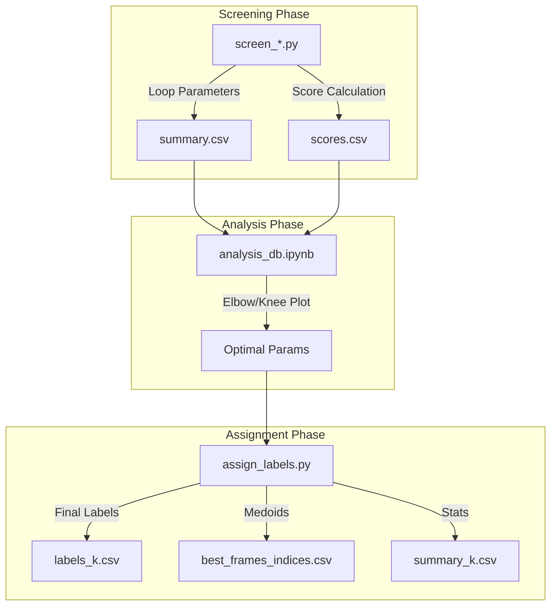
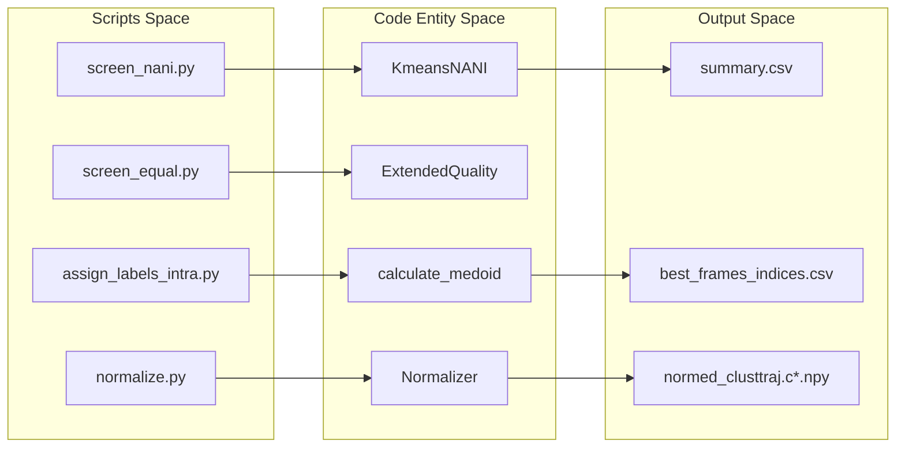

# Scripts Reference

Relevant source files

The following files were used as context for generating this wiki page:

- [scripts/equal/assign_labels.py](scripts/equal/assign_labels.py)
- [scripts/equal/screen_equal.py](scripts/equal/screen_equal.py)
- [scripts/helm/inter/assign_labels_inter.py](scripts/helm/inter/assign_labels_inter.py)
- [scripts/helm/intra/assign_labels_intra.py](scripts/helm/intra/assign_labels_intra.py)
- [scripts/nani/assign_labels.py](scripts/nani/assign_labels.py)
- [scripts/nani/screen_nani.py](scripts/nani/screen_nani.py)
- [scripts/prime/exec_rep_frames.py](scripts/prime/exec_rep_frames.py)
- [scripts/prime/exec_similarity.py](scripts/prime/exec_similarity.py)
- [scripts/prime/normalize.py](scripts/prime/normalize.py)

The `scripts/` directory provides a collection of ready-to-run Python scripts and Jupyter notebooks that implement the standard MDANCE workflows for each algorithm. These scripts serve as templates for users to perform large-scale screenings, assign cluster labels to trajectories, and analyze results using internal validation metrics.

## Common Workflow Pattern

Most algorithms in MDANCE follow a three-stage workflow facilitated by these scripts:

1.  **Screening (`screen_*.py` / `run_*.py`):** Iterates through a range of hyperparameters (e.g., number of clusters $k$ or similarity thresholds) to generate performance metrics.
2.  **Analysis (`analysis_*.ipynb`):** Uses the screening output to visualize internal validation scores like Davies-Bouldin Index (DBI) or Calinski-Harabasz (CH) score to identify optimal parameters.
3.  **Label Assignment (`assign_labels.py`):** Applies the chosen parameters to the full dataset to produce final cluster memberships, population summaries, and representative medoid frames.

### Workflow Logic Diagram

The following diagram illustrates the relationship between script types and the data they produce.

**Sources:** [scripts/nani/screen_nani.py:38-75](), [scripts/nani/assign_labels.py:30-74](), [scripts/equal/screen_equal.py:48-80]()

---

## Algorithm Script Directories

### NANI and eQual
These scripts handle the partition-based and density-based clustering workflows. The NANI scripts focus on $k$-selection, while eQual scripts focus on threshold-based growth.

*   **NANI Scripts:** Includes `screen_nani.py` for testing various $k$ values and `assign_labels.py` for generating the final clustering results.
*   **eQual Scripts:** Includes `screen_equal.py` to test different radial similarity thresholds and `assign_labels.py` to extract clusters based on a specific threshold.

For details, see [NANI and eQual Scripts](#6.1).

### HELM and DIVINE
These scripts manage hierarchical workflows. HELM is agglomerative (bottom-up), often starting from NANI pre-clusters, while DIVINE is divisive (top-down).

*   **HELM Scripts:** Divided into `intra/`, `inter/`, and `ward/` subdirectories, each containing specific `assign_labels_*.py` scripts to handle the tree-merging logic [scripts/helm/intra/assign_labels_intra.py:1-20]().
*   **DIVINE Scripts:** Provide `run_divine.py` for recursive splitting and `assign_labels.py` for tree traversal.

For details, see [HELM, DIVINE, and Other Algorithm Scripts](#6.2).

### PRIME (Structure Prediction)
PRIME scripts implement a specialized pipeline for native structure prediction using the similarity results from other algorithms.

*   **Preprocessing:** `normalize.py` prepares cluster frames using Min-Max normalization [scripts/prime/normalize.py:10-35]().
*   **Execution:** `exec_similarity.py` and `exec_rep_frames.py` act as wrappers for the `prime_sim` and `prime_rep` CLI tools [scripts/prime/exec_similarity.py:21-23](), [scripts/prime/exec_rep_frames.py:18-19]().

---

## Code Entity Mapping

The following diagram bridges the script files to the core classes they instantiate and the output files they generate.

**Sources:** [scripts/nani/screen_nani.py:5-36](), [scripts/equal/screen_equal.py:7-54](), [scripts/helm/intra/assign_labels_intra.py:5-67](), [scripts/prime/normalize.py:7-33]()

### Standard Output Formats

| File Type | Script Source | Description |
| :--- | :--- | :--- |
| `labels_*.csv` | `assign_labels.py` | Mapping of frame indices to cluster IDs [scripts/nani/assign_labels.py:63-67](). |
| `best_frames_indices_*.csv` | `assign_labels.py` | Indices of frames closest to the cluster medoid [scripts/nani/assign_labels.py:59-60](). |
| `summary_*.csv` | `assign_labels.py` | Population fraction of each cluster [scripts/nani/assign_labels.py:70-74](). |
| `*.pkl` | `screen_equal.py` | Serialized cluster dictionaries for hierarchical or threshold methods [scripts/equal/screen_equal.py:60-64](). |

**Sources:** [scripts/nani/assign_labels.py:59-74](), [scripts/equal/screen_equal.py:60-64](), [scripts/helm/intra/assign_labels_intra.py:92-105]()

---