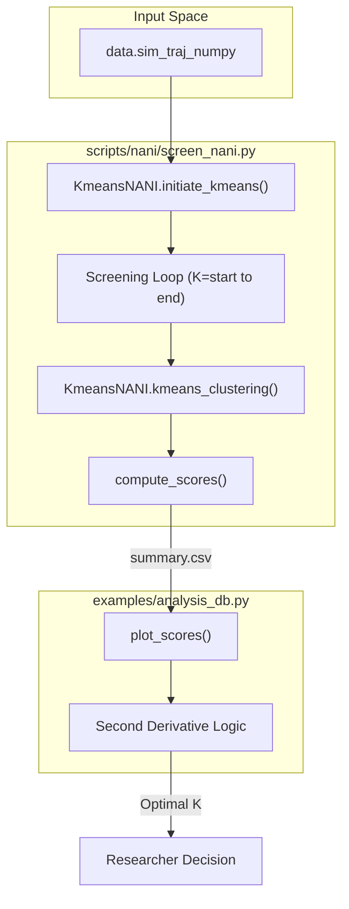
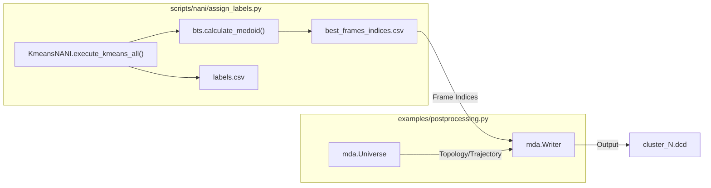

# NANI and eQual Scripts

Relevant source files

The following files were used as context for generating this wiki page:

- [examples/analysis_db.py](examples/analysis_db.py)
- [examples/postprocessing.py](examples/postprocessing.py)
- [examples/preprocessing.py](examples/preprocessing.py)
- [scripts/equal/assign_labels.py](scripts/equal/assign_labels.py)
- [scripts/equal/best_frames_indices_5.8.csv](scripts/equal/best_frames_indices_5.8.csv)
- [scripts/equal/cluster_labels_5.8.csv](scripts/equal/cluster_labels_5.8.csv)
- [scripts/equal/equal_screening.csv](scripts/equal/equal_screening.csv)
- [scripts/equal/equal_screening_nclusters.png](scripts/equal/equal_screening_nclusters.png)
- [scripts/equal/equal_screening_scores.csv](scripts/equal/equal_screening_scores.csv)
- [scripts/equal/equal_screening_scores_db.png](scripts/equal/equal_screening_scores_db.png)
- [scripts/equal/screen_equal.py](scripts/equal/screen_equal.py)
- [scripts/nani/assign_labels.py](scripts/nani/assign_labels.py)
- [scripts/nani/outputs/10comp_sim_summary.csv](scripts/nani/outputs/10comp_sim_summary.csv)
- [scripts/nani/outputs/10strat_all_summary.csv](scripts/nani/outputs/10strat_all_summary.csv)
- [scripts/nani/outputs/best_frames_indices_6.csv](scripts/nani/outputs/best_frames_indices_6.csv)
- [scripts/nani/outputs/labels_6.csv](scripts/nani/outputs/labels_6.csv)
- [scripts/nani/outputs/summary_6.csv](scripts/nani/outputs/summary_6.csv)
- [scripts/nani/screen_nani.py](scripts/nani/screen_nani.py)

This page provides a technical walkthrough of the screening and label assignment scripts for the **NANI** (Number of clusters-Agnostic N-ary Initialization) and **eQual** (Extended Quality) clustering algorithms. These scripts facilitate a standardized workflow: screening for optimal parameters, analyzing validity indices, and extracting representative structures.

## 1. NANI Scripts (scripts/nani/)

NANI implements a K-Means clustering workflow enhanced by N-ary similarity-based initialization strategies. The scripts in this directory automate the search for the optimal cluster count ($K$) and the generation of final cluster assignments.

### 1.1 screening with screen_nani.py
The `screen_nani.py` script iterates through a range of cluster numbers to evaluate clustering performance using internal validity indices.

**Key Parameters:**
* `init_type`: The initialization strategy, such as `strat_all`, `strat_reduced`, `comp_sim`, or `vanilla_kmeans++` [scripts/nani/screen_nani.py:17-17]().
* `start_n_clusters` / `end_n_clusters`: The range of $K$ to test [scripts/nani/screen_nani.py:19-20]().
* `percentage`: For N-ary strategies, the percentage of the dataset used to find initiators [scripts/nani/screen_nani.py:33-33]().

**Implementation Details:**
1. **Initiator Generation**: For strategies like `comp_sim` or `strat_all`, the script calls `KmeansNANI.initiate_kmeans()` once at the maximum $K$ to ensure consistency across the screening range [scripts/nani/screen_nani.py:34-36]().
2. **Clustering Loop**: For each $i$ in the range, it executes `KmeansNANI.kmeans_clustering()` [scripts/nani/screen_nani.py:46-55]().
3. **Scoring**: It uses `compute_scores` to calculate Calinski-Harabasz (CH) and Davies-Bouldin (DB) indices [scripts/nani/screen_nani.py:58-58](). It also calculates the Average Mean Squared Deviation (MSD) for each cluster using `extended_comparison` [scripts/nani/screen_nani.py:66-68]().

**Output:**
A summary CSV (e.g., `10strat_all_summary.csv`) containing:
* Number of clusters, Iterations, CH score, DB score, and Average MSD [scripts/nani/screen_nani.py:73-75]().

### 1.2 Label Assignment with assign_labels.py
Once the optimal $K$ is determined, `assign_labels.py` is used to generate final outputs.

**Workflow:**
* **Clustering**: Executes `execute_kmeans_all()` to get labels and centers [scripts/nani/assign_labels.py:30-30]().
* **Medoid Calculation**: For each cluster, it identifies the medoid frame using `calculate_medoid` [scripts/nani/assign_labels.py:40-40]().
* **Representative Extraction**: It identifies the `n_structures` closest to the medoid based on MSD [scripts/nani/assign_labels.py:44-49]().

**Output Files:**
| File Name | Description |
| :--- | :--- |
| `labels_{K}.csv` | Mapping of every frame index to its assigned Cluster Index [scripts/nani/assign_labels.py:63-67](). |
| `best_frames_indices_{K}.csv` | Indices of the top `n_structures` closest to the medoid for each cluster [scripts/nani/assign_labels.py:59-60](). |
| `summary_{K}.csv` | Population fraction for each cluster [scripts/nani/assign_labels.py:70-74](). |

### 1.3 Analysis with analysis_db.py
The `analysis_db.py` script (and corresponding notebook) processes the summary CSVs to visualize the "elbow" or "knee" in clustering scores.

**Key Logic:**
* **DBI Plotting**: Plots the Davies-Bouldin Index against the cluster number [examples/analysis_db.py:51-54]().
* **Optimal Selection**: Identifies the minimum DBI and the maximum of the second derivative of the DBI to suggest the optimal $K$ [examples/analysis_db.py:44-46, 62-65]().

**Sources:** [scripts/nani/screen_nani.py:1-75](), [scripts/nani/assign_labels.py:1-74](), [examples/analysis_db.py:1-83]()

---

## 2. eQual Scripts (scripts/equal/)

eQual is a radial threshold clustering algorithm. Unlike NANI, which requires $K$ as an input, eQual relies on a similarity threshold.

### 2.1 screening with screen_equal.py
This script screens the `threshold` parameter rather than the cluster count.

**Key Logic:**
* Iterates through a range defined by `start_threshold`, `end_threshold`, and `step` [scripts/equal/screen_equal.py:48-48]().
* For each threshold, it initializes `ExtendedQuality` and calls `run()` [scripts/equal/screen_equal.py:50-54]().
* Computes CH and DB scores for the resulting clusters [scripts/equal/screen_equal.py:56-56]().

**Output:**
* `equal_screening.csv`: Contains population distributions for the top 10 clusters across thresholds [scripts/equal/screen_equal.py:70-73]().
* `equal_screening_scores.csv`: Contains threshold-wise CH and DB scores [scripts/equal/screen_equal.py:76-79]().

### 2.2 Label Assignment with assign_labels.py
Similar to the NANI variant, this script extracts the final results for a specific chosen threshold.

**Key Logic:**
* It can either run the clustering from scratch or load a pickled cluster dictionary via `open_clusters` [scripts/equal/assign_labels.py:34-41]().
* It calculates medoids and identifies the `n_structures` closest to those medoids [scripts/equal/assign_labels.py:45-55]().
* **Outputs**: Generates `cluster_labels_{threshold}.csv` and `best_frames_indices_{threshold}.csv` [scripts/equal/assign_labels.py:67-84]().

**Sources:** [scripts/equal/screen_equal.py:1-79](), [scripts/equal/assign_labels.py:1-84]()

---

## 3. Data Flow and System Architecture

The following diagrams illustrate the transition from raw MD data through the screening scripts to the final analysis and postprocessing.

### Diagram 1: Screening and Analysis Workflow
This diagram bridges the script-level execution to the internal logic of the clustering classes.

**Sources:** [scripts/nani/screen_nani.py:34-58](), [examples/analysis_db.py:27-73]()

### Diagram 2: Label Assignment and Postprocessing
This diagram shows how the script outputs are consumed by the postprocessing utilities to generate MD-ready files.

**Sources:** [scripts/nani/assign_labels.py:30-60](), [examples/postprocessing.py:29-54]()

---

## 4. Summary of Output Formats

The scripts produce standardized CSV files to ensure interoperability between the different clustering algorithms and postprocessing tools.

| File Type | Column 1 | Column 2 | Purpose |
| :--- | :--- | :--- | :--- |
| **Labels CSV** | Frame Index | Cluster Index | Full trajectory assignment for analysis. |
| **Best Frames CSV** | Frame Index | Cluster Index | Filtered set of frames (centroids/medoids) for visualization. |
| **Summary CSV** | Cluster Index | Fraction | Population analysis of the ensemble. |

**Sources:** [scripts/nani/outputs/labels_6.csv:1-20](), [scripts/nani/outputs/best_frames_indices_6.csv:1-10](), [scripts/nani/outputs/summary_6.csv:1-9]()

---