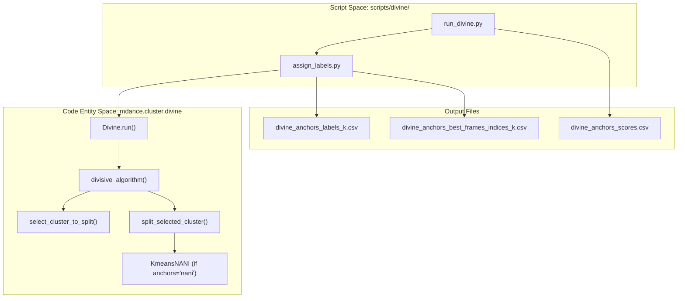
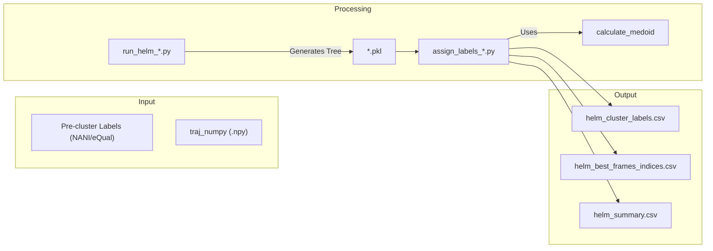
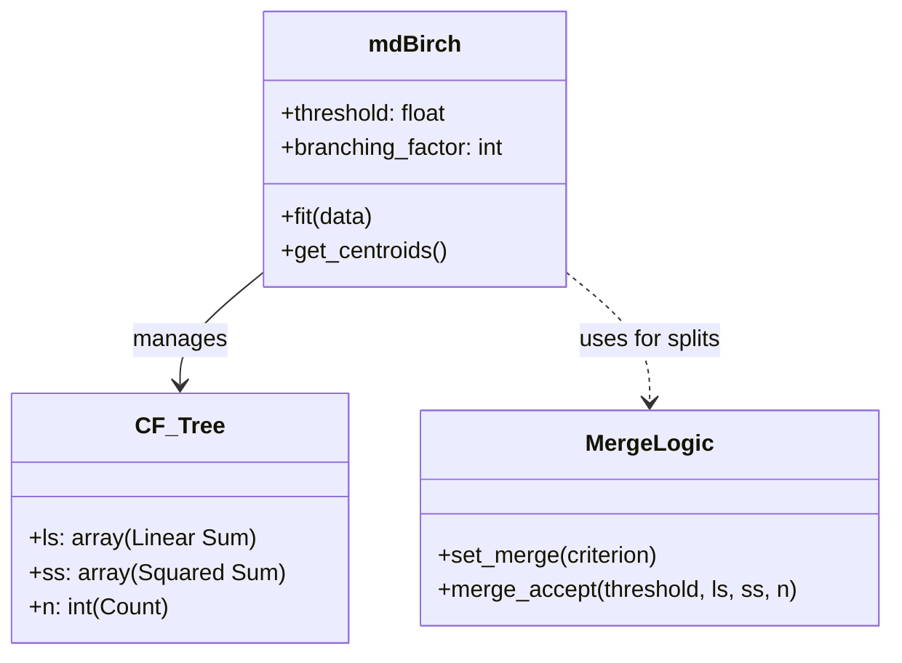

# HELM, DIVINE, and Other Algorithm Scripts

Relevant source files

The following files were used as context for generating this wiki page:

- [scripts/divine/assign_labels.py](scripts/divine/assign_labels.py)
- [scripts/divine/divine_nani_best_frames_indices_6.csv](scripts/divine/divine_nani_best_frames_indices_6.csv)
- [scripts/divine/divine_nani_labels_6.csv](scripts/divine/divine_nani_labels_6.csv)
- [scripts/divine/divine_nani_msds.csv](scripts/divine/divine_nani_msds.csv)
- [scripts/divine/divine_nani_scores.csv](scripts/divine/divine_nani_scores.csv)
- [scripts/divine/run_divine.py](scripts/divine/run_divine.py)
- [scripts/helm/inter/assign_labels_inter.py](scripts/helm/inter/assign_labels_inter.py)
- [scripts/helm/inter/run_helm_inter.py](scripts/helm/inter/run_helm_inter.py)
- [scripts/helm/intra/assign_labels_intra.py](scripts/helm/intra/assign_labels_intra.py)
- [scripts/helm/intra/run_helm_intra.py](scripts/helm/intra/run_helm_intra.py)
- [scripts/helm/ward/assign_labels_intra.py](scripts/helm/ward/assign_labels_intra.py)
- [scripts/helm/ward/run_helm_ward.py](scripts/helm/ward/run_helm_ward.py)
- [scripts/mdbirch/mdbirch_labels_3.06.csv](scripts/mdbirch/mdbirch_labels_3.06.csv)
- [scripts/mdbirch/run_mdbirch.py](scripts/mdbirch/run_mdbirch.py)
- [src/mdance/cluster/divine.py](src/mdance/cluster/divine.py)
- [src/mdance/cluster/mdbirch.py](src/mdance/cluster/mdbirch.py)
- [tests/test_divine.py](tests/test_divine.py)
- [tests/test_mdbirch.py](tests/test_mdbirch.py)

This page provides a technical walkthrough of the execution scripts and post-clustering analysis tools for hierarchical (HELM, DIVINE), streaming (mdBIRCH), and pathway-based (SHINE, PRISM) clustering algorithms in MDANCE. These scripts bridge the core `mdance.cluster` classes with practical Molecular Dynamics (MD) analysis workflows.

## DIVINE: Divisive Hierarchical Clustering

The `Divine` algorithm performs top-down recursive splitting of a trajectory [src/mdance/cluster/divine.py:8-33](). It is particularly useful for identifying major conformational states and their sub-states in a hierarchical manner.

### Execution and Label Assignment
The `run_divine.py` script executes the main clustering loop, while `assign_labels.py` handles the extraction of cluster memberships and representative medoids.

*   **Run Script**: `scripts/divine/run_divine.py` initializes the `Divine` class with parameters such as `split` (the metric for choosing which cluster to divide) and `anchors` (the method for finding split points) [scripts/divine/run_divine.py:26-28]().
*   **Label Assignment**: `scripts/divine/assign_labels.py` calculates the medoid for each final cluster using `calculate_medoid` and identifies the top $N$ closest frames to that medoid [scripts/divine/assign_labels.py:40-48]().

### DIVINE System Architecture

The following diagram maps the DIVINE script entities to the core implementation.

| Natural Language Concept | Code Entity |
| :--- | :--- |
| **Splitting Strategy** | `split` parameter (`MSD`, `radius`, `weighted_MSD`) [src/mdance/cluster/divine.py:15-16]() |
| **Anchor Selection** | `anchors` parameter (`nani`, `outlier_pair`, `splinter_split`) [src/mdance/cluster/divine.py:17-18]() |
| **Stopping Condition** | `end` parameter (`k` for cluster count or `points` for singletons) [src/mdance/cluster/divine.py:21-22]() |
| **Refinement Step** | `refine=True` (uses K-Means to clean up split boundaries) [src/mdance/cluster/divine.py:25-26]() |

**DIVINE Logic Flow**

Sources: [src/mdance/cluster/divine.py:8-163](), [scripts/divine/run_divine.py:1-35](), [scripts/divine/assign_labels.py:1-58]()

---

## HELM: Hierarchical Extended Linkage Method

HELM is an agglomerative (bottom-up) algorithm typically used as a second stage after an initial NANI or eQual clustering. It merges pre-existing clusters based on n-ary similarity [scripts/helm/intra/assign_labels_intra.py:13-18]().

### Variants and Scripts
MDANCE provides three variants of HELM located in `scripts/helm/`:
1.  **Intra**: Merging based on internal cluster similarity.
2.  **Inter**: Merging based on similarity between clusters.
3.  **Ward**: A variance-minimization linkage variant.

### Data Flow and Outputs
HELM scripts follow a specific pattern:
1.  **Run**: `run_helm_variant.py` generates a tree of merges stored in a pickle file (e.g., `intra-helm.pkl`) [scripts/helm/intra/assign_labels_intra.py:16]().
2.  **Assign**: `assign_labels_variant.py` loads the pickle file and the original pre-cluster labels to produce final memberships [scripts/helm/intra/assign_labels_intra.py:25-35]().

**HELM Data Flow**

Sources: [scripts/helm/intra/assign_labels_intra.py:21-105](), [scripts/helm/inter/assign_labels_inter.py:21-105]()

---

## mdBIRCH: Online Streaming Clustering

`mdBIRCH` is designed for massive trajectories that do not fit in memory. It uses a CF-tree (Clustering Feature tree) where each node contains condensed statistics: linear sum (`ls`), squared sum (`ss`), and count (`n`) [src/mdance/cluster/mdbirch.py:55-57]().

### Configuration
*   **Merge Criterion**: Set via `mdbirch.set_merge('radius', features=D)` [scripts/mdbirch/run_mdbirch.py:17]().
*   **Threshold**: The maximum radius allowed for a cluster before a split occurs [scripts/mdbirch/run_mdbirch.py:9]().

### Implementation Details
The algorithm utilizes `msd_condensed` to calculate Mean Square Deviation using only the CF-tree statistics, avoiding the need to re-read raw data [src/mdance/cluster/mdbirch.py:63-98]().

**mdBIRCH Component Map**

Sources: [src/mdance/cluster/mdbirch.py:34-98](), [scripts/mdbirch/run_mdbirch.py:11-42]()

---

## Output File Formats

All scripts in this directory produce standardized CSV outputs to facilitate downstream analysis and visualization.

### 1. Cluster Labels (`*_labels.csv`)
Maps every frame to a cluster ID.
*   **Format**: `frame_index,cluster_index`
*   **Example**: [scripts/mdbirch/mdbirch_labels_3.06.csv:1-12]()

### 2. Best Frames (`*_best_frames_indices.csv`)
Identifies representative structures (medoids and neighbors) for each cluster.
*   **Format**: `Frame Index,Cluster Index`
*   **Example**: [scripts/divine/divine_nani_best_frames_indices_6.csv:1-12]()

### 3. Clustering Metrics (`*_scores.csv`)
Contains internal validation indices for different cluster counts ($k$).
*   **Columns**: `n_clusters`, `CH_score` (Calinski-Harabasz), `DB_score` (Davies-Bouldin) [scripts/divine/divine_nani_scores.csv:1-10]().

### 4. MSD Statistics (`*_msds.csv`)
Provides the "tightness" of clusters at different levels of the hierarchy.
*   **Columns**: `level`, `cluster_index`, `population`, `msd` [scripts/divine/run_divine.py:33]().

Sources: [scripts/divine/run_divine.py:30-33](), [scripts/divine/assign_labels.py:34-57](), [scripts/helm/intra/assign_labels_intra.py:84-105]()

---