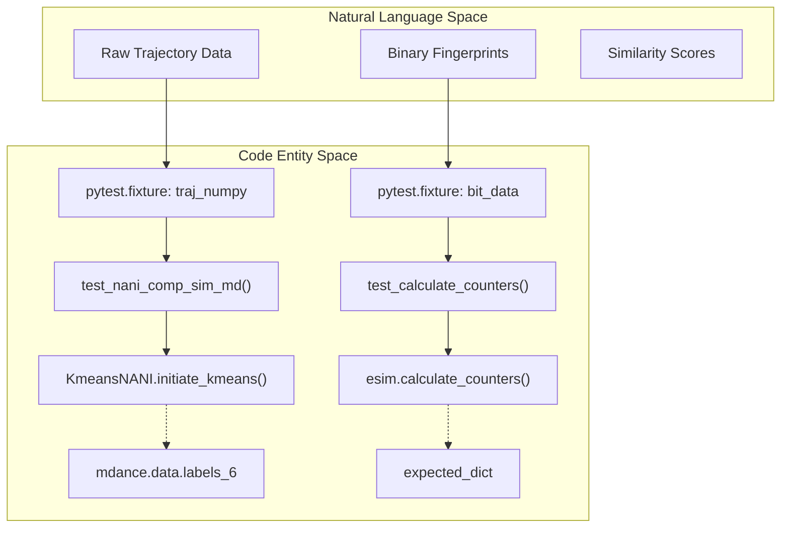
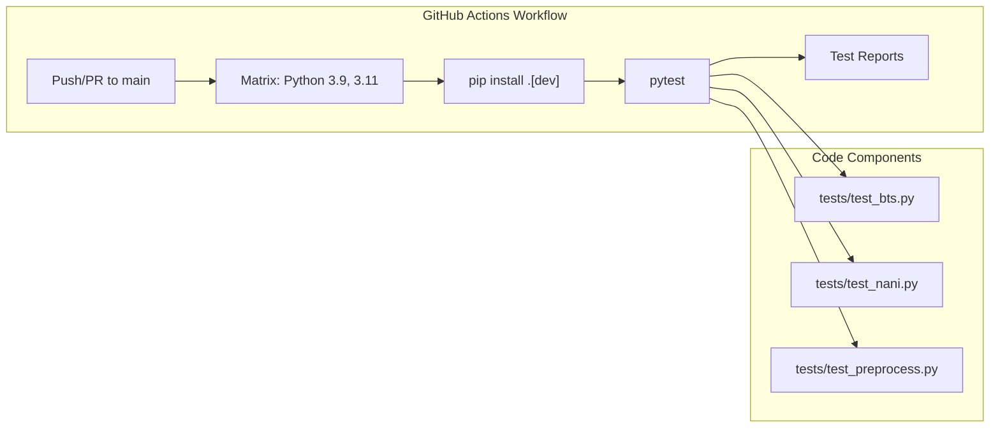

# Testing Infrastructure

Relevant source files

The following files were used as context for generating this wiki page:

- [.github/workflows/ci.yml](.github/workflows/ci.yml)
- [tests/test_bts.py](tests/test_bts.py)
- [tests/test_db.py](tests/test_db.py)
- [tests/test_esim.py](tests/test_esim.py)
- [tests/test_nani.py](tests/test_nani.py)
- [tests/test_preprocess.py](tests/test_preprocess.py)

The MDANCE testing infrastructure is built around the `pytest` framework, providing automated verification of the core n-ary similarity mathematics, clustering algorithms, and data preprocessing pipelines. The suite ensures that the O(N) scaling logic and the various initialization strategies remain consistent across updates.

The infrastructure is divided into modular unit tests located in the `tests/` directory, supported by a GitHub Actions CI pipeline for multi-version Python validation.

## Test Suite Overview

The test suite covers the entire lifecycle of an MDANCE analysis, from raw data ingestion to cluster validation. It utilizes a mix of synthetic datasets (e.g., Scikit-learn blobs) and real Molecular Dynamics (MD) trajectory data bundled within the package [tests/test_nani.py:10-25]().

### Core Components Tested
| Component | Test File | Primary Focus |
| :--- | :--- | :--- |
| **BTS Tools** | `tests/test_bts.py` | Mean Square Deviation (MSD), medoid/outlier detection, and condensed representation math. |
| **N-ary Similarity** | `tests/test_esim.py` | Extended similarity indices (Jaccard, RR, SM, etc.) and counter logic. |
| **Clustering** | `tests/test_nani.py`, `test_equal.py`, etc. | Algorithm-specific convergence and label assignment. |
| **Preprocessing** | `tests/test_preprocess.py` | MDAnalysis trajectory conversion and Min-Max normalization. |
| **Validation** | `tests/test_db.py` | Davies-Bouldin Index (DBI) calculation and optimal cluster count detection. |

Sources: [tests/test_bts.py:1-7](), [tests/test_nani.py:1-8](), [tests/test_db.py:4-9](), [tests/test_esim.py:1-5](), [tests/test_preprocess.py:1-6]()

## Pytest Fixtures and Patterns

MDANCE uses `pytest.fixture` to manage data state and `pytest.mark.parametrize` to run tests across multiple data types (binary vs. continuous).

### Data Abstraction
The testing suite defines standard fixtures for:
*   **Binary Data**: 5x6 binary arrays for similarity index verification [tests/test_bts.py:10-22]().
*   **Continuous Data**: 5x6 floating-point arrays for MSD and normalization testing [tests/test_bts.py:25-36]().
*   **MD Data**: Reference trajectory data loaded via `mdance.data` [tests/test_bts.py:40-42]().

### Condensed Representation Testing
A critical part of the infrastructure verifies that "Full" matrix calculations match "Condensed" (column-wise sum and squared sum) calculations, which is the basis for MDANCE's performance [tests/test_bts.py:95-113]().

### Code Entity Mapping: Test Fixtures to Logic
The following diagram illustrates how test fixtures bridge the gap between raw data and the mathematical tools in `mdance.tools`.

**Fixture and Logic Association**

Sources: [tests/test_nani.py:10-15](), [tests/test_esim.py:7-19](), [tests/test_esim.py:38-49](), [tests/test_nani.py:28-45]()

## CI/CD Pipeline

The project utilizes GitHub Actions to automate testing on every `push` or `pull_request` to the `main` branch [.github/workflows/ci.yml:3-7]().

### Execution Environment
The workflow runs on `ubuntu-latest` and tests against a matrix of Python versions: **3.9** and **3.11** [.github/workflows/ci.yml:13-15]().

### Pipeline Stages
1.  **Checkout**: Pulls the repository code [.github/workflows/ci.yml:18-19]().
2.  **Caching**: Uses `actions/cache` for `pip` dependencies, keyed by the `pyproject.toml` hash to speed up builds [.github/workflows/ci.yml:26-32]().
3.  **Installation**: Upgrades pip and installs the package with development dependencies using `pip install .[dev]` [.github/workflows/ci.yml:34-37]().
4.  **Test Execution**: Runs the entire suite via the `pytest` command [.github/workflows/ci.yml:39-40]().

**CI Pipeline Flow**

Sources: [.github/workflows/ci.yml:1-41]()

## Detailed Testing Documentation

For more granular details on specific test implementations and CI configurations, see the following child pages:

*   **[Unit Tests by Module](#7.1)**: Deep dive into per-module test coverage, including `test_bts.py`, `test_nani.py`, and the use of reference datasets in `mdance.data`.
*   **[CI/CD Pipeline](#7.2)**: Detailed breakdown of the GitHub Actions workflow, caching strategies, and dependency management.

---