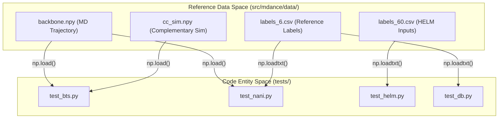
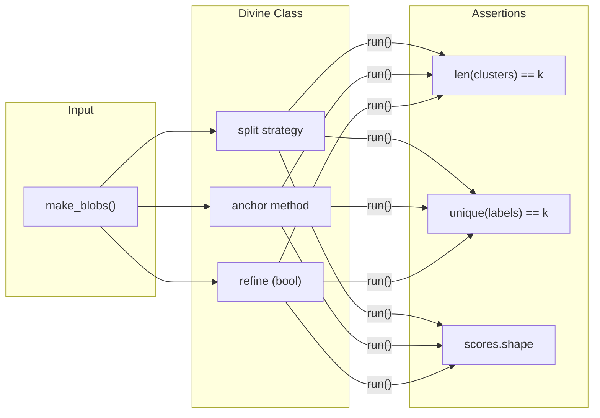

# Unit Tests by Module

Relevant source files

The following files were used as context for generating this wiki page:

- [scripts/divine/assign_labels.py](scripts/divine/assign_labels.py)
- [scripts/divine/run_divine.py](scripts/divine/run_divine.py)
- [src/mdance/cluster/divine.py](src/mdance/cluster/divine.py)
- [src/mdance/data/__init__.py](src/mdance/data/__init__.py)
- [src/mdance/data/labels_6.csv](src/mdance/data/labels_6.csv)
- [tests/test_bts.py](tests/test_bts.py)
- [tests/test_db.py](tests/test_db.py)
- [tests/test_divine.py](tests/test_divine.py)
- [tests/test_equal.py](tests/test_equal.py)
- [tests/test_esim.py](tests/test_esim.py)
- [tests/test_helm.py](tests/test_helm.py)
- [tests/test_nani.py](tests/test_nani.py)
- [tests/test_preprocess.py](tests/test_preprocess.py)
- [tests/test_shine.py](tests/test_shine.py)

The MDANCE test suite is designed to ensure the mathematical correctness of n-ary similarity calculations and the stability of clustering workflows. Tests are implemented using `pytest` and leverage a mix of synthetic datasets (generated via `scikit-learn`) and reference Molecular Dynamics (MD) data bundled within the package.

## Test Infrastructure and Fixtures

The test suite utilizes a hierarchical fixture pattern to provide data across different modules. Reference MD data is sourced from `src/mdance/data/` [src/mdance/data/__init__.py:1-20]().

### Data Flow for Testing
The following diagram illustrates how raw data and pre-computed reference files flow into the test modules.

**Diagram: Test Data Association**

Sources: [tests/test_bts.py:40-42](), [tests/test_nani.py:10-15](), [tests/test_helm.py:17-22](), [tests/test_db.py:8-10]()

---

## 1. Core Tool Tests (`test_bts.py`, `test_esim.py`)

These tests validate the foundational n-ary similarity logic and sampling utilities in `mdance.tools.bts` and `mdance.tools.esim`.

### `test_bts.py`
- **Extended Comparison**: Validates `mean_sq_dev` and `extended_comparison` for both 'full' (raw array) and 'condensed' (c_sum, sq_sum) data representations [tests/test_bts.py:76-112]().
- **Medoid & Outlier**: Ensures the correct identification of central and peripheral frames using MSD [tests/test_bts.py:177-208]().
- **Complementary Similarity**: Tests `calculate_comp_sim` against pre-computed values in `cc_sim.npy` [tests/test_bts.py:157-174]().
- **Trimming**: Validates `trim_outliers` which removes frames with high MSD [tests/test_bts.py:211-220]().

### `test_esim.py`
Focuses on binary fingerprint similarity indices.
- **Counters**: Validates the `a`, `d`, and weighted counters used in n-ary indices [tests/test_esim.py:38-49]().
- **Similarity Indices**: Checks indices like Jaccard (Ja), Russell-Rao (RR), and Simple Matching (SM) [tests/test_esim.py:52-66]().

Sources: [tests/test_bts.py:1-220](), [tests/test_esim.py:1-100]()

---

## 2. Clustering Algorithm Tests

Each clustering module is tested for its ability to recover known clusters from MD trajectories or synthetic "blobs."

### `test_nani.py` (K-Means with N-ary Initialization)
Tests the `KmeansNANI` class with multiple initialization strategies:
- **`comp_sim`**: Uses complementary similarity to pick initiators. Tested on both MD data (`backbone.npy`) and synthetic blobs [tests/test_nani.py:28-71]().
- **`strat_all` / `strat_reduced`**: Validates stratified sampling methods for initiator selection [tests/test_nani.py:74-135]().
- **Error Handling**: Ensures a `ValueError` is raised if the percentage of data selected results in fewer initiators than requested clusters [tests/test_nani.py:138-142]().

### `test_equal.py` (Radial Threshold Clustering)
Validates the `ExtendedQuality` algorithm. It checks the resulting Davies-Bouldin (DB) and Calinski-Harabasz (CH) scores against reference values for a 1000-sample blob dataset [tests/test_equal.py:17-35]().

### `test_divine.py` (Divisive Hierarchical Clustering)
Tests the `Divine` class across various parameter combinations:
- **Split Strategies**: `MSD`, `radius`, `weighted_MSD` [tests/test_divine.py:13]().
- **Anchor Methods**: `nani`, `outlier_pair`, `splinter_split` [tests/test_divine.py:14]().
- **Stopping Criteria**: Validates both cluster count (`k`) and singleton (`points`) termination [tests/test_divine.py:41-76]().

**Diagram: Divine Logic Verification**

Sources: [tests/test_divine.py:13-39](), [src/mdance/cluster/divine.py:8-33]()

### `test_helm.py` (Hierarchical Extended Linkage)
Tests the agglomerative merging of pre-existing clusters.
- **Input Preparation**: Converts raw trajectory data into the required `cluster_dict` format containing `c_sum` and `sq_sum` for each initial cluster [tests/test_helm.py:38-48]().
- **Parameters**: Tests `eps` (distance threshold), `pops` (population-based merging), and `n_clusters` (fixed target) [tests/test_helm.py:51-174]().
- **Trimming**: Validates `trim_k` and `min_samples` for filtering low-population clusters during the hierarchy build [tests/test_helm.py:175-183]().

Sources: [tests/test_nani.py:1-142](), [tests/test_equal.py:1-35](), [tests/test_divine.py:1-113](), [tests/test_helm.py:1-200]()

---

## 3. Utility and Database Tests

### `test_preprocess.py`
Validates the data ingestion pipeline:
- **`gen_traj_numpy`**: Confirms that atom selection strings (e.g., `'resid 3 to 12 and name N CA C O H'`) correctly filter MDAnalysis trajectories to match reference numpy files [tests/test_preprocess.py:16-22]().
- **`Normalizer`**: Checks the 'v3' normalization (Min-Max) to ensure all features fall within the [0, 1] range [tests/test_preprocess.py:25-34]().

### `test_db.py`
Specifically tests the logic for selecting the optimal number of clusters using the Davies-Bouldin index. It verifies the calculation of the **second derivative** of the DB index curve to identify the "elbow" or local minima [tests/test_db.py:22-41]().

| Test Function | Target Module | Key Verification |
| :--- | :--- | :--- |
| `test_gen_traj_numpy` | `mdance.inputs.preprocess` | Trajectory to Numpy conversion accuracy |
| `test_Normalizer` | `mdance.inputs.preprocess` | Min-Max scaling bounds |
| `test_db` | `scripts/nani/` logic | Optimal cluster count via second derivative |
| `test_calculate_counters`| `mdance.tools.esim` | N-ary overlap counts (`a`, `d`, `w_a`, `w_d`) |

Sources: [tests/test_preprocess.py:1-34](), [tests/test_db.py:4-41](), [tests/test_esim.py:38-49]()

---