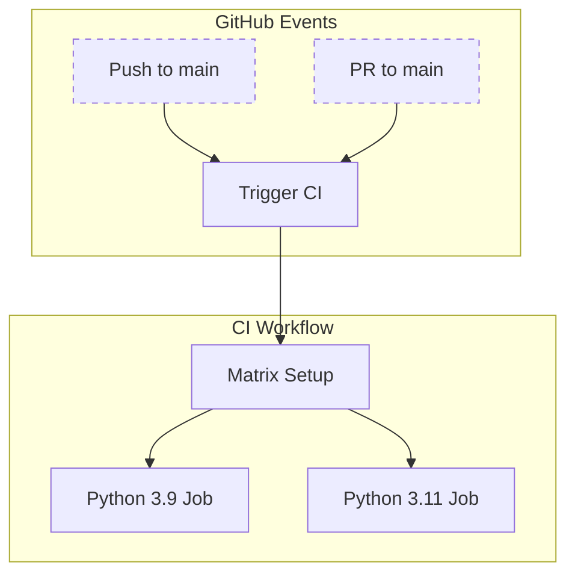
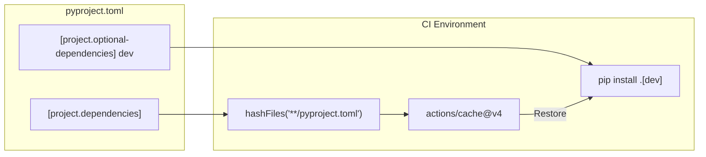

# CI/CD Pipeline

Relevant source files

The following files were used as context for generating this wiki page:

- [.github/workflows/ci.yml](.github/workflows/ci.yml)
- [pyproject.toml](pyproject.toml)
- [setup.cfg](setup.cfg)
- [setup.py](setup.py)
- [src/mdance/_version.py](src/mdance/_version.py)

The MDANCE CI/CD pipeline is designed to automate the validation of code changes through a robust testing suite. It ensures that every contribution to the repository maintains the integrity of the n-ary similarity framework and clustering algorithms across multiple Python environments.

### Pipeline Configuration and Triggers

The pipeline is implemented using GitHub Actions and is defined in the `.github/workflows/ci.yml` file. It is configured to trigger automatically under specific conditions to ensure the `main` branch remains stable.

*   **Push Triggers**: Any push to the `main` branch initiates a workflow run [[.github/workflows/ci.yml:4-5]]().
*   **Pull Request Triggers**: Any pull request targeting the `main` branch triggers the suite to validate proposed changes before they are merged [[.github/workflows/ci.yml:6-7]]().

**Workflow Trigger Logic**

Sources: [[.github/workflows/ci.yml:1-8]]()

### Matrix Strategy and Environment

The pipeline utilizes a matrix strategy to test the codebase against different Python versions. This ensures compatibility with both legacy and modern Python 3 environments.

*   **Runner OS**: The jobs execute on the latest Ubuntu runner (`ubuntu-latest`) [[.github/workflows/ci.yml:11]]().
*   **Python Versions**: The matrix currently tests Python **3.9** and **3.11** [[.github/workflows/ci.yml:15]]().
*   **Version Management**: The `actions/setup-python@v5` action is used to provision the specific Python environment for each matrix node [[.github/workflows/ci.yml:21-24]]().

Sources: [[.github/workflows/ci.yml:9-25]]()

### Dependency Management and Caching

To optimize build times, the pipeline implements a caching mechanism for `pip` packages. This prevents redundant downloads of heavy dependencies like `MDAnalysis`, `torch`, and `shapeGMMTorch`.

1.  **Cache Key Generation**: The cache key is generated by hashing the `pyproject.toml` file [[.github/workflows/ci.yml:30]](). This ensures that the cache is invalidated and refreshed whenever the project's dependencies are updated.
2.  **Restoration**: If a matching cache is found for the operating system and dependency hash, it is restored to `~/.cache/pip` [[.github/workflows/ci.yml:29-32]]().
3.  **Installation**: The project is installed in editable mode along with development dependencies using the `dev` optional dependency group defined in `pyproject.toml` [[pyproject.toml:51-54](), [.github/workflows/ci.yml:37]]().

**Dependency Flow Diagram**

Sources: [[.github/workflows/ci.yml:26-37](), [pyproject.toml:19-25](), [pyproject.toml:51-54]]()

### Test Execution

The final stage of the pipeline involves executing the unit tests. The pipeline uses `pytest` as the primary test runner.

*   **Configuration**: Pytest settings are defined in `pyproject.toml`, specifying that tests are located in the `tests` directory and setting a minimum version of 6.0 [[pyproject.toml:40-43]]().
*   **Execution**: The command `pytest` is invoked directly [[.github/workflows/ci.yml:40]](). This triggers the discovery and execution of all test modules, including those for core utilities (`test_bts.py`), clustering algorithms (`test_nani.py`, `test_helm.py`), and similarity indices (`test_esim.py`).

**CI Execution Steps**
| Step | Command | Purpose |
| :--- | :--- | :--- |
| Checkout | `actions/checkout@v4` | Pulls source code into the runner [[.github/workflows/ci.yml:18-19]]() |
| Setup | `actions/setup-python@v5` | Configures Python matrix version [[.github/workflows/ci.yml:21-24]]() |
| Cache | `actions/cache@v4` | Speeds up dependency installation [[.github/workflows/ci.yml:26-32]]() |
| Install | `pip install .[dev]` | Installs `MDANCE` and `pytest` [[.github/workflows/ci.yml:34-37]]() |
| Test | `pytest` | Runs the full test suite [[.github/workflows/ci.yml:39-40]]() |

Sources: [[.github/workflows/ci.yml:17-41](), [pyproject.toml:40-43]]()

---