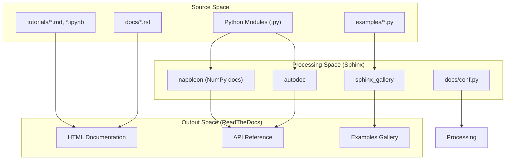
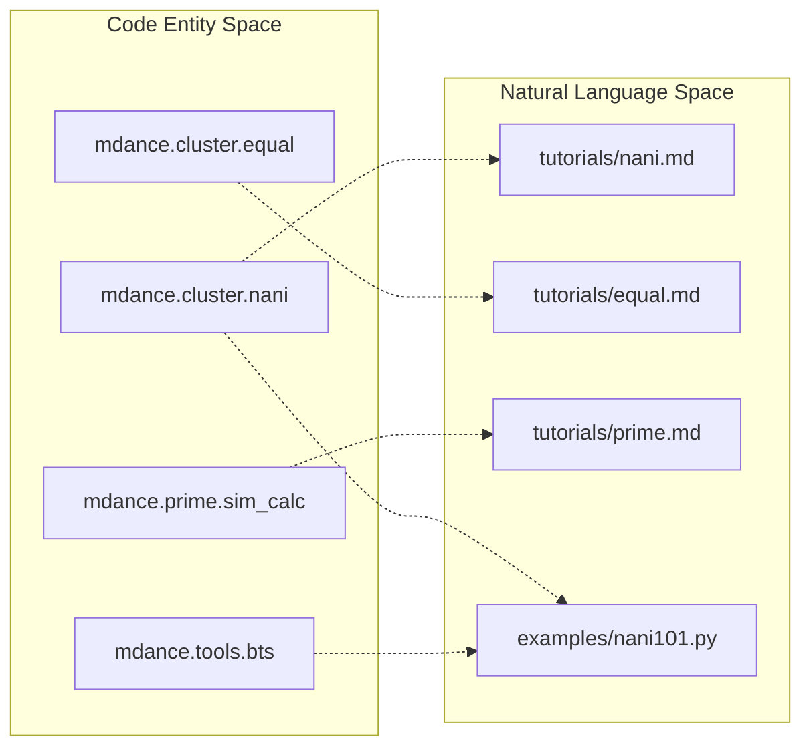

# Documentation and Examples

Relevant source files

The following files were used as context for generating this wiki page:

- [.readthedocs.yaml](.readthedocs.yaml)
- [docs/_static/custom.css](docs/_static/custom.css)
- [docs/api.rst](docs/api.rst)
- [docs/conf.py](docs/conf.py)
- [docs/index.rst](docs/index.rst)
- [docs/requirements.txt](docs/requirements.txt)

This page provides a high-level overview of the MDANCE documentation infrastructure and the available learning resources. The project utilizes a modern documentation-as-code approach, combining automated API generation with executable examples and thematic tutorials to support both users and developers.

### Documentation Architecture

The MDANCE documentation system is built using **Sphinx** and hosted on **ReadTheDocs**. It integrates source code docstrings, manual guides, and auto-generated galleries into a unified web interface.

#### System Components
*   **Sphinx Builder**: Uses `docs/conf.py` [docs/conf.py:1-187]() to orchestrate the build process.
*   **ReadTheDocs Integration**: Configured via `.readthedocs.yaml` [0:1-13](), specifying an **Ubuntu 22.04** environment with **Python 3.10** [0:4-6]().
*   **API Generation**: Uses `sphinx.ext.autodoc` and `sphinx.ext.napoleon` [docs/conf.py:42-45]() to parse **NumPy-style docstrings** from the codebase.
*   **Automated Gallery**: `sphinx-gallery` [docs/conf.py:48-55]() transforms Python scripts in the `examples/` directory into formatted HTML pages with integrated outputs and plots.

For a detailed breakdown of the build configuration and styling, see [Sphinx Documentation System](#8.1).

### Documentation Pipeline Diagram

The following diagram illustrates how various source files are processed into the final documentation site.

**MDANCE Doc Build Flow**

**Sources:** [docs/conf.py:41-55](), [.readthedocs.yaml:1-13](), [docs/index.rst:9-41]()

### Learning Resources and Examples

MDANCE provides a multi-tiered approach to learning the framework, ranging from basic API usage to complex scientific workflows.

*   **API Reference**: A comprehensive index of all classes and functions, organized by module (e.g., `mdance.cluster`, `mdance.tools`, `mdance.prime`) in `docs/api.rst` [docs/api.rst:1-163]().
*   **Examples Gallery**: Standalone Python scripts that demonstrate core tasks like preprocessing, NANI initialization, and DBI analysis [docs/index.rst:21-24]().
*   **Tutorials**: Long-form guides (Markdown and Jupyter Notebooks) covering specific scientific methodologies such as SHINE, HELM, and PRIME [docs/index.rst:30-34]().

**Documentation Entity Mapping**

**Sources:** [docs/index.rst:17-35](), [docs/api.rst:1-163]()

### Content Organization

The documentation is structured into logical sections within the main `index.rst` [docs/index.rst:9-41]():

| Section | Content Type | Key Files/Modules |
| :--- | :--- | :--- |
| **About** | High-level guides | `about.rst`, `getting_started.rst` |
| **Examples** | Executable scripts | `examples/nani101.py`, `examples/preprocessing.py` |
| **Tutorials** | Methodological guides | `tutorials/shine.ipynb`, `tutorials/helm.md` |
| **API** | Technical reference | `mdance.cluster.*`, `mdance.tools.bts` |

For more information on the specific contents of the examples and tutorials, see [Examples and Tutorials](#8.2).

**Sources:**
* [docs/index.rst:1-48]()
* [docs/api.rst:1-163]()
* [docs/conf.py:41-72]()
* [.readthedocs.yaml:1-13]()

---