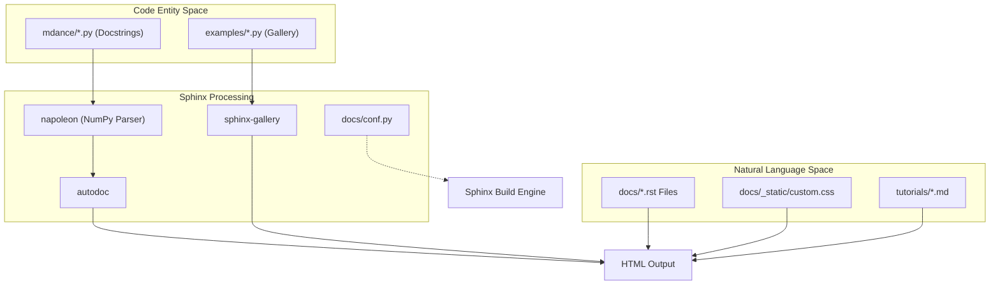
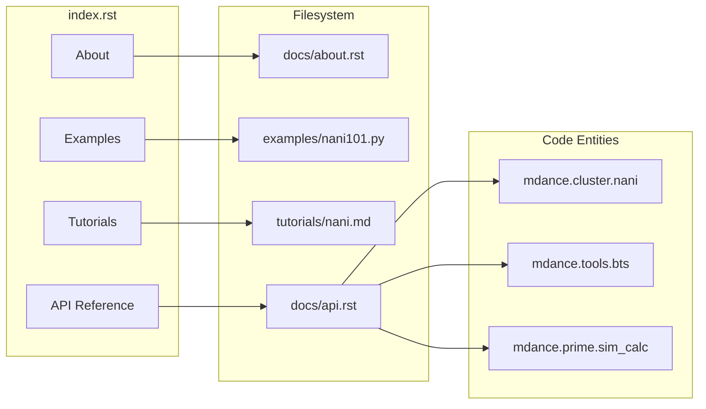

# Sphinx Documentation System

Relevant source files

The following files were used as context for generating this wiki page:

- [.readthedocs.yaml](.readthedocs.yaml)
- [docs/Makefile](docs/Makefile)
- [docs/README.md](docs/README.md)
- [docs/_static/README.md](docs/_static/README.md)
- [docs/_static/custom.css](docs/_static/custom.css)
- [docs/_static/mdance.png](docs/_static/mdance.png)
- [docs/api.rst](docs/api.rst)
- [docs/conf.py](docs/conf.py)
- [docs/img/2k2e.png](docs/img/2k2e.png)
- [docs/img/methods.jpg](docs/img/methods.jpg)
- [docs/index.rst](docs/index.rst)
- [docs/make.bat](docs/make.bat)
- [docs/requirements.txt](docs/requirements.txt)

The MDANCE documentation system is built using **Sphinx**, a Python-based tool that transforms reStructuredText (RST) and docstrings into a searchable, structured HTML site. The system integrates automated API reference generation, a gallery for visual examples, and hosting via ReadTheDocs.

## Build Configuration and Environment

The documentation is configured to build in a specific environment defined by the ReadTheDocs specification file.

### ReadTheDocs Build Specification
The `.readthedocs.yaml` file defines the build environment, ensuring consistency between local builds and the hosted version.
*   **Operating System:** Ubuntu 22.04 `[ .readthedocs.yaml:4 ]()`.
*   **Python Version:** 3.10 `[ .readthedocs.yaml:6 ]()`.
*   **Dependencies:** Installed via `docs/requirements.txt`, which includes `sphinx`, `sphinx-rtd-theme`, and `sphinx-gallery` `[ docs/requirements.txt:1-4 ]()`.

### Configuration (conf.py)
The core configuration resides in `docs/conf.py`. Key settings include:
*   **Path Injection:** The parent directory is added to `sys.path` to allow Sphinx to import the `mdance` package for `autodoc` `[ docs/conf.py:18-19 ]()`.
*   **Theme:** Uses `sphinx_rtd_theme` for the standard ReadTheDocs visual layout `[ docs/conf.py:105 ]()`.
*   **Extensions:** 
    *   `sphinx.ext.autodoc`: Pulls documentation from docstrings `[ docs/conf.py:42 ]()`.
    *   `sphinx.ext.napoleon`: Parses NumPy-style docstrings `[ docs/conf.py:45 ]()`.
    *   `sphinx.ext.mathjax`: Renders mathematical equations `[ docs/conf.py:43 ]()`.
    *   `sphinx_gallery.gen_gallery`: Automatically executes and renders scripts in `../examples` `[ docs/conf.py:48-55 ]()`.

**Sources:** `[ .readthedocs.yaml:1-13 ]()`, `[ docs/conf.py:1-187 ]()`, `[ docs/requirements.txt:1-4 ]()`.

---

## Documentation Pipeline

The documentation data flow involves extracting information from source code, combining it with manual RST files, and applying visual styles.

### Data Flow Diagram: Code to HTML
This diagram illustrates how code entities and example scripts are transformed into the final documentation.

Title: Documentation Generation Pipeline

**Sources:** `[ docs/conf.py:41-49 ]()`, `[ docs/index.rst:9-41 ]()`, `[ docs/api.rst:1-163 ]()`.

---

## API Structure (docs/api.rst)

The `docs/api.rst` file serves as the master template for the automated API reference. It uses `automodule` directives to scan the codebase and generate documentation for classes and functions.

| Section | Target Module | Purpose |
| :--- | :--- | :--- |
| **mdance.cluster** | `nani`, `equal`, `helm`, `shine` | Core clustering algorithm documentation `[ docs/api.rst:4-31 ]()`. |
| **mdance.cli** | `prime_sim`, `prime_rep` | Command-line interface tool references `[ docs/api.rst:37-51 ]()`. |
| **mdance.inputs** | `preprocess` | Trajectory loading and normalization functions `[ docs/api.rst:97-101 ]()`. |
| **mdance.tools** | `bts`, `isim`, `esim` | Mathematical utilities and similarity indices `[ docs/api.rst:141-163 ]()`. |

**Sources:** `[ docs/api.rst:1-163 ]()`.

---

## Sphinx-Gallery and Examples

The `sphinx-gallery` extension is used to convert Python scripts in the `examples/` directory into formatted HTML pages that include both the code and any generated outputs (plots, logs).

*   **Source Directory:** `../examples` `[ docs/conf.py:52 ]()`.
*   **Target Directory:** `docs/examples` `[ docs/conf.py:53 ]()`.
*   **Pattern:** It looks for files ending in `.py` `[ docs/conf.py:54 ]()`.

The main index links these generated examples into the site structure:
*   `examples/nani101` `[ docs/index.rst:21 ]()`.
*   `examples/preprocessing` `[ docs/index.rst:22 ]()`.
*   `examples/analysis_db` `[ docs/index.rst:23 ]()`.

**Sources:** `[ docs/conf.py:51-55 ]()`, `[ docs/index.rst:17-25 ]()`.

---

## Visual Overrides and Customization

While the site uses the standard ReadTheDocs theme, custom CSS is applied to refine the layout and typography.

### Custom Styling
The `setup(app)` function in `conf.py` injects `custom.css` into the build `[ docs/conf.py:186-187 ]()`.
*   **Typography:** Sets the body font to 'Lucida Grande' and size to 15px `[ docs/_static/custom.css:1-4 ]()`.
*   **Sidebar:** Fixed width of 20% with a light grey background `[ docs/_static/custom.css:6-9 ]()`.
*   **Navigation:** Dark background (`#272525`) for the search and top navigation bars `[ docs/_static/custom.css:29-31 ]()`.
*   **Code Blocks:** Literal code snippets are colored with `#aa2583` `[ docs/_static/custom.css:47-49 ]()`.

### Site Structure Mapping
This diagram maps the documentation structure to the physical files and code modules.

Title: Documentation Hierarchy and Code Mapping

**Sources:** `[ docs/index.rst:9-41 ]()`, `[ docs/api.rst:4-163 ]()`, `[ docs/conf.py:186-187 ]()`, `[ docs/_static/custom.css:1-50 ]()`.

---