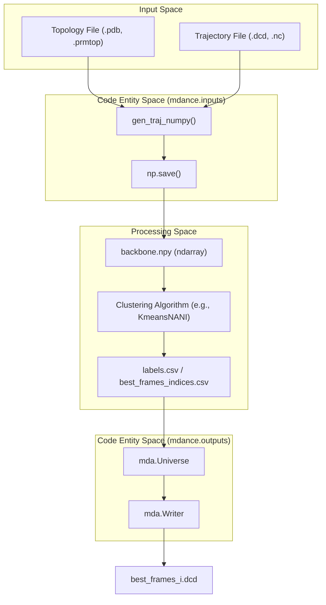
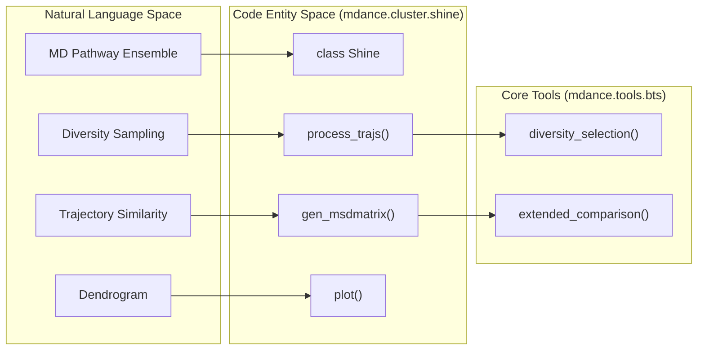

# Examples and Tutorials

Relevant source files

The following files were used as context for generating this wiki page:

- [docs/getting_started.rst](docs/getting_started.rst)
- [examples/analysis_db.py](examples/analysis_db.py)
- [examples/nani101.py](examples/nani101.py)
- [examples/postprocessing.py](examples/postprocessing.py)
- [examples/preprocessing.py](examples/preprocessing.py)
- [scripts/shine/run_shine.py](scripts/shine/run_shine.py)
- [src/mdance/cluster/shine.py](src/mdance/cluster/shine.py)
- [tutorials/HELM.md](tutorials/HELM.md)
- [tutorials/MDANCE.ipynb](tutorials/MDANCE.ipynb)
- [tutorials/SHINE.ipynb](tutorials/SHINE.ipynb)
- [tutorials/eQual.md](tutorials/eQual.md)
- [tutorials/mdBIRCH.md](tutorials/mdBIRCH.md)
- [tutorials/nani.md](tutorials/nani.md)

The MDANCE documentation includes a comprehensive suite of examples and tutorials designed to guide users from basic installation to advanced pathway analysis. These resources are organized into two primary directories: `examples/`, which contains standalone Python scripts that demonstrate core API usage, and `tutorials/`, which contains long-form Markdown guides and Jupyter Notebooks for complex workflows.

## Documentation Rendering System

MDANCE utilizes `sphinx-gallery` to transform Python scripts in the `examples/` directory into formatted HTML documentation pages. This process executes the scripts and captures their output, including generated plots and terminal logs, providing a live look at the library's performance.

**Rendering Workflow:**
1.  **Script Parsing:** Sphinx identifies Python files in the `examples/` directory.
2.  **Execution:** Each script is executed. For example, `examples/nani101.py` generates synthetic data and runs K-Means comparisons [examples/nani101.py:28-84]().
3.  **Visual Capture:** Any `matplotlib` figures (e.g., the DBI plots in `examples/analysis_db.py`) are captured and embedded into the HTML [examples/analysis_db.py:51-79]().
4.  **HTML Generation:** The docstrings and comments are converted into narrative text surrounding the code blocks and outputs.

**Sources:** [examples/nani101.py:1-93](), [examples/analysis_db.py:1-83]().

---

## Examples Directory

The `examples/` directory provides focused demonstrations of specific pipeline stages.

### Preprocessing and Data Flow
The `examples/preprocessing.py` script illustrates the conversion of raw Molecular Dynamics (MD) trajectories into the internal MDANCE format. It utilizes `MDAnalysis` via the `gen_traj_numpy` function to create a NumPy array of shape `(n_frames, n_atoms * 3)` [examples/preprocessing.py:18-34]().

**Data Flow: Preprocessing to Postprocessing**
The following diagram tracks the transformation of data from raw files to clustering and back to structural output.

**Title: MDANCE Data Lifecycle**

**Sources:** [examples/preprocessing.py:21-41](), [examples/postprocessing.py:16-54]().

### Analysis and Scoring
The `examples/analysis_db.py` script provides the logic for determining the optimal number of clusters using the Davies-Bouldin Index (DBI). It implements a second-derivative analysis to find "elbow" points in the screening data [examples/analysis_db.py:58-76]().

---

## Tutorials Directory

The `tutorials/` directory contains step-by-step guides for the major clustering families.

### NANI: N-ary Natural Initiation
The NANI tutorial covers the deterministic initialization of K-Means. It follows a four-step workflow:
1.  **Input Preparation:** Using `gen_traj_numpy` or `normalize.py` [tutorials/nani.md:17-43]().
2.  **Screening:** Running `screen_nani.py` across a range of `n_clusters` [tutorials/nani.md:45-78]().
3.  **Analysis:** Evaluating DBI scores in `analysis_db.ipynb` [tutorials/nani.md:79-82]().
4.  **Assignment:** Final label generation with `assign_labels.py` [tutorials/nani.md:84-121]().

### SHINE: Pathway Clustering
The `SHINE` algorithm (Sampling Hierarchical Intrinsic N-ary Ensembles) is specialized for analyzing ensembles of MD pathways [tutorials/SHINE.ipynb:14-15](). It leverages the `Shine` class to calculate distances between trajectories using various merge schemes like `intra`, `inter`, or `haus` (Hausdorff) [src/mdance/cluster/shine.py:49-52]().

**SHINE System Association**
This diagram bridges the conceptual pathway analysis with the internal class implementation.

**Title: SHINE Pathway Analysis Architecture**

**Sources:** [src/mdance/cluster/shine.py:17-147](), [scripts/shine/run_shine.py:9-38]().

### mdBIRCH: Online Clustering
The `mdBIRCH.md` tutorial describes an online, single-pass clustering algorithm that builds a Clustering Feature (CF) tree [tutorials/mdBIRCH.md:14-15](). It is particularly effective for large datasets where memory efficiency is required. The clustering granularity is controlled by a `threshold` parameter representing a radius-based merge criterion [tutorials/mdBIRCH.md:18-19]().

### Algorithm Summary Table
| Tutorial | Primary Class/Script | Key Parameters | Output |
| :--- | :--- | :--- | :--- |
| **NANI** | `KmeansNANI` | `init_type`, `n_clusters` | DBI Scores, Cluster Labels |
| **eQual** | `ExtendedQuality` | `threshold`, `min_samples` | Density-based clusters |
| **mdBIRCH**| `mdBirch` | `threshold`, `sieve` | CF-tree, online labels |
| **SHINE** | `Shine` | `merge_scheme`, `sampling` | Pathway Dendrogram |

**Sources:** [tutorials/nani.md:46-69](), [tutorials/eQual.md:57-90](), [tutorials/mdBIRCH.md:56-64](), [src/mdance/cluster/shine.py:25-60]().

---