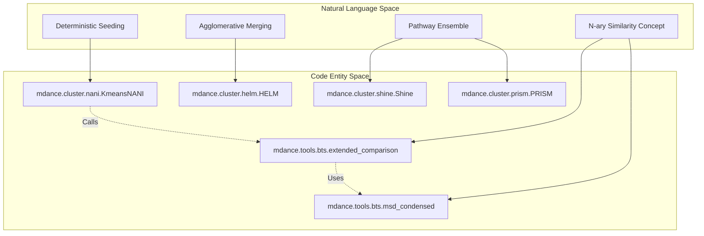
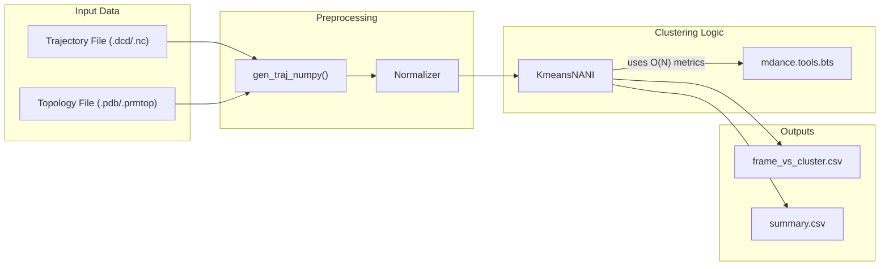

# Glossary

Relevant source files

The following files were used as context for generating this wiki page:

- [README.md](README.md)
- [docs/tutorials/equal.rst](docs/tutorials/equal.rst)
- [docs/tutorials/helm.rst](docs/tutorials/helm.rst)
- [docs/tutorials/nani.rst](docs/tutorials/nani.rst)
- [scripts/mdbirch/mdbirch_labels_3.06.csv](scripts/mdbirch/mdbirch_labels_3.06.csv)
- [scripts/mdbirch/run_mdbirch.py](scripts/mdbirch/run_mdbirch.py)
- [scripts/prism/run_prism.py](scripts/prism/run_prism.py)
- [scripts/shine/run_shine.py](scripts/shine/run_shine.py)
- [src/mdance/cluster/equal.py](src/mdance/cluster/equal.py)
- [src/mdance/cluster/helm.py](src/mdance/cluster/helm.py)
- [src/mdance/cluster/mdbirch.py](src/mdance/cluster/mdbirch.py)
- [src/mdance/cluster/nani.py](src/mdance/cluster/nani.py)
- [src/mdance/cluster/prism.py](src/mdance/cluster/prism.py)
- [src/mdance/cluster/shine.py](src/mdance/cluster/shine.py)
- [src/mdance/prime/sim_calc.py](src/mdance/prime/sim_calc.py)
- [src/mdance/tools/bts.py](src/mdance/tools/bts.py)
- [src/mdance/tools/esim.py](src/mdance/tools/esim.py)
- [tests/test_mdbirch.py](tests/test_mdbirch.py)
- [tests/test_prism.py](tests/test_prism.py)
- [tutorials/SHINE.ipynb](tutorials/SHINE.ipynb)
- [tutorials/prime.md](tutorials/prime.md)

This page provides technical definitions for terms, algorithms, and mathematical concepts used in the MDANCE (Molecular Dynamics Analysis with N-ary Clustering Ensembles) codebase.

## Core Framework Concepts

### N-ary Similarity
Unlike traditional pairwise comparisons that scale at $O(N^2)$, MDANCE utilizes **n-ary similarity** which compares $n$ objects simultaneously. This framework allows for $O(N)$ linear scaling by calculating column-wise sums and squared sums of features across the entire dataset or cluster [src/mdance/tools/bts.py:14-51]().

### Condensed Data Representation
A computational optimization where a dataset of $N$ objects is represented by two vectors:
1.  **c_sum**: The column-wise sum of the feature matrix [src/mdance/tools/bts.py:47]().
2.  **sq_sum**: The column-wise sum of the squared feature matrix [src/mdance/tools/bts.py:48]().

These vectors allow for the calculation of Mean Square Deviation (MSD) and other similarity indices without re-traversing the raw data [src/mdance/tools/bts.py:54-93]().

### Complementary Similarity (`comp_sim`)
A measure of how much a single object $i$ contributes to the overall diversity of a set. It is calculated by comparing the similarity of the set including object $i$ versus the set excluding it. In MDANCE, this is used to identify high-density regions (low complementary similarity) or outliers [src/mdance/tools/bts.py:190-208]().

---

## Algorithm Acronyms

| Acronym | Full Name | Definition | Code Pointer |
| :--- | :--- | :--- | :--- |
| **NANI** | N-Ary Natural Initialization | A deterministic seeding method for *k*-means that uses n-ary density estimation to pick initial centroids. | [src/mdance/cluster/nani.py:8-9]() |
| **HELM** | Hierarchical Extended Linkage Method | A hierarchical agglomerative clustering (HAC) algorithm that merges clusters using n-ary similarity instead of a distance matrix. | [src/mdance/cluster/helm.py]() |
| **DIVINE** | Divisive Hierarchical Clustering | A top-down hierarchical clustering algorithm that recursively splits clusters based on n-ary variance. | [src/mdance/cluster/divine.py]() |
| **SHINE** | Sampling Hierarchical Intrinsic N-ary Ensembles | A pathway clustering algorithm designed for enhanced sampling MD trajectories. | [src/mdance/cluster/shine.py:17-64]() |
| **PRISM** | Pathway Representation via Intrinsic Structural Medoids | A framework that summarizes pathways into "medoid sets" before performing hierarchical clustering. | [src/mdance/cluster/prism.py:12-98]() |
| **PRIME** | Protein Retrieval via Integrative Molecular Ensembles | A post-processing suite for predicting native structures from simulation ensembles. | [src/mdance/prime/sim_calc.py:10-53]() |
| **eQual** | Extended Quality Clustering | An $O(N)$ implementation of Radial Threshold Clustering using extended similarity indices. | [src/mdance/cluster/equal.py]() |

---

## Mathematical & Domain Terms

### Mean Square Deviation (MSD)
The primary metric for structural similarity in MDANCE. The n-ary version is implemented to scale linearly:
$$\text{MSD} = \frac{\sum 2(N \cdot \text{sq\_sum} - \text{c\_sum}^2)}{N^2}$$
[src/mdance/tools/bts.py:49-50]()

### Extended Similarity Indices
Generalizations of binary similarity coefficients (like Jaccard or Tanimoto) for $n$ objects.
*   **RR (Russel-Rao)**: Measures the ratio of common "on" bits across all objects to the total bits [src/mdance/tools/esim.py]().
*   **SM (Sokal-Michener)**: Measures the ratio of bits where all objects agree (all "on" or all "off") to the total bits [src/mdance/tools/esim.py]().

### Medoid
The representative object of a cluster that has the highest similarity (or lowest average distance) to all other members in that cluster. MDANCE provides $O(N)$ methods to calculate medoids using the condensed representation [src/mdance/tools/bts.py:228-265]().

---

## Code Logic Diagrams

### From Scientific Concepts to Code Entities
The following diagram maps the mathematical requirements of n-ary clustering to the specific classes and functions in the `mdance.tools` and `mdance.cluster` packages.

**Conceptual Mapping Diagram**

Sources: [src/mdance/tools/bts.py:96-188](), [src/mdance/cluster/nani.py:8-50](), [src/mdance/cluster/shine.py:17-64](), [src/mdance/cluster/prism.py:12-98]()

### Data Flow: Trajectory to Clustering Result
This diagram illustrates the transformation of raw MD data into cluster labels using the internal pipeline.

**Data Flow Diagram**

Sources: [src/mdance/inputs/preprocess.py](), [src/mdance/cluster/nani.py:97-149](), [scripts/nani/assign_labels.py:240-250]()

---

## File Formats

*   **`.npy`**: NumPy binary files used for intermediate storage of trajectory coordinates after preprocessing [docs/tutorials/nani.rst:52-60]().
*   **`.pkl`**: Python pickle files used to store hierarchical tree structures for HELM and SHINE [docs/tutorials/helm.rst:166-168]().
*   **`frame_vs_cluster.csv`**: A two-column CSV mapping each trajectory frame index to its assigned cluster ID [docs/tutorials/helm.rst:105-114]().
*   **`summary.csv`**: A file containing cluster populations and quality scores (DBI, CH) for a specific clustering run [scripts/nani/screen_nani.py:162-167]().

Sources: [docs/tutorials/nani.rst:109-168](), [docs/tutorials/helm.rst:101-114](), [src/mdance/prime/sim_calc.py:54-66]()