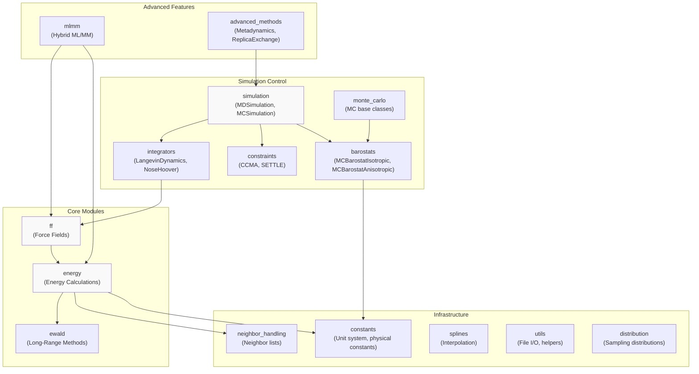
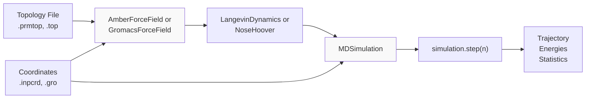
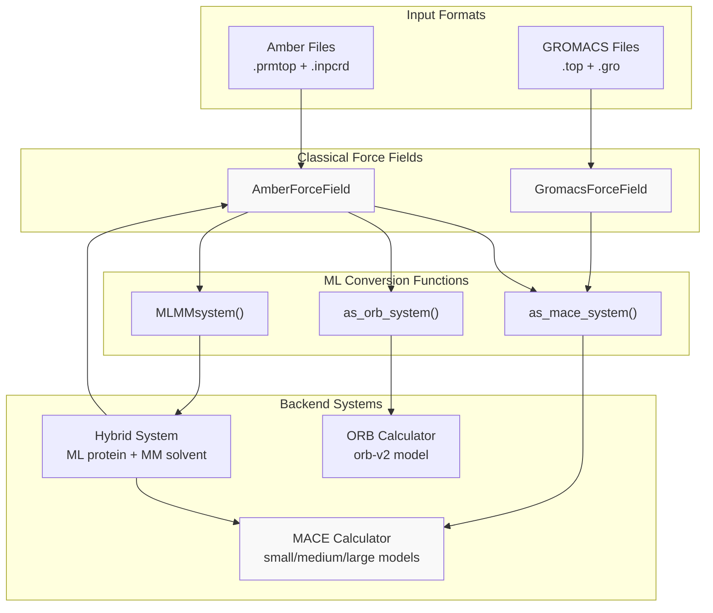

# Overview

<details>
<summary>Relevant source files</summary>

The following files were used as context for generating this wiki page:

- [README.md](README.md)
- [dimos-logo.svg](dimos-logo.svg)
- [dimos/__init__.py](dimos/__init__.py)

</details>


This document provides a comprehensive introduction to the DIMOS (Differentiable Molecular Simulator) framework, covering its architecture, key capabilities, and design philosophy. For practical installation instructions, see [Installation and Setup](#1.1). For a hands-on tutorial, see [Quick Start Tutorial](#1.2). For licensing information, see [License and Academic Use Terms](#1.3).

---

## Purpose and Scope

DIMOS is a PyTorch-based molecular simulation framework that enables molecular dynamics (MD) and Monte Carlo (MC) simulations with end-to-end differentiability. The framework bridges classical molecular mechanics and modern machine learning workflows, supporting classical force fields, machine learning interatomic potentials (MLIPs), and hybrid ML/MM approaches.

This overview covers:
- The core mission and distinguishing features of DIMOS
- High-level system architecture and module organization
- Integration points between major subsystems
- Basic usage patterns and code entry points

For detailed information on specific subsystems, refer to:
- Force field implementations: [Force Field Systems](#4)
- Integration algorithms: [Integration Methods](#3.2)
- Enhanced sampling: [Advanced Sampling Methods](#5)
- Performance evaluation: [Benchmarking Suite](#6)

**Sources:** [README.md:1-55](), [dimos/__init__.py:1-389]()

---

## What is DIMOS?

DIMOS is designed to address three key challenges in computational chemistry and materials science:

1. **Differentiability**: Built on PyTorch, DIMOS provides automatic differentiation through the entire simulation stack, enabling gradient-based optimization and seamless ML integration
2. **Modularity**: Clean separation between force field calculations, integration schemes, constraints, and thermostats allows components to be swapped and extended independently
3. **Performance**: Leverages `torch.compile` for JIT optimization and supports both CPU and CUDA execution with mixed-precision capabilities

The framework is particularly suited for:
- Training and validating machine learning potentials
- Hybrid quantum mechanics/molecular mechanics (QM/MM) simulations
- Benchmarking different simulation engines and force field approaches
- Research workflows requiring custom force field modifications

**Sources:** [README.md:5-11](), Diagram 1 from high-level architecture

---

## Key Features

| Feature Category | Capabilities |
|-----------------|--------------|
| **Force Fields** | Classical MM (Amber, GROMACS), ML potentials (MACE, ORB), Hybrid ML/MM |
| **Integration** | Langevin dynamics, Nose-Hoover thermostat, Verlet-based schemes |
| **Constraints** | CCMA (general constraints), SETTLE (rigid water) |
| **Ensembles** | NVE, NVT, NPT with MC barostats (isotropic/anisotropic) |
| **Long-Range Electrostatics** | Ewald summation, Particle Mesh Ewald (PME), Reaction Field Approximation |
| **Enhanced Sampling** | Metadynamics, Replica Exchange/Parallel Tempering (experimental) |
| **Unit Systems** | Amber (kcal/mol), GROMACS/OpenMM (kJ/mol), Reduced units |
| **Precision** | float32/float64, independent force field and integration precision |
| **Optimization** | `torch.compile` support for simulation loop and ML calculators |

**Sources:** [README.md:5-11](), Diagrams 1-2 from high-level architecture, [dimos/__init__.py:374-389]()

---

## System Architecture

### High-Level Module Organization



**Description:** DIMOS organizes functionality into distinct modules imported through the top-level `dimos` package. The `simulation` module coordinates execution, while `ff` and `energy` handle force calculations. Infrastructure modules provide supporting functionality for unit conversion, neighbor list management, and numerical utilities.

**Sources:** [dimos/__init__.py:374-389](), Diagram 5 from high-level architecture

---

## Core Components

### Primary Classes and Their Roles

| Module | Key Classes | Purpose |
|--------|-------------|---------|
| `dimos.ff` | `AmberForceField`, `GromacsForceField` | Load and manage classical force field parameters from topology files |
| `dimos.simulation` | `MDSimulation`, `MCSimulation` | Orchestrate simulation execution, trajectory storage, statistics |
| `dimos.integrators` | `LangevinDynamics`, `NoseHoover` | Propagate system state forward in time with thermostats |
| `dimos.constraints` | `CCMA`, `SETTLE` | Enforce bond length and angle constraints |
| `dimos.barostats` | `MCBarostatIsotropic`, `MCBarostatAnisotropic` | Control pressure through volume moves in NPT ensemble |
| `dimos.energy` | Bonded/nonbonded energy functions | Calculate potential energy and forces |
| `dimos.ewald` | `EwaldSum`, `PME` | Handle long-range electrostatics |
| `dimos.mlmm` | `as_mace_system`, `as_orb_system`, `MLMMsystem` | Convert to ML potentials or create hybrid ML/MM systems |
| `dimos.neighbor_handling` | `NeighborList` | Efficient pairwise interaction calculation |
| `dimos.constants` | Physical constants, unit conversions | Ensure consistent units across calculations |

**Sources:** [dimos/__init__.py:374-389](), Diagram 1 from high-level architecture

---

## Simulation Workflow

### Typical MD Simulation Pipeline



**Description:** The typical workflow involves: (1) loading a force field from topology files using `AmberForceField` or `GromacsForceField`, (2) creating an integrator with desired thermostat settings, (3) initializing `MDSimulation` with the system, integrator, and initial positions, and (4) running simulation steps.

**Sources:** [README.md:46-54](), Diagram 5 from high-level architecture

---

## Basic Usage Pattern

The following example demonstrates the minimal code required to run a simulation:

```python
import dimos

# Load force field from Amber topology
system = dimos.AmberForceField("config.prmtop")

# Create Langevin integrator (timestep, temperature, friction, system)
integrator = dimos.LangevinDynamics(dt, T, gamma, system)

# Initialize MD simulation
simulation = dimos.MDSimulation(system, integrator, positions, T)

# Run simulation
simulation.step(num_steps)
```

For GROMACS-format files, replace `AmberForceField` with `GromacsForceField`:

```python
system = dimos.GromacsForceField("system.top", "system.gro")
```

For ML potentials, convert the system after initialization:

```python
system = dimos.AmberForceField("config.prmtop")
system = dimos.as_mace_system(system, model="small", compile=True)
```

**Sources:** [README.md:46-54](), Diagram 2 from high-level architecture

---

## Force Field Architecture

### Classical and ML Force Field Integration



**Description:** DIMOS provides conversion functions that transform classical force field objects into ML-based calculators. The `as_mace_system` and `as_orb_system` functions wrap the entire system with ML potentials, while `MLMMsystem` creates hybrid configurations where ML handles protein atoms and classical MM handles solvent.

**Sources:** [dimos/__init__.py:381](), Diagram 2 from high-level architecture, [dimos/ff.py]() (inferred), [dimos/mlmm.py]() (inferred)

---

## Unit System Management

DIMOS supports three unit systems, configured through the `constants` module:

| Unit System | Energy Units | Usage |
|-------------|--------------|-------|
| `"amber"` or `"kcal/mol"` | kcal/mol | Amber force fields, default for AmberForceField |
| `"gromacs"`, `"openmm"`, or `"kJ/mol"` | kJ/mol | GROMACS force fields, OpenMM compatibility |
| `"lj"`, `"none"`, or `"unitless"` | Reduced units | Lennard-Jones systems, dimensionless simulations |

The unit system is typically set automatically when loading a force field, but can be configured explicitly:

```python
import dimos.constants as const
const.init_constants_in_unit_system("amber")
```

All physical constants (`BOLTZMANN`, `ONE_BY_4_PI_EPSILON_0`, etc.) and conversion factors are adjusted accordingly. For details, see [Unit Systems and Physical Constants](#2.3).

**Sources:** [dimos/constants.py]() (inferred from Diagram 6), Diagram 6 from high-level architecture

---

## Compilation and Performance

DIMOS leverages PyTorch's `torch.compile` for JIT optimization:

```python
# Enable compilation for the entire simulation loop
simulation = dimos.MDSimulation(system, integrator, positions, T)
simulation.step = torch.compile(simulation.step)

# Or enable during ML system creation
system = dimos.as_mace_system(system, model="small", compile=True)
```

Compilation provides significant speedups (typically 2-5x) but incurs initial overhead. It is most beneficial for:
- Long production runs (>10,000 steps)
- Small to medium systems where Python overhead is significant
- ML potentials where kernel fusion provides additional benefits

For benchmarking and performance considerations, see [Platform Comparison and Performance](#6.3).

**Sources:** Diagram 2 from high-level architecture, [README.md:33-38]()

---

## Design Philosophy

### Modularity and Composability

DIMOS follows a modular design where components can be independently replaced:

- **Force Fields**: Swap between Amber, GROMACS, MACE, ORB, or custom implementations
- **Integrators**: Choose Langevin, Nose-Hoover, or implement custom schemes
- **Constraints**: Apply CCMA, SETTLE, or no constraints
- **Barostats**: Add isotropic or anisotropic pressure control as needed

This composability enables rapid prototyping and systematic comparison of methods.

### Differentiability First

All calculations maintain gradient flow through PyTorch's autograd system. This enables:
- Training ML potentials end-to-end with MD trajectories
- Gradient-based parameter optimization
- Analysis of sensitivity to initial conditions or parameters

### Validation Through Benchmarking

DIMOS includes extensive benchmarks comparing against OpenMM and TorchMD (see [Benchmarking Suite](#6)). This ensures correctness while demonstrating performance characteristics across different system sizes and configurations.

**Sources:** [README.md:5-11](), Diagram 1 from high-level architecture

---

## Academic Use and Citation

DIMOS is provided under the NEC Software Library Academic Use License, which permits use by accredited educational and research institutions for non-commercial purposes. Commercial use requires a separate license agreement.

When using DIMOS in academic work, please cite:

> H. Christiansen, T. Maruyama, F. Errica, V. Zaverkin, M. Takamoto, and F. Alesiani, Fast, Modular, and Differentiable Framework for Machine Learning-Enhanced Molecular Simulations, J. Chem. Phys. 163, 182501 (2025).

For complete license terms, see [License and Academic Use Terms](#1.3).

**Sources:** [README.md:9-23](), [dimos/__init__.py:1-371]()

---

## Next Steps

- **New Users**: Proceed to [Installation and Setup](#1.1) to install DIMOS, then work through the [Quick Start Tutorial](#1.2)
- **Force Field Setup**: Learn about classical force fields in [Classical Force Fields](#4.1) or ML potentials in [Machine Learning Potentials](#4.2)
- **Advanced Features**: Explore [Metadynamics](#5.1) or [Replica Exchange](#5.2) for enhanced sampling
- **Developers**: Review [Project Structure and Architecture](#8.1) for information on extending DIMOS

**Sources:** Table of contents in JSON format

---