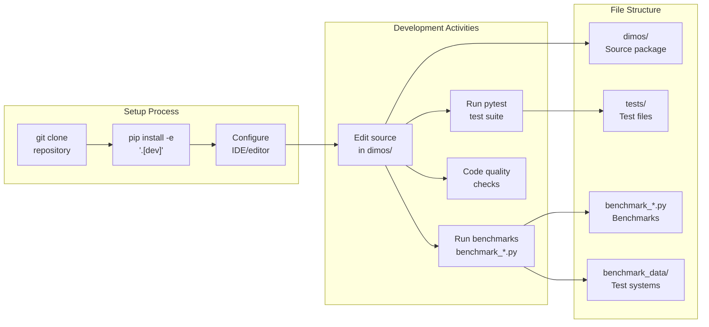

# Installation and Setup

<details>
<summary>Relevant source files</summary>

The following files were used as context for generating this wiki page:

- [.gitignore](.gitignore)
- [README.md](README.md)

</details>


## Purpose and Scope

This document covers the installation of DIMOS on your system, including both production and development installations. It describes core and optional dependencies, installation methods via pip or from source, and setup of a development environment for contributing to DIMOS or creating derivative works. For information about using DIMOS to run your first simulation, see [Quick Start Tutorial](#1.2). For license and attribution requirements when creating derivative works, see [License and Academic Use Terms](#1.3) and [Creating Derivative Works](#8.3).

**Sources:** [README.md:26-54]()

---

## Installation Methods

DIMOS can be installed through two primary methods depending on your use case: standard pip installation for production use, or installation from source for development or customization.

### Standard Installation (pip)

For standard usage of DIMOS in your molecular simulation workflows, install via pip:

```bash
pip install dimos-torch
```

This installs the core DIMOS package with all required dependencies. The package name on PyPI is `dimos-torch` to avoid naming conflicts with other packages.

**Sources:** [README.md:28-31]()

### Installation from Source

For development, contributing to DIMOS, or using unreleased features, clone the repository and install locally:

```bash
git clone https://github.com/nec-research/dimos.git
cd dimos
python -m pip install -e .
```

The `-e` flag installs the package in editable mode, allowing you to modify the source code and immediately see the effects without reinstalling.

**Sources:** [README.md:33-39]()

---

## Dependency Architecture

```mermaid
graph TD
    subgraph "Core Dependencies"
        PYTORCH["PyTorch<br/>Deep learning framework"]
        NUMPY["NumPy<br/>Numerical operations"]
        SCIPY["SciPy (implied)<br/>Scientific computing"]
    end
    
    subgraph "Optional: ML Potentials"
        MACE["MACE<br/>Machine learning potential"]
        ORB["ORB<br/>ML interatomic potential"]
        ASE["ASE<br/>Atomic Simulation Environment"]
    end
    
    subgraph "Optional: MM Tools"
        PARMED["ParmEd<br/>Amber topology parsing"]
        MDTRAJ["MDTraj<br/>Trajectory analysis"]
        OPENMM["OpenMM (comparison)<br/>Reference MD engine"]
    end
    
    subgraph "Optional: Development"
        PYTEST["pytest<br/>Testing framework"]
        TORCHMD["TorchMD<br/>Benchmark comparison"]
        NETWORKX["NetworkX<br/>Graph operations"]
        PANDAS["pandas<br/>Data analysis"]
        TQDM["tqdm<br/>Progress bars"]
        PYYAML["PyYAML<br/>Configuration files"]
    end
    
    DIMOS["DIMOS Package"]
    
    PYTORCH --> DIMOS
    NUMPY --> DIMOS
    SCIPY --> DIMOS
    
    MACE -.->|"[mace] extra"| DIMOS
    ORB -.->|"[orb] extra"| DIMOS
    ASE -.->|used with ML| DIMOS
    
    PARMED -.->|"[mmtools] extra"| DIMOS
    MDTRAJ -.->|"[mmtools] extra"| DIMOS
    OPENMM -.->|benchmarking| DIMOS
    
    PYTEST -.->|"[dev] extra"| DIMOS
    TORCHMD -.->|test cases| DIMOS
    NETWORKX -.->|with TorchMD| DIMOS
    PANDAS -.->|with TorchMD| DIMOS
    TQDM -.->|with TorchMD| DIMOS
    PYYAML -.->|with TorchMD| DIMOS
```



**Diagram: DIMOS Dependency Structure**

DIMOS is built on PyTorch as its core computational backend, with optional dependency groups for different use cases. The modular dependency structure allows users to install only what they need.

**Sources:** [README.md:33-44]()

---

## Dependency Groups and Extras

DIMOS organizes optional dependencies into extras that can be installed selectively. The following table describes each extra group:

| Extra Group | Command Flag | Purpose | Key Packages |
|-------------|--------------|---------|--------------|
| **Core** | (none) | Required dependencies for basic functionality | PyTorch, NumPy |
| **mace** | `[mace]` | MACE machine learning potential integration | mace-torch |
| **orb** | `[orb]` | ORB v2 machine learning potential integration | orb-models |
| **mmtools** | `[mmtools]` | Molecular mechanics file format support | ParmEd, MDTraj |
| **dev** | `[dev]` | Development and testing tools | pytest, black, flake8 |

To install multiple extras simultaneously, combine them in the installation command:

```bash
python -m pip install -e '.[dev,mmtools,mace,orb]'
```

This installs DIMOS with development tools, MM format support, and both ML potential backends.

**Sources:** [README.md:37-39]()

---

## Specialized Dependency: TorchMD for Benchmarking

For running benchmark comparisons against TorchMD (see [Platform Comparison and Performance](#6.3)), TorchMD must be installed separately. To avoid installing the proprietary `moleculekit` dependency, use:

```bash
pip install torchmd scipy networkx pandas tqdm pyyaml --no-deps
```

The `--no-deps` flag prevents pip from automatically installing `moleculekit`, which may not be accessible in all environments. Note that this installation method requires that compatible versions of `scipy`, `networkx`, `pandas`, `tqdm`, and `pyyaml` are already available or will be installed explicitly.

**Sources:** [README.md:41-44]()

---

## Installation Verification

After installation, verify that DIMOS is correctly installed and can import its core modules:

```python
import dimos
import torch

# Check DIMOS is importable
print(f"DIMOS version: {dimos.__version__ if hasattr(dimos, '__version__') else 'unknown'}")

# Verify PyTorch backend
print(f"PyTorch version: {torch.__version__}")
print(f"CUDA available: {torch.cuda.is_available()}")
```

For a more comprehensive check, verify that key submodules can be imported:

```python
from dimos import AmberForceField, LangevinDynamics, MDSimulation
from dimos.constraints import CCMA, SETTLE
from dimos.barostats import MCBarostat
from dimos.integrators import NoseHooverDynamics

print("Core modules successfully imported")
```

If using ML potentials, verify their availability:

```python
# Check MACE availability
try:
    from dimos.utils import as_mace_system
    print("MACE integration available")
except ImportError:
    print("MACE not installed (install with [mace] extra)")

# Check ORB availability  
try:
    from dimos.utils import as_orb_system
    print("ORB integration available")
except ImportError:
    print("ORB not installed (install with [orb] extra)")
```

**Sources:** [README.md:48-54]()

---

## Development Environment Setup



**Diagram: Development Workflow**

**Sources:** [README.md:33-39](), [.gitignore:1-181]()

### Cloning the Repository

Clone the DIMOS repository from GitHub:

```bash
git clone https://github.com/nec-research/dimos.git
cd dimos
```

The repository structure includes:
- `dimos/` - Main package source code
- `tests/` - Test suite (if present)
- `benchmark_*.py` - Benchmarking scripts for various systems
- `benchmark_data/` - Test system topologies and coordinates

**Sources:** [README.md:35]()

### Installing in Editable Mode

Install DIMOS in editable/development mode with all optional dependencies:

```bash
python -m pip install -e '.[dev,mmtools,mace,orb]'
```

This command:
- Installs DIMOS so that Python imports reference the local source directory
- Includes development tools (`[dev]`)
- Includes molecular mechanics tools (`[mmtools]`)
- Includes ML potential support (`[mace]`, `[orb]`)

Changes to source files in `dimos/` are immediately reflected when importing the package without needing to reinstall.

**Sources:** [README.md:37-39]()

### IDE and Editor Configuration

The repository includes configuration files for common development environments, as indicated in [.gitignore:130-141]():

- **VS Code:** `.vscode/` directory (settings, tasks, launch configs)
- **JetBrains IDEs:** `.idea/` directory
- **Vim:** `*.sw?` swap files

The `.gitignore` file excludes most IDE-specific files except essential VS Code configurations, allowing developers to customize their environment while maintaining consistency for debugging configurations.

**Sources:** [.gitignore:130-141]()

---

## Running Tests

If the repository includes a test suite (typically under a `tests/` directory), run tests using pytest:

```bash
pytest
```

For verbose output:

```bash
pytest -v
```

To run specific test files or test functions:

```bash
pytest tests/test_energy.py
pytest tests/test_energy.py::test_harmonic_bond
```

**Sources:** [.gitignore:40-52]() (test-related ignores), [README.md:38]() (dev extras)

---

## Environment and Configuration Files

The following files and directories are excluded from version control as indicated in `.gitignore` but may be relevant for local development:

| Pattern | Purpose |
|---------|---------|
| `.env`, `.autoenv` | Environment variables for local configuration |
| `configs/local/default.yaml` | Local configuration overrides |
| `logs/`, `wandb/` | Training/simulation logs and experiment tracking |
| `data/` | Local data files |
| `*.pt`, `*.pkl` | Model checkpoints and serialized objects |
| `*.pdb`, `*.dat` | Generated trajectory and output files |

These directories and files are created during development, testing, or simulation runs but should not be committed to version control.

**Sources:** [.gitignore:142-180]()

---

## System Requirements

DIMOS requires:

- **Python:** Version 3.8 or higher (implied by PyTorch compatibility)
- **Operating System:** Linux, macOS, or Windows (via WSL recommended for Windows)
- **Hardware:** 
  - CPU: Any modern multi-core processor
  - GPU: NVIDIA GPU with CUDA support recommended for performance (optional)
  - Memory: Minimum 8 GB RAM; 16+ GB recommended for larger systems

For GPU acceleration, ensure appropriate CUDA-compatible PyTorch is installed. See PyTorch installation guide for CUDA version compatibility.

**Sources:** [README.md:28-31]()

---

## Troubleshooting Common Installation Issues

### PyTorch Installation

If PyTorch is not automatically installed or you need a specific CUDA version:

```bash
# Install PyTorch with CUDA 11.8
pip install torch --index-url https://download.pytorch.org/whl/cu118

# Or CPU-only version
pip install torch --index-url https://download.pytorch.org/whl/cpu
```

### Import Errors for Optional Modules

If you encounter `ImportError` when trying to use ML potentials or MM tools:

1. Verify the extra is installed: `pip list | grep mace` or `pip list | grep ParmEd`
2. Reinstall with the appropriate extra: `pip install -e '.[mace]'` or `pip install -e '.[mmtools]'`

### TorchMD Installation Conflicts

If `moleculekit` installation fails when installing TorchMD:

```bash
# Use --no-deps as shown in the README
pip install torchmd scipy networkx pandas tqdm pyyaml --no-deps

# Ensure these dependencies are available
pip install scipy networkx pandas tqdm pyyaml
```

**Sources:** [README.md:41-44]()

---

## Next Steps

After successful installation:

1. **Quick Start:** Follow the [Quick Start Tutorial](#1.2) to run your first simulation
2. **License Review:** Review the [License and Academic Use Terms](#1.3) to understand usage restrictions
3. **Core Concepts:** Read about [Force Fields Overview](#2.2) and [Unit Systems](#2.3)
4. **Benchmarking:** Explore the [Benchmarking Suite](#6) to validate your installation

**Sources:** [README.md:46-54]()

---