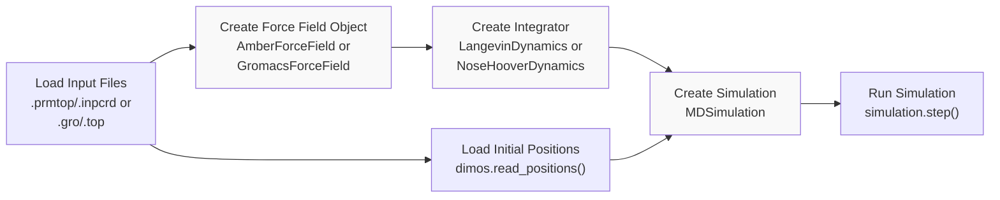
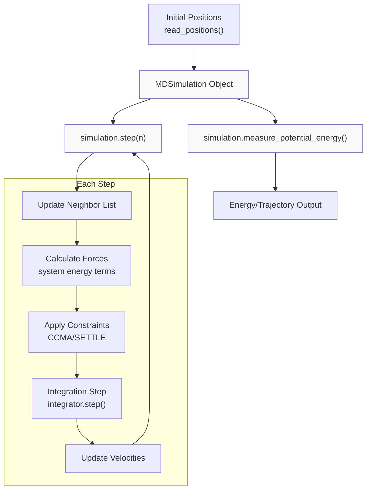
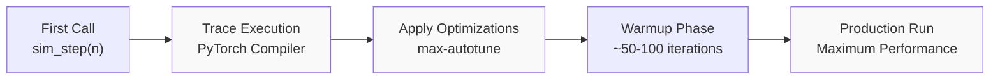
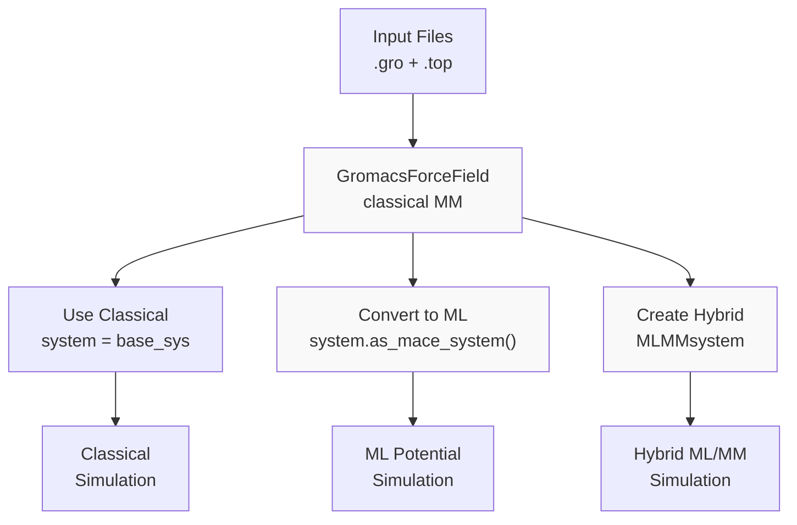
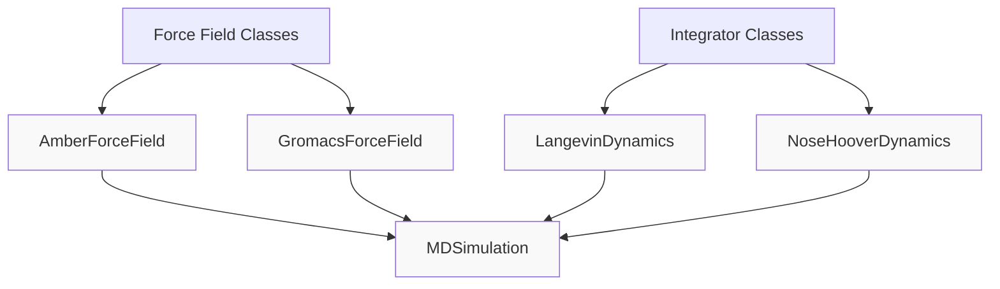

# Quick Start Tutorial

<details>
<summary>Relevant source files</summary>

The following files were used as context for generating this wiki page:

- [README.md](README.md)
- [benchmark/proteins/benchmark_proteins.py](benchmark/proteins/benchmark_proteins.py)

</details>


This tutorial provides a practical introduction to running molecular dynamics simulations with DIMOS. It covers the essential workflow from loading molecular systems to running simulations and monitoring results. This page focuses on classical force field simulations; for ML potentials see [Machine Learning Potentials](#4.2), for hybrid approaches see [Hybrid ML/MM Systems](#4.3), and for detailed force field configuration see [Classical Force Fields](#4.1).

## Purpose and Scope

This tutorial demonstrates:
- Loading molecular systems from standard file formats
- Setting up integrators and thermostats
- Configuring constraints for stable simulations
- Running MD simulations with basic monitoring
- Performance optimization with `torch.compile`

**Prerequisites**: DIMOS should be installed following the instructions in [Installation and Setup](#1.1).

## Basic DIMOS Workflow

The standard workflow for running a molecular dynamics simulation in DIMOS follows these steps:



**Sources**: [README.md:46-54](), [benchmark/proteins/benchmark_proteins.py:23-47]()

## Example 1: Minimal Amber System

The simplest possible DIMOS simulation uses an Amber topology and coordinate file:

```python
import dimos
import torch

# Set device and precision
torch.set_default_dtype(torch.float32)
torch.set_default_device("cuda:0")  # or "cpu"

# Load force field from Amber files
system = dimos.AmberForceField("system.prmtop")

# Load initial coordinates
positions = dimos.read_positions("system.inpcrd")

# Create Langevin integrator
# dt=2.0 fs, T=300K, friction=1.0 ps^-1
integrator = dimos.LangevinDynamics(
    dt=2.0,           # timestep in femtoseconds
    T=300.0,          # temperature in Kelvin
    gamma=1.0,        # friction coefficient
    system=system
)

# Create simulation
simulation = dimos.MDSimulation(
    system=system,
    integrator=integrator,
    initial_pos=positions,
    temperature=300.0
)

# Run 1000 steps
simulation.step(1000)
```

### Key Components Table

| Component | Class Name | Purpose | Key Parameters |
|-----------|-----------|---------|----------------|
| Force Field | `AmberForceField` | Loads topology and defines energy terms | `prmtop_file` |
| Integrator | `LangevinDynamics` | Propagates dynamics with thermostat | `dt`, `T`, `gamma`, `system` |
| Simulation | `MDSimulation` | Manages simulation loop | `system`, `integrator`, `initial_pos`, `temperature` |

**Sources**: [README.md:48-54]()

## Example 2: GROMACS System with Constraints

A more realistic simulation using GROMACS files with constraints and advanced force field options:

```python
import dimos
import torch

torch.set_default_dtype(torch.float32)
torch.set_default_device("cuda:0")

# Load positions from GROMACS .gro file
positions = dimos.read_positions("protein_water.gro")

# Create GROMACS force field with advanced options
system = dimos.GromacsForceField(
    topology_file="protein_water.top",
    structure_file="protein_water.gro",
    cutoff=10.0,                    # nonbonded cutoff in Angstroms
    switch_distance=7.5,            # switching function starts at 7.5 Å
    nonbonded_type="PME",           # Particle Mesh Ewald for long-range
    constraint_option="h_angles"    # constrain bonds involving hydrogen
)

# Constraints allow larger timestep
integrator = dimos.NoseHooverDynamics(
    dt=2.0,              # 2 fs possible with constraints
    T=300.0,
    tau=0.05,           # coupling time in picoseconds
    system=system,
    dtype=torch.float64  # higher precision for integrator
)

# Create and run simulation
simulation = dimos.MDSimulation(
    system=system,
    integrator=integrator,
    initial_pos=positions,
    temperature=300.0
)

simulation.step(5000)
```

### Constraint and Timestep Selection

| Constraint Option | Typical Timestep | Use Case |
|------------------|------------------|----------|
| `None` | 0.5 fs | Maximum accuracy, no constraints |
| `"h_bonds"` | 2.0 fs | Constrain H-X bonds only |
| `"h_angles"` | 2.0 fs | Constrain H-X bonds and H-X-Y angles |
| `"all_bonds"` | 2.0-2.5 fs | Constrain all bonds |

**Sources**: [benchmark/proteins/benchmark_proteins.py:23-31]()

## Example 3: Running and Monitoring a Simulation

This example shows how to run a simulation with energy monitoring and trajectory output:

```python
import dimos
import torch
import numpy as np

torch.set_default_dtype(torch.float32)
torch.set_default_device("cuda:0")

# Setup system (using GROMACS format)
positions = dimos.read_positions("ala2_tip3p.gro")
system = dimos.GromacsForceField(
    "ala2_tip3p.top",
    "ala2_tip3p.gro",
    cutoff=10.0,
    switch_distance=7.5,
    nonbonded_type="PME",
    constraint_option="h_angles"
)

integrator = dimos.LangevinDynamics(
    dt=2.0,
    T=300.0,
    gamma=1.0,
    system=system
)

simulation = dimos.MDSimulation(
    system=system,
    integrator=integrator,
    initial_pos=positions,
    temperature=300.0
)

# Run simulation with monitoring
num_steps = 10000
report_interval = 100

for step in range(0, num_steps, report_interval):
    simulation.step(report_interval)
    
    # Measure and print energy
    potential_energy = simulation.measure_potential_energy()
    print(f"Step {step}: E_pot = {potential_energy:.3f} kcal/mol")
```

### Simulation Data Flow



**Sources**: [benchmark/proteins/benchmark_proteins.py:47-65]()

## Performance Optimization with torch.compile

DIMOS supports PyTorch's compilation for significant performance improvements:

```python
import dimos
import torch

torch.set_default_dtype(torch.float32)
torch.set_default_device("cuda:0")

# Setup system and simulation as before
positions = dimos.read_positions("system.gro")
system = dimos.GromacsForceField(
    "system.top",
    "system.gro",
    cutoff=10.0,
    switch_distance=7.5,
    nonbonded_type="PME",
    constraint_option="h_angles"
)

integrator = dimos.NoseHooverDynamics(
    dt=2.0,
    T=300.0,
    tau=0.05,
    system=system,
    dtype=torch.float64
)

simulation = dimos.MDSimulation(
    system=system,
    integrator=integrator,
    initial_pos=positions,
    temperature=300.0
)

# Reset compiler state (good practice)
torch.compiler.reset()
torch._dynamo.reset()

# Compile the step function
sim_step = torch.compile(
    simulation.step,
    mode="max-autotune-no-cudagraphs"
)

# Warmup phase (compile + optimize)
warmup_steps = 50
for i in range(warmup_steps):
    sim_step(25)
    print(f"Warmup iteration {i}")

# Production run (compiled and optimized)
sim_step(10000)
```

### Compilation Strategy



**Performance Notes**:
- First compilation takes 30-60 seconds
- Warmup iterations ensure stable compiled code
- Production runs typically 2-5x faster than uncompiled
- Use `mode="max-autotune-no-cudagraphs"` for best performance on most systems

**Sources**: [benchmark/proteins/benchmark_proteins.py:49-56]()

## Common Workflow Patterns

### Pattern 1: Switching Between Force Field Types



**Sources**: [benchmark/proteins/benchmark_proteins.py:31-44]()

### Pattern 2: Device and Precision Management

| Configuration | Usage | Performance | Accuracy |
|--------------|-------|-------------|----------|
| `torch.float32` + CPU | Development, testing | Slow | Good |
| `torch.float32` + CUDA | Production (fast) | Very Fast | Good |
| `torch.float64` + CUDA | High-accuracy studies | Fast | Excellent |
| Mixed: `float32` system, `float64` integrator | Optimal balance | Very Fast | Excellent |

```python
# System-wide settings
torch.set_default_dtype(torch.float32)
torch.set_default_device("cuda:0")

# Per-component precision override
integrator = dimos.NoseHooverDynamics(
    dt=2.0, T=300.0, tau=0.05,
    system=system,
    dtype=torch.float64  # Higher precision for integrator
)
```

**Sources**: [benchmark/proteins/benchmark_proteins.py:8-9, 46]()

## Quick Reference: Essential Classes and Methods

### Core Classes



### Essential Methods

| Class | Method | Purpose |
|-------|--------|---------|
| `dimos` | `read_positions(file)` | Load coordinates from .gro, .inpcrd, or .pdb |
| `AmberForceField` | `__init__(prmtop_file, ...)` | Initialize from Amber topology |
| `GromacsForceField` | `__init__(top_file, gro_file, ...)` | Initialize from GROMACS files |
| `MDSimulation` | `step(num_steps)` | Run simulation for specified steps |
| `MDSimulation` | `measure_potential_energy()` | Calculate current potential energy |
| `Integrator` | `get_timestep()` | Retrieve current timestep value |

**Sources**: [benchmark/proteins/benchmark_proteins.py:1-73](), [README.md:46-54]()

## Next Steps

After completing this tutorial, explore:

- **[Energy Calculations](#3.1)** - Understanding and configuring energy terms
- **[Integration Methods](#3.2)** - Choosing and tuning integrators
- **[Molecular Constraints](#3.3)** - Detailed constraint configuration
- **[Classical Force Fields](#4.1)** - Advanced force field options
- **[Machine Learning Potentials](#4.2)** - Using ML models
- **[Benchmarking Suite](#6)** - Performance testing and validation
- **[File Formats and Data Structures](#7)** - Input file specifications

For production simulations, consult the benchmarking results in [Platform Comparison and Performance](#6.3) to optimize your configuration.

**Sources**: [README.md:1-54](), [benchmark/proteins/benchmark_proteins.py:1-73]()

---