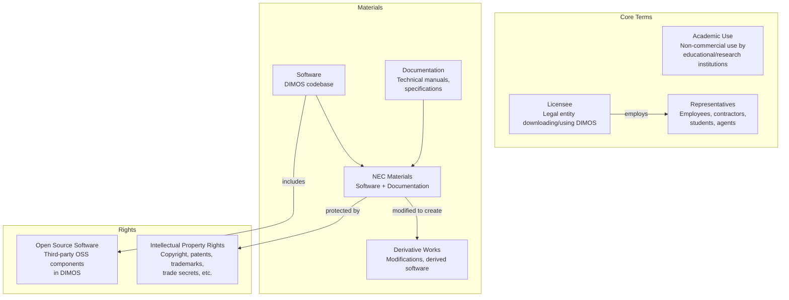
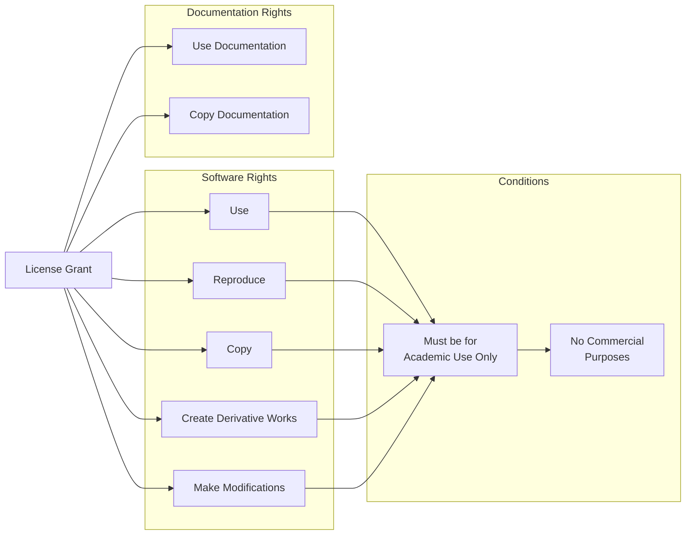
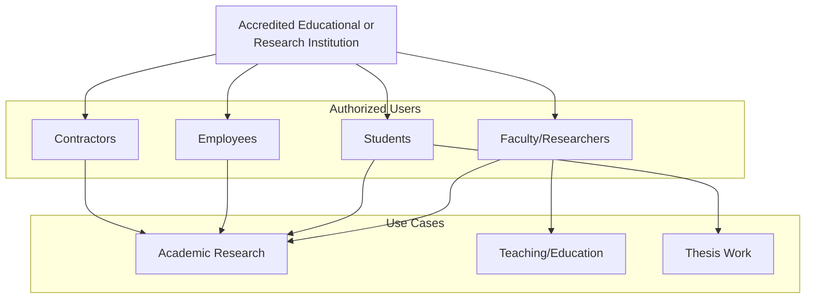
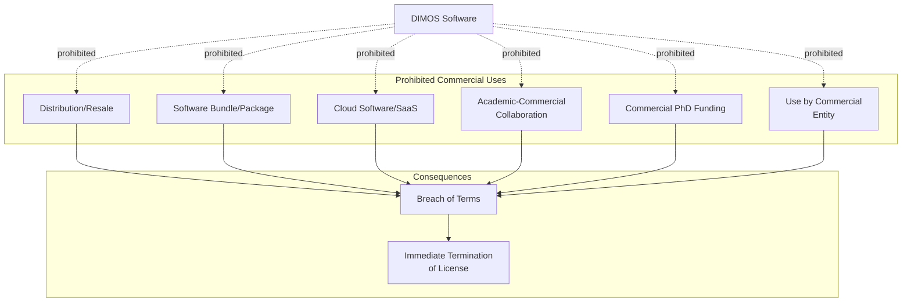
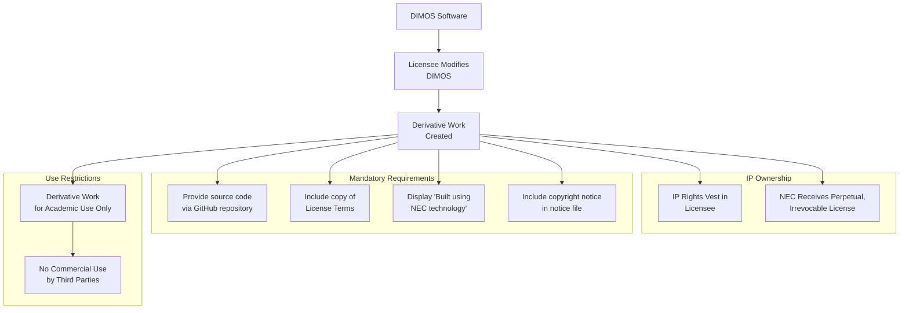
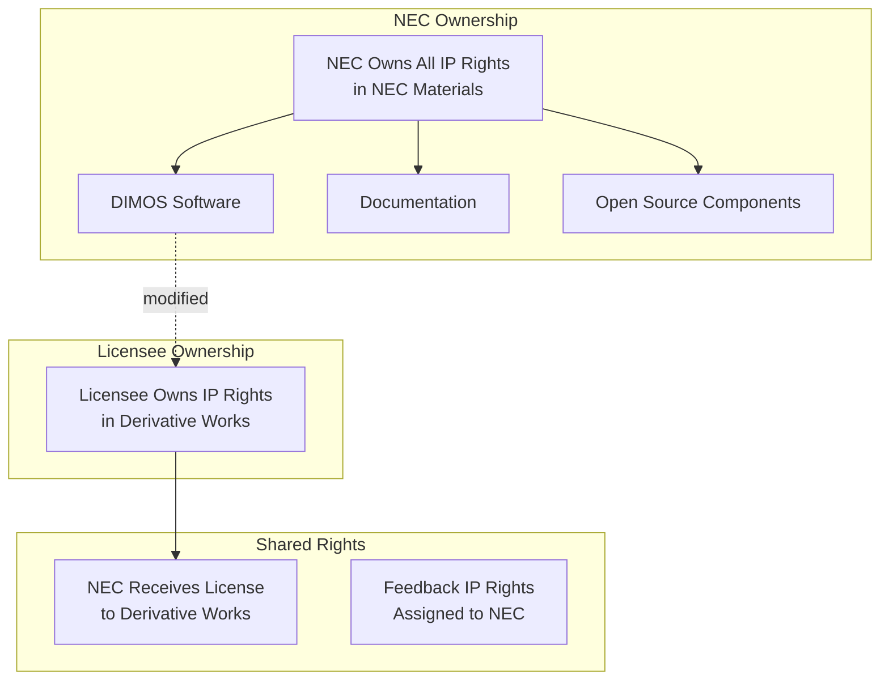
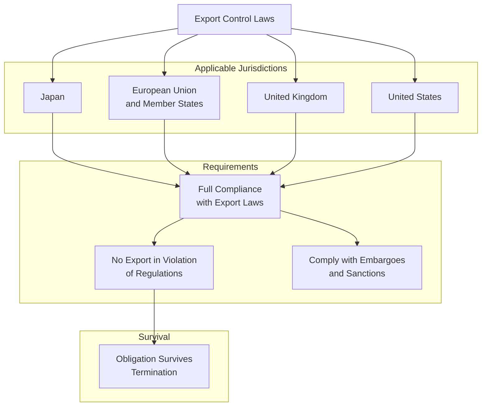
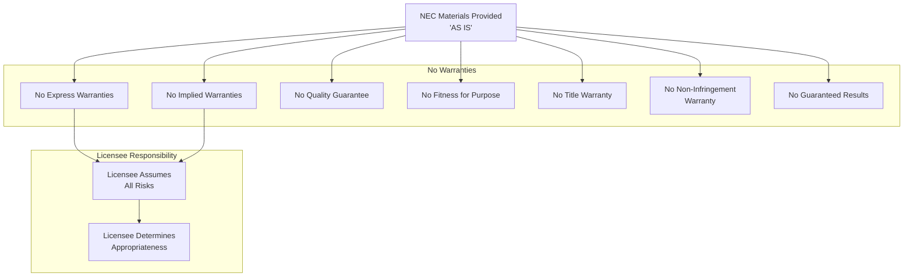
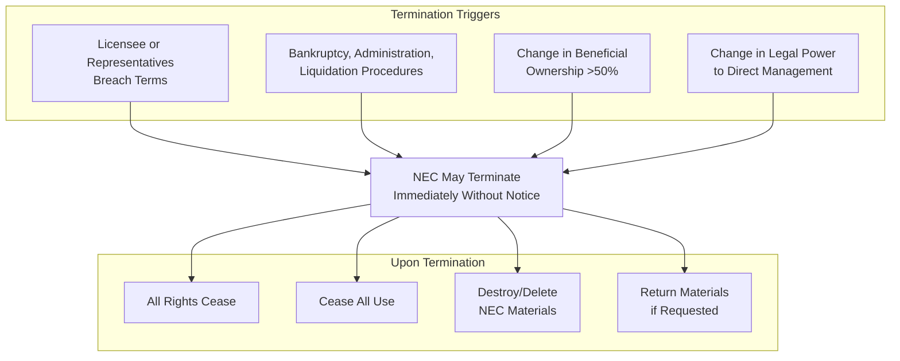
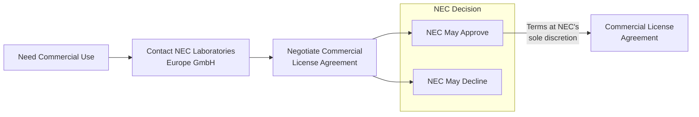

# License and Academic Use Terms

Relevant source files

The following files were used as context for generating this wiki page:

- [LICENSE](LICENSE)
- [dimos/__init__.py](dimos/__init__.py)

## Purpose and Scope

This page explains the licensing terms under which DIMOS is distributed. DIMOS is provided under the **NEC Software Library Academic Use Licence**, a custom academic license that permits use for academic research and teaching but restricts commercial applications. Understanding these terms is essential before downloading, using, or creating derivative works based on DIMOS.

For information about setting up and using DIMOS, see [Installation and Setup](#1.1) and [Quick Start Tutorial](#1.2). For guidance on creating derivative works, see [Creating Derivative Works](#8.3).

**Sources:** [LICENSE:1-372](), [dimos/__init__.py:1-372]()

---

## License Type and Governing Entity

DIMOS is licensed under the **NEC Software Library Academic Use Licence Terms**. The licensor is:

| Entity | Details |
|--------|---------|
| **Name** | NEC Laboratories Europe GmbH |
| **Registration** | HRB 728558 (Germany) |
| **VAT Number** | DE313703076 |
| **Address** | Kurfuersten-Anlage 36, 69115 Heidelberg, Germany |
| **Repository** | https://github.com/nec-research/DIMOS |

The license agreement is governed by the laws of **England and Wales**, with disputes subject to the exclusive jurisdiction of English and Welsh courts.

**Sources:** [LICENSE:328-334](), [LICENSE:294-300]()

---

## Key Definitions

Understanding the following terms is critical for compliance with the license:

**Key Definitions:**

| Term | Definition |
|------|------------|
| **Academic Use** | Use by accredited educational or research institutions for non-commercial purposes, including academic research and/or teaching |
| **Licensee** | The legal entity accessing or downloading the Software |
| **Representatives** | Employees, contractors, officers, directors, agents, students of the Licensee and/or any other representatives acting on behalf of the Licensee |
| **Software** | The DIMOS software accessed or downloaded from https://github.com/nec-research/DIMOS |
| **Documentation** | Description and specification of the Software, instructions for use, technical manuals |
| **NEC Materials** | Software and Documentation together |
| **Derivative Work** | Any derivative works of the Software, modifications to the Software, or products/services incorporating Derivative Works |
| **Intellectual Property Rights** | Copyright, patents, know-how, trade secrets, trademarks, service marks, design rights, database rights, domain names, and similar rights (whether registered or not) |

**Sources:** [LICENSE:307-347]()

---

## Permitted Uses: Academic Use

The license grants a **personal, non-exclusive, worldwide, non-transferrable, non-sublicensable, royalty-free and limited licence** to:

### Allowed Activities

The Licensee may:
- **Use** the Software for academic research or teaching
- **Reproduce and copy** the Software
- **Create derivative works** and make modifications to the Software
- **Use and copy** the Documentation in connection with the above rights

### Who Can Use DIMOS

**Important Requirements:**
- Only the Licensee's **Representatives** may use the Software
- The Licensee is **liable for the acts and omissions** of its Representatives
- All use must be in accordance with **applicable laws and regulations**, including export control laws

**Sources:** [LICENSE:14-60]()

---

## Prohibited Uses: Commercial Restrictions

The license **explicitly prohibits** commercial use of DIMOS. The following are considered violations:

### Commercial Use Restrictions

| Prohibited Activity | Description |
|---------------------|-------------|
| **Distribution/Resale** | Any distribution or resale of the Software, either directly or indirectly as part of any package or bundle |
| **Cloud/SaaS** | Use as part of cloud software or software-as-a-service products |
| **Academic-Commercial Collaborations** | Use in collaborations between academic and commercial entities (including PhD funding by commercial entities) |
| **Commercial Entity Use** | Any use (even non-commercial) of the Software by a commercial entity |
| **Misrepresentation** | Using the Software for commercial purposes while representing such use as Academic Use |

**Note:** If a Licensee wishes to use DIMOS for commercial purposes, they must enter into a **separate commercial licence agreement** with NEC. NEC reserves the right to decline such agreements.

**Sources:** [LICENSE:22-37](), [LICENSE:62-67]()

---

## Acceptable Use Policy

Beyond commercial restrictions, the license includes an acceptable use policy prohibiting various activities:

### Prohibited Activities Under Acceptable Use Policy

| Category | Prohibited Actions |
|----------|-------------------|
| **Unlawful Use** | Any purpose unlawful under applicable law |
| **Fraud/Harm** | Fraud, money laundering, deceptive or harmful activities |
| **Malicious Code** | Creating, storing, or distributing viruses, malware, ransomware, disabling code |
| **Spam/Disinformation** | Promoting unsolicited advertising, spam, disinformation |
| **Defamation** | Creating or promoting defamatory content |
| **Phishing** | Simulating communications to collect credentials or information |
| **Disruption** | Disrupting operations, equipment, websites (DoS attacks, etc.) |
| **Endangerment** | Harming minors or persons, causing property/environmental damage |
| **Unauthorized Access** | Gaining unauthorized access to computers, data, systems, networks |
| **Security Circumvention** | Attempting to circumvent security controls |
| **Harassment** | Harassment, abuse, bullying, discrimination |
| **IP Infringement** | Violating intellectual property rights of NEC or third parties |
| **Reverse Engineering** | Reverse engineering, decompiling, or disassembling (except as permitted) |

**Sources:** [LICENSE:102-139]()

---

## Requirements for Derivative Works

If you create derivative works based on DIMOS, you must comply with specific requirements:

### Derivative Works Flow

### Specific Requirements for Derivative Works

When creating derivative works, you must:

1. **Provide Source Code**
   - Submit source code via the code repository at https://github.com/nec-research/DIMOS
   - This can be through pull requests or other means of code sharing

2. **Include License Copy**
   - Distribute a copy of these Terms with the Derivative Work(s)

3. **Display Attribution**
   - Prominently display "**Built using NEC technology**" on:
     - Software description
     - Website
     - User interface
     - About page
     - Software specification
     - Technical documentation

4. **Copyright Notice**
   - Include in any notice text file: 
   > "[Derivative Work] is licensed under the NEC Software Library Academic License. Copyright © 2025 NEC Laboratories Europe GmbH. All Rights Reserved."

5. **License to NEC**
   - Automatically grant NEC a perpetual, fully paid-up, non-exclusive, royalty-free, transferrable, sublicensable, irrevocable license to use, copy, modify, reproduce, and create derivative works of your Derivative Works

6. **Academic Use Only**
   - Derivative Works may only be used for Academic Use
   - No commercial use or third-party commercial use permitted

**Sources:** [LICENSE:70-99]()

---

## Intellectual Property Rights

### Ownership Structure

### Key IP Provisions

| Aspect | Terms |
|--------|-------|
| **NEC Materials IP** | All Intellectual Property Rights in DIMOS and Documentation belong to and remain vested in NEC |
| **Derivative Works IP** | IP Rights in Derivative Works belong to the Licensee |
| **NEC's License** | NEC receives a perpetual, irrevocable license to use Licensee's Derivative Works |
| **Feedback Assignment** | All IP Rights in feedback provided to NEC are assigned to NEC |
| **Open Source Acknowledgment** | DIMOS includes or is based on Open Source Software components |
| **No Transfer** | No IP Rights are transferred or licensed except as expressly granted |

### Feedback and Suggestions

If you provide feedback, suggestions for improvement, or bug reports:
- NEC may use such feedback without charge or limitation
- All Intellectual Property Rights in the feedback are **assigned to NEC**
- This assignment occurs automatically when feedback is first provided

**Sources:** [LICENSE:158-197]()

---

## Export Control Compliance

The Licensee must comply with applicable export control laws:

The Licensee must:
- Ensure that DIMOS is not exported, directly or indirectly, in violation of export laws
- Comply with export control laws of Japan, EU, UK, and United States
- Follow embargo and sanction rules
- **This obligation survives termination** of the license

**Sources:** [LICENSE:39-51]()

---

## Warranty Disclaimer and Liability

### No Warranty

The NEC Materials are provided **"AS IS"** with no warranty:

NEC provides:
- No express or implied warranties
- No guarantees or conditions
- No warranty of quality, fitness for purpose, title, or non-infringement
- No warranty of ability to achieve results

The Licensee is **solely responsible** for:
- Determining the appropriateness of using DIMOS
- Assuming all risks associated with use
- Any outputs or results from DIMOS or Derivative Works

### Limitation of Liability

| Liability Aspect | Terms |
|------------------|-------|
| **Excluded Losses** | Consequential, indirect, or special losses; loss of profit/revenue; data loss/corruption; software/system corruption; equipment damage; loss of opportunity; harm to reputation; loss of goodwill |
| **Maximum Liability** | €500 aggregate liability to Licensee and Representatives |
| **Permitted by Law** | All limitations subject to applicable law |

### Licensee Indemnification

The Licensee must **indemnify NEC** against:
- Losses, claims, damages, liability, costs (including legal fees)
- Arising from third party actions relating to:
  - Use of Software/Documentation against these Terms
  - Any use of Derivative Works

**Sources:** [LICENSE:142-213]()

---

## Termination

### License Commencement and Duration

The license begins when the Licensee:
- Accepts these Terms; **or**
- Accesses or downloads any NEC Materials (whichever is sooner)

The license continues until terminated.

### Termination by NEC

NEC may terminate immediately if:
1. Licensee or Representatives breach any provision
2. Licensee undergoes bankruptcy, administration, provisional liquidation, or similar proceedings
3. Licensee undergoes change in beneficial ownership exceeding 50%
4. Licensee undergoes change in legal power to direct management

### Obligations Upon Termination

When the license terminates:
- All rights granted by NEC **immediately cease**
- Licensee and Representatives must **cease all use** of NEC Materials
- Licensee must **destroy and delete** all copies of Software and Documentation
- If requested by NEC, **return** all copies
- Provisions intended to survive (export control, IP rights, liability, etc.) **remain in effect**

**Sources:** [LICENSE:216-245]()

---

## Obtaining a Commercial License

If you need to use DIMOS for commercial purposes:

**Process:**
1. Contact NEC to express interest in commercial use
2. NEC will determine terms at its **sole discretion**
3. NEC **reserves the right to decline** commercial license agreements
4. Terms will be specific to the commercial arrangement

**Contact Information:**
- NEC Laboratories Europe GmbH
- Kurfuersten-Anlage 36, 69115 Heidelberg, Germany

**Sources:** [LICENSE:62-67](), [LICENSE:328-330]()

---

## License Text Locations in Codebase

The complete license text appears in two locations:

| Location | Purpose |
|----------|---------|
| [LICENSE:1-372]() | Standalone license file in repository root |
| [dimos/__init__.py:1-372]() | License text as comments in main package initialization file |

Both locations contain identical text and constitute the binding agreement.

**Sources:** [LICENSE:1-372](), [dimos/__init__.py:1-372]()

---

## Summary: Key Compliance Points

To use DIMOS in compliance with the license:

1. ✓ **Use only for Academic Use** - Research and teaching at accredited institutions
2. ✓ **No commercial use** - No distribution, SaaS, or commercial entity use
3. ✓ **Ensure Representatives comply** - You are liable for your Representatives' actions
4. ✓ **Follow export control laws** - Comply with international export regulations
5. ✓ **For Derivative Works:**
   - Provide source code via GitHub
   - Include license terms
   - Display "Built using NEC technology"
   - Include copyright notice
   - Use only for Academic Use
6. ✓ **Accept no warranty** - Software provided "AS IS"
7. ✓ **Comply with acceptable use policy** - No malicious, illegal, or harmful use
8. ✓ **Contact NEC for commercial needs** - Separate commercial license required

For detailed guidance on creating compliant derivative works, see [Creating Derivative Works](#8.3).

**Sources:** [LICENSE:1-372]()

---