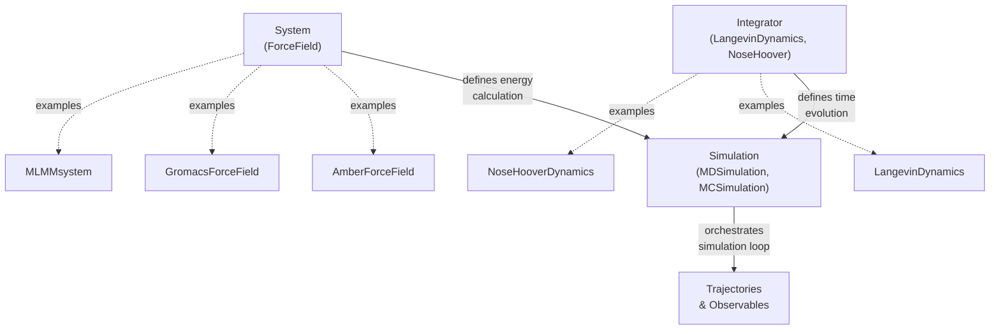
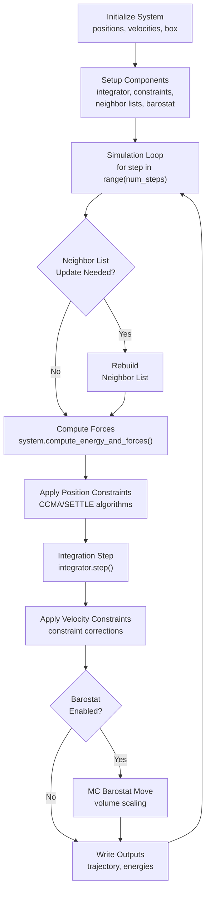
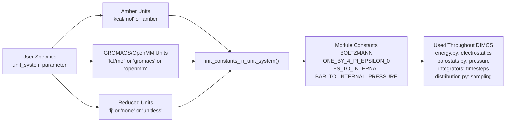
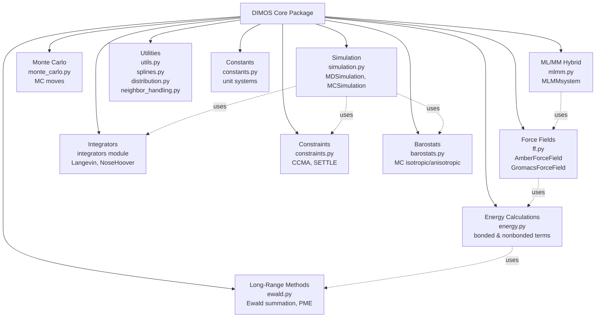
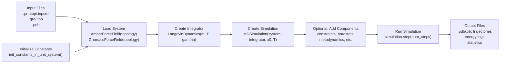

# Core Concepts

<details>
<summary>Relevant source files</summary>

The following files were used as context for generating this wiki page:

- [README.md](README.md)
- [dimos/__init__.py](dimos/__init__.py)
- [dimos/constants.py](dimos/constants.py)

</details>


This page introduces the fundamental concepts underlying molecular simulation in DIMOS, including the core abstractions, design patterns, and theoretical foundations. It provides an overview of how DIMOS represents molecular systems, computes their energies, and advances their dynamics through time.

For detailed information about specific simulation methods, see [Molecular Dynamics and Monte Carlo](#2.1). For comprehensive coverage of different force field types, see [Force Fields Overview](#2.2). For unit system specifications and conversions, see [Unit Systems and Physical Constants](#2.3).

## What is DIMOS?

DIMOS (Differentiable Molecular Simulator) is a PyTorch-based framework that bridges classical molecular simulation with modern machine learning workflows. Unlike traditional molecular dynamics engines, DIMOS is designed to be:

- **Differentiable**: All operations support automatic differentiation via PyTorch's autograd
- **Flexible**: Supports classical force fields, ML potentials, and hybrid ML/MM approaches
- **Modular**: Components can be mixed and matched (integrators, constraints, barostats, etc.)
- **Performance-oriented**: Leverages `torch.compile` for JIT optimization

The framework implements both Molecular Dynamics (MD) and Monte Carlo (MC) simulation methodologies, providing a unified interface for different sampling strategies.

**Sources:** [README.md:1-55](), [dimos/__init__.py:374-389]()

## Core Abstractions

DIMOS is built around three fundamental abstractions that define its architecture:



### System (Force Field)

The `System` represents a molecular system and encapsulates all information needed to compute energies and forces. Different force field implementations inherit from base classes and provide specific energy calculation methods:

| Force Field Type | Class Name | Description |
|-----------------|------------|-------------|
| Classical Amber | `AmberForceField` | Amber topology files (.prmtop) |
| Classical GROMACS | `GromacsForceField` | GROMACS topology files (.top) |
| ML Potential (MACE) | Created via `as_mace_system()` | Machine learning interatomic potential |
| ML Potential (ORB) | Created via `as_orb_system()` | ORB v2 neural network potential |
| Hybrid ML/MM | `MLMMsystem` | Combines ML and classical regions |

Each system provides methods to compute:
- Total potential energy
- Forces on all atoms
- Virial tensor (for pressure calculations)

### Integrator

The `Integrator` defines how the system evolves through time. It implements numerical integration schemes for solving Newton's equations of motion or performing Monte Carlo moves:

- `LangevinDynamics`: Stochastic dynamics with friction and random forces
- `NoseHooverDynamics`: Deterministic thermostat for canonical ensemble

Integrators are responsible for:
- Advancing positions and velocities
- Applying thermostats for temperature control
- Maintaining the correct statistical ensemble

### Simulation

The `Simulation` class orchestrates the entire simulation loop, coordinating the system and integrator with additional components:

- `MDSimulation`: Molecular dynamics simulations
- `MCSimulation`: Monte Carlo simulations

The simulation manages:
- Neighbor list updates for efficiency
- Application of constraints (bond lengths, angles)
- Barostat moves for pressure control
- Trajectory output and logging

**Sources:** [README.md:48-54](), [dimos/__init__.py:374-389]()

## The Simulation Loop

DIMOS implements a standard molecular simulation loop with modular components. Understanding this loop is essential for working with the framework:



Each component in this loop is modular and can be configured independently:

| Component | Purpose | Location |
|-----------|---------|----------|
| Force Calculation | Compute potential energy and forces | `dimos.energy` module |
| Neighbor Lists | Optimize force calculations | `dimos.neighbor_handling` module |
| Integrators | Time evolution schemes | `dimos.integrators` module |
| Constraints | Enforce geometric constraints | `dimos.constraints` module |
| Barostats | Pressure control | `dimos.barostats` module |

**Sources:** [dimos/__init__.py:374-389]()

## PyTorch Integration and Differentiability

DIMOS is built entirely on PyTorch tensors, enabling several key capabilities:

### Automatic Differentiation

All energy calculations support automatic differentiation through PyTorch's autograd system. Forces are computed as:

```
forces = -grad(potential_energy, positions)
```

This means:
- Forces are always consistent with the energy function
- The simulation is end-to-end differentiable
- Gradients can flow through entire trajectories for machine learning applications

### Hardware Acceleration

PyTorch provides transparent GPU acceleration:
- Move tensors to GPU with `.to('cuda')`
- All operations automatically run on the appropriate device
- Mixed precision training supported

### JIT Compilation

DIMOS leverages `torch.compile` for performance optimization:
- Compiles simulation loops to optimized kernels
- Significantly reduces Python overhead
- Particularly beneficial for small to medium systems

**Sources:** [README.md:5-6]()

## Unit Systems

DIMOS supports multiple unit conventions to ensure compatibility with different force fields and MD engines:



The `init_constants_in_unit_system()` function in [dimos/constants.py:399-462]() sets module-level constants based on the chosen unit system. These constants are then imported and used throughout the codebase:

| Constant | Purpose | Amber Value | GROMACS Value |
|----------|---------|-------------|---------------|
| `BOLTZMANN` | Boltzmann constant k_B | 1.987e-3 kcal/mol/K | 8.314e-3 kJ/mol/K |
| `ONE_BY_4_PI_EPSILON_0` | Coulomb constant | 332.06 kcal·Å/mol/e² | 138.94 kJ·nm/mol/e² |
| `FS_TO_INTERNAL` | Time unit conversion | 48.888 | 1.0 |
| `BAR_TO_INTERNAL_PRESSURE` | Pressure conversion | 1.439e-5 | 0.0602 |

The unit system must be initialized before creating any force field objects to ensure consistency across all calculations.

**Sources:** [dimos/constants.py:374-466]()

## Modular Architecture

DIMOS's modular design allows components to be mixed and matched. The main modules imported in [dimos/__init__.py:374-388]() are:



This modular structure means:
- Each component has a well-defined interface
- Components can be developed and tested independently
- Users can extend DIMOS by implementing new components (custom force fields, integrators, etc.)
- Advanced features like metadynamics and replica exchange integrate cleanly

**Sources:** [dimos/__init__.py:374-389]()

## Force Field Representation

Force fields in DIMOS define how to compute the potential energy of a molecular configuration. The energy is typically decomposed into bonded and nonbonded contributions:

```
E_total = E_bonded + E_nonbonded
E_bonded = E_bonds + E_angles + E_torsions + E_CMAP
E_nonbonded = E_LJ + E_electrostatic + E_long_range
```

### Energy Decomposition

| Energy Term | Description | Typical Form |
|-------------|-------------|--------------|
| Bonds | Harmonic bond stretching | k(r - r₀)² |
| Angles | Harmonic angle bending | k(θ - θ₀)² |
| Torsions | Dihedral angle rotation | Σ k[1 + cos(nφ - δ)] |
| Lennard-Jones | van der Waals interactions | 4ε[(σ/r)¹² - (σ/r)⁶] |
| Electrostatic | Coulomb interactions | q₁q₂/(4πε₀r) |
| Long-range | Ewald/PME corrections | Depends on method |

Classical force fields (Amber, GROMACS) define parameters for each of these terms in topology files. ML potentials replace all these terms with a single neural network evaluation that maps atomic positions to energy.

**Sources:** [dimos/__init__.py:377-378]()

## Data Flow: Input to Output

A typical DIMOS workflow follows this pattern:



This linear flow makes it easy to understand and modify simulations. Each step is explicit and configurable.

**Sources:** [README.md:48-54]()

## Key Design Principles

DIMOS follows several design principles that distinguish it from other MD engines:

### 1. Explicit over Implicit

Configuration is explicit rather than hidden in defaults:
- Unit systems must be explicitly initialized
- All components are explicitly created and passed to the simulation
- No global state or hidden configuration files

### 2. Composability

Components are designed to work together:
- Any integrator works with any force field
- Constraints, barostats, and advanced sampling methods are orthogonal
- ML and MM force fields have compatible interfaces

### 3. PyTorch Native

Everything is a PyTorch tensor:
- No custom data structures for positions/velocities
- Standard PyTorch operations for all transformations
- Natural integration with ML training loops

### 4. Performance and Correctness

DIMOS prioritizes both:
- `torch.compile` for performance where it helps
- Extensive benchmarking suite for validation
- Comparison against established engines (OpenMM, TorchMD)

**Sources:** [README.md:1-55]()

## Terminology and Conventions

| Term | Meaning in DIMOS |
|------|------------------|
| System | A force field object that can compute energies and forces |
| Integrator | Time evolution algorithm (MD) or move proposal (MC) |
| Simulation | The main simulation loop orchestrator |
| Constraint | Geometric constraint on bonds/angles |
| Barostat | Pressure control mechanism |
| Collective Variable | Function of coordinates for enhanced sampling |
| Neighbor List | Optimization data structure for force calculations |
| Internal Units | The unit system chosen via `init_constants_in_unit_system()` |

**Sources:** [dimos/__init__.py:374-389](), [dimos/constants.py:374-466]()

---