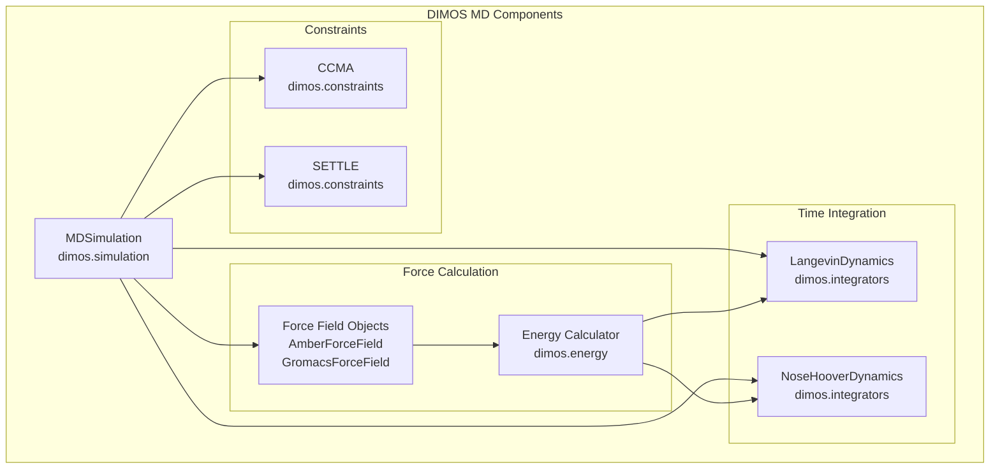
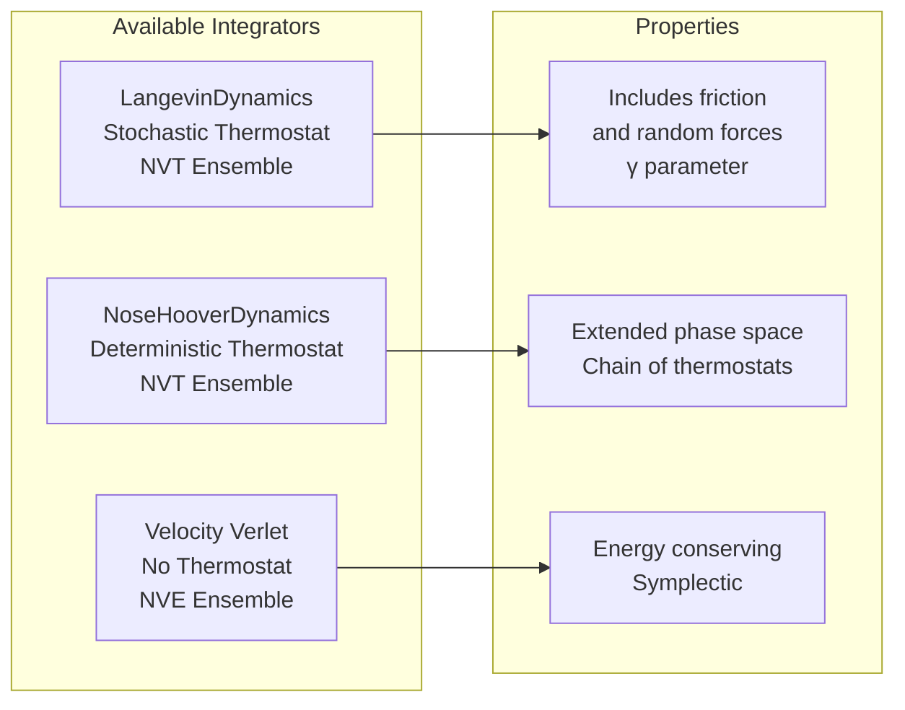
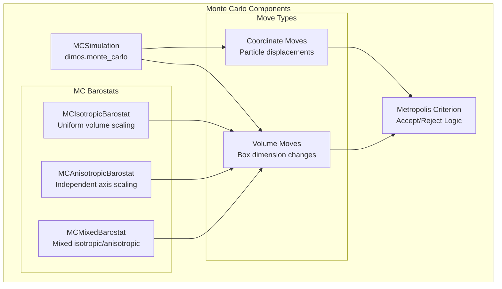
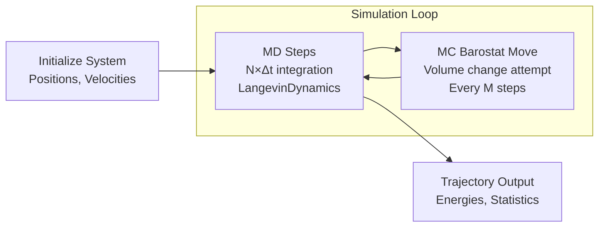

# Molecular Dynamics and Monte Carlo

<details>
<summary>Relevant source files</summary>

The following files were used as context for generating this wiki page:

- [README.md](README.md)
- [dimos/__init__.py](dimos/__init__.py)

</details>


## Purpose and Scope

This page explains the two fundamental simulation methodologies implemented in DIMOS: **Molecular Dynamics (MD)** and **Monte Carlo (MC)**. It covers the conceptual foundations of each approach, their implementations in the DIMOS framework, and guidance on when to use each method.

For details on specific integration algorithms used in MD simulations, see [Integration Methods](#3.2). For advanced sampling techniques that build on these foundations, see [Advanced Sampling Methods](#5). For information on force field calculations that drive both methods, see [Force Fields Overview](#2.2).

**Sources:** [README.md:1-55](), [dimos/__init__.py:374-388]()

---

## Fundamental Simulation Approaches

DIMOS implements two complementary approaches for exploring molecular configuration space: deterministic time evolution through molecular dynamics and stochastic sampling through Monte Carlo methods.

### Conceptual Comparison


**Key Distinctions:**

| Aspect | Molecular Dynamics | Monte Carlo |
|--------|-------------------|-------------|
| **Evolution** | Deterministic, time-ordered | Stochastic, time-independent |
| **State Variables** | Positions and velocities | Positions only |
| **Governing Principle** | Newton's equations of motion | Statistical mechanics sampling |
| **Time Information** | Provides real dynamics | No temporal information |
| **Primary Use** | Dynamic properties, transport coefficients | Equilibrium properties, phase transitions |
| **Efficiency** | All moves accepted | Many moves rejected |

**Sources:** [README.md:5]()

---

## Molecular Dynamics in DIMOS

### Theoretical Foundation

Molecular dynamics simulates the time evolution of a molecular system by numerically integrating Newton's equations of motion:

```
m_i d²r_i/dt² = F_i = -∇_i U(r₁, r₂, ..., r_N)
```

where `m_i` is the mass of particle `i`, `r_i` is its position, `F_i` is the force acting on it, and `U` is the potential energy.

DIMOS implements this through a modular architecture that separates force field calculations, constraint handling, and integration schemes.

### MD Implementation Architecture



**Sources:** [dimos/__init__.py:374-388](), [README.md:48-54]()

### MDSimulation Class

The `MDSimulation` class serves as the primary interface for running molecular dynamics simulations. It manages the simulation loop, coordinates integrator execution, and handles trajectory output.

**Typical usage pattern:**

```python
import dimos

# Initialize force field
system = dimos.AmberForceField("system.prmtop")

# Create integrator
integrator = dimos.LangevinDynamics(dt, temperature, gamma, system)

# Set up simulation
simulation = dimos.MDSimulation(system, integrator, positions, temperature)

# Run simulation
simulation.step(num_steps)
```

**Key components initialized:**

| Component | Purpose | Configuration |
|-----------|---------|---------------|
| **Force Field** | Defines interaction potential | `AmberForceField` or `GromacsForceField` |
| **Integrator** | Propagates dynamics | `LangevinDynamics` or `NoseHooverDynamics` |
| **Positions** | Initial coordinates | Torch tensor or coordinate file |
| **Temperature** | Target temperature | Specified in force field units |

**Sources:** [README.md:48-54](), [dimos/__init__.py:384]()

### Integration Schemes

DIMOS provides multiple integration algorithms that differ in their treatment of thermostats and conservation properties:



**Langevin Dynamics:** Incorporates stochastic forces and friction to maintain temperature. Suitable for most production simulations where realistic dynamics are needed with temperature control.

**Nose-Hoover Dynamics:** Uses deterministic extended-system thermostat. Provides smooth temperature coupling while preserving phase space volume (canonical ensemble).

The choice of integrator depends on the target ensemble and whether stochastic forces are acceptable. See [Integration Methods](#3.2) for detailed algorithmic descriptions.

**Sources:** [dimos/__init__.py:380]()

---

## Monte Carlo in DIMOS

### Theoretical Foundation

Monte Carlo methods sample configuration space stochastically according to a target probability distribution, typically the Boltzmann distribution:

```
P(r) ∝ exp(-U(r) / k_B T)
```

The Metropolis-Hastings algorithm generates configurations by:
1. Proposing a random move from state `i` to state `j`
2. Computing energy difference `ΔU = U_j - U_i`
3. Accepting with probability `min(1, exp(-ΔU / k_B T))`

This ensures detailed balance and correct equilibrium sampling.

### MC Implementation in DIMOS

DIMOS implements Monte Carlo methods primarily for pressure control (MC barostats) and as a standalone simulation mode:



**Sources:** [dimos/__init__.py:374-388]()

### MCSimulation Class

The `MCSimulation` class provides Monte Carlo sampling as an alternative to molecular dynamics. This is useful for:
- Systems where dynamics are not of interest
- Overcoming energy barriers through large moves
- Equilibrating systems before MD production runs
- Computing equilibrium properties without integration artifacts

**Sources:** [dimos/__init__.py:382]()

### Monte Carlo Barostats

DIMOS extensively uses Monte Carlo for pressure control in MD simulations. MC barostats periodically attempt volume moves during an MD trajectory, maintaining constant pressure through NPT sampling:

**Barostat Types:**

| Barostat | Application | Box Scaling |
|----------|-------------|-------------|
| **MCIsotropicBarostat** | Isotropic systems (liquids, cubic crystals) | Uniform scaling of all dimensions |
| **MCAnisotropicBarostat** | Anisotropic systems (membranes, layered materials) | Independent scaling of each axis |
| **MCMixedBarostat** | Semi-flexible boxes | Isotropic + anisotropic components |

**Algorithm:**
1. Propose volume change `V' = V + δV` (random displacement)
2. Scale particle coordinates: `r_i' = r_i × (V'/V)^(1/3)`
3. Compute energy change `ΔU` and volume work `PΔV`
4. Accept with probability `min(1, exp(-(ΔU + PΔV - N k_B T ln(V'/V)) / k_B T))`

The adaptive scaling feature automatically adjusts move sizes to maintain target acceptance rates (typically 40-50%).

**Sources:** [dimos/__init__.py:374]()

---

## Integration of MD and MC in DIMOS

### Hybrid MD-MC Simulations

DIMOS seamlessly combines MD and MC within a single simulation framework. The typical pattern is:



This hybrid approach enables:
- **NPT ensemble simulations:** MD for dynamics + MC barostat for pressure
- **Enhanced sampling:** MD for local exploration + MC for large moves
- **Flexible equilibration:** MC for initial equilibration, MD for production

**Configuration example:**
```python
# MD integrator for dynamics
integrator = dimos.LangevinDynamics(dt=2.0, temperature=300.0, gamma=1.0, system)

# MC barostat for pressure control
barostat = dimos.MCIsotropicBarostat(pressure=1.0, temperature=300.0, frequency=25)

# Combined MD+MC simulation
simulation = dimos.MDSimulation(system, integrator, positions, temperature, barostat=barostat)
```

**Sources:** [dimos/__init__.py:374-388]()

---

## Choosing the Appropriate Method

### Decision Matrix

| Requirement | Recommended Approach |
|-------------|---------------------|
| Need dynamic properties (diffusion, viscosity) | **Molecular Dynamics** |
| Need equilibrium properties only | **Monte Carlo** or MD |
| Large energy barriers present | **Monte Carlo** or enhanced sampling MD |
| Explicit time evolution required | **Molecular Dynamics** |
| Pressure control needed | **MD with MC Barostat** |
| System has constraints (bond lengths) | **MD with constraints** |
| Maximum computational efficiency | **MD** (all moves accepted) |
| Sampling rare events | **MC** or advanced MD methods |

### Ensemble Considerations

DIMOS enables the following statistical ensembles:

| Ensemble | Implementation | Fixed Variables | Control Method |
|----------|----------------|-----------------|----------------|
| **NVE** | MD with no thermostat | N, V, E | Energy-conserving integrator |
| **NVT** | MD with thermostat | N, V, T | Langevin or Nose-Hoover |
| **NPT** | MD + MC barostat | N, P, T | Thermostat + volume moves |
| **μVT** | Pure MC | μ, V, T | Particle insertion/deletion |

**Sources:** [dimos/__init__.py:374-388]()

---

## Computational Considerations

### Performance Characteristics

**Molecular Dynamics:**
- All proposed steps (integrator moves) are accepted
- Requires force/gradient calculations at every step
- Timestep limited by fastest motions (1-2 fs without constraints)
- Benefits from GPU acceleration for force calculations
- Neighbor list updates dominate performance for large systems

**Monte Carlo:**
- Many proposed moves are rejected (40-60% typical acceptance)
- Only energy calculations needed (no gradients for simple MC)
- Move size determines acceptance rate and efficiency
- Less benefit from GPU for simple moves (communication overhead)
- Can use larger effective steps than MD

### Unit System Compatibility

Both MD and MC methods in DIMOS respect the chosen unit system. Physical constants (Boltzmann constant, pressure conversion factors) are automatically configured. See [Unit Systems and Physical Constants](#2.3) for details.

**Sources:** [dimos/__init__.py:376]()

---

## Code Entity Summary

The following table maps conceptual components to their implementations in DIMOS:

| Concept | Code Entity | Location |
|---------|-------------|----------|
| **MD Simulation** | `MDSimulation` | `dimos.simulation` |
| **MC Simulation** | `MCSimulation` | `dimos.monte_carlo` |
| **Langevin Integrator** | `LangevinDynamics` | `dimos.integrators` |
| **Nose-Hoover Integrator** | `NoseHooverDynamics` | `dimos.integrators` |
| **MC Isotropic Barostat** | `MCIsotropicBarostat` | `dimos.barostats` |
| **MC Anisotropic Barostat** | `MCAnisotropicBarostat` | `dimos.barostats` |
| **Constraint Algorithm (general)** | `CCMA` | `dimos.constraints` |
| **Constraint Algorithm (water)** | `SETTLE` | `dimos.constraints` |
| **Force Field (Amber)** | `AmberForceField` | `dimos.ff` |
| **Force Field (GROMACS)** | `GromacsForceField` | `dimos.ff` |

**Sources:** [dimos/__init__.py:374-388](), [README.md:48-54]()

---