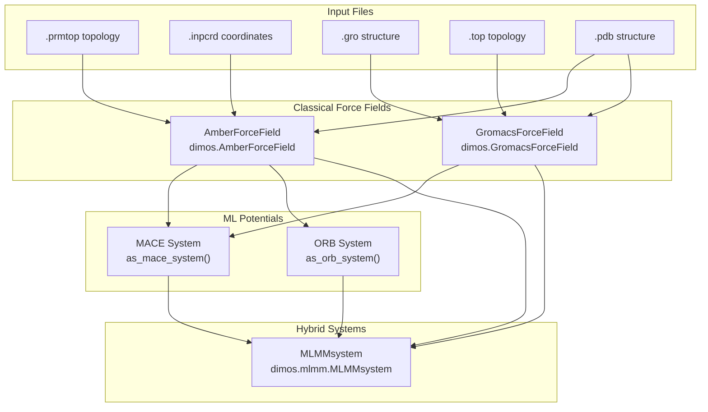
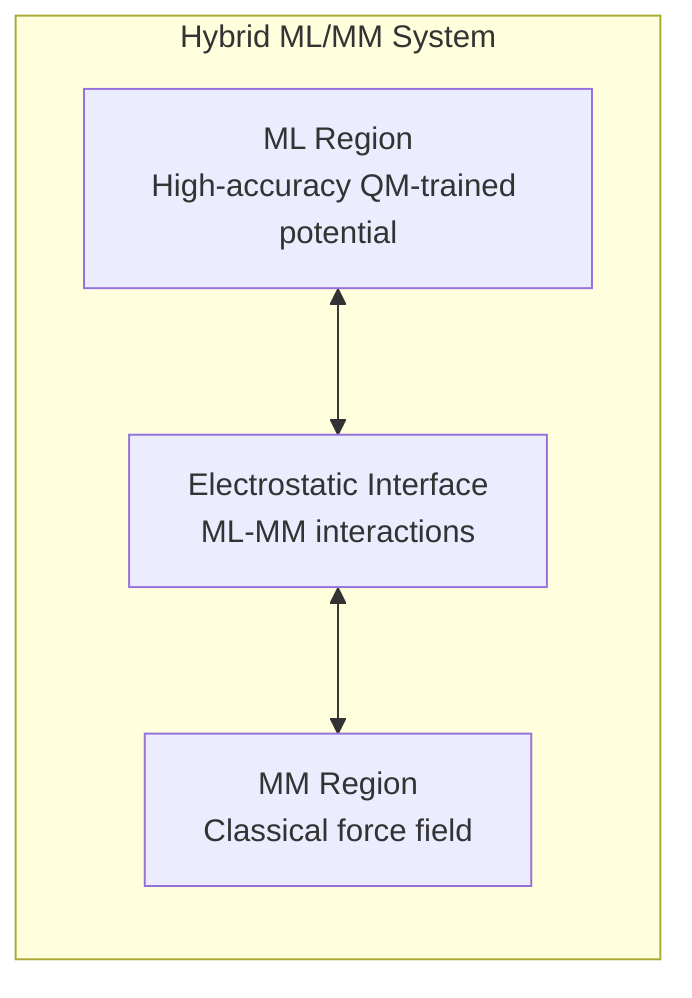
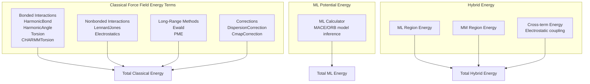
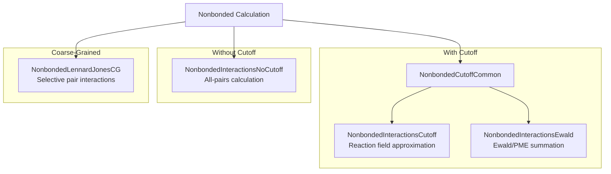
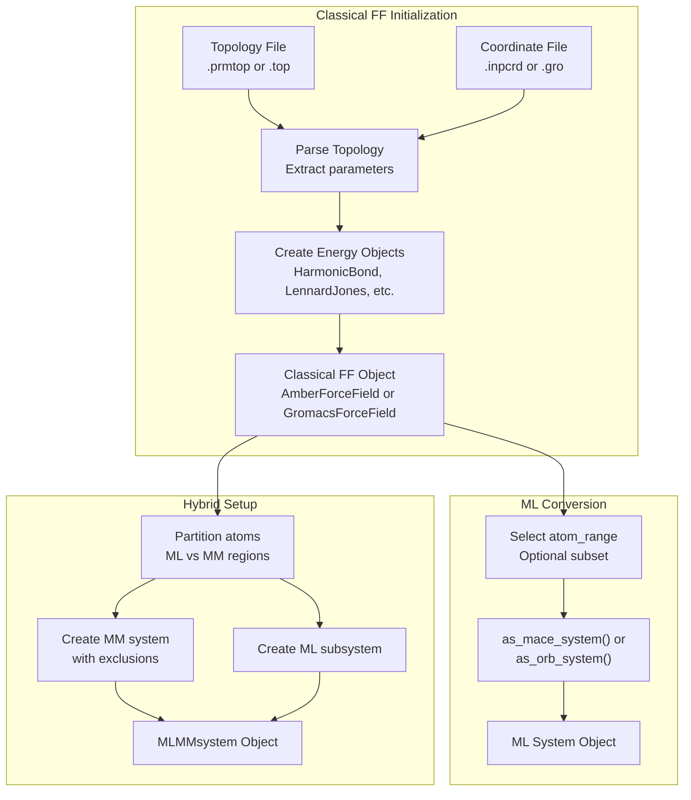
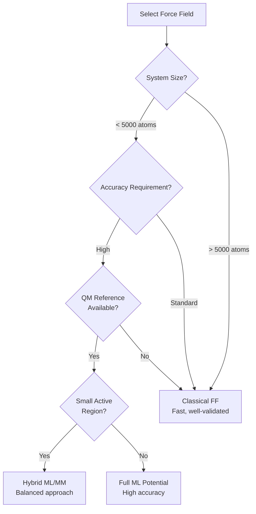
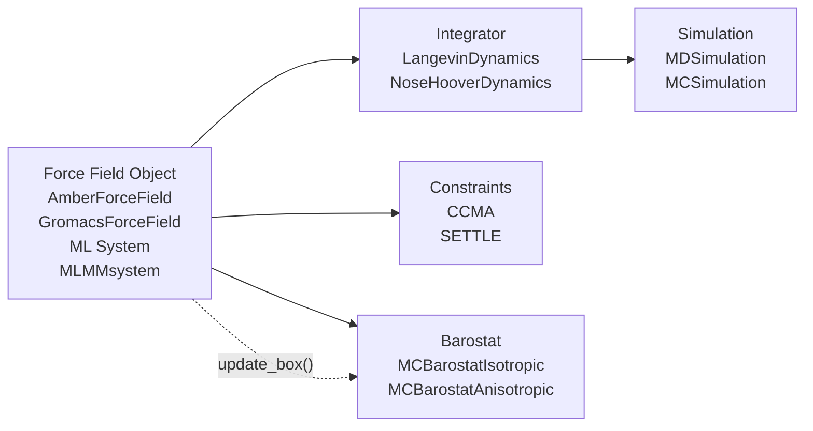

# Force Fields Overview

<details>
<summary>Relevant source files</summary>

The following files were used as context for generating this wiki page:

- [README.md](README.md)
- [benchmark/proteins/benchmark_proteins.py](benchmark/proteins/benchmark_proteins.py)
- [dimos/energy.py](dimos/energy.py)

</details>


## Purpose and Scope

This page provides an overview of the different force field types supported by DIMOS and their conceptual organization. DIMOS supports three main categories of force fields: classical molecular mechanics force fields (Amber, GROMACS), machine learning interatomic potentials (MACE, ORB), and hybrid ML/MM systems that combine both approaches. This overview covers the high-level concepts and differences between these approaches to help users select the appropriate force field for their simulations.

For detailed implementation information on using these force fields in practice, see [Classical Force Fields](#4.1), [Machine Learning Potentials](#4.2), and [Hybrid ML/MM Systems](#4.3). For information on the energy calculation implementation, see [Energy Calculations](#3.1).

## Force Field Categories

DIMOS organizes force fields into three primary categories based on their underlying computational approach:



**Sources:** [README.md:49-53](), [benchmark/proteins/benchmark_proteins.py:31-44]()

### Classical Force Fields

Classical force fields use physics-based functional forms with empirically fitted parameters to calculate energies and forces. DIMOS provides two primary classical force field implementations:

| Force Field | Class | Supported Formats | Primary Use Cases |
|------------|-------|-------------------|-------------------|
| Amber | `AmberForceField` | `.prmtop`, `.inpcrd`, `.pdb` | Biomolecular simulations, protein-ligand systems |
| GROMACS | `GromacsForceField` | `.gro`, `.top`, `.pdb` | Biomolecular simulations, flexible parameter specification |

Both implementations share the same underlying energy calculation framework defined in [dimos/energy.py]() but differ in how they parse topology files and assign parameters.

**Sources:** [dimos/energy.py:1-398](), [benchmark/proteins/benchmark_proteins.py:31]()

### Machine Learning Potentials

ML potentials replace the classical energy functions with learned models trained on quantum mechanical data. DIMOS integrates two state-of-the-art ML potentials:

| Potential | Method | Model Sizes | Primary Features |
|-----------|--------|-------------|------------------|
| MACE | `as_mace_system()` | small, medium, large | Multi-scale equivariant graph neural network |
| ORB | `as_orb_system()` | v2 | Orbital-based representation |

ML systems are created by converting an existing classical force field system:

```python
# Convert classical force field to MACE system
base_sys = dimos.GromacsForceField("system.top", "system.gro", ...)
ml_sys = base_sys.as_mace_system("mace-mp-large")
```

**Sources:** [benchmark/proteins/benchmark_proteins.py:43]()

### Hybrid ML/MM Systems

Hybrid systems partition the simulation into an ML region (typically a small molecule or active site) and an MM region (typically solvent or protein environment). The `MLMMsystem` class manages the interface between these regions:



The hybrid approach allows users to apply expensive ML potentials only where needed while maintaining computational efficiency for the rest of the system.

**Sources:** [benchmark/proteins/benchmark_proteins.py:36-41]()

## Energy Calculation Architecture

All force field types in DIMOS share a common energy calculation architecture, though they implement it differently:



**Sources:** [dimos/energy.py:375-384]()

### Classical Energy Terms

Classical force fields decompose the total energy into distinct components:

#### Bonded Terms

| Class | Energy Function | Purpose |
|-------|----------------|---------|
| `HarmonicBond` | E = k(r - r₀)² | Bond stretching |
| `HarmonicAngle` | E = k(θ - θ₀)² | Angle bending |
| `Torsion` | E = k(1 + cos(nφ - δ)) | Dihedral rotation |
| `CHARMMTorsion` | E = k(φ - φ₀)² | CHARMM-style impropers |
| `CmapCorrection` | E = spline(φ, ψ) | Backbone corrections |

**Sources:** [dimos/energy.py:2228-2535]()

#### Nonbonded Terms

The nonbonded interactions consist of Lennard-Jones (van der Waals) and electrostatic components:



The choice of nonbonded method affects both accuracy and performance:
- **Cutoff with reaction field**: Fastest, suitable for homogeneous systems
- **Cutoff with Ewald/PME**: Accurate for charged systems, required for periodic biomolecular simulations
- **No cutoff**: Exact for small non-periodic systems, computationally expensive

**Sources:** [dimos/energy.py:400-943]()

#### Special Interactions

Classical force fields handle special interaction pairs differently:

| Interaction Type | Treatment | Typical Scaling |
|-----------------|-----------|----------------|
| 1-2 (bonded) | Excluded | N/A |
| 1-3 (angles) | Excluded | N/A |
| 1-4 (dihedrals) | Scaled | LJ: 1/2, Elec: 1/1.2 or 1/2 |

The 1-4 interactions use separate parameters in some force fields and are calculated with dedicated methods like `LennardJonesExplicitOneFour`.

**Sources:** [dimos/energy.py:945-1181]()

## Force Field Initialization Flow

The initialization process differs between force field types but follows common patterns:



**Sources:** [benchmark/proteins/benchmark_proteins.py:23-44]()

### Configuration Parameters

Common parameters that affect force field behavior:

| Parameter | Affects | Typical Values |
|-----------|---------|----------------|
| `cutoff` | Nonbonded range | 8-12 Å |
| `switch_distance` | LJ switching | 7.5-10 Å or `None` |
| `nonbonded_type` | Electrostatics method | `"PME"`, `"Ewald"`, `"RFA"`, `None` |
| `constraint_option` | Bond constraints | `"h_angles"`, `"all_bonds"`, `None` |
| `create_graph` | Enable gradients | `True`/`False` |

**Sources:** [benchmark/proteins/benchmark_proteins.py:31]()

## Force Field Selection Guide

Choosing the appropriate force field depends on system size, accuracy requirements, and computational resources:



### Performance Characteristics

Typical computational costs (relative to classical with constraints):

| Force Field Type | Relative Cost | Example Use Case |
|-----------------|---------------|------------------|
| Classical (constrained) | 1× | Protein folding, long timescales |
| Classical (no constraints) | 4× | Small timestep studies |
| ML (MACE-small) | 10-50× | Small molecule reactions |
| ML (MACE-large) | 50-200× | High-accuracy thermodynamics |
| Hybrid ML/MM | 5-100× | Enzyme catalysis, QM/MM replacement |

The actual cost depends on system size, hardware (CPU vs CUDA), and whether `torch.compile` is used.

**Sources:** [benchmark/proteins/benchmark_proteins.py:13-15](), [benchmark/proteins/benchmark_proteins.py:46-51]()

## Integration with Simulation Components

Force field objects integrate with other DIMOS components through standard interfaces:



Force field objects must implement:
- Energy calculation: `calc_energy(positions, neighborlist)`
- Optional: `update_box(box)` for NPT simulations
- Optional: `constraint_handler` for constrained dynamics

**Sources:** [README.md:49-53](), [benchmark/proteins/benchmark_proteins.py:41-47]()

## Summary

DIMOS provides a flexible force field architecture supporting:

1. **Classical force fields** from Amber and GROMACS formats with complete bonded/nonbonded energy terms
2. **ML potentials** (MACE, ORB) for systems requiring quantum mechanical accuracy
3. **Hybrid ML/MM** systems for efficient multi-scale simulations

All force field types integrate seamlessly with DIMOS integrators, constraints, and advanced sampling methods. The choice of force field depends on system size, accuracy requirements, and available computational resources. For detailed usage instructions, see the force field-specific pages in Section 4.

**Sources:** [README.md:5](), [dimos/energy.py:375-384](), [benchmark/proteins/benchmark_proteins.py:31-44]()

---