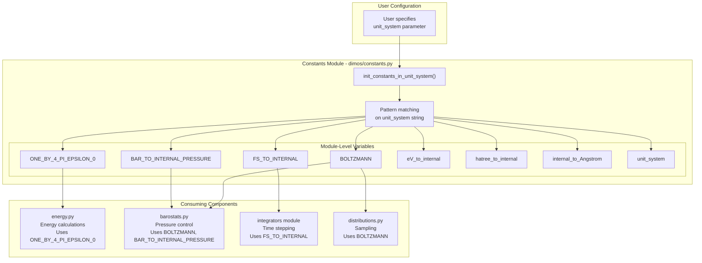
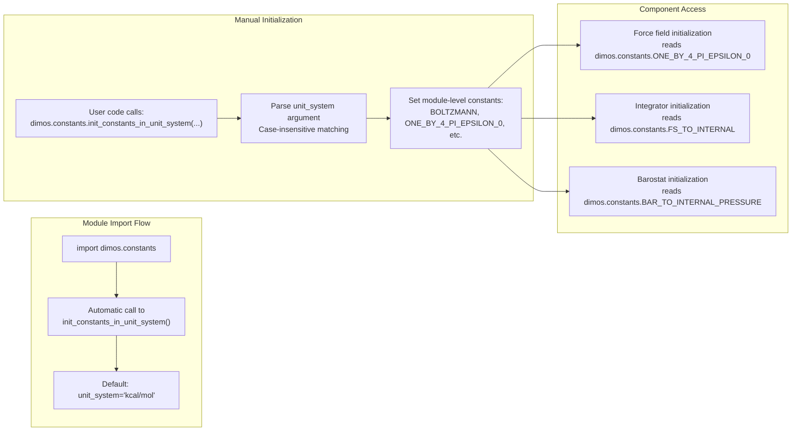

# Unit Systems and Physical Constants

<details>
<summary>Relevant source files</summary>

The following files were used as context for generating this wiki page:

- [dimos/constants.py](dimos/constants.py)

</details>


This document explains the unit system management and physical constants infrastructure in DIMOS. The constants module provides centralized handling of physical constants and conversion factors, ensuring consistency across all simulation components including energy calculations, integrators, barostats, and sampling methods.

For information about using these constants in specific simulation contexts, see [Integration Methods](#3.2), [Pressure Control with Barostats](#3.4), and [Energy Calculations](#3.1).

**Sources:** [dimos/constants.py:374-392]()

## Purpose and Architecture

The DIMOS framework uses a module-level constants system that must be initialized once at the start of a simulation. All components then access these constants through the `dimos.constants` module, ensuring that energy calculations, time integration, pressure control, and statistical distributions all operate in a consistent unit system.

The constants module supports three primary unit conventions:
- **Amber units** (kcal/mol)
- **OpenMM/GROMACS units** (kJ/mol)  
- **Reduced units** (LJ/dimensionless)

**Sources:** [dimos/constants.py:374-392](), [dimos/constants.py:399-431]()

### Unit System Module Architecture



**Diagram: Constants Module Architecture and Component Dependencies**

The module uses Python's `sys.modules[__name__]` pattern to store constants as module-level attributes, allowing all components to import and reference the same constant values after initialization.

**Sources:** [dimos/constants.py:397-398](), [dimos/constants.py:433-465]()

## Supported Unit Systems

DIMOS supports three unit system conventions, each identified by multiple equivalent string identifiers. The `init_constants_in_unit_system()` function performs case-insensitive pattern matching to recognize these identifiers.

| Unit System | Identifiers | Energy Units | Length Units | Primary Use Case |
|-------------|-------------|--------------|--------------|------------------|
| Amber | `'kcal/mol'`, `'amber'` | kcal/mol | Angstrom | Classical MD with Amber force fields |
| OpenMM/GROMACS | `'kJ/mol'`, `'openmm'`, `'gromacs'` | kJ/mol | nanometers | Classical MD with GROMACS force fields |
| Reduced/LJ | `'lj'`, `'none'`, `'unitless'` | dimensionless | sigma units | Coarse-grained or LJ fluid simulations |

**Sources:** [dimos/constants.py:409-415](), [dimos/constants.py:435-461]()

### Amber Unit System

The Amber unit system uses kcal/mol for energy and Angstroms for distance. This is the default unit system in DIMOS and is initialized automatically if no system is specified.

```python
# Initialized when unit_system matches "kcal/mol" or "amber"
BOLTZMANN = 1.987204259e-3                # kcal/(mol·K)
ONE_BY_4_PI_EPSILON_0 = 332.05575743860264  # kcal·Å/(mol·e²)
FS_TO_INTERNAL = 48.88821                 # internal time units per fs
BAR_TO_INTERNAL_PRESSURE = 1.439324095976664e-05  # internal pressure per bar
eV_to_internal = 23.060548012069496       # kcal/mol per eV
hatree_to_internal = 627.5094738898777    # kcal/mol per Hartree
internal_to_Angstrom = 1.0                # 1:1 mapping
```

The time unit conversion factor `FS_TO_INTERNAL` of 48.88821 is derived from LAMMPS conventions and relates internal time steps to femtoseconds.

**Sources:** [dimos/constants.py:436-443]()

### OpenMM/GROMACS Unit System

The OpenMM/GROMACS unit system uses kJ/mol for energy and nanometers for distance. This system is commonly used when interfacing with GROMACS topology files or comparing against OpenMM simulations.

```python
# Initialized when unit_system matches 'kJ/mol', "openmm", or "gromacs"
BOLTZMANN = 0.00831446261815324           # kJ/(mol·K)
ONE_BY_4_PI_EPSILON_0 = 138.93545764438203547881  # kJ·nm/(mol·e²)
FS_TO_INTERNAL = 1.0                      # 1:1 mapping
BAR_TO_INTERNAL_PRESSURE = 0.0602214076   # internal pressure per bar
eV_to_internal = 96.48533288249877        # kJ/mol per eV
hatree_to_internal = 2625.4996387552483   # kJ/mol per Hartree
internal_to_Angstrom = 10.0               # nm to Angstrom conversion
```

Note that `internal_to_Angstrom = 10.0` reflects the fact that internal length units are nanometers, which must be converted to Angstroms for output or comparison.

**Sources:** [dimos/constants.py:444-451]()

### Reduced (LJ) Unit System

The reduced unit system uses dimensionless units where fundamental quantities are scaled to unity. This is primarily used for Lennard-Jones fluid simulations and coarse-grained models.

```python
# Initialized when unit_system matches "lj", "none", or "unitless"
BOLTZMANN = 1.0                           # dimensionless
ONE_BY_4_PI_EPSILON_0 = 1.0 / (4 * math.pi)  # dimensionless
FS_TO_INTERNAL = 1.0                      # dimensionless
BAR_TO_INTERNAL_PRESSURE = 1.0            # dimensionless
eV_to_internal = None                     # N/A - incompatible units
hatree_to_internal = None                 # N/A - incompatible units
internal_to_Angstrom = None               # N/A - no natural conversion
```

Energy conversions from eV and Hartree are set to `None` as these conversions are physically meaningless in reduced units. Attempting to use these conversions will raise an error.

**Sources:** [dimos/constants.py:452-459]()

## Physical Constants Reference

### Boltzmann Constant (`BOLTZMANN`)

The Boltzmann constant relates temperature to energy and is fundamental to all statistical mechanics calculations including:
- Langevin thermostat friction coefficients
- Maxwell-Boltzmann velocity distributions
- Metropolis acceptance criteria in Monte Carlo moves
- Well-tempered metadynamics bias factors

The constant is expressed in energy units per kelvin (e.g., kcal/(mol·K) for Amber units).

**Sources:** [dimos/constants.py:437](), [dimos/constants.py:445](), [dimos/constants.py:453]()

### Coulomb Constant (`ONE_BY_4_PI_EPSILON_0`)

The Coulomb constant (1/4πε₀) appears in all electrostatic energy calculations:

```
E_elec = (1/4πε₀) × (q_i × q_j) / r_ij
```

This constant converts the product of charges divided by distance into energy units. The value depends on the chosen unit system and must be consistent with the charge units and distance units used in the force field parameters.

**Sources:** [dimos/constants.py:438](), [dimos/constants.py:446](), [dimos/constants.py:454]()

### Time Conversion Factor (`FS_TO_INTERNAL`)

The `FS_TO_INTERNAL` constant converts femtoseconds (the standard MD input unit for timesteps) to internal time units used by integrators:

```
internal_time = timestep_fs × FS_TO_INTERNAL
```

For Amber units, this factor is 48.88821, derived from LAMMPS unit conventions. For OpenMM/GROMACS and reduced units, the conversion is 1:1.

**Sources:** [dimos/constants.py:439](), [dimos/constants.py:447](), [dimos/constants.py:455]()

### Pressure Conversion Factor (`BAR_TO_INTERNAL_PRESSURE`)

Barostats require pressure conversion from bar (the standard input unit) to internal pressure units:

```
internal_pressure = pressure_bar × BAR_TO_INTERNAL_PRESSURE
```

This conversion accounts for the energy and volume units of the chosen system.

**Sources:** [dimos/constants.py:440](), [dimos/constants.py:448](), [dimos/constants.py:456]()

### Energy Conversion Factors

Two energy conversion factors enable interfacing with machine learning potentials that output energies in atomic units:

- **`eV_to_internal`**: Converts electron volts to the internal energy unit (kcal/mol or kJ/mol)
- **`hatree_to_internal`**: Converts Hartree (atomic units of energy) to the internal energy unit

These are particularly relevant when using ML potentials like MACE or ORB in hybrid ML/MM systems.

**Sources:** [dimos/constants.py:441-442](), [dimos/constants.py:449-450](), [dimos/constants.py:457-458]()

### Length Conversion Factor (`internal_to_Angstrom`)

The `internal_to_Angstrom` factor converts internal length units to Angstroms for output and visualization:

- Amber system: 1.0 (already in Angstroms)
- OpenMM/GROMACS system: 10.0 (converts nanometers to Angstroms)
- Reduced units: None (no natural conversion)

**Sources:** [dimos/constants.py:443](), [dimos/constants.py:451](), [dimos/constants.py:459]()

## Initialization and Usage Patterns

### Initialization Process

The constants module must be initialized before any simulation components are created. The initialization occurs through the `init_constants_in_unit_system()` function, which is called automatically with default Amber units when the module is imported.



**Diagram: Constants Initialization and Access Flow**

**Sources:** [dimos/constants.py:464-465](), [dimos/constants.py:399-431]()

### Code Access Pattern

All DIMOS components access constants through direct module attribute access:

```python
import dimos.constants

# Energy calculations use the Coulomb constant
coulomb_energy = dimos.constants.ONE_BY_4_PI_EPSILON_0 * q1 * q2 / distance

# Barostats use Boltzmann constant and pressure conversion
kT = dimos.constants.BOLTZMANN * temperature
pressure_internal = pressure_bar * dimos.constants.BAR_TO_INTERNAL_PRESSURE

# Integrators use time conversion
dt_internal = timestep_fs * dimos.constants.FS_TO_INTERNAL
```

The module-level storage pattern ensures all components reference the same constant values, preventing unit mismatches between different parts of the simulation.

**Sources:** [dimos/constants.py:397-398]()

### Unit System Validation

The `init_constants_in_unit_system()` function validates the unit system string using pattern matching. If an unrecognized string is provided, it raises `NotImplementedError`:

```python
case _:
    raise NotImplementedError(
        f"The unit system {unit_system} was not recognized or is not implemented"
    )
```

This ensures that typos or invalid unit system specifications are caught immediately at initialization rather than causing subtle numerical errors during simulation.

**Sources:** [dimos/constants.py:460-461]()

## Unit System Selection Guide

### Choosing the Appropriate Unit System

The choice of unit system should be based on the force field topology files and the platform being compared against:

| Force Field Format | Recommended Unit System | Rationale |
|-------------------|------------------------|-----------|
| Amber `.prmtop` files | `'amber'` or `'kcal/mol'` | Native Amber parameter units |
| GROMACS `.top` files | `'openmm'` or `'gromacs'` or `'kJ/mol'` | Native GROMACS parameter units |
| Pure ML potentials (MACE, ORB) | Either, based on reference data | ML models are unit-agnostic; choose based on training data conventions |
| Hybrid ML/MM systems | Match the MM component | MM parameters dictate the unit system |
| Lennard-Jones fluids | `'lj'` or `'unitless'` | Dimensionless formulation is standard |

**Sources:** [dimos/constants.py:409-415]()

### Unit System Consistency Requirements

Once a unit system is initialized, **all** input quantities must be specified in those units:

- **Timesteps**: femtoseconds (converted internally using `FS_TO_INTERNAL`)
- **Temperatures**: Kelvin (converted to energy using `BOLTZMANN`)
- **Pressures**: bar (converted using `BAR_TO_INTERNAL_PRESSURE`)
- **Coordinates**: Angstroms for Amber, nanometers for OpenMM/GROMACS
- **Box dimensions**: Same length units as coordinates
- **Force field parameters**: Must match the topology file's native units

Mixing units from different systems will produce incorrect energies, forces, and dynamics.

**Sources:** [dimos/constants.py:399-431]()

### Comparison Across Platforms

When benchmarking DIMOS against other MD engines (OpenMM, TorchMD, LAMMPS), use the target platform's native unit system:

- **OpenMM comparisons**: Use `'openmm'` or `'kJ/mol'`
- **LAMMPS comparisons**: Use `'amber'` or `'kcal/mol'` (LAMMPS "real" units)
- **GROMACS comparisons**: Use `'gromacs'` or `'kJ/mol'`

This eliminates unit conversion as a source of numerical discrepancies in validation tests.

**Sources:** [dimos/constants.py:435-461]()

## Summary of Module-Level Constants

The following table summarizes all module-level constants set by `init_constants_in_unit_system()`:

| Constant Name | Physical Quantity | Amber Value | OpenMM/GROMACS Value | Reduced Units Value |
|---------------|-------------------|-------------|----------------------|---------------------|
| `BOLTZMANN` | Boltzmann constant | 1.987204259e-3 kcal/(mol·K) | 0.00831446261815324 kJ/(mol·K) | 1.0 (dimensionless) |
| `ONE_BY_4_PI_EPSILON_0` | Coulomb constant | 332.0558 kcal·Å/(mol·e²) | 138.9355 kJ·nm/(mol·e²) | 1/(4π) (dimensionless) |
| `FS_TO_INTERNAL` | Time conversion | 48.88821 | 1.0 | 1.0 |
| `BAR_TO_INTERNAL_PRESSURE` | Pressure conversion | 1.4393e-5 | 0.0602214076 | 1.0 |
| `eV_to_internal` | eV to energy units | 23.0605 kcal/mol | 96.4853 kJ/mol | None |
| `hatree_to_internal` | Hartree to energy units | 627.509 kcal/mol | 2625.50 kJ/mol | None |
| `internal_to_Angstrom` | Length to Angstrom | 1.0 | 10.0 | None |
| `unit_system` | Current system name | stored string | stored string | stored string |

**Sources:** [dimos/constants.py:436-459]()

---