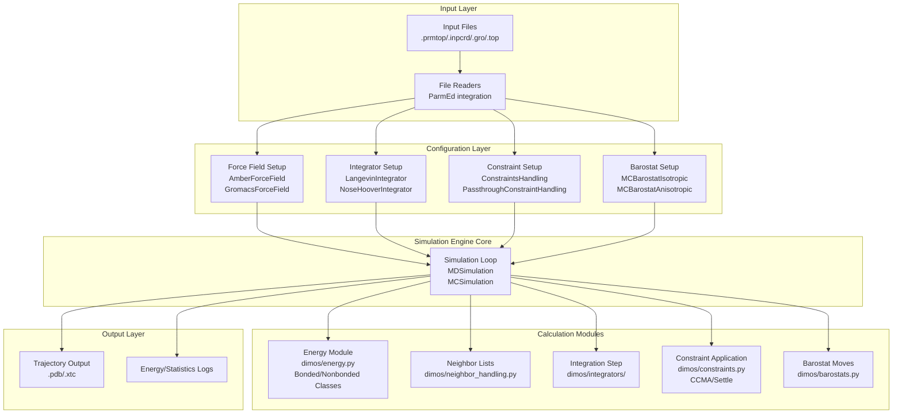
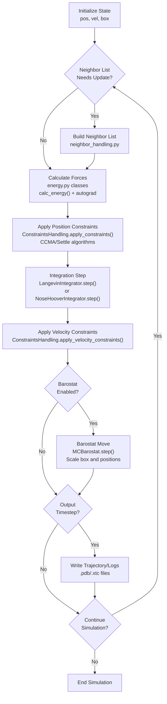
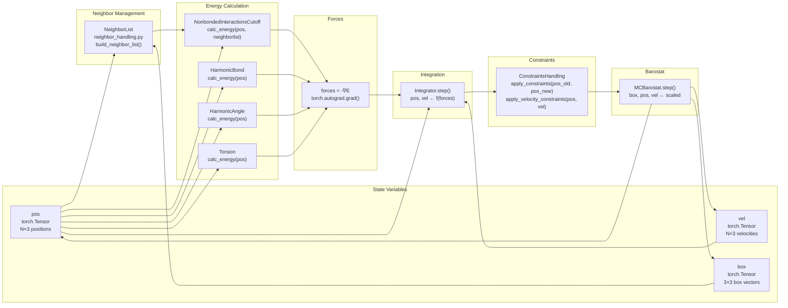
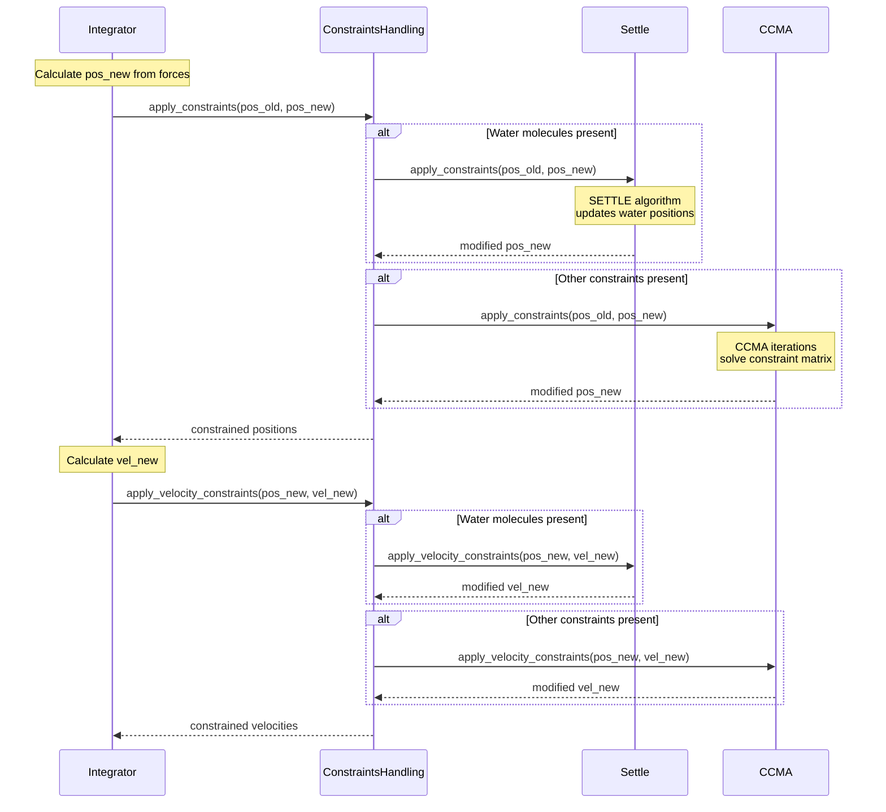

# Simulation Engine

<details>
<summary>Relevant source files</summary>

The following files were used as context for generating this wiki page:

- [dimos/__init__.py](dimos/__init__.py)
- [dimos/constraints.py](dimos/constraints.py)
- [dimos/energy.py](dimos/energy.py)

</details>


The Simulation Engine is the core computational framework in DIMOS responsible for executing molecular dynamics and Monte Carlo simulations. It orchestrates the integration of atomic positions and velocities over time, manages thermodynamic ensembles through thermostats and barostats, enforces molecular constraints, and calculates energies and forces from the force field. This page describes the overall architecture and data flow of the simulation engine; detailed information about specific subsystems can be found in the following child pages: [Energy Calculations](#3.1), [Integration Methods](#3.2), [Molecular Constraints](#3.3), and [Pressure Control with Barostats](#3.4).

## Architecture Overview

The simulation engine follows a modular design where independent components can be combined to create different simulation protocols. The main components include force field evaluation, integration schemes, constraint algorithms, and optional barostat moves for NPT simulations.



**Sources:** [dimos/__init__.py:374-389](), Diagram 5 from system overview

## Simulation Loop Flow

The core simulation loop follows a standard molecular dynamics workflow with constraint correction steps. The loop maintains atomic positions, velocities, and box dimensions, updating them at each timestep through a series of coordinated operations.



**Sources:** [dimos/constraints.py:625-655](), [dimos/energy.py:649-681](), Diagram 5 from system overview

## Core Components

### Energy Calculation System

The energy calculation system computes forces and energies from the force field. It handles both bonded interactions (bonds, angles, torsions) and nonbonded interactions (Lennard-Jones, electrostatics) with support for various cutoff methods, switching functions, and long-range treatments.

**Key Classes:**
- `NonbondedInteractionsCutoff` - nonbonded with simple cutoff and reaction field [dimos/energy.py:695-810]()
- `NonbondedInteractionsEwald` - nonbonded with Ewald/PME summation [dimos/energy.py:812-942]()
- `LennardJones` - Lennard-Jones potential [dimos/energy.py:1183-1419]()
- `ElectrostaticsCutoff` - electrostatics with reaction field [dimos/energy.py:1421-1618]()
- `HarmonicBond` - harmonic bond potential [dimos/energy.py:2228-2280]()
- `HarmonicAngle` - harmonic angle potential [dimos/energy.py:2282-2376]()
- `Torsion` - periodic torsion potential [dimos/energy.py:2457-2534]()
- `DispersionCorrection` - long-range dispersion correction [dimos/energy.py:2539-2697]()

For detailed information, see [Energy Calculations](#3.1).

**Sources:** [dimos/energy.py:374-384](), [dimos/__init__.py:377]()

### Integration Methods

Integrators propagate the system forward in time by updating positions and velocities. DIMOS provides two main integration schemes: Langevin dynamics for NVT simulations with implicit solvent friction, and Nosé-Hoover dynamics for deterministic thermostatting.

**Available Integrators:**
- `LangevinIntegrator` - stochastic dynamics with friction and random forces
- `NoseHooverIntegrator` - deterministic thermostat with extended variables

Both integrators are imported from the `dimos.integrators` module [dimos/__init__.py:380]().

For detailed information, see [Integration Methods](#3.2).

**Sources:** [dimos/__init__.py:380]()

### Molecular Constraints

The constraint system maintains rigid bonds and angles during integration to allow larger timesteps. It automatically detects water molecules and applies the specialized SETTLE algorithm, while using CCMA for general constraints.

**Key Classes:**
- `ConstraintsHandling` - main coordinator for all constraints [dimos/constraints.py:423-656]()
- `CCMA` - Constant Constraint Matrix Approximation algorithm [dimos/constraints.py:658-914]()
- `Settle` - specialized algorithm for rigid water molecules [dimos/constraints.py:916-1183]()
- `PassthroughConstraintHandling` - no-op for unconstrained systems [dimos/constraints.py:400-420]()

The `ConstraintsHandling` class automatically partitions constraints between SETTLE (for water) and CCMA (for everything else) based on topology analysis [dimos/constraints.py:503-611]().

For detailed information, see [Molecular Constraints](#3.3).

**Sources:** [dimos/constraints.py:374-394](), [dimos/__init__.py:375]()

### Pressure Control

Barostats enable NPT ensemble simulations by adjusting the simulation box size to maintain constant pressure. DIMOS implements Monte Carlo barostats that attempt periodic box scaling moves accepted via the Metropolis criterion.

**Available Barostats:**
- `MCBarostatIsotropic` - isotropic pressure coupling (uniform scaling)
- `MCBarostatAnisotropic` - anisotropic pressure coupling (independent axis scaling)

Both classes are imported from `dimos.barostats` [dimos/__init__.py:374]().

For detailed information, see [Pressure Control with Barostats](#3.4).

**Sources:** [dimos/__init__.py:374]()

## Component Interaction Patterns

The simulation engine components interact through well-defined interfaces. The following diagram shows the data dependencies and method call patterns during a single simulation step.



**Sources:** [dimos/energy.py:649-681](), [dimos/constraints.py:625-655](), Diagram 5 from system overview

## Periodic Boundary Conditions

Throughout the simulation engine, periodic boundary conditions are handled consistently. Most calculation classes accept `periodic` (bool) and `box` (torch.Tensor) parameters during initialization and provide an `update_box()` method to handle box changes during NPT simulations.

**Key Features:**
- All energy classes inherit from `CommonNonBonded` or `CommonBonded` base classes that provide `update_box()` [dimos/energy.py:402-413](), [dimos/energy.py:2125-2141]()
- Distance calculations use `periodic_correction()` from `dimos.utils` [dimos/constraints.py:398]()
- The constraint system updates box dimensions via `ConstraintsHandling.update_box()` [dimos/constraints.py:614-623]()
- Barostats modify box dimensions and automatically notify all components [dimos/__init__.py:374]()

**Sources:** [dimos/energy.py:402-413](), [dimos/energy.py:2125-2141](), [dimos/constraints.py:614-623]()

## Unit System Integration

The simulation engine uses the centralized unit system from `dimos.constants` to ensure consistency across all calculations. Physical constants like `BOLTZMANN`, `ONE_BY_4_PI_EPSILON_0`, and unit conversion factors are set during initialization based on the chosen unit system (Amber, GROMACS, or reduced units).

**Usage Patterns:**
- Electrostatic energies multiply by `constants.ONE_BY_4_PI_EPSILON_0` [dimos/energy.py:1560](), [dimos/energy.py:1582]()
- Time conversion via `constants.FS_TO_INTERNAL` in integrators
- Pressure conversion via `constants.BAR_TO_INTERNAL_PRESSURE` in barostats

For detailed information about unit systems, see [Unit Systems and Physical Constants](#2.3).

**Sources:** [dimos/energy.py:393](), [dimos/energy.py:1560](), [dimos/energy.py:1582]()

## Constraint Handling Workflow

The constraint system uses a two-phase approach: position constraints ensure geometric constraints are satisfied, while velocity constraints ensure velocities are consistent with the constraints (zero relative velocity along constrained bonds).



**Sources:** [dimos/constraints.py:625-655](), [dimos/constraints.py:996-1120](), [dimos/constraints.py:826-913]()

## Neighbor List Management

The simulation engine uses neighbor lists to accelerate nonbonded calculations by tracking which atom pairs are within interaction range. The neighbor list includes a "skin" distance beyond the cutoff to reduce rebuild frequency.

**Key Components:**
- Neighbor list building in `dimos.neighbor_handling` [dimos/__init__.py:383]()
- Cutoff-based filtering in energy classes [dimos/energy.py:666-673]()
- Distance calculations via `get_distances_edge_list()` [dimos/energy.py:390]()

The neighbor list is rebuilt when atoms move beyond a threshold distance, balancing computational cost of list construction against redundant pair evaluations.

**Sources:** [dimos/__init__.py:383](), [dimos/energy.py:666-673]()

## Force and Energy Calculation

Forces are computed via automatic differentiation of the total energy with respect to atomic positions. All energy classes implement a `calc_energy(pos, ...)` method that returns a scalar PyTorch tensor, enabling gradient calculation through `torch.autograd.grad()`.

**Energy Composition:**
```
E_total = E_bonded + E_nonbonded + E_corrections

E_bonded = E_bonds + E_angles + E_torsions + E_cmap
E_nonbonded = E_LJ + E_electrostatic  
E_corrections = E_dispersion
```

Each energy term is calculated by a separate class instance, and the total energy is summed before differentiation [dimos/energy.py:374-384]().

**Sources:** [dimos/energy.py:374-384]()

## Extension Points

The modular architecture allows straightforward extension of the simulation engine:

| Component | Extension Method | Base Class |
|-----------|-----------------|------------|
| New energy term | Implement `calc_energy(pos)` method | `CommonBonded` or `CommonNonBonded` |
| New integrator | Implement `step()` method | Check `dimos.integrators` module |
| New constraint algorithm | Implement `apply_constraints()` and `apply_velocity_constraints()` | Add to `ConstraintsHandling` |
| New barostat scheme | Implement `step()` method with box scaling | Check `dimos.barostats` module |

All components follow consistent interfaces for initialization (`periodic`, `box` parameters) and updates (`update_box()` method), ensuring interoperability.

**Sources:** [dimos/energy.py:402-413](), [dimos/energy.py:2125-2141](), [dimos/__init__.py:374-389]()

---