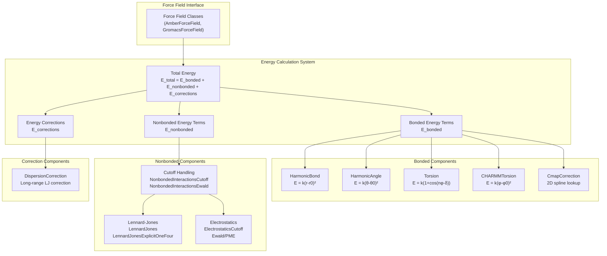
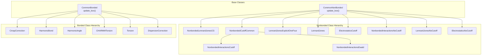
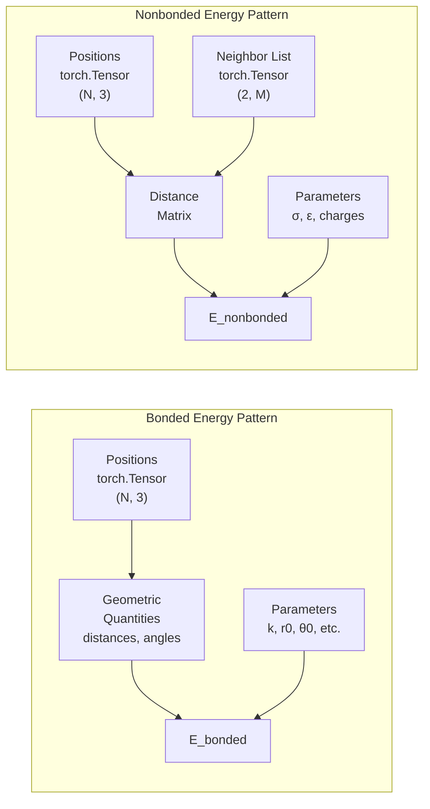
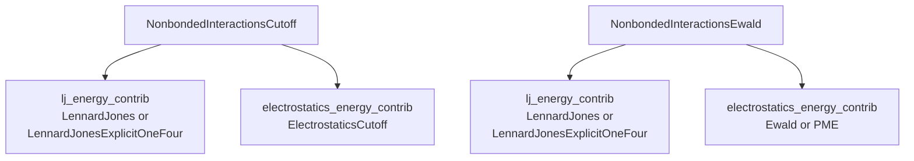
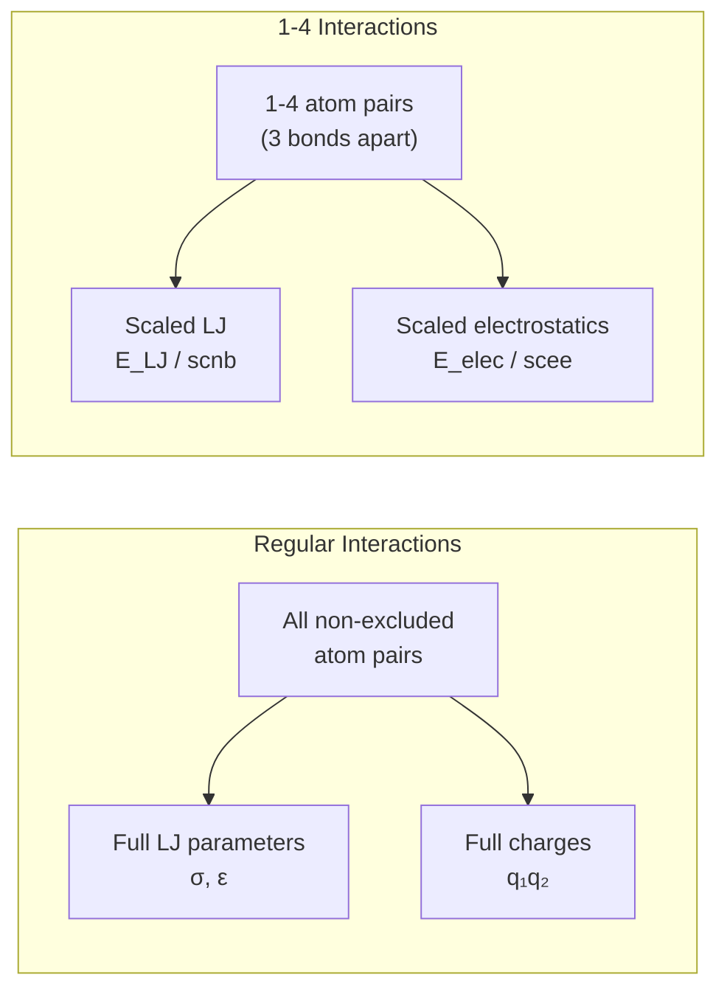

# Energy Calculations

<details>
<summary>Relevant source files</summary>

The following files were used as context for generating this wiki page:

- [dimos/constants.py](dimos/constants.py)
- [dimos/energy.py](dimos/energy.py)

</details>


## Purpose and Scope

This page provides an overview of the energy calculation system in DIMOS, which computes the potential energy of molecular systems using various force field terms. The energy calculation system is the core of the simulation engine, providing forces through automatic differentiation of the computed energies.

For detailed information about specific energy components, see:
- Bonded interactions (bonds, angles, torsions, CMAP): [Bonded Interactions](#3.1.1)
- Nonbonded interactions (Lennard-Jones, electrostatics): [Nonbonded Interactions](#3.1.2)
- Long-range methods and corrections (Ewald, PME, dispersion): [Long-Range Methods and Corrections](#3.1.3)

For information about unit systems and physical constants used in energy calculations, see [Unit Systems and Physical Constants](#2.3).

## Energy Calculation Architecture

The energy calculation system in DIMOS is organized into separate components for different types of interactions, which are combined by force field classes to compute the total system energy.

### High-Level Energy Components



**Sources:** [dimos/energy.py:374-2698]()

### Class Hierarchy and Organization

The energy calculation classes follow a clear inheritance structure with base classes providing common functionality:



**Sources:** [dimos/energy.py:402-414](), [dimos/energy.py:2125-2141]()

## Energy Calculation Flow

Energy calculations in DIMOS follow a consistent pattern across all components:

| Step | Description | Key Methods |
|------|-------------|-------------|
| 1. Initialization | Create energy calculator objects with parameters | `__init__()` methods |
| 2. Position Input | Provide atomic positions to calculator | `calc_energy(pos)` |
| 3. Distance Calculation | Compute pairwise distances or geometric quantities | `get_distances_edge_list()`, `get_distance_vectors()`, `get_dihedral_angle()` |
| 4. Energy Evaluation | Apply energy function to geometric quantities | Class-specific energy formulas |
| 5. Force Derivation | Automatic differentiation via PyTorch | `torch.autograd.grad()` (external to energy module) |

### Energy Calculation Patterns



**Sources:** [dimos/energy.py:649-681](), [dimos/energy.py:2265-2280]()

## Main Energy Calculator Classes

### Nonbonded Interaction Classes

The main entry points for nonbonded energy calculations are:

| Class | Purpose | Cutoff Method | Long-Range Treatment |
|-------|---------|---------------|----------------------|
| `NonbondedInteractionsCutoff` | Standard cutoff method | Simple cutoff | Reaction field approximation |
| `NonbondedInteractionsEwald` | Ewald summation | Real-space cutoff | Ewald/PME reciprocal space |
| `NonbondedInteractionsNoCutoff` | No cutoff (small systems) | None | Exact all-pair calculation |
| `NonbondedLennardJonesCG` | Coarse-grained LJ only | Cutoff | None |

Each of these classes internally uses specialized calculators for Lennard-Jones and electrostatic components:



**Sources:** [dimos/energy.py:695-810](), [dimos/energy.py:812-943]()

### Bonded Interaction Classes

The bonded energy calculation uses separate calculator objects for each term type:

| Class | Energy Function | Parameters |
|-------|-----------------|------------|
| `HarmonicBond` | E = k(r - r₀)² | k (force constant), r₀ (equilibrium length) |
| `HarmonicAngle` | E = k(θ - θ₀)² | k (force constant), θ₀ (equilibrium angle) |
| `Torsion` | E = k(1 + cos(nφ - δ)) | k (barrier height), n (multiplicity), δ (phase) |
| `CHARMMTorsion` | E = k(φ - φ₀)² | k (force constant), φ₀ (equilibrium angle) |
| `CmapCorrection` | 2D spline interpolation | Grid of correction values |

**Sources:** [dimos/energy.py:2228-2281](), [dimos/energy.py:2282-2377](), [dimos/energy.py:2457-2535](), [dimos/energy.py:2379-2455](), [dimos/energy.py:2144-2226]()

## Special Features

### 1-4 Interaction Handling

DIMOS handles 1-4 interactions (between atoms separated by exactly three bonds) specially, as they require scaled parameters in most force fields:



The `LennardJonesExplicitOneFour` class uses separate parameters for 1-4 pairs, while `LennardJones` scales them by the `scnb` factor. Similarly, electrostatics are scaled by `scee`.

**Sources:** [dimos/energy.py:945-1181](), [dimos/energy.py:1183-1420]()

### Switching Functions

For Lennard-Jones interactions with cutoffs, DIMOS supports switching functions that smoothly reduce the potential to zero:

```
S(r) = 1                                                    for r ≤ r_switch
S(r) = 1 + t³(-10 + t(15 - 6t))                            for r_switch < r < r_cutoff
       where t = (r - r_switch)/(r_cutoff - r_switch)
S(r) = 0                                                     for r ≥ r_cutoff
```

**Sources:** [dimos/energy.py:1108-1114](), [dimos/energy.py:1333-1341]()

### Unit System Integration

All energy calculations respect the unit system set via `dimos.constants.init_constants_in_unit_system()`. Key constants used in energy calculations:

| Constant | Usage | Module Location |
|----------|-------|-----------------|
| `ONE_BY_4_PI_EPSILON_0` | Coulomb's constant for electrostatics | `dimos.constants` |
| `BOLTZMANN` | Boltzmann constant (used in thermostats) | `dimos.constants` |

The constants are imported and used directly in energy calculations:

**Sources:** [dimos/energy.py:393](), [dimos/energy.py:1560](), [dimos/energy.py:2073]()

## Energy Calculation Code Example

Typical usage pattern for energy calculation (simplified):

```python
# Nonbonded energy with Ewald summation
nonbonded = NonbondedInteractionsEwald(
    sigmas=sigmas,
    epsilons=epsilons,
    sigmas_adjust=sigmas_14,
    epsilons_adjust=epsilons_14,
    adjust_list=pairs_14,
    charges=charges,
    cutoff=cutoff,
    switch_distance=switch_dist,
    tolerance=ewald_tolerance,
    scnb=scnb,
    scee=scee,
    all_exclusions=exclusions,
    dihedral_exclusions=dihedrals,
    periodic=True,
    box=box,
    method="PME"
)

# Bonded energy
bonds = HarmonicBond(bond_list, bond_params, periodic=True, box=box)
angles = HarmonicAngle(angle_list, angle_params, periodic=True, box=box)
torsions = Torsion(torsion_list, torsion_params, periodic=True, box=box)

# Calculate energies
E_nonbonded = nonbonded.calc_energy(positions, neighbor_list)
E_bonds = bonds.calc_energy(positions)
E_angles = angles.calc_energy(positions)
E_torsions = torsions.calc_energy(positions)

E_total = E_nonbonded + E_bonds + E_angles + E_torsions
```

This pattern is used internally by force field classes like `AmberForceField` and `GromacsForceField`.

## Performance Considerations

### Neighbor Lists

Nonbonded energy calculations require neighbor lists to efficiently find atom pairs within the cutoff distance. The neighbor list includes a "skin" distance beyond the cutoff:

- Neighbor list contains all pairs within `cutoff + skin`
- Energy calculation filters to pairs actually within `cutoff`
- Neighbor list is updated only when atoms move significantly

**Sources:** [dimos/energy.py:669-672](), [dimos/energy.py:526-534]()

### Precomputed Coefficients

Many energy calculators precompute coefficient tensors during initialization to avoid repeated calculations:

- Lennard-Jones: `aa` and `bb` coefficients for r¹² and r⁶ terms
- Electrostatics: Charge products
- 1-4 interactions: Scaled parameters

**Sources:** [dimos/energy.py:1855-1870](), [dimos/energy.py:2037-2043]()

### PyTorch Compilation

All energy calculation classes are compatible with `torch.compile()` for JIT optimization, enabling significant performance improvements when used with the compiled simulation loop.

**Sources:** Referenced in high-level system architecture diagrams

---