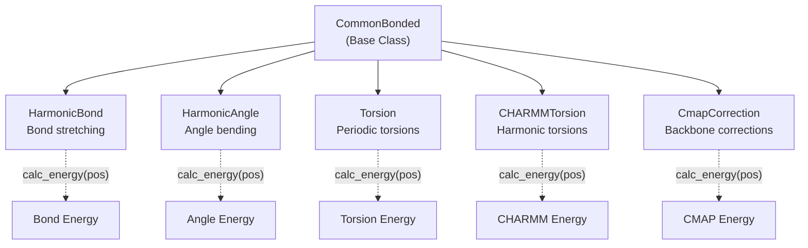
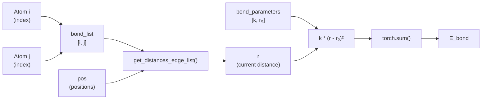
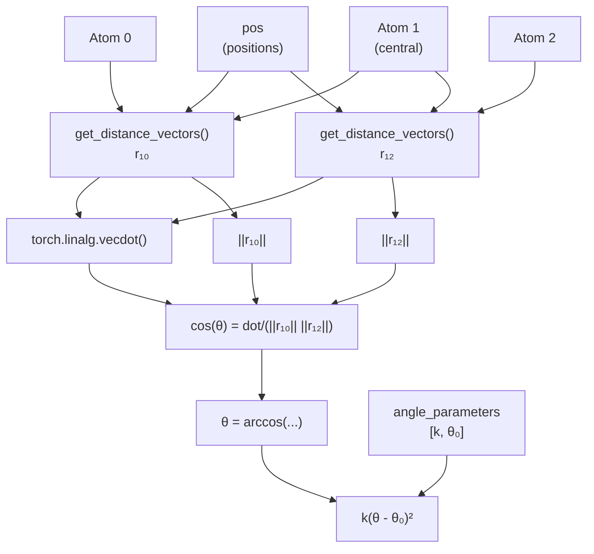
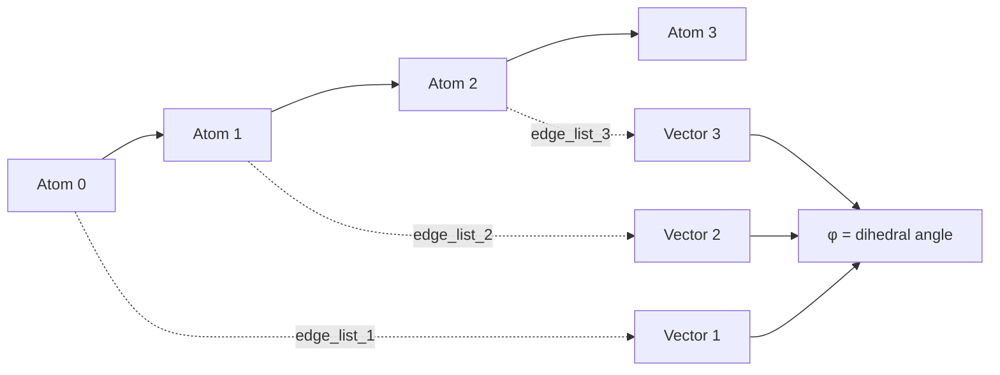
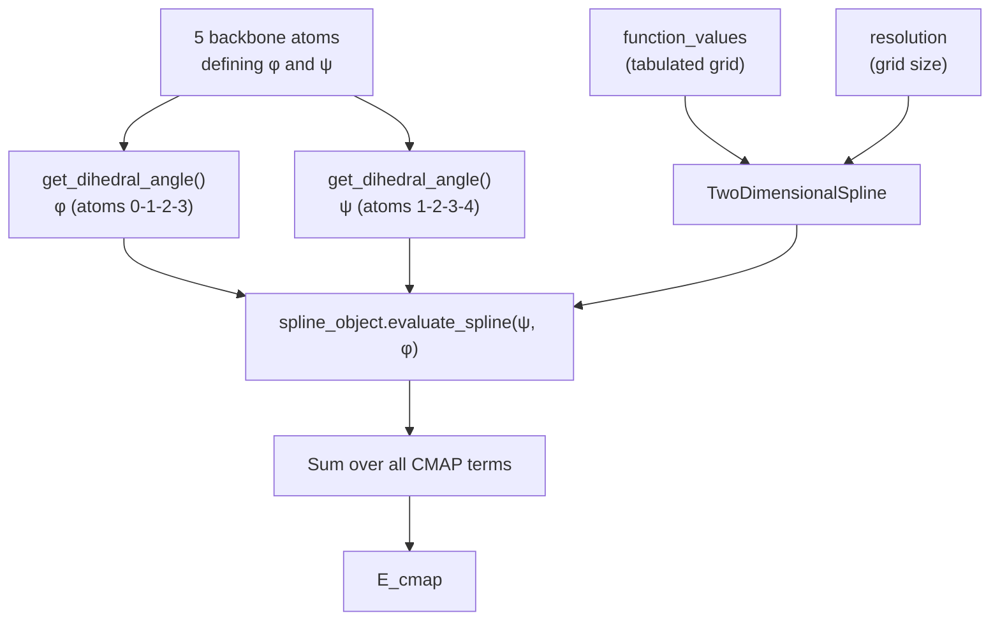
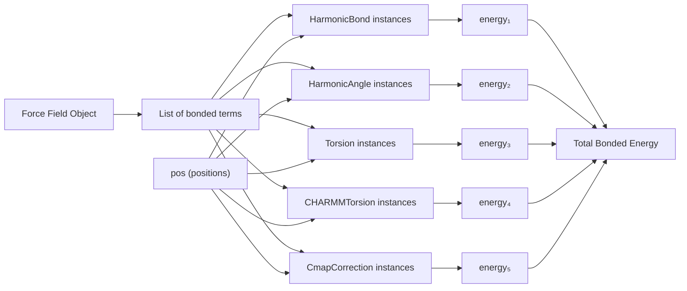

# Bonded Interactions

<details>
<summary>Relevant source files</summary>

The following files were used as context for generating this wiki page:

- [benchmark/proteins/ala2_tip3p.top](benchmark/proteins/ala2_tip3p.top)
- [dimos/energy.py](dimos/energy.py)

</details>


## Purpose and Scope

This page documents the bonded interaction energy terms implemented in DIMOS. Bonded interactions describe the intramolecular forces that hold molecules together: chemical bonds, bond angles, and torsional rotations around bonds. These terms are essential components of classical molecular mechanics force fields.

For information about nonbonded interactions (Lennard-Jones and electrostatics), see [Nonbonded Interactions](#3.1.2). For long-range electrostatics and analytical corrections, see [Long-Range Methods and Corrections](#3.1.3).

## Overview

DIMOS implements five types of bonded energy terms:

| Term Type | Class Name | Description | Equation Form |
|-----------|-----------|-------------|---------------|
| Bonds | `HarmonicBond` | Harmonic bond stretching | E = k(r - r₀)² |
| Angles | `HarmonicAngle` | Harmonic angle bending | E = k(θ - θ₀)² |
| Torsions | `Torsion` | Periodic dihedral angles | E = k(1 + cos(nφ - δ)) |
| CHARMM Torsions | `CHARMMTorsion` | Harmonic dihedral angles | E = k(φ - φ₀)² |
| CMAP | `CmapCorrection` | 2D correction maps for protein backbones | E = f(φ, ψ) |

All bonded interaction classes inherit from `CommonBonded` and implement a `calc_energy(pos)` method that computes the energy contribution given atomic positions.

**Sources:** [dimos/energy.py:2123-2698]()

## Class Hierarchy



**Sources:** [dimos/energy.py:2125-2141](), [dimos/energy.py:2228-2280](), [dimos/energy.py:2282-2376](), [dimos/energy.py:2457-2534](), [dimos/energy.py:2379-2454](), [dimos/energy.py:2144-2225]()

## Harmonic Bond Interactions

### Mathematical Form

Harmonic bonds model the energy required to stretch or compress a chemical bond:

```
E_bond = k(r - r₀)²
```

where:
- `k` is the force constant (energy per length²)
- `r` is the current bond length
- `r₀` is the equilibrium bond length

### Implementation

The `HarmonicBond` class computes bond energies for all bonds in the system:

| Attribute | Type | Description |
|-----------|------|-------------|
| `bond_list` | `torch.Tensor` | Nx2 tensor of atom indices defining bonds |
| `bond_parameters` | `torch.Tensor` | Nx2 tensor of [k, r₀] for each bond |
| `periodic` | `bool` | Whether to use periodic boundary conditions |
| `box` | `torch.Tensor` | Box vectors for periodic systems |

The energy calculation:
1. Computes distances for all bonds using `get_distances_edge_list()`
2. Calculates deviations from equilibrium: (r - r₀)
3. Sums the squared deviations weighted by force constants



**Sources:** [dimos/energy.py:2228-2280](), [dimos/utils.py]()

### Example from Topology File

From the alanine dipeptide system, bond definitions appear in the `[bonds]` section:

```
[ bonds ]
;    ai     aj funct         c0         c1
      2      3     1   0.10900 284512.000000
      1      2     1   0.10900 284512.000000
      5      6     1   0.12290 476976.000000
```

Where:
- `ai`, `aj`: atom indices (1-based in file, converted to 0-based)
- `funct`: function type (1 = harmonic bond)
- `c0`: equilibrium length r₀ (nm)
- `c1`: force constant k (kJ mol⁻¹ nm⁻²)

**Sources:** [benchmark/proteins/ala2_tip3p.top:66-88]()

## Harmonic Angle Interactions

### Mathematical Form

Harmonic angles model the energy required to bend a bond angle:

```
E_angle = k(θ - θ₀)²
```

where:
- `k` is the force constant (energy per radian²)
- `θ` is the current angle between three atoms
- `θ₀` is the equilibrium angle

### Implementation

The `HarmonicAngle` class stores angle triplets and computes energies using vector operations:

| Attribute | Type | Description |
|-----------|------|-------------|
| `edge_list_10` | `torch.Tensor` | 2xN tensor connecting atoms 0→1 |
| `edge_list_12` | `torch.Tensor` | 2xN tensor connecting atoms 2→1 |
| `angle_parameters` | `torch.Tensor` | Nx2 tensor of [k, θ₀] for each angle |

The energy calculation:
1. Obtains vectors r₁₀ and r₁₂ from central atom to endpoints
2. Computes the angle using dot product: cos(θ) = (r₁₀·r₁₂)/(|r₁₀||r₁₂|)
3. Takes arccos to get angle θ
4. Sums squared deviations: k(θ - θ₀)²



**Sources:** [dimos/energy.py:2282-2376](), [dimos/utils.py]()

### Example from Topology File

From the alanine dipeptide system, angle definitions appear in the `[angles]` section:

```
[ angles ]
;    ai     aj     ak funct         c0         c1
      5      7      8     1   120.0000514 251.040000
      3      2      4     1   109.5000469 292.880000
      7      9     11     1   109.7000470 669.440000
```

Where:
- `ai`, `aj`, `ak`: atom indices (aj is the central atom)
- `funct`: function type (1 = harmonic angle)
- `c0`: equilibrium angle θ₀ (degrees in file, converted to radians)
- `c1`: force constant k (kJ mol⁻¹ rad⁻²)

**Sources:** [benchmark/proteins/ala2_tip3p.top:134-171]()

## Torsional Interactions

Torsional (dihedral) interactions describe rotation around bonds. DIMOS supports two formulations: periodic torsions (standard in AMBER/GROMACS) and CHARMM-style harmonic torsions.

### Atom Definitions for Torsions

Both torsion types involve four atoms defining the dihedral angle:



The dihedral angle φ is computed using `get_dihedral_angle()` which returns angles in the range [0, 2π] or [-π, π] depending on convention.

**Sources:** [dimos/energy.py:2421-2423](), [dimos/energy.py:2500-2502](), [dimos/utils.py]()

### Periodic Torsions

#### Mathematical Form

```
E_torsion = k(1 + cos(nφ - δ))
```

where:
- `k` is the force constant (energy)
- `n` is the multiplicity (periodicity)
- `φ` is the dihedral angle
- `δ` is the phase shift

#### Implementation: Torsion Class

| Attribute | Type | Description |
|-----------|------|-------------|
| `edge_list_1` | `torch.Tensor` | 2xN tensor [atom0, atom1] |
| `edge_list_2` | `torch.Tensor` | 2xN tensor [atom1, atom2] |
| `edge_list_3` | `torch.Tensor` | 2xN tensor [atom2, atom3] |
| `torsion_parameters` | `torch.Tensor` | Nx3 tensor of [k, n, δ] |

The calculation follows:
1. Compute dihedral angle φ using the three edge lists
2. Calculate angle difference: nφ - δ
3. Sum contributions: k(1 + cos(nφ - δ))

**Sources:** [dimos/energy.py:2457-2534]()

#### Example from Topology File

```
[ dihedrals ]
;    ai     aj     ak     al funct         c0         c1         c2
      6      5      7      8     1  0.0000000  8.3680000  1
      6      5      7      8     1  180.0000771  10.4600000  2
      5      7      9     15     1  0.0000000  3.5564000  1
      5      7      9     15     1  180.0000771  1.2552000  2
```

Where:
- `ai`, `aj`, `ak`, `al`: four atom indices defining torsion
- `funct`: function type (1 = periodic proper dihedral)
- `c0`: phase shift δ (degrees)
- `c1`: force constant k (kJ/mol)
- `c2`: multiplicity n

Note: Multiple terms with different multiplicities can be defined for the same set of atoms, allowing for complex torsional profiles.

**Sources:** [benchmark/proteins/ala2_tip3p.top:173-226]()

### CHARMM-Style Harmonic Torsions

#### Mathematical Form

```
E_torsion = k(φ - φ₀)²
```

where:
- `k` is the force constant
- `φ` is the dihedral angle
- `φ₀` is the equilibrium angle

This is used for improper dihedrals in CHARMM force fields to maintain planarity or chirality.

#### Implementation: CHARMMTorsion Class

The structure is similar to `Torsion` but with different parameters:

| Attribute | Type | Description |
|-----------|------|-------------|
| `edge_list_1`, `edge_list_2`, `edge_list_3` | `torch.Tensor` | Edge lists defining torsion |
| `torsion_parameters` | `torch.Tensor` | Nx2 tensor of [k, φ₀] |

**Sources:** [dimos/energy.py:2379-2454]()

## CMAP Corrections

### Purpose

CMAP (Correction Map) corrections are 2D energy correction terms used primarily in CHARMM force fields to improve the accuracy of protein backbone energetics. They correct systematic errors in the treatment of φ and ψ backbone dihedral angles.

### Mathematical Form

```
E_cmap = f(φ, ψ)
```

where f is a 2D spline function tabulated on a grid, and φ, ψ are consecutive backbone dihedral angles.

### Implementation: CmapCorrection Class



| Attribute | Type | Description |
|-----------|------|-------------|
| `spline_object` | `TwoDimensionalSpline` | 2D spline interpolator |
| `edge_list_1_0`, `edge_list_2_0`, `edge_list_3_0` | `torch.Tensor` | Edge lists for φ dihedral |
| `edge_list_1_1`, `edge_list_2_1`, `edge_list_3_1` | `torch.Tensor` | Edge lists for ψ dihedral |
| `periodic` | `bool` | Whether dihedrals are periodic |

The CMAP correction:
1. Defines two consecutive backbone dihedrals using 5 atoms
2. Computes both dihedral angles φ and ψ
3. Evaluates the 2D spline function at (φ, ψ)
4. Sums contributions from all CMAP terms

### Status

CMAP corrections are marked as **experimental** with a warning in the code. The implementation uses 2D spline interpolation but requires thorough validation against reference implementations.

**Sources:** [dimos/energy.py:2144-2225](), [dimos/splines.py]()

## Code Structure and Integration

### CommonBonded Base Class

All bonded interaction classes inherit from `CommonBonded`, which provides:

```python
class CommonBonded():
    def update_box(self, box):
        """Update the simulation box dimensions."""
        self.box = box
```

This allows bonded terms to be updated when the box changes during NPT simulations with barostats.

**Sources:** [dimos/energy.py:2125-2141]()

### Energy Calculation Pattern

All bonded classes follow the same interface:



Each bonded term object:
1. Stores the atom indices involved (edge lists)
2. Stores the force field parameters
3. Implements `calc_energy(pos)` to compute energy from positions
4. Returns a scalar energy value

The total bonded energy is the sum of all contributions.

**Sources:** [dimos/energy.py:2265-2280](), [dimos/energy.py:2349-2376](), [dimos/energy.py:2515-2534](), [dimos/energy.py:2436-2454](), [dimos/energy.py:2204-2225]()

## Utility Functions

Bonded energy calculations rely on geometric utility functions:

| Function | Purpose | Returns |
|----------|---------|---------|
| `get_distances_edge_list()` | Compute distances for atom pairs | Distance tensor |
| `get_distance_vectors()` | Compute displacement vectors | Vector tensor |
| `get_dihedral_angle()` | Compute dihedral angles | Angle tensor |

All functions support periodic boundary conditions via the `periodic` and `box` parameters.

**Sources:** [dimos/utils.py]()

## Performance Considerations

### Vectorization

All bonded calculations are fully vectorized using PyTorch operations:
- Bond distances computed for all bonds simultaneously
- Angle calculations use batched vector operations
- Torsions computed in parallel using edge lists

### Periodic Boundaries

When `periodic=True`, distance calculations use minimum image convention to handle molecules crossing periodic boundaries. This is essential for:
- Bonds spanning periodic boundaries
- Angles and torsions involving wrapped coordinates

### Memory Layout

Edge lists are stored as 2xN tensors for efficient indexing:
```python
bond_list = torch.tensor([[atom_i_indices], 
                          [atom_j_indices]])
```

This allows vectorized distance calculations: `distances = get_distances_edge_list(pos, bond_list, ...)`

**Sources:** [dimos/energy.py:2279-2280](), [dimos/energy.py:2335-2336](), [dimos/utils.py]()

---