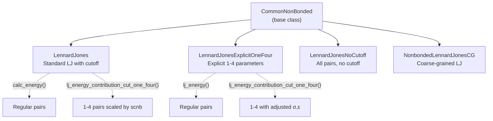
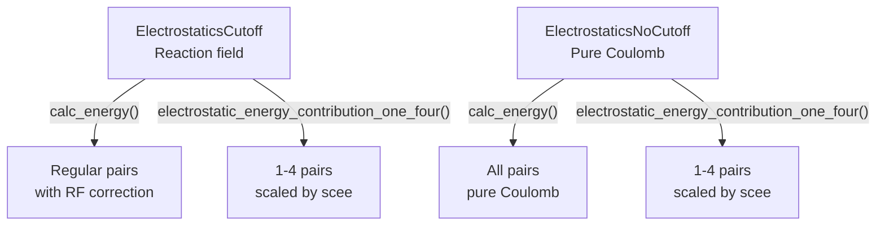
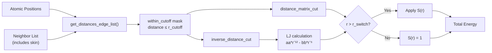
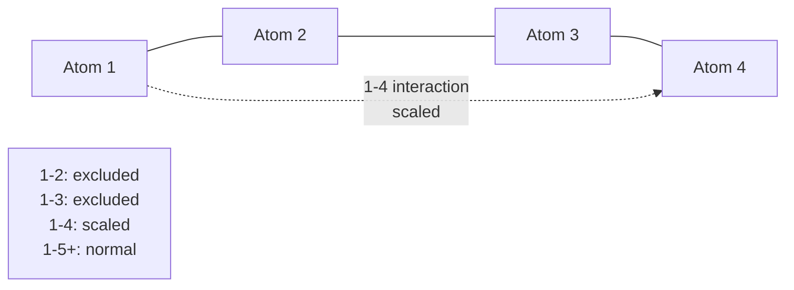
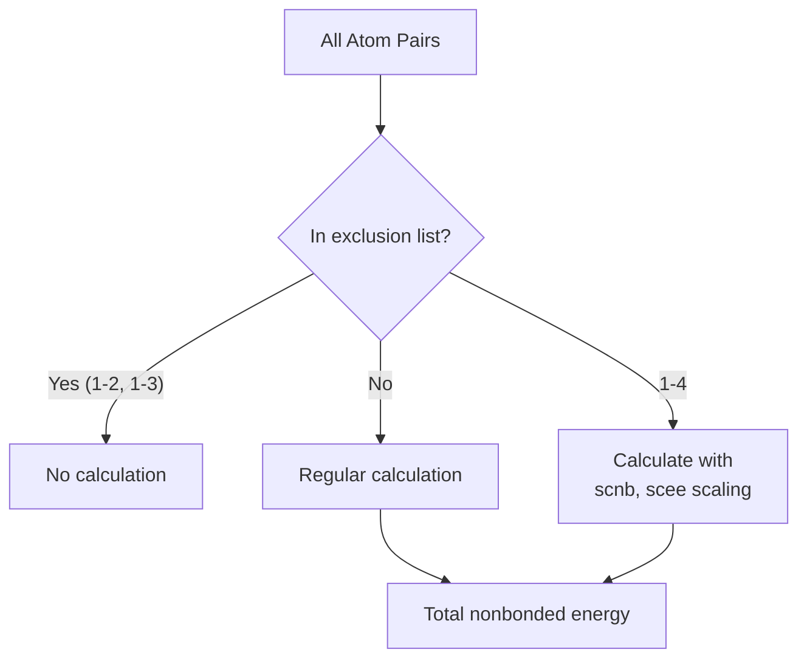
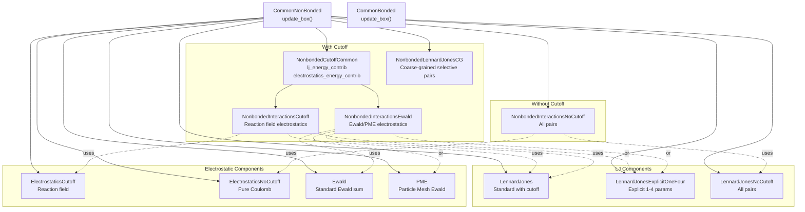
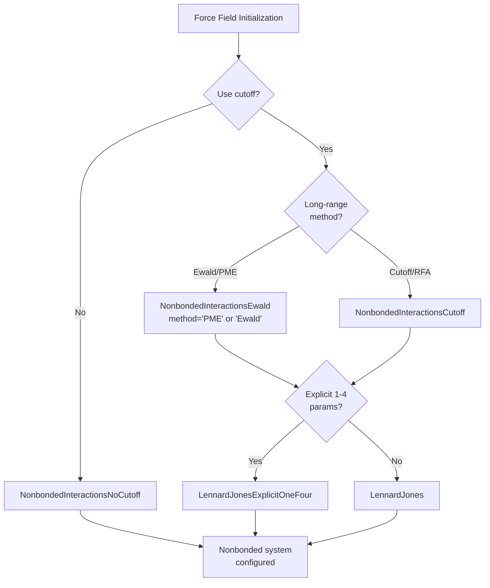
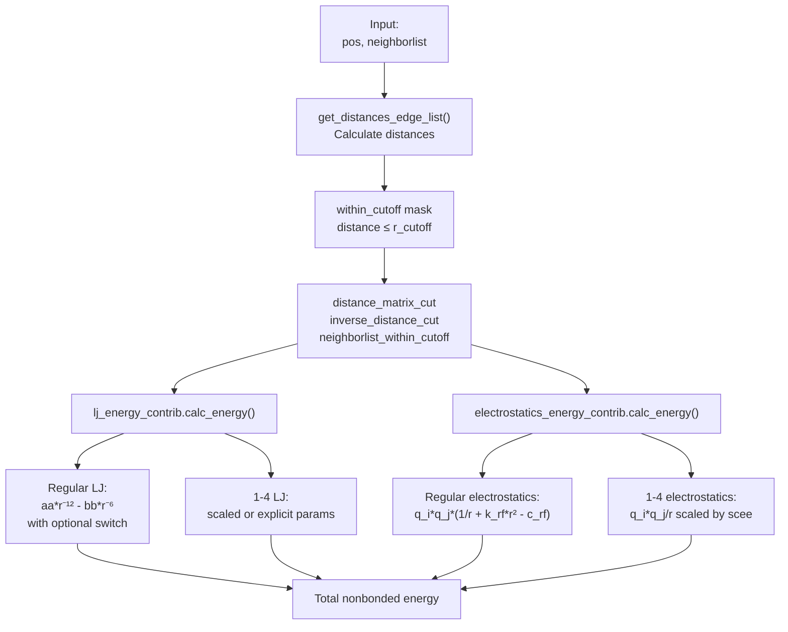
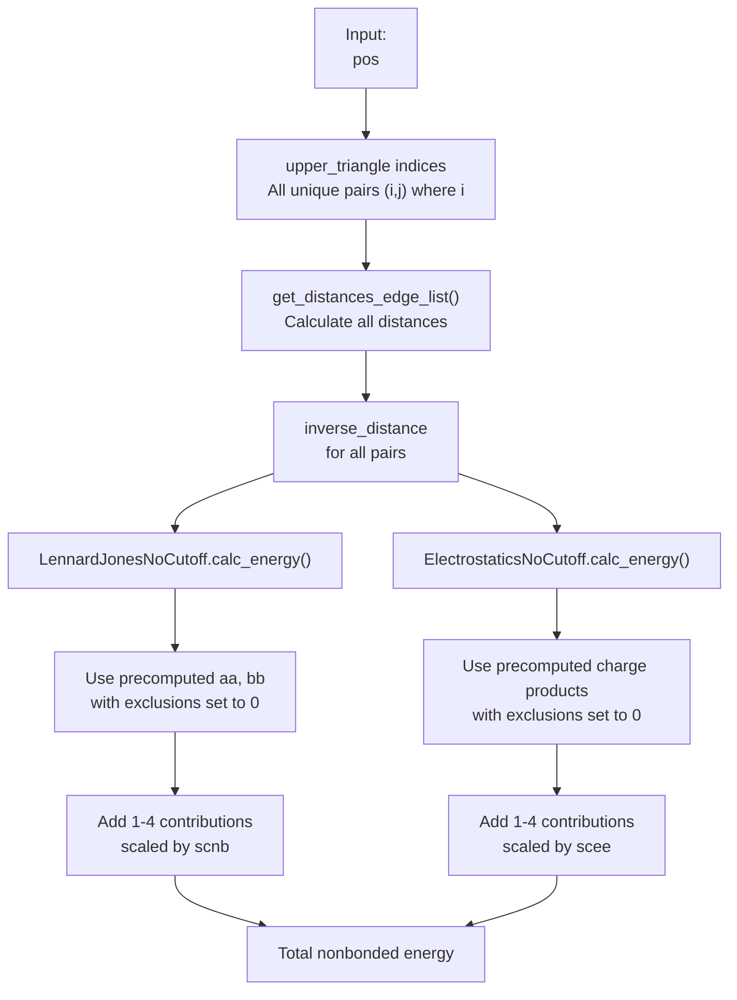

# Nonbonded Interactions

<details>
<summary>Relevant source files</summary>

The following files were used as context for generating this wiki page:

- [benchmark/proteins/ala2_tip3p.top](benchmark/proteins/ala2_tip3p.top)
- [dimos/energy.py](dimos/energy.py)

</details>


## Purpose and Scope

This page documents the nonbonded interaction calculations in DIMOS, covering Lennard-Jones and electrostatic interactions. These interactions occur between atoms that are not directly bonded or connected through angles/dihedrals, and typically constitute the most computationally expensive part of molecular dynamics simulations.

For long-range electrostatic methods (Ewald summation, PME) and analytical corrections, see [Long-Range Methods and Corrections](#3.1.3). For bonded interactions (bonds, angles, torsions), see [Bonded Interactions](#3.1.1).

**Sources:** [dimos/energy.py:374-384]()

## Overview

Nonbonded interactions in DIMOS include two primary components:

1. **Lennard-Jones (van der Waals)** - Short-range repulsion and long-range attraction
2. **Electrostatics** - Coulombic interactions between partial charges

These interactions are computed for all atom pairs except those that are excluded (typically 1-2 and 1-3 neighbors) or have special scaling (1-4 neighbors). The implementation supports multiple calculation methods including cutoff-based approaches with optional switching functions, and systems with or without periodic boundary conditions.

**Sources:** [dimos/energy.py:375-383]()

## Lennard-Jones Interactions

### Potential Form

The Lennard-Jones potential is implemented using the 12-6 form:

```
E_LJ = 4ε[(σ/r)¹² - (σ/r)⁶]
```

where:
- `ε` (epsilon) is the well depth
- `σ` (sigma) is the distance at which the potential is zero
- `r` is the distance between atom pairs

The repulsive r⁻¹² term dominates at short distances, while the attractive r⁻⁶ term dominates at longer distances.

**Sources:** [dimos/energy.py:945-956](), [dimos/energy.py:1184-1195]()

### Combining Rules

When computing interactions between different atom types, DIMOS uses combining rules to determine the effective parameters:

| Combining Rule | Epsilon | Sigma |
|---------------|---------|-------|
| **Lorentz-Berthelot** (arithmetic) | `ε_ij = √(ε_i × ε_j)` | `σ_ij = (σ_i + σ_j)/2` |
| **Geometric** | `ε_ij = √(ε_i × ε_j)` | `σ_ij = √(σ_i × σ_j)` |

The Lorentz-Berthelot rule (also called "arithmetic") is the default and most commonly used in classical force fields like Amber and GROMACS.

**Sources:** [dimos/energy.py:1279-1282](), [dimos/energy.py:1320-1326]()

### Implementation Classes



**Lennard-Jones Classes:**

- **`LennardJones`** [dimos/energy.py:1183-1419]() - Standard implementation with cutoff, optional switching, and scaled 1-4 interactions using the same σ and ε parameters
- **`LennardJonesExplicitOneFour`** [dimos/energy.py:945-1181]() - Allows explicit σ and ε parameters for 1-4 interactions different from regular parameters
- **`LennardJonesNoCutoff`** [dimos/energy.py:1733-1953]() - Computes all pairwise interactions without a cutoff
- **`NonbondedLennardJonesCG`** [dimos/energy.py:416-548]() - Specialized for coarse-grained simulations with selective pair interactions

**Sources:** [dimos/energy.py:416-548](), [dimos/energy.py:945-1181](), [dimos/energy.py:1183-1419](), [dimos/energy.py:1733-1953]()

## Electrostatic Interactions

### Coulomb Potential

Electrostatic interactions follow Coulomb's law:

```
E_elec = (q_i × q_j) / (4πε₀ × r_ij)
```

where:
- `q_i`, `q_j` are the partial charges on atoms i and j
- `ε₀` is the vacuum permittivity
- `r_ij` is the distance between atoms

The Coulomb constant `1/(4πε₀)` is accessed through `constants.ONE_BY_4_PI_EPSILON_0` and is unit-system dependent.

**Sources:** [dimos/energy.py:1421-1476](), [dimos/energy.py:1955-2121]()

### Reaction Field Approximation

For cutoff-based electrostatics, DIMOS implements the reaction field approximation (RFA), which models the solvent beyond the cutoff as a dielectric continuum. The potential becomes:

```
E_RF = (q_i × q_j / 4πε₀) × (1/r + k_rf × r² - c_rf)
```

where the reaction field parameters are:

```
k_rf = (ε_solv - 1) / [(2ε_solv + 1) × r_c³]
c_rf = 3ε_solv / [(2ε_solv + 1) × r_c]
```

Here `ε_solv` is the solvent dielectric constant and `r_c` is the cutoff radius.

**Sources:** [dimos/energy.py:1518-1520](), [dimos/energy.py:1533-1560]()

### Implementation Classes



- **`ElectrostaticsCutoff`** [dimos/energy.py:1421-1618]() - Reaction field approximation with cutoff
- **`ElectrostaticsNoCutoff`** [dimos/energy.py:1955-2121]() - Pure Coulomb for all pairs without cutoff

**Sources:** [dimos/energy.py:1421-1618](), [dimos/energy.py:1955-2121]()

## Cutoff Methods and Switching Functions

### Distance Cutoff

A distance cutoff ignores interactions beyond a specified distance `r_cutoff`. This introduces a discontinuity in both energy and forces at the cutoff, which can affect energy conservation.

### Switching Function

To smooth the transition at the cutoff, DIMOS implements a fifth-order polynomial switching function that gradually reduces interactions between `r_switch` and `r_cutoff`:

```
S(r) = 1                                           for r ≤ r_switch
S(r) = 1 - 10t³ + 15t⁴ - 6t⁵                      for r_switch < r < r_cutoff
S(r) = 0                                           for r ≥ r_cutoff

where t = (r - r_switch) / (r_cutoff - r_switch)
```

The switched energy is `E_switched = E_LJ(r) × S(r)`.

**Sources:** [dimos/energy.py:1108-1113](), [dimos/energy.py:1333-1340]()

### Implementation



The neighbor list typically includes a "skin" distance beyond the cutoff to reduce the frequency of list updates. Only pairs within the actual cutoff are included in energy calculations.

**Sources:** [dimos/energy.py:649-681](), [dimos/energy.py:1293-1342]()

## 1-4 Interactions and Scaling

### What are 1-4 Interactions?

1-4 interactions occur between atoms separated by exactly three bonds (e.g., the first and fourth atoms in a dihedral angle). These atoms are typically excluded from normal nonbonded calculations but are reintroduced with special scaling factors.



**Sources:** [dimos/energy.py:554-595]()

### Scaling Factors

Two scaling factors control 1-4 interactions:

| Parameter | Applies To | Typical Values | GROMACS Name |
|-----------|-----------|----------------|--------------|
| **scnb** | Lennard-Jones | 2.0 (Amber), 1.0 (CHARMM) | `fudgeLJ` |
| **scee** | Electrostatics | 1.2 (Amber), 1.0 (CHARMM) | `fudgeQQ` |

The 1-4 energy is calculated as:

```
E_LJ_14 = E_LJ(r) / scnb
E_elec_14 = E_elec(r) / scee
```

**Sources:** [benchmark/proteins/ala2_tip3p.top:17-19](), [dimos/energy.py:1344-1383](), [dimos/energy.py:1562-1582]()

### Implementation Approaches

DIMOS provides two approaches for handling 1-4 Lennard-Jones interactions:

**Approach 1: Scaled with Same Parameters** (`LennardJones` class)

Uses the same σ and ε as regular interactions but divides the energy by `scnb`:

```python
# Regular interaction
E_ij = aa * r^-12 - bb * r^-6

# 1-4 interaction (same aa, bb)
E_14 = (aa * r^-12 - bb * r^-6) / scnb
```

**Sources:** [dimos/energy.py:1344-1383]()

**Approach 2: Explicit 1-4 Parameters** (`LennardJonesExplicitOneFour` class)

Allows separate σ and ε parameters for 1-4 interactions:

```python
# Regular interaction
E_ij = aa * r^-12 - bb * r^-6

# 1-4 interaction (different aa_14, bb_14)
E_14 = (aa_14 * r^-12 - bb_14 * r^-6) / scnb
```

**Sources:** [dimos/energy.py:1008-1181]()

### 1-4 Pairs in Topology Files

In GROMACS topology files, 1-4 pairs are listed explicitly with their interaction parameters:

```
[ pairs ]
;    ai     aj funct         c0         c1
      6      8     1 0.201450018 0.120121612
      5     10     1 0.293551128 0.076870682
```

Here `c0` represents the combined σ value and `c1` represents the combined ε value for the pair.

**Sources:** [benchmark/proteins/ala2_tip3p.top:90-132]()

## Exclusions

### Types of Exclusions

Interactions between certain atom pairs are excluded from nonbonded calculations:

| Exclusion Type | Description | Typical in Force Fields |
|---------------|-------------|------------------------|
| **1-2 exclusions** | Atoms directly bonded | Always excluded |
| **1-3 exclusions** | Atoms separated by 2 bonds | Always excluded |
| **1-4 exclusions** | Atoms separated by 3 bonds | Excluded from regular calculation, reintroduced with scaling |

The parameter `nrexcl` in topology files specifies how many bonds away to exclude. A value of 3 means exclude 1-2, 1-3, and 1-4 neighbors (with 1-4 reintroduced as scaled interactions).

**Sources:** [benchmark/proteins/ala2_tip3p.top:34-36](), [dimos/energy.py:856-920]()

### Handling in Code

Exclusions are passed to energy calculators and applied by either:
1. **Masking** - Setting interaction coefficients to zero for excluded pairs
2. **List filtering** - Removing excluded pairs from interaction lists



**Sources:** [dimos/energy.py:1861-1865](), [dimos/energy.py:2037-2042]()

## Nonbonded System Architecture

### Class Hierarchy



**Sources:** [dimos/energy.py:402-943]()

### System Selection Logic

The choice of nonbonded system depends on the force field configuration:



**Sources:** [dimos/energy.py:550-943]()

## Energy Calculation Flow

### With Cutoff



**Sources:** [dimos/energy.py:649-681]()

### Without Cutoff

For systems without cutoff, all unique pairs (upper triangle of the interaction matrix) are computed:



**Sources:** [dimos/energy.py:1700-1725]()

## Periodic Boundary Conditions

All nonbonded classes support periodic boundary conditions. When `periodic=True`, the minimum image convention is applied to compute distances:

```
r_ij = r_j - r_i - box * round((r_j - r_i) / box)
```

This ensures that the shortest distance between atom pairs is used, accounting for periodic images.

The `box` parameter can be updated dynamically (e.g., during NPT simulations) using the `update_box()` method available on all nonbonded classes.

**Sources:** [dimos/energy.py:405-413](), [dimos/energy.py:683-693](), [dimos/energy.py:797-809]()

## Coarse-Grained Interactions

The `NonbondedLennardJonesCG` class provides specialized handling for coarse-grained or mixed-resolution simulations:

```python
# Example: Only certain particle types interact
applies_to = torch.tensor([[0, 5], [1, 6], [2, 7]])  # Specific pairs

nonbonded_cg = NonbondedLennardJonesCG(
    num_atoms=num_atoms,
    sigmas=sigmas,
    epsilons=epsilons,
    cutoff=cutoff,
    switch_distance=switch_distance,
    periodic=True,
    box=box,
    applies_to=applies_to  # Only these pairs interact
)
```

When `applies_to` is specified, only the listed particle pairs will have Lennard-Jones interactions calculated. All other pairs are filtered out.

**Sources:** [dimos/energy.py:416-548]()

## Performance Considerations

### Neighbor Lists

Nonbonded calculations are the most expensive part of MD simulations. DIMOS uses neighbor lists to avoid computing distances for all O(N²) pairs. The neighbor list includes atoms within `cutoff + skin` distance, where `skin` is a buffer distance.

The actual energy calculation then filters to only pairs within the cutoff:

```python
distance_matrix = get_distances_edge_list(pos, neighborlist, periodic, box)
within_cutoff = distance_matrix <= self.cutoff
# Only compute energy for pairs within cutoff
```

**Sources:** [dimos/energy.py:649-681]()

### Precomputed Terms

For interactions without cutoff, many terms are precomputed during initialization to avoid redundant calculations:

- **LJ coefficients**: `aa = 4ε(σ)¹²` and `bb = 4ε(σ)⁶` computed once with exclusions applied
- **Charge products**: `q_i × q_j` computed once with exclusions applied

**Sources:** [dimos/energy.py:1855-1870](), [dimos/energy.py:2037-2043]()

### Switching Function Cost

The switching function adds computational cost between `r_switch` and `r_cutoff`. However, it significantly improves energy conservation compared to a hard cutoff. The cost is minimal compared to the benefit for typical system sizes.

**Sources:** [dimos/energy.py:1333-1340]()

---