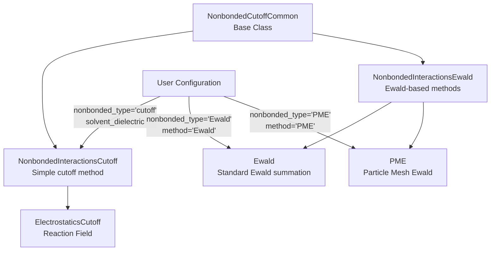
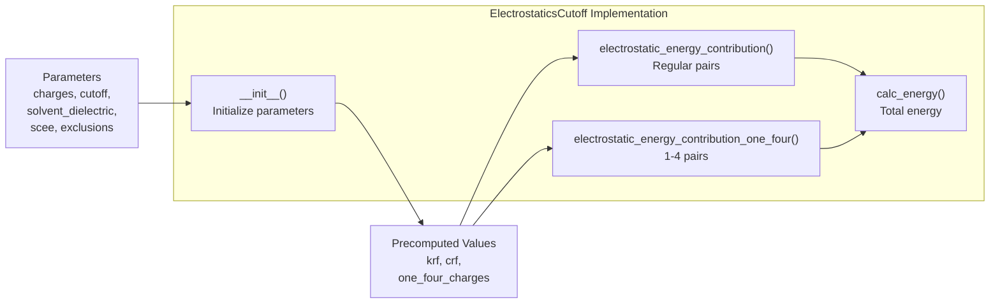
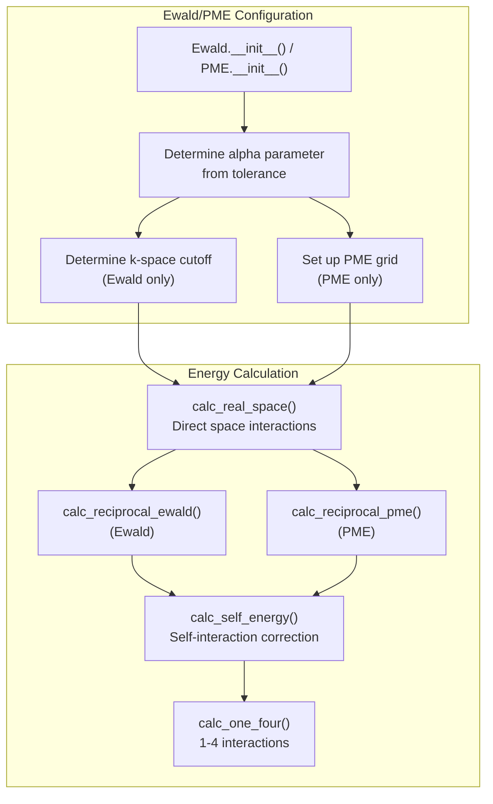
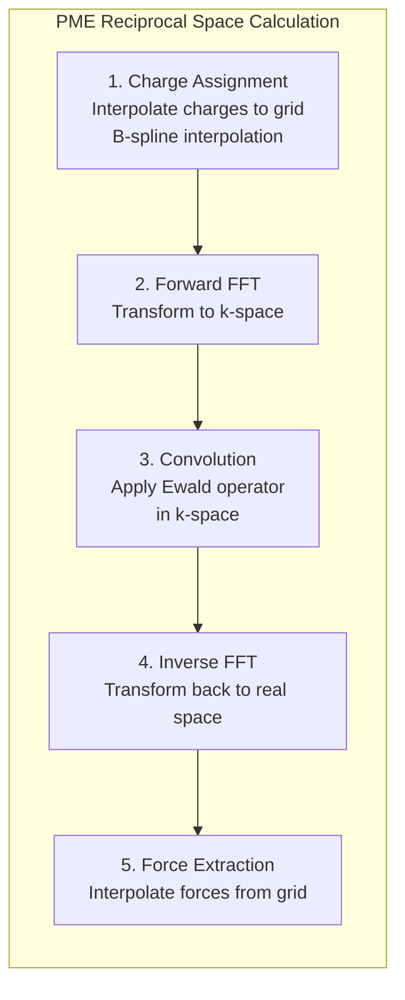
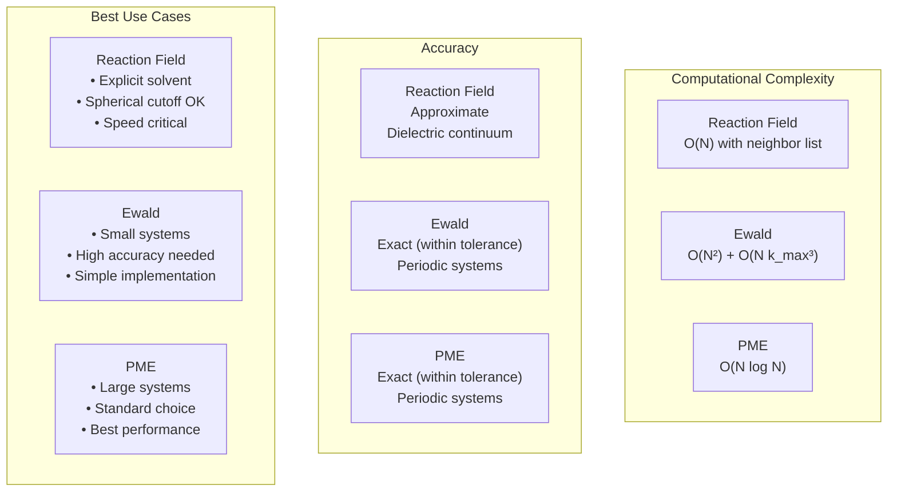
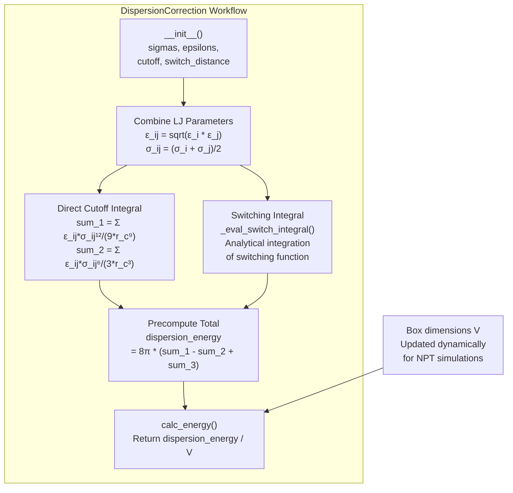
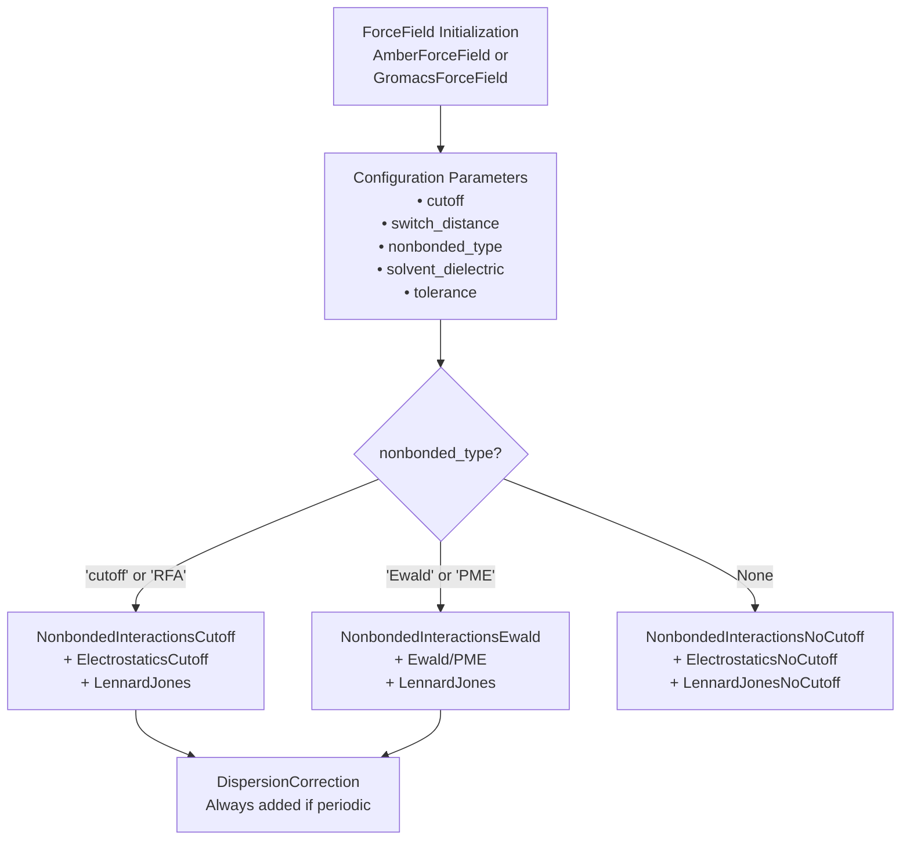
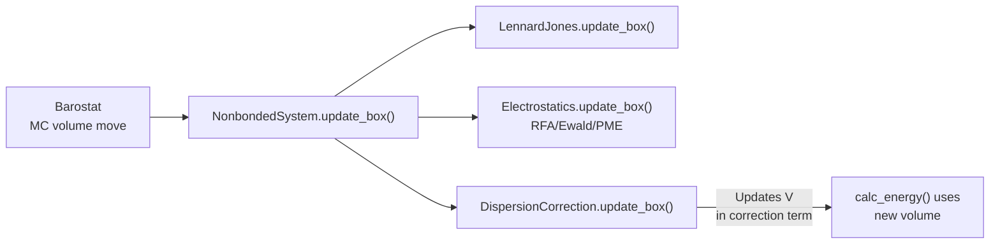

# Long-Range Methods and Corrections

<details>
<summary>Relevant source files</summary>

The following files were used as context for generating this wiki page:

- [benchmark/proteins/benchmark_proteins.py](benchmark/proteins/benchmark_proteins.py)
- [dimos/energy.py](dimos/energy.py)

</details>


## Purpose and Scope

This document describes the implementation of long-range electrostatic methods and analytical dispersion corrections in DIMOS. These methods are essential for accurately modeling systems with periodic boundary conditions, where interactions extend beyond the cutoff distance used for direct calculations.

For information about nonbonded interactions within the cutoff distance, see [Nonbonded Interactions](#3.1.2). For bonded interaction terms, see [Bonded Interactions](#3.1.1).

---

## Overview of Long-Range Corrections

Long-range corrections address two distinct problems in molecular dynamics simulations:

1. **Electrostatic Long-Range Effects**: Coulombic interactions decay slowly (1/r) and require special treatment to properly account for interactions beyond the cutoff in periodic systems
2. **Dispersion Corrections**: Lennard-Jones interactions are typically truncated at a cutoff, leading to systematic errors in energy and pressure that can be corrected analytically

DIMOS implements three approaches for handling long-range electrostatics and one method for dispersion corrections:

| Method | Type | Use Case | Class |
|--------|------|----------|-------|
| Reaction Field Approximation (RFA) | Electrostatics | Fast approximation for explicit solvent | `ElectrostaticsCutoff` |
| Ewald Summation | Electrostatics | Accurate periodic electrostatics | `Ewald` |
| Particle Mesh Ewald (PME) | Electrostatics | Efficient Ewald for large systems | `PME` |
| Analytical Dispersion | Lennard-Jones | Corrects for cutoff truncation | `DispersionCorrection` |

**Sources:** [dimos/energy.py:374-398](), [dimos/energy.py:812-943]()

---

## Electrostatic Long-Range Methods

### Method Selection Architecture



**Sources:** [dimos/energy.py:550-810](), [dimos/energy.py:812-943]()

---

### Reaction Field Approximation (RFA)

The Reaction Field Approximation treats the region beyond the cutoff as a dielectric continuum with a specified dielectric constant. This provides a computationally efficient approximation for systems with explicit solvent.

#### Theory

The reaction field potential takes the form:

```
E = (q₁q₂/4πε₀) * (1/r + k_rf*r² - c_rf)
```

where the reaction field parameters are:

```
k_rf = (1/r_c³) * (ε_rf - 1) / (2*ε_rf + 1)
c_rf = (1/r_c) * (3*ε_rf) / (2*ε_rf + 1)
```

with `ε_rf` being the solvent dielectric constant and `r_c` the cutoff distance.

#### Implementation: ElectrostaticsCutoff Class



**Key Implementation Details:**

- **Initialization**: [dimos/energy.py:1478-1521]()
  - Precomputes `krf` and `crf` parameters based on cutoff and dielectric constant
  - Stores scaled charge products for 1-4 interactions (divided by `scee` factor)
  
- **Regular Interactions**: [dimos/energy.py:1533-1560]()
  - Applies reaction field formula: `pot = q[i]*q[j] * (1/r + krf*r² - crf)`
  - Multiplies by Coulomb constant `constants.ONE_BY_4_PI_EPSILON_0`
  
- **1-4 Interactions**: [dimos/energy.py:1562-1582]()
  - Uses simple Coulomb interaction with pre-scaled charges
  - No reaction field correction applied to 1-4 pairs

**Sources:** [dimos/energy.py:1421-1619]()

---

### Ewald Summation

Ewald summation splits the slowly-converging electrostatic sum into two rapidly-converging parts: a real-space sum and a reciprocal-space sum. This method is exact (within numerical precision) for periodic systems.

#### Method Overview

The total electrostatic energy is decomposed as:

```
E_total = E_real + E_reciprocal + E_self + E_14
```

where:
- **E_real**: Short-range direct-space contribution (complementary error function screened)
- **E_reciprocal**: Long-range reciprocal-space contribution (Fourier space)
- **E_self**: Correction for self-interaction of Gaussian charge distributions
- **E_14**: Scaled 1-4 interactions

#### Implementation: Ewald and PME Classes



**Key Parameters:**

| Parameter | Description | Determined By |
|-----------|-------------|---------------|
| `alpha` (α) | Gaussian width parameter | `tolerance` via error function |
| `cutoff` | Real-space cutoff | User-specified |
| `tolerance` | Target accuracy | User-specified (default: 1e-5) |
| `kmax` | Reciprocal space cutoff (Ewald) | Calculated from `alpha` and `tolerance` |
| `grid_size` | PME grid dimensions | Calculated from box size |

**Sources:** [dimos/energy.py:812-943](), [dimos/ewald.py:1-392]()

---

### Particle Mesh Ewald (PME)

PME is an optimized implementation of Ewald summation that uses fast Fourier transforms (FFT) on a grid to compute reciprocal space contributions. This reduces the computational complexity from O(N²) to O(N log N).

#### PME Workflow



**PME-Specific Implementation:**

- Grid size is automatically determined to provide sufficient resolution
- B-spline interpolation (typically 4th order) maps charges to grid points
- FFT operations are performed using PyTorch's FFT capabilities
- Supports both `float32` and `float64` precision

**Sources:** [dimos/ewald.py:1-392]()

---

### Comparison of Electrostatic Methods



**Sources:** [dimos/energy.py:695-810](), [dimos/energy.py:812-943]()

---

## Dispersion Corrections

### Purpose

Lennard-Jones interactions are typically truncated at a cutoff distance for computational efficiency. However, this truncation introduces systematic errors in both energy and pressure. Analytical dispersion corrections account for the missing tail of the LJ potential beyond the cutoff.

### Theory

The dispersion correction assumes a uniform particle distribution beyond the cutoff and integrates the Lennard-Jones potential analytically:

```
E_disp = (8π/V) * Σᵢⱼ εᵢⱼσᵢⱼ⁶ * [σᵢⱼ⁶/(9r_c⁹) - 1/(3r_c³)]
```

where:
- V is the system volume
- r_c is the cutoff distance
- εᵢⱼ, σᵢⱼ are the combined Lennard-Jones parameters

For switched potentials, an additional integral accounts for the switching region.

### Implementation: DispersionCorrection Class



**Key Implementation Features:**

1. **Initialization** [dimos/energy.py:2566-2600]():
   - Computes pairwise LJ parameter combinations
   - Calculates direct cutoff integral contributions
   - Adds switching region correction if applicable
   - Stores precomputed energy term (independent of volume)

2. **Switching Function Integral** [dimos/energy.py:2612-2677]():
   - Analytical integration of 5th-order polynomial switch
   - Switch function: `S(r) = 1 + t³(-10 + t(15 - 6t))` where `t = (r-r_s)/(r_c-r_s)`
   - Complex polynomial expressions for both r⁶ and r¹² terms

3. **Energy Calculation** [dimos/energy.py:2679-2697]():
   - Simply divides precomputed value by current box volume
   - Very efficient: O(1) operation per energy evaluation
   - Volume-dependent for proper NPT ensemble behavior

**Sources:** [dimos/energy.py:2539-2698]()

---

## Integration with Nonbonded System

### System Configuration

Different long-range methods are selected through the nonbonded system configuration:



**Configuration Examples:**

```python
# Reaction Field with 10 Å cutoff, 7.5 Å switch
system = dimos.AmberForceField(
    topology_file,
    coordinate_file,
    cutoff=10.0,
    switch_distance=7.5,
    nonbonded_type="cutoff",
    solvent_dielectric=78.5  # Water dielectric
)

# PME with 10 Å cutoff, 1e-5 tolerance
system = dimos.GromacsForceField(
    topology_file,
    coordinate_file,
    cutoff=10.0,
    nonbonded_type="PME",
    tolerance=1e-5
)
```

**Sources:** [benchmark/proteins/benchmark_proteins.py:31](), [dimos/energy.py:695-943]()

---

## Box Updates for NPT Simulations

All long-range methods support dynamic box dimension updates for NPT ensemble simulations through the `update_box()` method:



The `update_box()` method propagates box dimension changes through the hierarchy of energy calculators, ensuring that:
- Periodic minimum image conventions use updated box vectors
- Dispersion corrections use the current volume
- PME grid spacing remains appropriate (may trigger reinitialization)

**Sources:** [dimos/energy.py:405-414](), [dimos/energy.py:683-693](), [dimos/energy.py:798-809](), [dimos/energy.py:931-942]()

---

## Performance Considerations

| Method | Initialization Cost | Per-Step Cost | Memory | Best For |
|--------|-------------------|---------------|--------|----------|
| **RFA** | Low | O(N) | Low | Small-medium systems, speed priority |
| **Ewald** | Medium | O(N²) + O(Nk³) | Medium | Small systems (<1000 atoms) |
| **PME** | Medium-High | O(N log N) | Medium-High | Large systems (>1000 atoms) |
| **Dispersion** | Low | O(1) | Very Low | All periodic systems |

**Optimization Notes:**

1. **PME Grid Size**: Automatically determined but can impact performance
   - Larger grids: More accurate, slower FFT
   - Smaller grids: Faster but may require larger cutoff

2. **Ewald Alpha Parameter**: Balances real vs reciprocal space work
   - Larger α: More reciprocal space work, less real space
   - Smaller α: More real space work, less reciprocal space

3. **Dispersion Correction**: Always recommended for cutoff-based methods
   - Nearly zero computational cost
   - Significant improvement in thermodynamic properties

**Sources:** [dimos/energy.py:374-398](), [benchmark/proteins/benchmark_proteins.py:1-73]()

---