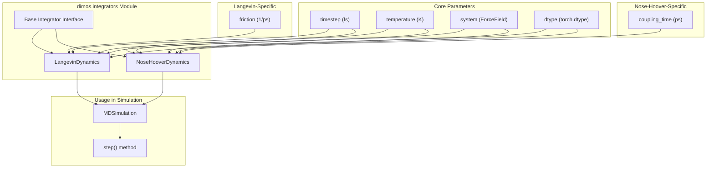
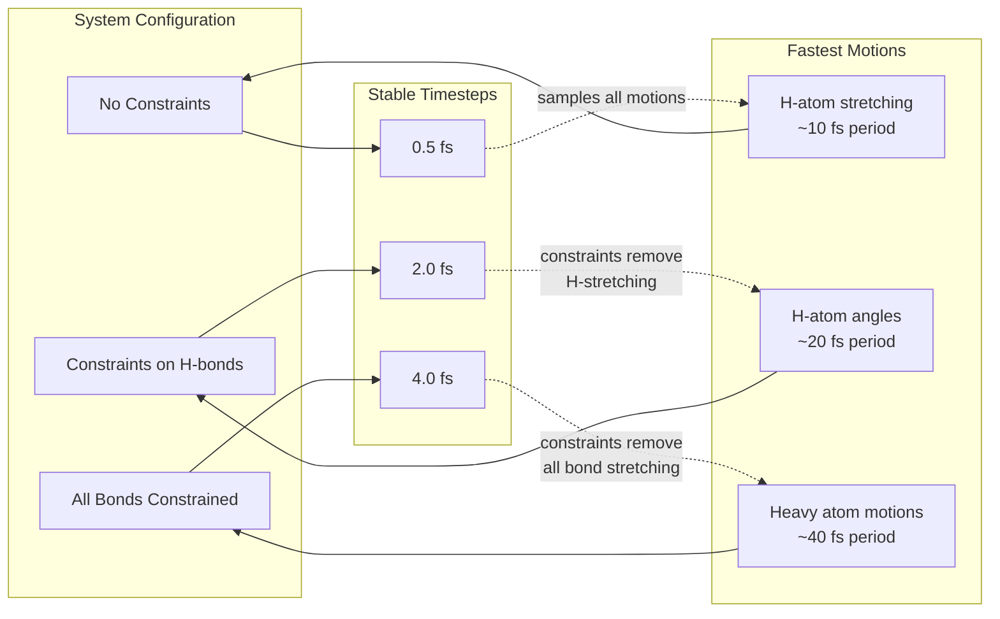
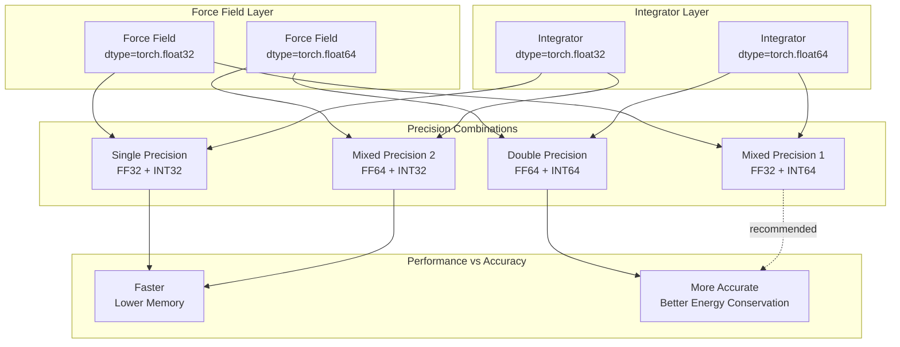
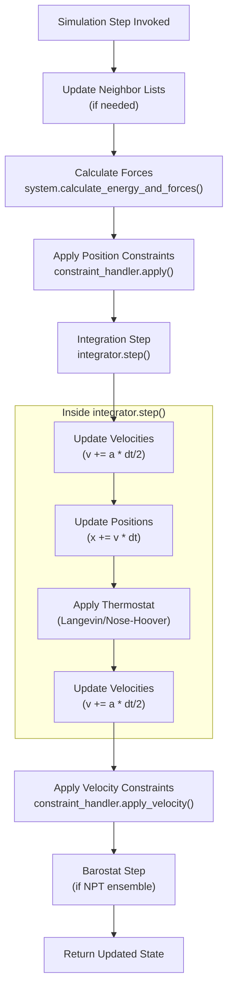

# Integration Methods

<details>
<summary>Relevant source files</summary>

The following files were used as context for generating this wiki page:

- [benchmark/proteins/benchmark_proteins.py](benchmark/proteins/benchmark_proteins.py)
- [benchmark/water/dimos_water.py](benchmark/water/dimos_water.py)
- [dimos/__init__.py](dimos/__init__.py)

</details>


## Purpose and Scope

This document describes the integration methods available in DIMOS for propagating molecular dynamics trajectories. Integration methods numerically solve the equations of motion to update particle positions and velocities at each timestep. DIMOS provides two primary integrators: Langevin dynamics for stochastic simulations with implicit solvent friction and Nose-Hoover dynamics for deterministic thermostatted simulations.

For information about constraint algorithms that work in conjunction with integrators, see [Molecular Constraints](#3.3). For details on barostats for NPT simulations, see [Pressure Control with Barostats](#3.4). For the overall simulation loop architecture, see [Simulation Engine](#3).

---

## Available Integrator Classes

DIMOS implements two main integrator classes that handle time propagation in molecular dynamics simulations. Both integrators follow a common interface pattern and can be used interchangeably in simulation workflows.

### Integrator Class Hierarchy



**Sources:** [dimos/__init__.py:380](), [benchmark/proteins/benchmark_proteins.py:46](), [benchmark/water/dimos_water.py:63]()

---

## Langevin Dynamics

Langevin dynamics simulates systems in contact with a heat bath by adding stochastic forces and friction terms to the equations of motion. This method is particularly useful for systems where explicit solvent molecules are not present or when enhanced sampling through temperature control is desired.

### Constructor Signature

The `LangevinDynamics` integrator is instantiated with the following parameters:

| Parameter | Type | Description |
|-----------|------|-------------|
| `timestep` | float | Integration timestep in femtoseconds |
| `temperature` | float | Target temperature in Kelvin |
| `friction` | float | Friction coefficient in inverse picoseconds (1/ps) |
| `system` | ForceField | The force field system defining energy calculations |
| `dtype` | torch.dtype | Numerical precision for integration (float32 or float64) |

### Example Usage

```python
import dimos
import torch

# Load system
system = dimos.AmberForceField('system.prmtop', cutoff=10, 
                                switch_distance=7.5, 
                                nonbonded_type='PME',
                                dtype=torch.float32)

# Create Langevin integrator
integrator = dimos.integrators.LangevinDynamics(
    timestep=0.5,           # 0.5 fs timestep
    temperature=300,        # 300 K
    friction=1.0,           # 1.0 ps^-1 friction
    system=system,
    dtype=torch.float64     # Double precision for integration
)
```

### Friction Coefficient

The friction coefficient controls the strength of coupling to the heat bath. Typical values:
- **1.0 ps⁻¹**: Standard coupling, balances thermalization and dynamics
- **0.1-0.5 ps⁻¹**: Weak coupling, closer to deterministic dynamics
- **5.0-10.0 ps⁻¹**: Strong coupling, rapid thermalization

**Sources:** [benchmark/water/dimos_water.py:63](), [benchmark/water/dimos_water.py:87]()

---

## Nose-Hoover Dynamics

Nose-Hoover dynamics provides deterministic thermostatted molecular dynamics without stochastic forces. This method introduces extended system variables that generate the canonical ensemble while maintaining time-reversibility.

### Constructor Signature

The `NoseHooverDynamics` integrator is instantiated with the following parameters:

| Parameter | Type | Description |
|-----------|------|-------------|
| `timestep` | float | Integration timestep in femtoseconds |
| `temperature` | float | Target temperature in Kelvin |
| `coupling_time` | float | Thermostat coupling time in picoseconds |
| `system` | ForceField | The force field system defining energy calculations |
| `dtype` | torch.dtype | Numerical precision for integration (float32 or float64) |

### Example Usage

```python
import dimos
import torch

# Create Nose-Hoover integrator
integrator = dimos.NoseHooverDynamics(
    timestep=2.0,           # 2.0 fs timestep (with constraints)
    temperature=300.0,      # 300 K
    coupling_time=0.05,     # 0.05 ps coupling time
    system=system,
    dtype=torch.float64     # Double precision
)
```

### Coupling Time

The coupling time parameter determines how quickly the system thermalizes:
- **0.01-0.1 ps**: Fast coupling, tight temperature control
- **0.5-1.0 ps**: Moderate coupling, allows temperature fluctuations
- **>1.0 ps**: Weak coupling, approaches NVE dynamics

**Sources:** [benchmark/proteins/benchmark_proteins.py:46]()

---

## Timestep Selection and Stability

Choosing an appropriate timestep is critical for simulation stability and accuracy. The maximum stable timestep depends on the fastest motions in the system, which are typically bond stretching vibrations involving hydrogen atoms.

### Timestep Guidelines



### Recommended Timesteps

| Constraint Configuration | Timestep | Use Case |
|-------------------------|----------|----------|
| No constraints | 0.5 fs | Small molecules, accurate dynamics, method development |
| H-bonds and H-angles constrained | 2.0 fs | Standard protein simulations, production runs |
| All bonds constrained | 4.0 fs | Large systems, coarse dynamics (use with caution) |

### Implementation in Benchmarks

The DIMOS benchmark suite demonstrates this principle:

```python
# From benchmark_proteins.py
if "no_constraints" in name:
    constraint_option = None
    timestep = 0.5  # Small timestep without constraints
else:
    constraint_option = "h_angles"
    timestep = 2.0  # Larger timestep with H-constraints
```

**Sources:** [benchmark/proteins/benchmark_proteins.py:24-29]()

---

## Mixed Precision Support

DIMOS supports independent precision control for force field calculations and numerical integration, allowing for optimal performance-accuracy tradeoffs.

### Precision Architecture



### Precision Selection Example

```python
# Separate precision for force field and integration
ff_dtype = torch.float32        # Fast force calculations
integration_dtype = torch.float64  # Accurate integration

# Create system with FF precision
system = dimos.AmberForceField(
    'system.prmtop',
    cutoff=10,
    dtype=ff_dtype
)

# Create integrator with integration precision
integrator = dimos.integrators.LangevinDynamics(
    timestep=0.5,
    temperature=300,
    friction=1.0,
    system=system,
    dtype=integration_dtype  # Can differ from system dtype
)
```

### Precision Tradeoffs

| Configuration | Energy Calculation | Integration | Use Case |
|--------------|-------------------|-------------|----------|
| float32/float32 | Fast | Fast | Exploratory runs, large systems |
| float64/float64 | Slow | Accurate | High-precision studies, long simulations |
| float32/float64 | Fast | Accurate | **Recommended balance** |
| float64/float32 | Accurate | Fast | Rarely used |

**Sources:** [benchmark/water/dimos_water.py:30-40](), [benchmark/proteins/benchmark_proteins.py:46]()

---

## Integration Loop and Compilation

Integrators work within the main simulation loop and can be optimized using PyTorch's compilation features for significant performance improvements.

### Integration Step Flow



### Compilation for Performance

DIMOS simulations can be compiled using `torch.compile` for significant speedups:

```python
import dimos
import torch

# Create simulation
sim = dimos.MDSimulation(system, integrator, 
                          initial_pos=positions,
                          temperature=300.0)

# Compile the step function
torch.compiler.reset()
torch._dynamo.reset()
sim_step = torch.compile(sim.step, mode="max-autotune-no-cudagraphs")

# Run compiled simulation
for i in range(1000):
    sim_step(50)  # 50 steps per call
```

### Compilation Modes

| Mode | Description | Use Case |
|------|-------------|----------|
| `"default"` | Standard optimizations | Development, debugging |
| `"reduce-overhead"` | Minimize Python overhead | Short simulations |
| `"max-autotune"` | Extensive kernel tuning | Production runs |
| `"max-autotune-no-cudagraphs"` | Autotune without CUDA graphs | **Recommended for MD** |

### Warmup and Measurement

Compilation has overhead on the first call. Benchmark workflows separate warmup and measurement phases:

```python
warmup_iterations = 50
steps_per_warmup = 25

# Warmup phase (compilation occurs here)
for warm_it in range(warmup_iterations):
    sim_step(steps_per_warmup)

# Measurement phase (steady-state performance)
measure_iterations = 50
steps_per_measure = 50
for meas_it in range(measure_iterations):
    start_time = time.time()
    sim_step(steps_per_measure)
    elapsed = time.time() - start_time
```

**Sources:** [benchmark/proteins/benchmark_proteins.py:49-55](), [benchmark/water/dimos_water.py:67-71]()

---

## Integrator Method Interface

While the exact implementation details are in the `integrators` module, the common interface pattern can be inferred from usage:

### Key Methods

| Method | Description | Return Type |
|--------|-------------|-------------|
| `step(n_steps)` | Perform n integration steps | None |
| `get_timestep()` | Return current timestep in fs | float |
| `set_temperature(T)` | Update target temperature | None |
| `get_kinetic_energy()` | Calculate kinetic energy | torch.Tensor |

### Integration with MDSimulation

```python
# The MDSimulation class manages the integrator
class MDSimulation:
    def __init__(self, system, integrator, initial_pos, temperature):
        self.sys = system
        self.integrator = integrator
        self.pos = initial_pos
        self.temperature = temperature
    
    def step(self, n_steps):
        """Perform n_steps of dynamics"""
        # Calls integrator.step() internally with
        # force calculations and constraint applications
        pass
    
    def measure_potential_energy(self):
        """Calculate current potential energy"""
        return self.sys.calculate_energy(self.pos)
```

### Timestep Retrieval

The integrator's timestep can be retrieved for performance calculations:

```python
# From benchmark code
sim.integrator.get_timestep()  # Returns timestep in fs

# Used in ns/day calculation
ns_per_day = (timestep * n_steps * 1e-6) / (elapsed_time / 86400)
```

**Sources:** [benchmark/proteins/benchmark_proteins.py:65-68](), [benchmark/proteins/benchmark_proteins.py:47]()

---

## Platform Comparison

The benchmark suite compares DIMOS integrators against other MD engines to validate correctness and assess performance.

### Comparison with OpenMM

DIMOS integrators are designed to produce equivalent results to OpenMM's implementations:

| DIMOS | OpenMM Equivalent | Notes |
|-------|-------------------|-------|
| `LangevinDynamics` | `LangevinMiddleIntegrator` | Middle scheme for better energy conservation |
| `NoseHooverDynamics` | `NoseHooverIntegrator` | Deterministic thermostat |

### Performance Metrics

The benchmark suite measures integration performance in ns/day (nanoseconds of simulation per wall-clock day):

```python
# Performance calculation
time_period = end_time - start_time
fraction_of_day = time_period / (24 * 60 * 60)
ns_per_day = (timestep * steps * 1e-6) / fraction_of_day

# Stored with standard error
measurements[meas_it, 2] = ns_per_day
ns_per_day_mean = measurements[:, 2].mean()
ns_per_day_stderr = measurements[:, 2].std(ddof=1) / sqrt(n_measurements)
```

### Device Support

Both integrators support CPU and CUDA devices:

```python
# CPU execution
torch.set_default_device("cpu")
integrator = dimos.integrators.LangevinDynamics(...)

# CUDA execution
torch.set_default_device("cuda:0")
integrator = dimos.integrators.LangevinDynamics(...)
```

**Sources:** [benchmark/water/dimos_water.py:46-73](), [benchmark/proteins/benchmark_proteins.py:58-72]()

---

## Summary Table

### Integrator Comparison

| Feature | LangevinDynamics | NoseHooverDynamics |
|---------|------------------|-------------------|
| Stochastic/Deterministic | Stochastic | Deterministic |
| Additional Parameter | `friction` | `coupling_time` |
| Typical Use | Implicit solvent, enhanced sampling | Explicit solvent, canonical ensemble |
| Reversibility | No (stochastic) | Yes (deterministic) |
| Temperature Control | Through random forces | Through extended variables |
| OpenMM Equivalent | LangevinMiddleIntegrator | NoseHooverIntegrator |

### Recommended Settings by System Type

| System Type | Integrator | Timestep | Constraints | Precision |
|------------|-----------|----------|-------------|-----------|
| Small molecule in vacuum | Langevin | 0.5 fs | None | float64/float64 |
| Protein in explicit solvent | Langevin | 2.0 fs | h_angles | float32/float64 |
| Large protein system | NoseHoover | 2.0 fs | h_angles | float32/float64 |
| ML/MM hybrid | Langevin | 2.0 fs | h_angles | float32/float64 |

**Sources:** [benchmark/proteins/benchmark_proteins.py:20-46](), [benchmark/water/dimos_water.py:22-66]()

---