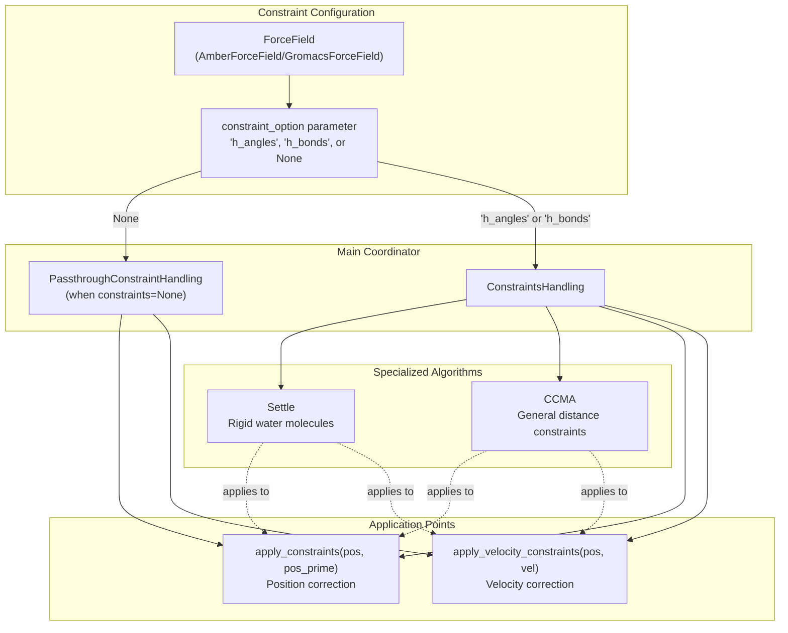
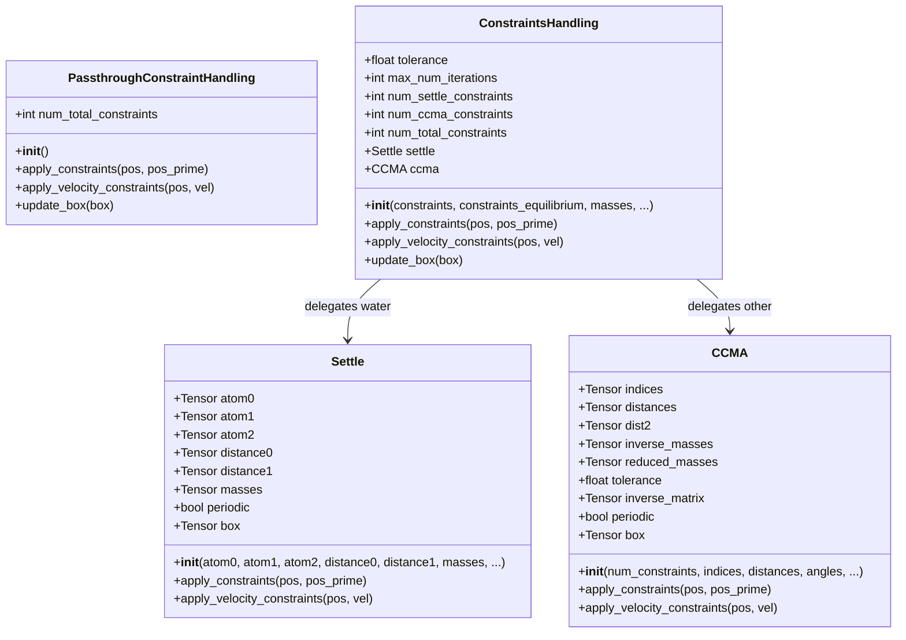
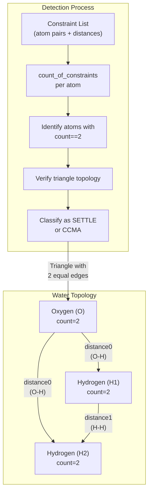
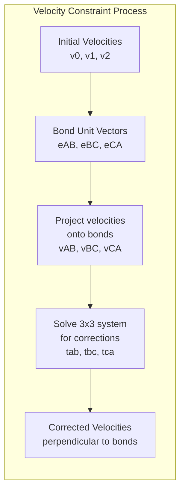
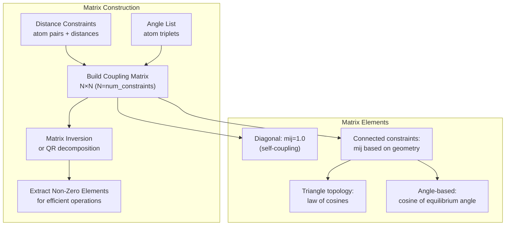
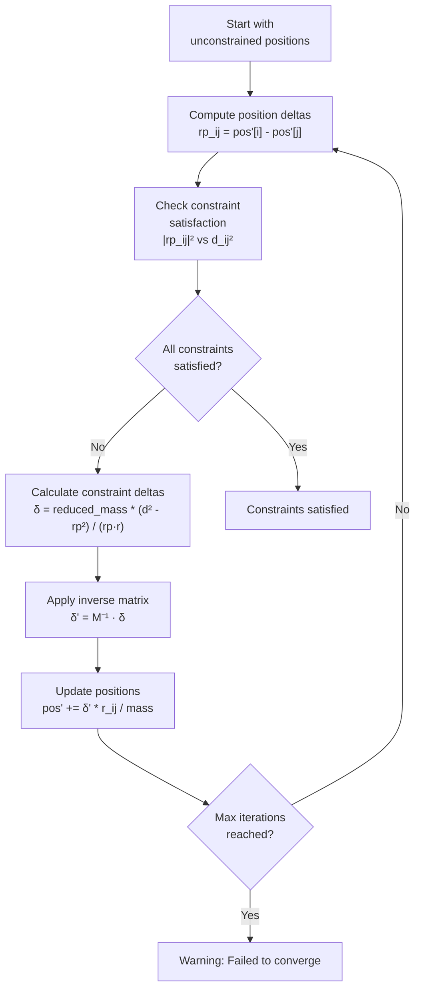
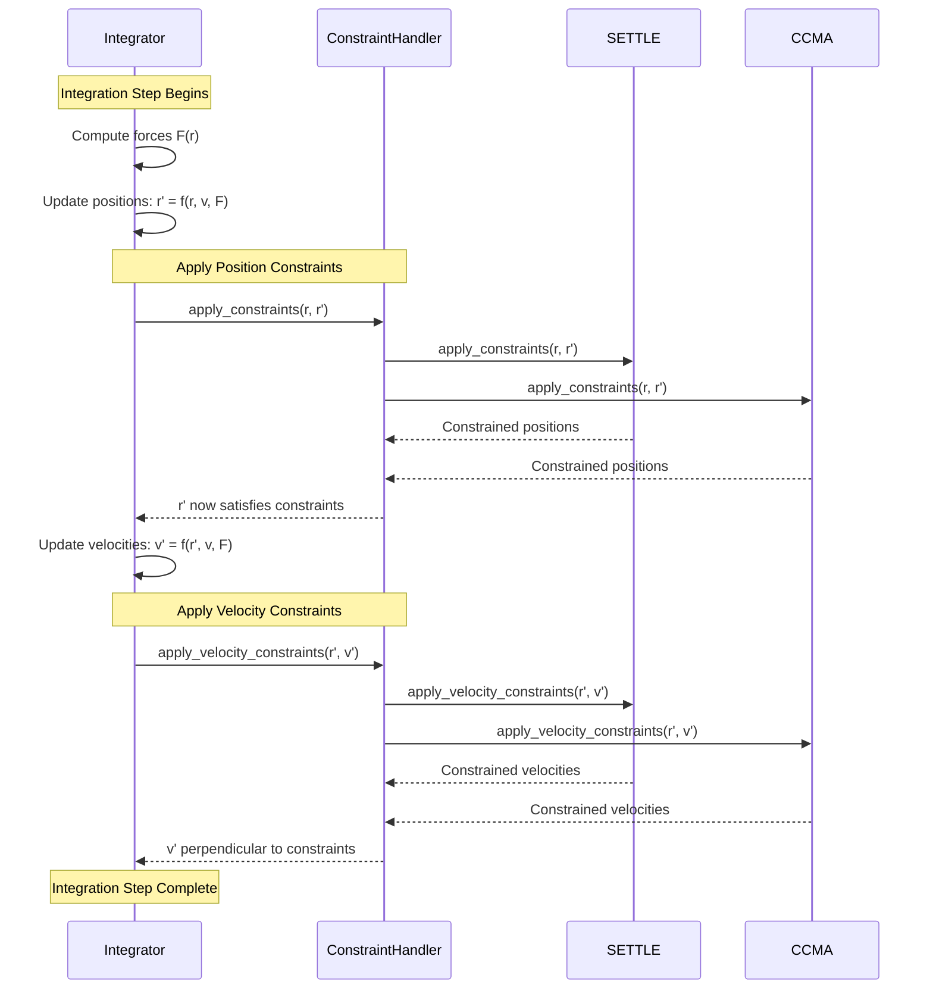

# Molecular Constraints

<details>
<summary>Relevant source files</summary>

The following files were used as context for generating this wiki page:

- [benchmark/proteins/benchmark_proteins.py](benchmark/proteins/benchmark_proteins.py)
- [dimos/constraints.py](dimos/constraints.py)

</details>


## Purpose and Scope

This document describes the molecular constraint system in DIMOS, which maintains geometric constraints on molecular structures during simulations. Constraints allow the use of larger timesteps by removing high-frequency vibrational modes, typically hydrogen bond stretches and angles. The system implements two specialized algorithms: SETTLE for rigid water molecules and CCMA (Constant Constraint Matrix Approximation) for general distance constraints.

For information about integration methods that use constraints, see [Integration Methods](#3.2). For force field setup that configures constraints, see [Classical Force Fields](#4.1).

**Sources:** [dimos/constraints.py:374-394]()

---

## Constraint System Architecture

The constraint system uses a hierarchical design where a main coordinator delegates to specialized algorithms based on molecular topology. The system automatically detects water molecules and uses the efficient SETTLE algorithm for them, while handling other constraints with CCMA.



**Diagram: Constraint System Component Hierarchy**

**Sources:** [dimos/constraints.py:400-421](), [dimos/constraints.py:423-612]()

---

## Configuration and Usage

Constraints are configured when creating a force field object through the `constraint_option` parameter. This parameter determines which bonds and angles are constrained during simulation.

### Constraint Options

| Option | Description | Typical Use Case |
|--------|-------------|------------------|
| `None` | No constraints | Small timesteps (0.5 fs), no hydrogen atoms, or when maximum accuracy needed |
| `"h_bonds"` | Constrain bonds involving hydrogen | Medium timesteps (1-1.5 fs) |
| `"h_angles"` | Constrain bonds and angles involving hydrogen | Large timesteps (2.0 fs), most common for biomolecular simulations |

### Example Configuration

```python
# From benchmark code - with constraints
base_sys = dimos.GromacsForceField(
    f"{system}.top", 
    f"{system}.gro",
    cutoff=10, 
    switch_distance=7.5, 
    nonbonded_type="PME", 
    constraint_option="h_angles",  # Enable constraints
    create_graph=False
)
timestep = 2.0  # fs - larger timestep possible with constraints

# Without constraints
base_sys = dimos.GromacsForceField(
    f"{system}.top", 
    f"{system}.gro",
    cutoff=10, 
    switch_distance=7.5, 
    nonbonded_type="PME", 
    constraint_option=None,  # No constraints
    create_graph=False
)
timestep = 0.5  # fs - smaller timestep required
```

**Sources:** [benchmark/proteins/benchmark_proteins.py:23-31]()

### Timestep Recommendations

The constraint option directly impacts the safe timestep size:

| Constraint Option | Recommended Timestep | Rationale |
|-------------------|---------------------|-----------|
| `None` | 0.5 - 1.0 fs | Must resolve hydrogen vibrations |
| `"h_bonds"` | 1.0 - 1.5 fs | Eliminates fastest vibrations |
| `"h_angles"` | 1.5 - 2.0 fs | Eliminates both bond and angle vibrations |

**Sources:** [benchmark/proteins/benchmark_proteins.py:24-29]()

---

## Constraint Handler Classes

The system uses three main classes to manage constraints, selected based on system topology.



**Diagram: Constraint Class Hierarchy and Relationships**

**Sources:** [dimos/constraints.py:400-421](), [dimos/constraints.py:423-656](), [dimos/constraints.py:658-914](), [dimos/constraints.py:916-1183]()

---

## SETTLE Algorithm for Water

SETTLE is a specialized analytical algorithm for maintaining rigid water geometry. It is significantly more efficient than iterative methods for the common case of water molecules with fixed O-H bond lengths and H-O-H angles.

### Water Molecule Detection

The `ConstraintsHandling` class automatically detects water molecules by identifying atoms with exactly 2 constraints each that form a triangle topology:



**Diagram: SETTLE Water Molecule Detection Algorithm**

**Sources:** [dimos/constraints.py:503-576]()

### SETTLE Algorithm Steps

The SETTLE algorithm applies constraints through five coordinate transformation steps:

| Step | Operation | Purpose |
|------|-----------|---------|
| **1** | Transform to center-of-mass frame | Remove translational motion |
| **2** | Calculate rotation angles (φ, ψ) | Determine required rotation |
| **3** | Solve for constrained positions in body frame | Apply geometric constraints |
| **4** | Rotate to alignment | Orient molecule correctly |
| **5** | Transform back to lab frame | Restore to original coordinate system |

**Algorithm Parameters:**

The SETTLE class pre-computes geometric parameters for efficiency:

```python
# Key geometric parameters computed in __init__
inverse_total_mass = 1 / (mA + mB + mC)  # For COM calculation
rc = 0.5 * distance1                      # Half H-H distance
rb = sqrt(distance0² - rc²)               # Geometric parameter
ra = rb * (mB + mC) * inverse_total_mass  # COM offset
rb = rb - ra                              # Adjusted parameter
```

**Sources:** [dimos/constraints.py:916-995](), [dimos/constraints.py:996-1121]()

### Velocity Constraints with SETTLE

SETTLE also constrains velocities to ensure they remain perpendicular to constraint directions:



**Diagram: SETTLE Velocity Constraint Algorithm**

**Sources:** [dimos/constraints.py:1122-1183]()

---

## CCMA Algorithm for General Constraints

CCMA (Constant Constraint Matrix Approximation) handles general distance constraints that don't fit the water molecule pattern. It uses an iterative approach with a pre-computed inverse constraint matrix.

### CCMA Initialization

During initialization, CCMA constructs and inverts a constraint coupling matrix:



**Diagram: CCMA Constraint Matrix Construction**

The coupling matrix element `m[j,k]` between constraints `j` and `k` depends on their topology:

| Topology | Matrix Element | Formula |
|----------|---------------|---------|
| Same constraint (j=k) | 1.0 | Diagonal elements |
| Non-connected | 0.0 | No coupling |
| Connected via triangle | Geometric | `scale * (d₁² + d₂² - d₃²) / (2·d₁·d₂)` |
| Connected via angle | Angular | `scale * cos(θ₀)` |

Where `scale = m_inv_shared / (m_inv_a + m_inv_b)` accounts for mass distribution.

**Sources:** [dimos/constraints.py:755-820](), [dimos/constraints.py:821-824]()

### CCMA Constraint Application

The iterative constraint application process:



**Diagram: CCMA Iterative Constraint Solver**

**Convergence Criteria:**

```python
# From code: constraint is satisfied when
lowerTolerance = 1 - 2*tolerance + tolerance²
upperTolerance = 1 + 2*tolerance + tolerance²

# Constraint j is satisfied if:
lowerTolerance * dist2[j] <= |rp_ij|² <= upperTolerance * dist2[j]
```

**Sources:** [dimos/constraints.py:826-872]()

### CCMA Velocity Constraints

Velocity constraints ensure velocities don't violate constraint conditions:

**Key Differences from Position Constraints:**

| Aspect | Position Constraints | Velocity Constraints |
|--------|---------------------|---------------------|
| Target | Maintain distance: `\|r_ij\| = d_ij` | Maintain zero relative velocity along bond: `v_ij · r_ij = 0` |
| Delta calculation | `δ = μ(d² - rp²)/(rp·r)` | `δ = -2μ(rp·r)/d²` |
| Convergence | Distance within tolerance | `\|δ\| < tolerance` |
| Iterations | Typically more | Typically fewer |

**Sources:** [dimos/constraints.py:873-913]()

---

## Integration with Simulation Engine

Constraints are applied at specific points in the integration cycle to maintain both position and velocity consistency.

### Integration Cycle with Constraints



**Diagram: Constraint Application in Integration Cycle**

**Sources:** [dimos/constraints.py:625-656]()

### Constraint Handler Transfer

When using ML/MM hybrid systems, the constraint handler must be explicitly transferred:

```python
# From benchmark code
smaller_gromacs_ml_system = system_excluding_protein.as_mace_system(
    "mace-mp-large", 
    atom_range=(0,len(ml_atoms))
)
syst = dimos.mlmm.MLMMsystem(
    ml_atoms, 
    smaller_gromacs_ml_system, 
    system_excluding_protein, 
    electrostatic_type=None, 
    create_graph=False
)
# Transfer constraint handler from MM system
syst.constraint_handler = system_excluding_protein.constraint_handler
```

This ensures constraints from the MM force field are properly applied in the hybrid system.

**Sources:** [benchmark/proteins/benchmark_proteins.py:36-41](), [benchmark/proteins/benchmark_proteins.py:42-44]()

---

## Periodic Boundary Conditions

Both SETTLE and CCMA support periodic boundary conditions, which are critical for bulk simulations.

### Periodic Correction Application

When `periodic=True`, distance vectors are corrected to use the minimum image convention:

```python
# From utils - periodic correction
def periodic_correction(r_ij, box):
    """
    Apply minimum image convention:
    - Map vectors to [-box/2, box/2]
    - Ensures distances use nearest periodic image
    """
    pass  # Implementation in dimos.utils
```

**Application Points in Constraints:**

| Algorithm | Position Constraints | Velocity Constraints |
|-----------|---------------------|---------------------|
| **SETTLE** | Lines 1016-1040 | Lines 1146-1149 |
| **CCMA** | Lines 839-847 | Lines 886-887 |

All distance calculations between constrained atoms use periodic correction when enabled to ensure proper constraint satisfaction across periodic boundaries.

**Sources:** [dimos/constraints.py:838-847](), [dimos/constraints.py:885-887](), [dimos/constraints.py:1016-1040](), [dimos/constraints.py:1146-1149]()

---

## Performance Characteristics

### Algorithm Comparison

| Feature | SETTLE | CCMA |
|---------|--------|------|
| **Applicable to** | Rigid 3-atom molecules (water) | General distance constraints |
| **Method** | Analytical solution | Iterative with pre-inverted matrix |
| **Iterations** | 0 (direct calculation) | Typically 5-15 per timestep |
| **Typical use** | Water molecules | Protein bonds/angles, other molecules |
| **Efficiency** | Very high for water | Good for sparse constraints |
| **Convergence** | Always (analytical) | Depends on tolerance and system |

### Constraint Count Impact

The `ConstraintsHandling` class tracks constraint distribution:

```python
# Accessible attributes
handler.num_settle_constraints  # Count handled by SETTLE
handler.num_ccma_constraints    # Count handled by CCMA  
handler.num_total_constraints   # Total constraint count
```

**Typical Constraint Counts (for reference):**

| System | Total Atoms | Water Molecules | SETTLE Constraints | CCMA Constraints |
|--------|-------------|-----------------|-------------------|------------------|
| ala2_tip3p | ~770 | 749 | ~2247 (3 per water) | Variable |
| Pure water box (1000 molecules) | 3000 | 1000 | 3000 | 0 |
| Protein + water | Variable | Variable | 3 × N_water | 3-5 × N_protein_heavy |

**Sources:** [dimos/constraints.py:567-612]()

---

## Algorithm References

### SETTLE

The SETTLE algorithm is described in:

> Miyamoto, S., & Kollman, P. A. (1992). SETTLE: An analytical version of the SHAKE and RATTLE algorithm for rigid water models. *Journal of Computational Chemistry*, 13(8), 952-962.

**Key advantages:**
- Analytical solution (no iteration required)
- Exact constraint satisfaction (within floating-point precision)
- Significantly faster than iterative methods for water

### CCMA

The CCMA algorithm is described in:

> Eastman, P., & Pande, V. S. (2010). Constant constraint matrix approximation: A robust, parallelizable constraint method for molecular simulations. *Journal of Chemical Theory and Computation*, 6(2), 434-437.

**Key advantages:**
- Single matrix inversion during initialization (not per-step)
- Efficient parallelization through sparse matrix operations
- Good convergence properties for typical constraint networks

**Sources:** [dimos/constraints.py:387-393]()

---

## Tolerance and Convergence

### Configuration Parameters

| Parameter | Default | Location | Purpose |
|-----------|---------|----------|---------|
| `tolerance` | Force field dependent | Set during initialization | Convergence threshold |
| `max_num_iterations` | 150 | `ConstraintsHandling.__init__` | Maximum solver iterations |

### CCMA Convergence Bounds

CCMA uses asymmetric convergence criteria:

```python
lowerTolerance = 1 - 2*tolerance + tolerance²
upperTolerance = 1 + 2*tolerance + tolerance²

# Constraint satisfied when:
# lowerTolerance * d² ≤ |r'|² ≤ upperTolerance * d²
```

This allows small deviations while preventing accumulation of constraint violations.

**Sources:** [dimos/constraints.py:750-753]()

---

## Common Usage Patterns

### Pattern 1: Standard Biomolecular Simulation

```python
# Most common configuration for protein simulations
force_field = dimos.GromacsForceField(
    topology_file,
    coordinate_file,
    constraint_option="h_angles",  # Constrain H bonds and angles
    cutoff=10.0,
    nonbonded_type="PME"
)

integrator = dimos.NoseHooverDynamics(
    timestep=2.0,  # fs - safe with h_angles constraints
    temperature=300.0,
    tau=0.05,
    force_field=force_field
)
```

### Pattern 2: No Constraints (Maximum Accuracy)

```python
# For validation or when maximum accuracy needed
force_field = dimos.GromacsForceField(
    topology_file,
    coordinate_file,
    constraint_option=None,  # No constraints
    cutoff=10.0,
    nonbonded_type="PME"
)

integrator = dimos.LangevinDynamics(
    timestep=0.5,  # fs - must use smaller timestep
    temperature=300.0,
    friction=1.0,
    force_field=force_field
)
```

### Pattern 3: Checking Constraint Status

```python
# Query constraint configuration
handler = force_field.constraint_handler

if handler.num_total_constraints > 0:
    print(f"System has {handler.num_total_constraints} constraints")
    print(f"  SETTLE: {handler.num_settle_constraints}")
    print(f"  CCMA: {handler.num_ccma_constraints}")
else:
    print("No constraints applied")
```

**Sources:** [benchmark/proteins/benchmark_proteins.py:23-47]()

---