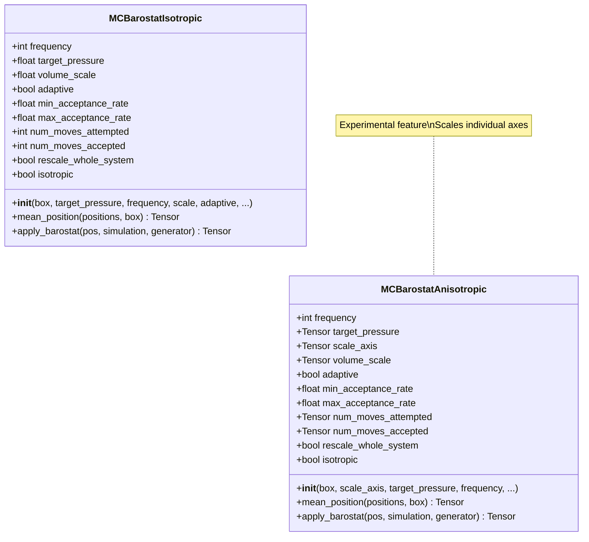
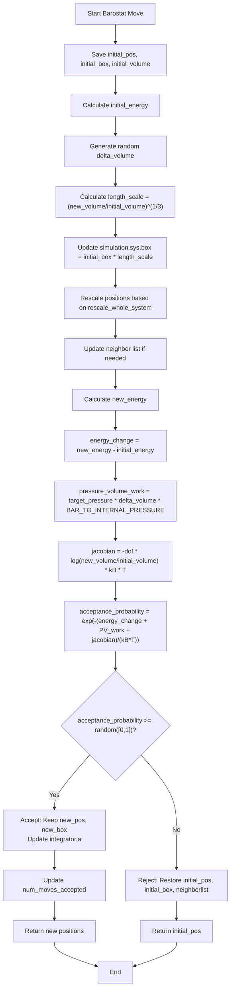
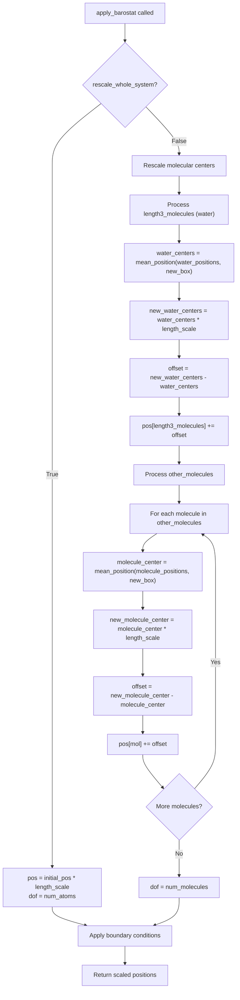
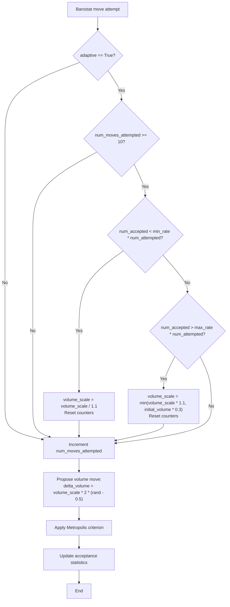
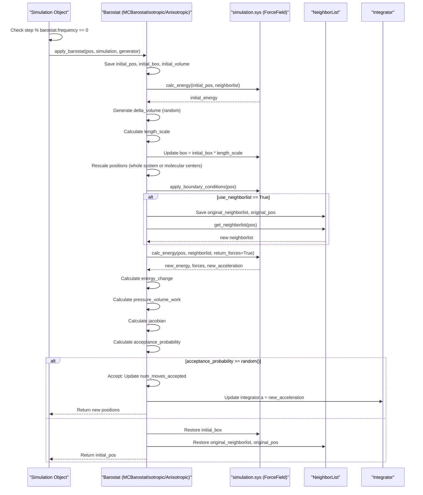

# Pressure Control with Barostats

<details>
<summary>Relevant source files</summary>

The following files were used as context for generating this wiki page:

- [dimos/barostats.py](dimos/barostats.py)

</details>


This document covers the implementation and usage of Monte Carlo barostats in DIMOS for conducting constant pressure (NPT ensemble) molecular dynamics simulations. Barostats control the system pressure by periodically attempting volume changes and accepting or rejecting them based on the Metropolis criterion.

For information about temperature control, see Integration Methods ([3.2](#3.2)). For details on the overall simulation engine architecture, see Simulation Engine ([3](#3)).

## Overview

DIMOS implements pressure control through Monte Carlo barostats that periodically attempt to change the simulation box volume. The implementation follows the Monte Carlo method where volume moves are proposed at regular intervals and accepted or rejected based on the change in system energy, pressure-volume work, and a Jacobian correction term.

Two barostat implementations are provided:
- `MCBarostatIsotropic`: Scales the box uniformly in all directions (standard approach)
- `MCBarostatAnisotropic`: Scales individual box axes independently (experimental)

**Sources:** [dimos/barostats.py:375-386]()

## Barostat Classes

### Class Hierarchy



**Sources:** [dimos/barostats.py:392-443](), [dimos/barostats.py:583-640]()

### MCBarostatIsotropic

The `MCBarostatIsotropic` class implements standard isotropic pressure control where the simulation box is scaled uniformly in all three dimensions.

#### Configuration Parameters

| Parameter | Type | Default | Description |
|-----------|------|---------|-------------|
| `box` | `torch.Tensor` | Required | Initial simulation box dimensions |
| `target_pressure` | `float` | `1.0` | Target pressure in bar |
| `frequency` | `int` | `25` | Number of MD steps between barostat attempts |
| `scale` | `float` | `0.01` | Initial volume change scale as fraction of box volume |
| `adaptive` | `bool` | `True` | Enable adaptive adjustment of move size |
| `min_acceptance_rate` | `float` | `0.25` | Minimum acceptance rate threshold for adaptive scaling |
| `max_acceptance_rate` | `float` | `0.75` | Maximum acceptance rate threshold for adaptive scaling |
| `rescale_whole_system` | `bool` | `False` | If True, rescale all atoms; if False, rescale molecular centers |
| `isotropic` | `bool` | `True` | Whether to perform isotropic scaling |

**Sources:** [dimos/barostats.py:445-457]()

### MCBarostatAnisotropic

The `MCBarostatAnisotropic` class extends pressure control to allow independent scaling of individual box axes. This is useful for systems with anisotropic pressure tensors or interface simulations.

⚠️ **Warning:** This is an experimental feature and should be used with caution. It has not been thoroughly validated against established implementations.

#### Additional Configuration

| Parameter | Type | Default | Description |
|-----------|------|---------|-------------|
| `scale_axis` | `tuple[bool]` | `(True, True, True)` | Which axes to scale |
| `target_pressure` | `tuple[float]` or `float` | `(1.0, 1.0, 1.0)` | Target pressure for each axis in bar |

**Sources:** [dimos/barostats.py:642-664]()

## Monte Carlo Acceptance Criterion

### Metropolis Acceptance Calculation



The acceptance probability for a volume move is calculated as:

```
acceptance_probability = exp(-ΔE / (kB * T))
```

where the total energy change `ΔE` consists of three terms:

1. **Energy change**: `ΔE_pot = E_new - E_initial`
2. **Pressure-volume work**: `ΔE_PV = P_target * ΔV * BAR_TO_INTERNAL_PRESSURE`
3. **Jacobian correction**: `ΔE_jac = -N_dof * kB * T * ln(V_new / V_initial)`

The degree of freedom `N_dof` depends on the `rescale_whole_system` parameter:
- If `True`: `N_dof = number of atoms`
- If `False`: `N_dof = number of molecules`

**Sources:** [dimos/barostats.py:561-581](), [dimos/barostats.py:774-794]()

## Position Rescaling Strategies

### Rescaling Workflow



### Whole System vs Molecular Center Rescaling

The `rescale_whole_system` parameter determines how atomic positions are updated during volume changes:

**Whole System Rescaling** (`rescale_whole_system=True`):
- All atomic coordinates are scaled uniformly by `length_scale`
- Simple and efficient
- May distort molecular geometries if constraints are not applied
- Degree of freedom = number of atoms

**Molecular Center Rescaling** (`rescale_whole_system=False`, default):
- Only molecular centers of mass are scaled
- Maintains internal molecular geometries
- More physically appropriate for rigid or constrained molecules
- Degree of freedom = number of molecules
- Optimized implementation:
  - `length3_molecules` (typically water) processed in parallel
  - `other_molecules` processed sequentially

The `mean_position` method correctly handles periodic boundary conditions when computing molecular centers using circular mean:

```
θ = 2π * r / L
center = (L / 2π) * arctan2(⟨sin(θ)⟩, ⟨cos(θ)⟩)
```

**Sources:** [dimos/barostats.py:530-553](), [dimos/barostats.py:459-479](), [dimos/barostats.py:743-765]()

## Adaptive Move Scaling

### Adaptive Scaling Logic



The adaptive scaling mechanism automatically adjusts the size of volume moves based on acceptance statistics:

- **Acceptance too low** (< 25%): Reduce `volume_scale` by factor of 1.1
- **Acceptance too high** (> 75%): Increase `volume_scale` by factor of 1.1, capped at 30% of box volume
- Adjustments occur after every 10 attempted moves
- Counters reset after each adjustment

This adaptive behavior improves efficiency by maintaining acceptance rates in the optimal range (typically 25-75%). However, note the implementation includes a comment questioning this approach based on adaptive MCMC theory.

**Sources:** [dimos/barostats.py:504-515](), [dimos/barostats.py:716-725]()

## Integration with Simulation Loop

### Barostat Application Workflow



**Sources:** [dimos/barostats.py:481-581](), [dimos/barostats.py:688-794]()

## Usage Considerations

### When to Use Barostats

Use barostats when you need to:
- Simulate NPT ensemble (constant pressure, temperature, particle number)
- Equilibrate system density
- Study pressure-dependent phenomena
- Match experimental conditions at specified pressure

### Frequency Selection

The `frequency` parameter controls how often volume moves are attempted:

- **Smaller frequency** (e.g., 10-25 steps): More frequent moves, better pressure control, higher computational cost
- **Larger frequency** (e.g., 50-100 steps): Less frequent moves, adequate for most applications
- Default value of 25 is suitable for most systems
- Very small frequencies may cause instabilities
- Should be balanced with constraint application frequency

### Anisotropic Barostat Considerations

When using `MCBarostatAnisotropic`:
- Each move only scales one randomly selected axis (from those enabled in `scale_axis`)
- Requires ~3× more moves to achieve same equilibration as isotropic
- Useful for systems with directional pressure differences (interfaces, membranes, crystals)
- Track acceptance rates per axis via `num_moves_accepted` and `num_moves_attempted` tensors
- Exercise caution: experimental feature with limited validation

**Sources:** [dimos/barostats.py:642-664](), [dimos/barostats.py:710-725]()

## Constants and Units

The barostat implementation uses the following constants from `dimos.constants`:

- `BAR_TO_INTERNAL_PRESSURE`: Converts pressure from bar to internal energy units per volume
- `BOLTZMANN`: Boltzmann constant in internal units

Pressure values should be specified in **bar** (the standard unit in molecular simulation). The `target_pressure` parameter defaults to 1.0 bar (atmospheric pressure).

**Sources:** [dimos/barostats.py:388-389](), [dimos/barostats.py:564](), [dimos/barostats.py:565](), [dimos/barostats.py:777-778]()

## Example Configuration

```python
# Isotropic barostat for standard NPT simulation at 1 bar
from dimos.barostats import MCBarostatIsotropic

barostat = MCBarostatIsotropic(
    box=simulation.sys.box,
    target_pressure=1.0,        # 1 bar
    frequency=25,                # Attempt every 25 steps
    scale=0.01,                  # 1% of box volume initial scale
    adaptive=True,               # Enable adaptive scaling
    rescale_whole_system=False   # Rescale molecular centers only
)

# Anisotropic barostat for interface simulation
from dimos.barostats import MCBarostatAnisotropic

barostat = MCBarostatAnisotropic(
    box=simulation.sys.box,
    scale_axis=(True, True, False),      # Scale x,y but not z
    target_pressure=(1.0, 1.0, 1.0),     # Pressure per axis
    frequency=25,
    adaptive=True
)
```

**Sources:** [dimos/barostats.py:392-457](), [dimos/barostats.py:583-664]()

---