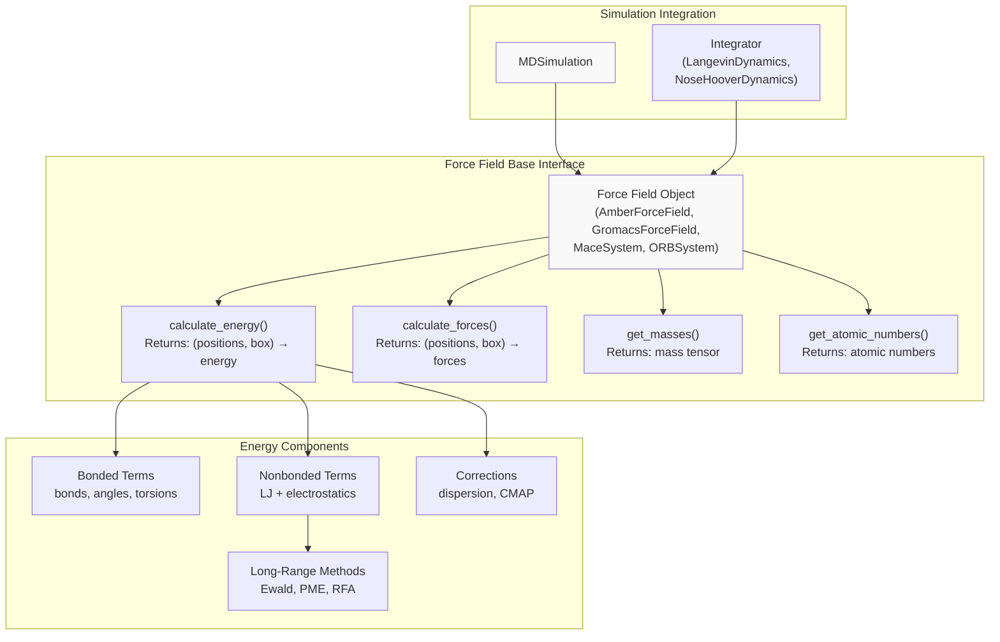
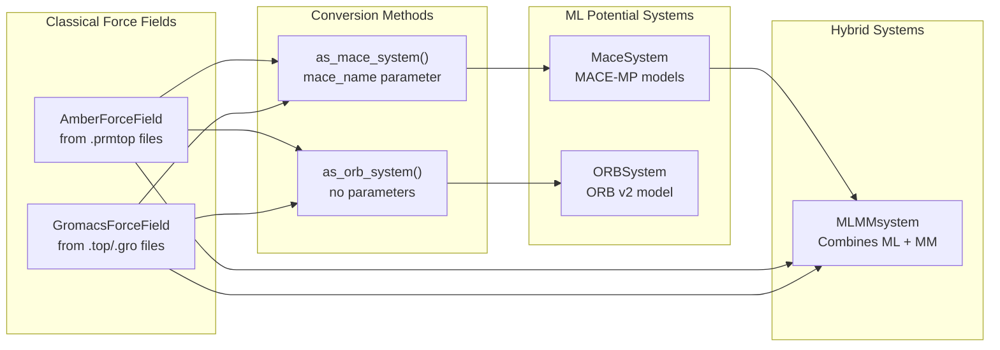
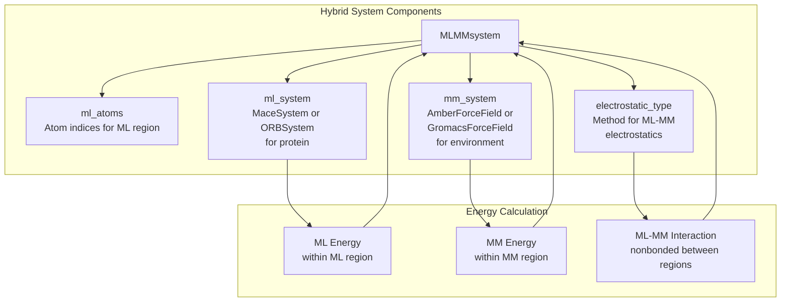
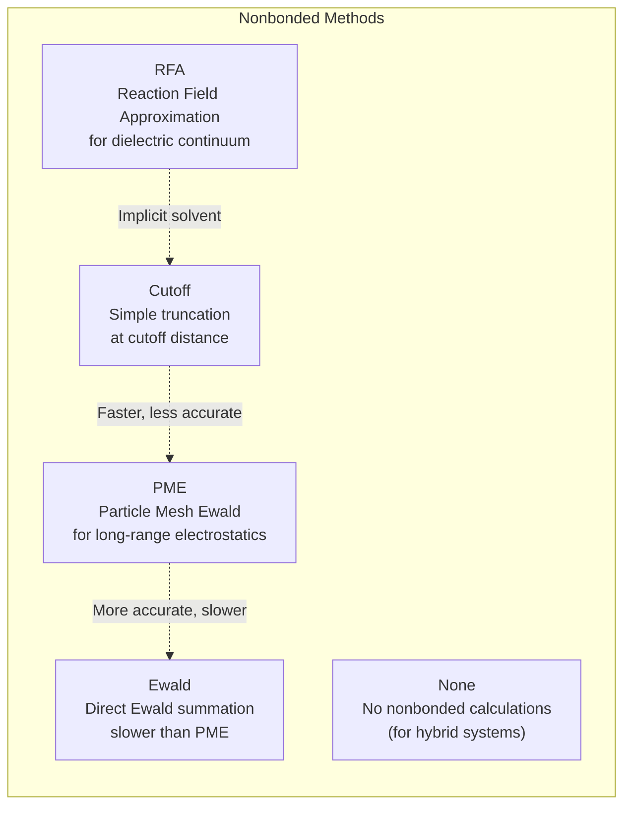
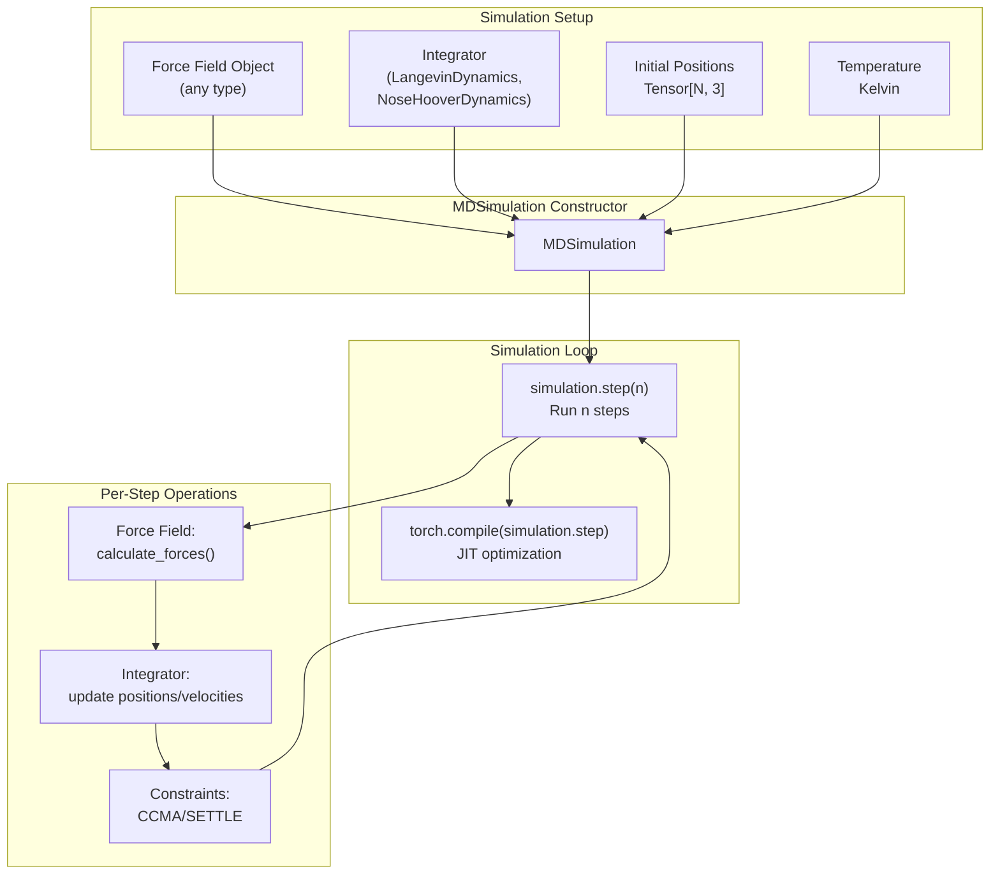

# Force Field Systems

<details>
<summary>Relevant source files</summary>

The following files were used as context for generating this wiki page:

- [benchmark/proteins/ala2_tip3p.top](benchmark/proteins/ala2_tip3p.top)
- [benchmark/proteins/benchmark_proteins.py](benchmark/proteins/benchmark_proteins.py)
- [benchmark/water/dimos_water_ml.py](benchmark/water/dimos_water_ml.py)

</details>


## Purpose and Scope

This page provides a comprehensive overview of the force field architecture in DIMOS, explaining how potential energy calculations are organized and implemented. Force fields define the potential energy function that governs molecular interactions, and DIMOS supports three distinct types: classical molecular mechanics (Amber, GROMACS), machine learning potentials (MACE, ORB), and hybrid ML/MM systems.

For detailed information about specific force field types, see:
- Classical force field usage and parameters: [Classical Force Fields](#4.1)
- ML potential integration and configuration: [Machine Learning Potentials](#4.2)
- Hybrid system setup and partitioning: [Hybrid ML/MM Systems](#4.3)

For energy calculation details (bonded, nonbonded, long-range methods), see [Energy Calculations](#3.1).

For unit system conventions used in force field parameters, see [Unit Systems and Physical Constants](#2.3).

---

## Force Field Architecture

DIMOS implements a modular force field architecture where force fields are separate objects that calculate energies and forces independently of the simulation loop. All force field classes provide a common interface for energy evaluation, making them interchangeable within the simulation engine.

### Core Force Field Interface



**Sources**: [benchmark/proteins/benchmark_proteins.py:31-47](), [benchmark/water/dimos_water_ml.py:69-96]()

---

## Force Field Types and Conversion

DIMOS supports three categories of force fields, with conversion methods to transform between them:



**Sources**: [benchmark/proteins/benchmark_proteins.py:31-44](), [benchmark/water/dimos_water_ml.py:69-84]()

### Force Field Type Comparison

| Force Field Type | Input Files | Primary Use Case | Differentiability | Performance |
|-----------------|-------------|------------------|-------------------|-------------|
| `AmberForceField` | `.prmtop`, `.inpcrd` | Classical MD, Amber-based systems | Full | Fast |
| `GromacsForceField` | `.top`, `.gro` | Classical MD, GROMACS-based systems | Full | Fast |
| `MaceSystem` | None (pretrained) | ML-driven MD, general molecules | Full | Moderate |
| `ORBSystem` | None (pretrained) | ML-driven MD, ORB potential | Full | Moderate |
| `MLMMsystem` | Combination | Protein (ML) + environment (MM) | Full | Variable |

---

## Classical Force Field Classes

### AmberForceField

The `AmberForceField` class loads Amber topology (`.prmtop`) files and provides classical molecular mechanics energy calculations:

**Key Parameters:**
- `prmtop_file`: Path to Amber topology file
- `cutoff`: Nonbonded cutoff distance (Angstroms)
- `switch_distance`: Distance where switching function begins (Angstroms)
- `nonbonded_type`: Method for electrostatics (`"Cutoff"`, `"PME"`, `"Ewald"`, `"RFA"`)
- `periodic`: Boolean for periodic boundary conditions
- `dtype`: Precision for calculations (`torch.float32` or `torch.float64`)

**Example Usage:**
```python
# From dimos_water_ml.py:69
mm_system = dimos.ff.AmberForceField(
    'amber20.prmtop', 
    cutoff=5.0, 
    switch_distance=3.5, 
    nonbonded_type="Cutoff", 
    periodic=True, 
    dtype=torch.float64
)
```

**Sources**: [benchmark/water/dimos_water_ml.py:69]()

### GromacsForceField

The `GromacsForceField` class loads GROMACS topology (`.top`) and coordinate (`.gro`) files:

**Key Parameters:**
- `top_file`: Path to GROMACS topology file
- `gro_file`: Path to GROMACS coordinate file
- `cutoff`: Nonbonded cutoff distance (Angstroms)
- `switch_distance`: Distance where switching function begins (Angstroms)
- `nonbonded_type`: Method for electrostatics (`"PME"`, `"Ewald"`, `"Cutoff"`, `None`)
- `constraint_option`: Constraint handling (`"h_angles"`, `"h_bonds"`, `None`)
- `excluded_bonded_atoms`: Atom indices to exclude from bonded calculations (for hybrid systems)
- `create_graph`: Boolean for gradient graph creation (for higher-order derivatives)

**Example Usage:**
```python
# From benchmark_proteins.py:31
base_sys = dimos.GromacsForceField(
    "ala2_tip3p.top", 
    "ala2_tip3p.gro",
    cutoff=10, 
    switch_distance=7.5, 
    nonbonded_type="PME", 
    constraint_option="h_angles", 
    create_graph=False
)
```

**Sources**: [benchmark/proteins/benchmark_proteins.py:31-38]()

### GROMACS Topology File Structure

GROMACS `.top` files define molecular topology with multiple sections:

```mermaid
graph TB
    subgraph "Topology File Sections"
        DEFAULTS["[ defaults ]<br/>nbfunc, comb-rule,<br/>gen-pairs, fudgeLJ, fudgeQQ"]
        ATOMTYPES["[ atomtypes ]<br/>atom type definitions<br/>sigma, epsilon"]
        MOLTYPE["[ moleculetype ]<br/>molecule definition<br/>exclusion count"]
        ATOMS["[ atoms ]<br/>atom list with<br/>types, charges, masses"]
        BONDS["[ bonds ]<br/>harmonic bond parameters"]
        ANGLES["[ angles ]<br/>angle parameters"]
        DIHEDRALS["[ dihedrals ]<br/>torsion parameters"]
        PAIRS["[ pairs ]<br/>1-4 interactions"]
        SETTLES["[ settles ]<br/>water constraints"]
        SYSTEM["[ system ]<br/>system name"]
        MOLECULES["[ molecules ]<br/>molecule counts"]
    end
    
    DEFAULTS --> ATOMTYPES
    ATOMTYPES --> MOLTYPE
    MOLTYPE --> ATOMS
    ATOMS --> BONDS
    BONDS --> ANGLES
    ANGLES --> DIHEDRALS
    DIHEDRALS --> PAIRS
    PAIRS --> SETTLES
    SETTLES --> SYSTEM
    SYSTEM --> MOLECULES
```



**Example from ala2_tip3p.top:**
- `[ defaults ]`: Combination rule 2, fudgeLJ=1.0, fudgeQQ=0.83333 [benchmark/proteins/ala2_tip3p.top:17-19]()
- `[ atomtypes ]`: Defines H1, C1, C2, O1, N1, etc. with sigma and epsilon [benchmark/proteins/ala2_tip3p.top:21-31]()
- `[ moleculetype ]`: Protein molecule "system1" with nrexcl=3 [benchmark/proteins/ala2_tip3p.top:34-36]()
- `[ atoms ]`: 22 atoms for alanine dipeptide [benchmark/proteins/ala2_tip3p.top:38-64]()
- `[ molecules ]`: 1 protein molecule + 749 water molecules [benchmark/proteins/ala2_tip3p.top:274-277]()

**Sources**: [benchmark/proteins/ala2_tip3p.top:1-278]()

---

## Machine Learning Potential Systems

DIMOS integrates pretrained ML interatomic potentials through conversion methods on classical force field objects.

### MACE Systems

The `as_mace_system()` method converts classical force fields to use MACE (Multi-Atomic Cluster Expansion) potentials:

**Method Signature:**
```python
as_mace_system(
    mace_name: str,          # "mace-mp-small", "mace-mp-medium", "mace-mp-large"
    atom_range: tuple = None, # (start_idx, end_idx) for subset of atoms
    enable_cueq: bool = False # Enable charge equilibration
)
```

**MACE Model Options:**

| Model Name | Parameter Count | Speed | Accuracy | Use Case |
|-----------|----------------|-------|----------|----------|
| `"mace-mp-small"` | Smallest | Fastest | Lower | Rapid prototyping, large systems |
| `"mace-mp-medium"` | Medium | Moderate | Medium | Balanced accuracy/speed |
| `"mace-mp-large"` | Largest | Slowest | Highest | Production simulations, benchmarks |

**Example Usage:**
```python
# From benchmark_proteins.py:39
smaller_gromacs_ml_system = system_excluding_protein.as_mace_system(
    "mace-mp-large", 
    atom_range=(0, len(ml_atoms))
)

# From benchmark_proteins.py:43
syst = base_sys.as_mace_system("mace-mp-large")
```

**Sources**: [benchmark/proteins/benchmark_proteins.py:39-43](), [benchmark/water/dimos_water_ml.py:72-82]()

### ORB Systems

The `as_orb_system()` method converts classical force fields to use the ORB v2 potential:

**Method Signature:**
```python
as_orb_system()  # No parameters - uses ORB v2 pretrained model
```

**Example Usage:**
```python
# From dimos_water_ml.py:84
dimos_system = mm_system.as_orb_system()
```

**Sources**: [benchmark/water/dimos_water_ml.py:83-84]()

---

## Hybrid ML/MM Systems

The `MLMMsystem` class combines ML potentials for a subset of atoms (typically protein) with classical MM force fields for the environment (typically solvent):



**Constructor Signature:**
```python
MLMMsystem(
    ml_atoms,              # List/tensor of atom indices for ML region
    ml_system,             # MaceSystem or ORBSystem
    mm_system,             # AmberForceField or GromacsForceField
    electrostatic_type,    # Method for cross-region electrostatics (None, "Cutoff", etc.)
    create_graph=False     # Enable gradient graph creation
)
```

**Example Usage:**
```python
# From benchmark_proteins.py:36-41
ml_atoms = base_sys.other_molecules[0]

# Create MM system excluding protein bonded terms
system_excluding_protein = dimos.GromacsForceField(
    f"{system}.top", f"{system}.gro", 
    cutoff=10, 
    switch_distance=7.5, 
    nonbonded_type=None,  # ML handles protein nonbonded
    constraint_option=constraint_option, 
    excluded_bonded_atoms=ml_atoms,  # Exclude protein bonded terms
    create_graph=False
)

# Create ML system for protein region
smaller_gromacs_ml_system = system_excluding_protein.as_mace_system(
    "mace-mp-large", 
    atom_range=(0, len(ml_atoms))
)

# Combine into hybrid system
syst = dimos.mlmm.MLMMsystem(
    ml_atoms, 
    smaller_gromacs_ml_system, 
    system_excluding_protein, 
    electrostatic_type=None,  # Can also be "Cutoff", "PME", etc.
    create_graph=False
)

# Attach constraints from MM system
syst.constraint_handler = system_excluding_protein.constraint_handler
```

**Sources**: [benchmark/proteins/benchmark_proteins.py:36-41]()

### Partitioning Considerations

When creating hybrid systems:

1. **Molecule Detection**: Use `base_sys.other_molecules` to access detected molecule groupings
2. **Bonded Term Exclusion**: Pass `excluded_bonded_atoms` to classical force field to prevent double-counting
3. **Nonbonded Handling**: Set `nonbonded_type=None` in MM system if ML handles all nonbonded in ML region
4. **Constraint Transfer**: Constraints from MM system must be manually attached to hybrid system
5. **Electrostatic Type**: Controls how electrostatic interactions between ML and MM regions are calculated

---

## Force Field Configuration Options

### Cutoff and Switching

Most force fields support cutoff-based nonbonded calculations with optional switching functions:

| Parameter | Description | Typical Values | Units |
|-----------|-------------|----------------|-------|
| `cutoff` | Distance beyond which nonbonded interactions are zero | 8-12 | Angstroms |
| `switch_distance` | Distance where switching function begins | 6-10 | Angstroms |

The switching function smoothly reduces interactions to zero between `switch_distance` and `cutoff`, preventing energy discontinuities.

### Nonbonded Methods



**Method Selection Guide:**

- **`"Cutoff"`**: Fastest, suitable for testing or non-polar systems
- **`"PME"`**: Standard choice for biomolecular simulations with periodic boundaries
- **`"Ewald"`**: Direct Ewald summation, slower than PME but exact
- **`"RFA"`**: Reaction field approximation for implicit solvent effects
- **`None`**: Disables nonbonded calculations (used in hybrid ML/MM systems)

**Sources**: [benchmark/proteins/benchmark_proteins.py:31](), [benchmark/water/dimos_water_ml.py:69]()

### Constraint Options

Constraints maintain fixed bond lengths or angles, allowing larger timesteps:

| Option | Constraints Applied | Typical Timestep | Use Case |
|--------|-------------------|------------------|----------|
| `None` | No constraints | 0.5 fs | Testing, high-accuracy integration |
| `"h_bonds"` | Bonds to hydrogen | 1.0 fs | Moderate speedup |
| `"h_angles"` | Bonds to hydrogen + angles | 2.0 fs | Standard production runs |

**Example:**
```python
# From benchmark_proteins.py:24-29
if "no_constraints" in name:
    constraint_option = None
    timestep = 0.5
else:
    constraint_option = "h_angles"
    timestep = 2.0
```

**Sources**: [benchmark/proteins/benchmark_proteins.py:24-29]()

### Precision Control

Force field calculations support mixed precision:

```python
# From dimos_water_ml.py:41-48
if ff_accuracy == 32:
    dtype_ff = torch.float32
else:
    dtype_ff = torch.float64
    
if integration_accuracy == 32:
    dtype_integration = torch.float32
else:
    dtype_integration = torch.float64

# Create force field with specific precision
mm_system = dimos.ff.AmberForceField(
    'amber20.prmtop', 
    cutoff=5.0, 
    dtype=dtype_ff  # Force field precision
)

# Create integrator with potentially different precision
integrator = dimos.integrators.LangevinDynamics(
    stepsize, 300, 0.1, 
    mm_system, 
    dtype=dtype_integration  # Integration precision
)
```

This allows force field evaluations in float32 for speed while maintaining float64 for integration accuracy.

**Sources**: [benchmark/water/dimos_water_ml.py:41-48](), [benchmark/water/dimos_water_ml.py:69](), [benchmark/water/dimos_water_ml.py:86]()

---

## Integration with Simulation Engine

Force fields interface with the simulation engine through the `MDSimulation` class:



**Standard Workflow:**
```python
# From benchmark_proteins.py:46-51
# 1. Create force field
syst = dimos.GromacsForceField("system.top", "system.gro", ...)

# 2. Create integrator
integrator = dimos.NoseHooverDynamics(timestep, 300.0, 0.05, syst, dtype=torch.float64)

# 3. Create simulation
sim = dimos.MDSimulation(syst, integrator, initial_pos=positions, temperature=300.0)

# 4. Optional: compile for performance
torch.compiler.reset()
sim_step = torch.compile(sim.step, mode="max-autotune-no-cudagraphs")

# 5. Run simulation
sim_step(100)  # Run 100 steps
```

**Sources**: [benchmark/proteins/benchmark_proteins.py:46-55](), [benchmark/water/dimos_water_ml.py:86-96]()

### PyTorch Compilation

Force field calculations are fully compatible with `torch.compile()` for JIT optimization:

```python
# From dimos_water_ml.py:90-96
if "compile" in tool:
    print("Compilation started")
    torch.compiler.reset()
    step = torch.compile(simulation.step, mode="max-autotune-no-cudagraphs")
    print("...done")                
else:
    step = simulation.step
```

**Compilation Modes:**
- `"default"`: Standard optimization
- `"reduce-overhead"`: Minimize Python overhead
- `"max-autotune"`: Extensive optimization search
- `"max-autotune-no-cudagraphs"`: Max optimization without CUDA graphs (more stable)

**Sources**: [benchmark/water/dimos_water_ml.py:90-96](), [benchmark/proteins/benchmark_proteins.py:49-51]()

---

## Force Field Data Access

Force field objects provide methods to access system properties:

### Mass Access
```python
masses = force_field.get_masses()  # Returns torch.Tensor of atomic masses
```

### Atomic Numbers
```python
atomic_numbers = force_field.get_atomic_numbers()  # Returns torch.Tensor of Z values
```

### Molecule Groupings
```python
# From benchmark_proteins.py:36
ml_atoms = base_sys.other_molecules[0]  # First molecule (protein)
# other_molecules is a list of atom index lists for each molecule
```

### Structure Output
```python
# From dimos_water_ml.py:193
mm_system.write_pdb(simulation.pos, config_file, unwrap_bonds=False)
```

Classical force field objects (`AmberForceField`, `GromacsForceField`) provide PDB writing capabilities for trajectory output.

**Sources**: [benchmark/proteins/benchmark_proteins.py:36](), [benchmark/water/dimos_water_ml.py:193]()

---

## Summary

DIMOS provides a flexible force field system with three main categories:

1. **Classical Force Fields** (`AmberForceField`, `GromacsForceField`): Standard molecular mechanics with bonded and nonbonded terms, supporting multiple long-range electrostatic methods.

2. **ML Potential Systems** (`MaceSystem`, `ORBSystem`): Pretrained neural network potentials accessed via `.as_mace_system()` and `.as_orb_system()` conversion methods.

3. **Hybrid ML/MM Systems** (`MLMMsystem`): Combines ML for protein/small molecules with MM for solvent, with flexible electrostatic handling between regions.

All force field types share a common interface for energy/force calculation and integrate seamlessly with the simulation engine, supporting PyTorch compilation for optimized performance.

---