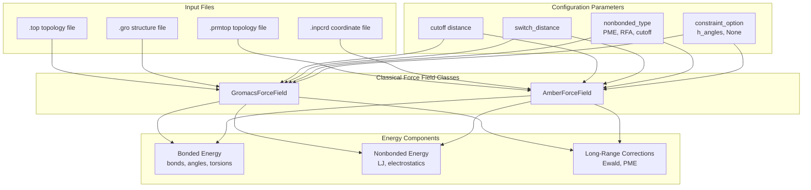
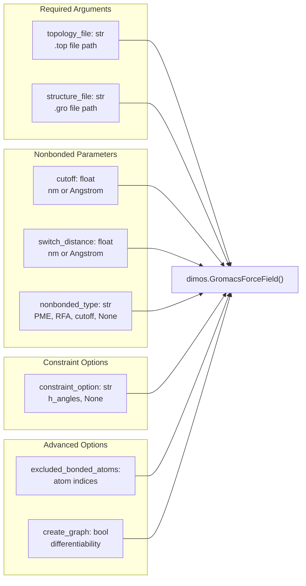
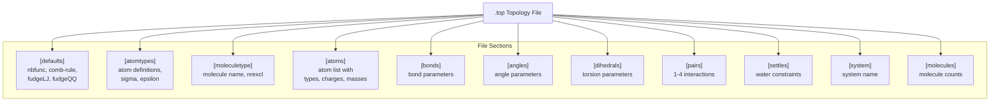
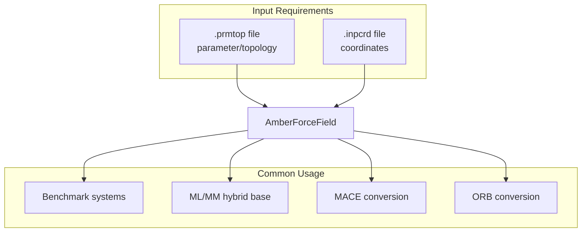
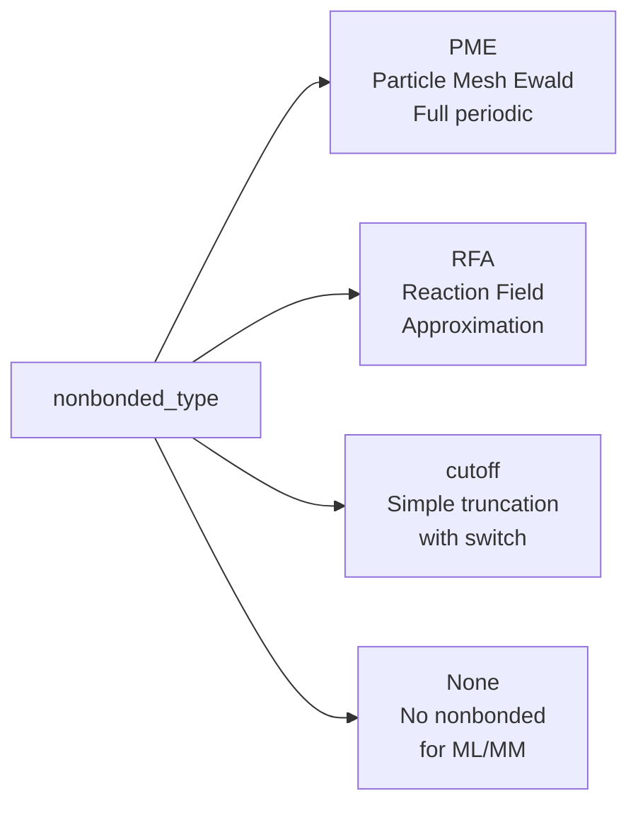
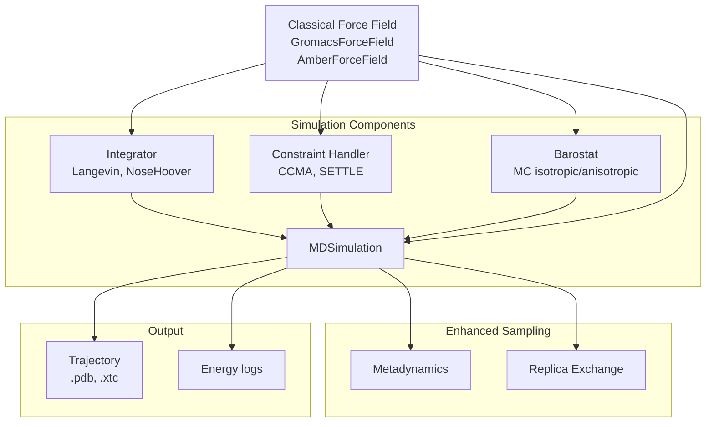
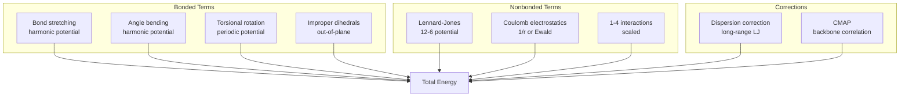

# Classical Force Fields

<details>
<summary>Relevant source files</summary>

The following files were used as context for generating this wiki page:

- [benchmark/proteins/ala2_tip3p.top](benchmark/proteins/ala2_tip3p.top)
- [benchmark/proteins/benchmark_proteins.py](benchmark/proteins/benchmark_proteins.py)
- [benchmark/proteins/trp-cage_sol.top](benchmark/proteins/trp-cage_sol.top)

</details>


## Purpose and Scope

This page documents the use of classical molecular mechanics force fields in DIMOS, specifically the Amber and GROMACS force field implementations. These force fields compute molecular energies and forces using parameterized functional forms for bonded and nonbonded interactions.

For general information about force field types supported in DIMOS, see [Force Fields Overview](#2.2). For details on how energy terms are calculated, see [Energy Calculations](#3.1). For machine learning-based potentials, see [Machine Learning Potentials](#4.2), and for combining classical and ML approaches, see [Hybrid ML/MM Systems](#4.3).

---

## Force Field Architecture

DIMOS provides two primary classical force field implementations that follow similar interfaces but read different file formats.



**Sources**: benchmark/proteins/benchmark_proteins.py:31

---

## GROMACS Force Field

### Class: `GromacsForceField`

The `GromacsForceField` class reads GROMACS-format topology (.top) and structure (.gro) files to initialize a classical force field system.

#### Initialization Parameters



**Sources**: benchmark/proteins/benchmark_proteins.py:31, benchmark/proteins/benchmark_proteins.py:38

#### Configuration Example

The following table shows common parameter configurations:

| Configuration | `cutoff` | `switch_distance` | `nonbonded_type` | `constraint_option` | Timestep |
|--------------|----------|-------------------|------------------|---------------------|----------|
| Standard MD with PME | 10 Å | 7.5 Å | `"PME"` | `"h_angles"` | 2.0 fs |
| No constraints | 10 Å | 7.5 Å | `"PME"` | `None` | 0.5 fs |
| Cutoff only | 12 Å | 10.0 Å | `"cutoff"` | `"h_angles"` | 2.0 fs |
| ML/MM hybrid | 10 Å | 7.5 Å | `None` | `"h_angles"` | 2.0 fs |

**Sources**: benchmark/proteins/benchmark_proteins.py:24-31

#### Usage Pattern

```python
import dimos

# Initialize GROMACS force field
system = dimos.GromacsForceField(
    "system.top",           # topology file
    "system.gro",           # structure file
    cutoff=10,              # 10 Angstrom cutoff
    switch_distance=7.5,    # start switching at 7.5 Angstrom
    nonbonded_type="PME",   # Use Particle Mesh Ewald
    constraint_option="h_angles",  # Constrain hydrogen bonds and angles
    create_graph=False      # No automatic differentiation
)

# Read initial positions
positions = dimos.read_positions("system.gro")

# Use with integrator and simulation
integrator = dimos.NoseHooverDynamics(
    timestep=2.0,           # 2 fs timestep when constraints enabled
    temperature=300.0,
    collision_rate=0.05,
    system=system
)

simulation = dimos.MDSimulation(
    system=system,
    integrator=integrator,
    initial_pos=positions,
    temperature=300.0
)
```

**Sources**: benchmark/proteins/benchmark_proteins.py:23-47

### Topology File Structure

GROMACS topology files (.top) contain force field parameters organized in sections. The key sections are:



**Sources**: benchmark/proteins/ala2_tip3p.top:1-278, benchmark/proteins/trp-cage_sol.top:1-2986

#### Key Topology Sections

| Section | Purpose | Example Line |
|---------|---------|--------------|
| `[defaults]` | Global force field rules | `1  2  no  1  0.83333333` |
| `[atomtypes]` | Atom type parameters (σ, ε) | `H1  1  1.007947  0.0  A  0.26495328  0.0656888` |
| `[atoms]` | Atom definitions with charges | `1  H1  1  ACE  H1  1  0.1123  1.007947` |
| `[bonds]` | Bonded interactions | `1  2  1  0.10900  284512.000000` |
| `[angles]` | Angular terms | `1  2  3  1  109.5  292.880000` |
| `[dihedrals]` | Torsional terms | `1  2  3  4  9  180.0  10.46  2` |
| `[pairs]` | 1-4 nonbonded scaling | `1  5  1  0.2014  0.1201` |
| `[molecules]` | Composition | `Protein_chain_A  1` |

**Sources**: benchmark/proteins/ala2_tip3p.top:17-277, benchmark/proteins/trp-cage_sol.top:20-2986

For complete file format specifications, see [GROMACS File Formats](#7.1).

---

## Amber Force Field

### Class: `AmberForceField`

The `AmberForceField` class reads Amber-format topology (.prmtop) and coordinate (.inpcrd) files. It provides similar functionality to `GromacsForceField` but uses the Amber file format conventions.



**Sources**: benchmark/proteins/benchmark_proteins.py:36-44

### Converting to ML Systems

A key feature of DIMOS force field classes is the ability to convert classical systems to ML-based or hybrid systems:

```python
# Initialize Amber force field
base_sys = dimos.AmberForceField(
    "system.prmtop",
    "system.inpcrd",
    cutoff=10,
    switch_distance=7.5,
    nonbonded_type="PME",
    constraint_option="h_angles"
)

# Convert to MACE ML system
ml_system = base_sys.as_mace_system("mace-mp-large")
ml_system.constraint_handler = base_sys.constraint_handler

# Or create ML/MM hybrid
ml_atoms = base_sys.other_molecules[0]  # Extract protein atoms
env_system = dimos.AmberForceField(
    "system.prmtop",
    "system.inpcrd",
    cutoff=10,
    nonbonded_type=None,
    excluded_bonded_atoms=ml_atoms
)
ml_subsystem = env_system.as_mace_system(
    "mace-mp-large",
    atom_range=(0, len(ml_atoms))
)
hybrid = dimos.mlmm.MLMMsystem(
    ml_atoms,
    ml_subsystem,
    env_system,
    electrostatic_type=None
)
```

**Sources**: benchmark/proteins/benchmark_proteins.py:33-44

For more details on ML conversions, see [Machine Learning Potentials](#4.2) and [Hybrid ML/MM Systems](#4.3).

For Amber file format specifications, see [Amber File Formats](#7.2).

---

## Configuration Parameters

### Cutoff and Switching

Both force field classes support cutoff-based nonbonded calculations with optional switching functions:

| Parameter | Type | Units | Description |
|-----------|------|-------|-------------|
| `cutoff` | `float` | Å or nm | Maximum distance for nonbonded interactions |
| `switch_distance` | `float` | Å or nm | Distance at which switching function starts |

The switching function smoothly reduces forces to zero between `switch_distance` and `cutoff` to avoid discontinuities.

**Sources**: benchmark/proteins/benchmark_proteins.py:31

### Nonbonded Treatment

The `nonbonded_type` parameter controls how long-range electrostatics are handled:



| Value | Method | Use Case |
|-------|--------|----------|
| `"PME"` | Particle Mesh Ewald | Standard periodic systems, accurate long-range |
| `"RFA"` | Reaction Field Approximation | Faster alternative with approximations |
| `"cutoff"` | Simple cutoff with switching | Gas phase or non-periodic |
| `None` | Disabled | ML/MM systems where ML handles interactions |

**Sources**: benchmark/proteins/benchmark_proteins.py:31, benchmark/proteins/benchmark_proteins.py:38

For detailed descriptions of these methods, see [Long-Range Methods and Corrections](#3.1.3).

### Constraint Options

The `constraint_option` parameter determines which geometric constraints are applied:

| Value | Constraints Applied | Recommended Timestep |
|-------|---------------------|---------------------|
| `"h_angles"` | Hydrogen bonds and H-X-Y angles | 2.0 fs |
| `None` | No constraints | 0.5 fs |

```python
# With constraints - allows larger timestep
system = dimos.GromacsForceField(
    "system.top", "system.gro",
    cutoff=10,
    constraint_option="h_angles"
)
integrator = dimos.NoseHooverDynamics(timestep=2.0, ...)

# Without constraints - requires smaller timestep
system = dimos.GromacsForceField(
    "system.top", "system.gro",
    cutoff=10,
    constraint_option=None
)
integrator = dimos.NoseHooverDynamics(timestep=0.5, ...)
```

**Sources**: benchmark/proteins/benchmark_proteins.py:24-29

For implementation details, see [Molecular Constraints](#3.3).

---

## Advanced Configuration

### Excluded Bonded Atoms

The `excluded_bonded_atoms` parameter allows certain atoms to be excluded from bonded energy calculations, useful for ML/MM hybrid systems:

```python
# Extract protein atoms for ML treatment
ml_atoms = base_sys.other_molecules[0]

# Create environment system excluding protein bonded terms
env_system = dimos.GromacsForceField(
    "system.top", "system.gro",
    cutoff=10,
    nonbonded_type=None,
    excluded_bonded_atoms=ml_atoms  # Don't compute bonded for these atoms
)
```

**Sources**: benchmark/proteins/benchmark_proteins.py:36-40

### Create Graph Option

The `create_graph` parameter controls whether computational graphs are built for automatic differentiation:

```python
# Standard simulation - no graph needed
system = dimos.GromacsForceField(
    "system.top", "system.gro",
    cutoff=10,
    create_graph=False  # Default, faster
)

# For gradient-based methods or training
system = dimos.GromacsForceField(
    "system.top", "system.gro",
    cutoff=10,
    create_graph=True  # Enables autograd
)
```

**Sources**: benchmark/proteins/benchmark_proteins.py:31

---

## Integration with Simulation Components

Classical force fields integrate with other DIMOS components through standard interfaces:



**Sources**: benchmark/proteins/benchmark_proteins.py:46-47

### Constraint Handler Access

Force field objects maintain a `constraint_handler` attribute that can be transferred when converting to other system types:

```python
# Classical force field with constraints
classical_sys = dimos.GromacsForceField(
    "system.top", "system.gro",
    constraint_option="h_angles"
)

# Convert to ML system
ml_sys = classical_sys.as_mace_system("mace-mp-large")

# Transfer constraint handler
ml_sys.constraint_handler = classical_sys.constraint_handler
```

**Sources**: benchmark/proteins/benchmark_proteins.py:41-44

### Usage in Benchmarking

Classical force fields are used throughout the DIMOS benchmarking suite to compare performance against other MD engines:

```python
# Benchmark configuration
system_name = "ala2_tip3p"  # or "dhfr", "trp-cage_sol"
constraint_option = "h_angles" if "constraints" in name else None
timestep = 2.0 if "constraints" in name else 0.5

# Initialize system
positions = dimos.read_positions(f"{system_name}.gro")
system = dimos.GromacsForceField(
    f"{system_name}.top",
    f"{system_name}.gro",
    cutoff=10,
    switch_distance=7.5,
    nonbonded_type="PME",
    constraint_option=constraint_option,
    create_graph=False
)

# Setup simulation with torch.compile optimization
integrator = dimos.NoseHooverDynamics(
    timestep, 300.0, 0.05, system,
    dtype=torch.float64
)
sim = dimos.MDSimulation(
    system, integrator,
    initial_pos=positions,
    temperature=300.0
)
sim_step = torch.compile(sim.step, mode="max-autotune-no-cudagraphs")
```

**Sources**: benchmark/proteins/benchmark_proteins.py:16-51

For benchmarking details, see [Protein Benchmark Systems](#6.1) and [Platform Comparison and Performance](#6.3).

---

## Energy Calculation Components

Classical force fields compute total energy as a sum of bonded and nonbonded contributions:



**Sources**: benchmark/proteins/ala2_tip3p.top:66-227, benchmark/proteins/trp-cage_sol.top:354-2895

For detailed energy term descriptions, see:
- [Bonded Interactions](#3.1.1) - bonds, angles, torsions
- [Nonbonded Interactions](#3.1.2) - Lennard-Jones, electrostatics
- [Long-Range Methods and Corrections](#3.1.3) - Ewald, PME, dispersion corrections

---

## Unit System Considerations

Classical force fields use the unit system specified during DIMOS initialization. Both Amber and GROMACS conventions are supported:

| Unit System | Energy | Length | Force Constant |
|-------------|--------|--------|----------------|
| Amber (`"kcal/mol"` or `"amber"`) | kcal/mol | Å | kcal/(mol·Å²) |
| GROMACS (`"kJ/mol"` or `"openmm"` or `"gromacs"`) | kJ/mol | nm | kJ/(mol·nm²) |

The force field classes automatically handle unit conversions when reading topology files. Ensure the unit system is initialized before creating force field objects:

```python
# Initialize unit system
dimos.init_constants_in_unit_system("gromacs")  # or "amber"

# Then create force field
system = dimos.GromacsForceField("system.top", "system.gro", ...)
```

For more information, see [Unit Systems and Physical Constants](#2.3).

**Sources**: Inferred from system architecture and constants module usage

---