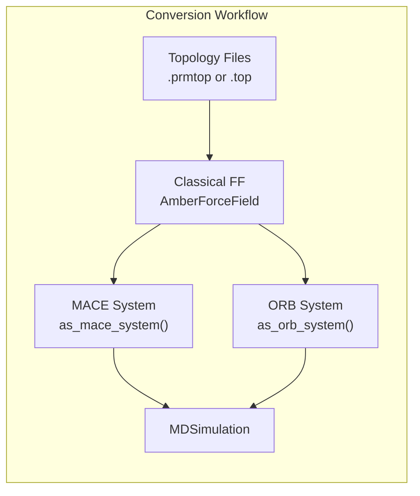
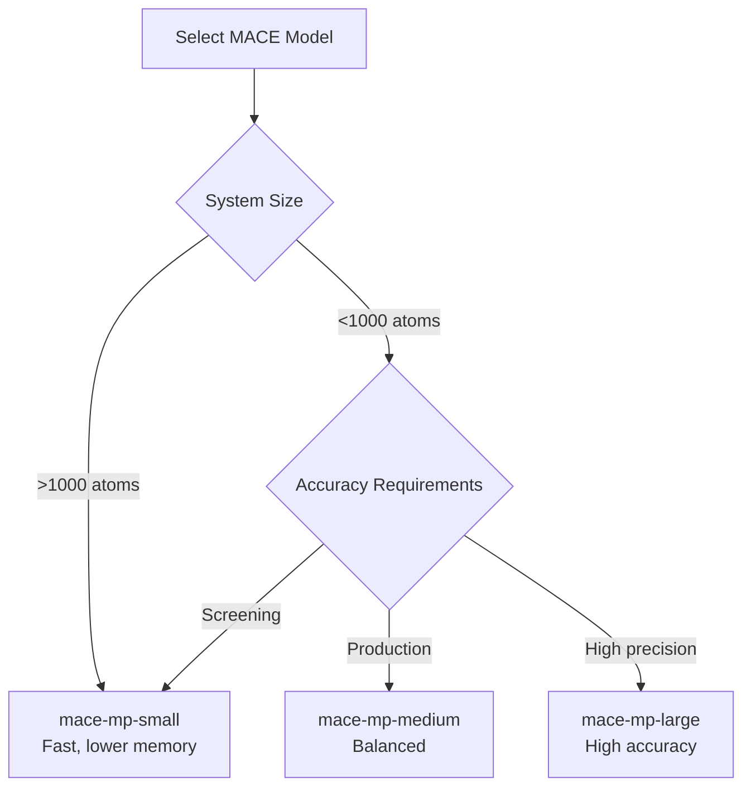
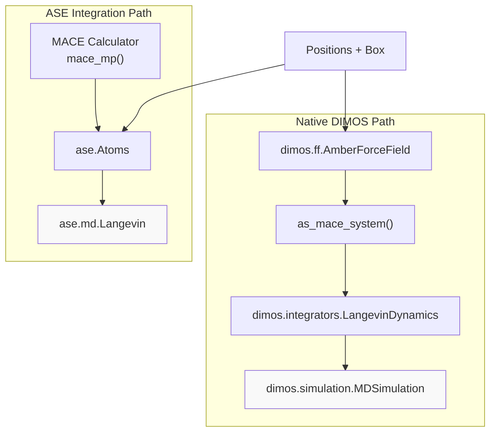
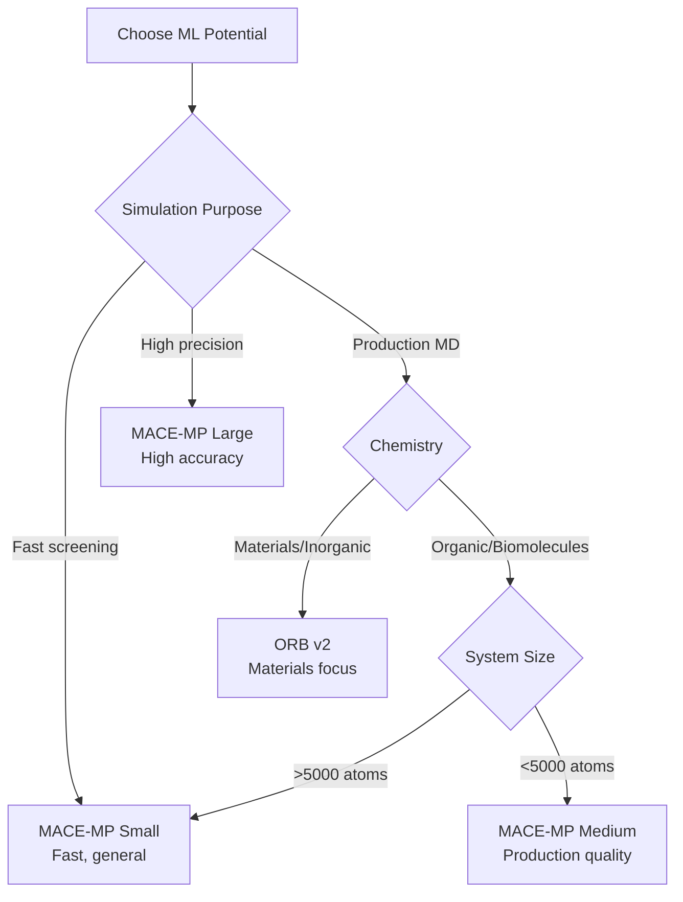

# Machine Learning Potentials

<details>
<summary>Relevant source files</summary>

The following files were used as context for generating this wiki page:

- [README.md](README.md)
- [benchmark/water/dimos_water_ml.py](benchmark/water/dimos_water_ml.py)

</details>


## Purpose and Scope

This document describes how to integrate machine learning interatomic potentials (MLIPs) into DIMOS simulations. DIMOS supports two primary ML backends: MACE (Materials and Chemistry Foundation Models) and ORB (Orbital Materials Foundation Models). These ML potentials can replace classical force fields entirely or be used in hybrid configurations.

For information about classical force fields, see [Classical Force Fields](#4.1). For hybrid ML/MM approaches that combine ML potentials with classical force fields, see [Hybrid ML/MM Systems](#4.3).

---

## Supported ML Potential Backends

DIMOS provides native integration with two state-of-the-art machine learning interatomic potential frameworks:

| Backend | Model Version | Description | Installation |
|---------|---------------|-------------|--------------|
| **MACE** | mace-mp (small/medium/large) | Universal ML potential trained on diverse materials | `pip install -e '.[mace]'` |
| **ORB** | orb-v2 | Foundation model for materials chemistry | `pip install -e '.[orb]'` |

Both backends support:
- Periodic boundary conditions
- GPU acceleration (CUDA)
- CPU execution with thread control
- Mixed precision (float32/float64)
- torch.compile optimization

**Sources:** [README.md:33-38](), [benchmark/water/dimos_water_ml.py:11-15]()

---

## Converting Classical Systems to ML Systems

DIMOS uses a conversion pattern where a classical force field system (e.g., `AmberForceField` or `GromacsForceField`) is first initialized to extract topology information (masses, atomic numbers, periodic boundary conditions), then converted to an ML-based system.



### MACE System Conversion

The `as_mace_system()` method converts a classical force field system to use MACE potentials:

```python
mm_system = dimos.ff.AmberForceField(
    "topology.prmtop", 
    cutoff=5.0, 
    switch_distance=3.5,
    nonbonded_type="Cutoff",
    periodic=True,
    dtype=torch.float64
)

mace_system = mm_system.as_mace_system(
    mace_name="mace-mp-small",
    enable_cueq=False
)
```

**Key Parameters:**

| Parameter | Type | Description |
|-----------|------|-------------|
| `mace_name` | str | Model variant: `"mace-mp-small"`, `"mace-mp-medium"`, or `"mace-mp-large"` |
| `enable_cueq` | bool | Enable CuEq optimization for improved memory efficiency |

The converted system retains topology information (masses, atomic numbers, box dimensions) from the classical system but uses MACE for energy and force calculations.

**Sources:** [benchmark/water/dimos_water_ml.py:69-82]()

### ORB System Conversion

The `as_orb_system()` method converts to the ORB v2 foundation model:

```python
mm_system = dimos.ff.AmberForceField(
    "topology.prmtop",
    cutoff=5.0,
    periodic=True,
    dtype=torch.float64
)

orb_system = mm_system.as_orb_system()
```

ORB systems use default cutoff radii and neighbor list parameters optimized for the ORB model architecture. No additional parameters are required for the conversion.

**Sources:** [benchmark/water/dimos_water_ml.py:83-84]()

---

## MACE Model Variants

MACE foundation models are available in three sizes with different accuracy-performance tradeoffs:

| Model Variant | Parameters | Typical Use Case | Memory Usage |
|---------------|------------|------------------|--------------|
| `mace-mp-small` | ~5M | Fast screening, small systems | Low |
| `mace-mp-medium` | ~20M | Balanced accuracy/speed | Medium |
| `mace-mp-large` | ~100M | High accuracy requirements | High |

### Model Selection Criteria



**CuEq Optimization:**

The `enable_cueq=True` option enables CUDA equivariant optimization, which can reduce memory usage and improve performance on GPU devices. This is particularly beneficial for larger systems or larger model variants.

```python
# With CuEq optimization (recommended for GPU)
mace_system = mm_system.as_mace_system(
    mace_name="mace-mp-medium",
    enable_cueq=True
)
```

**Sources:** [benchmark/water/dimos_water_ml.py:72-82]()

---

## Performance Optimization

### torch.compile Integration

Both MACE and ORB systems support PyTorch's `torch.compile()` for just-in-time optimization. This can provide significant speedups (typically 1.5-3x) after an initial compilation overhead.

```python
simulation = dimos.simulation.MDSimulation(
    mace_system, 
    integrator, 
    positions, 
    temperature=300
)

# Compile the simulation step function
torch.compiler.reset()
step = torch.compile(
    simulation.step, 
    mode="max-autotune-no-cudagraphs"
)

# First call compiles (slow), subsequent calls are fast
step(100)  # Compilation happens here
step(100)  # Uses compiled version
```

**Compilation Modes:**

| Mode | Description | Use Case |
|------|-------------|----------|
| `"default"` | Balanced optimization | General use |
| `"reduce-overhead"` | Minimize compilation time | Rapid prototyping |
| `"max-autotune"` | Maximum performance | Production runs |
| `"max-autotune-no-cudagraphs"` | Max optimization without CUDA graphs | ML potentials (recommended) |

The `"max-autotune-no-cudagraphs"` mode is recommended for ML potential simulations as it avoids CUDA graph capture issues while still providing aggressive optimization.

**Sources:** [benchmark/water/dimos_water_ml.py:90-96]()

### Mixed Precision Support

DIMOS allows independent precision control for force field evaluation and integration:

```python
# float32 for force field, float64 for integration
mm_system = dimos.ff.AmberForceField(
    "topology.prmtop",
    dtype=torch.float32  # Force field precision
)

mace_system = mm_system.as_mace_system(mace_name="mace-mp-small")

integrator = dimos.integrators.LangevinDynamics(
    dt=0.5,
    temperature=300,
    friction=0.1,
    system=mace_system,
    dtype=torch.float64  # Integration precision
)
```

**Precision Guidelines:**

| Configuration | Memory | Speed | Accuracy | Recommended For |
|---------------|--------|-------|----------|-----------------|
| `float32` / `float32` | Lowest | Fastest | ~1e-6 | Screening, large systems |
| `float32` / `float64` | Medium | Fast | ~1e-12 | General production |
| `float64` / `float64` | Highest | Slower | ~1e-15 | High precision required |

**Sources:** [benchmark/water/dimos_water_ml.py:41-48](), [benchmark/water/dimos_water_ml.py:86-88]()

### Device Selection

Device selection is controlled via PyTorch's default device mechanism:

```python
# CPU execution
torch.set_default_device("cpu")
mm_system = dimos.ff.AmberForceField("topology.prmtop")
mace_system = mm_system.as_mace_system(mace_name="mace-mp-small")

# GPU execution
torch.set_default_device("cuda:0")
mm_system = dimos.ff.AmberForceField("topology.prmtop")
mace_system = mm_system.as_mace_system(mace_name="mace-mp-small")
```

The device must be set before creating the force field system. Thread count for CPU execution is controlled via the `OMP_NUM_THREADS` environment variable.

**Sources:** [benchmark/water/dimos_water_ml.py:58-63]()

---

## Integration with ASE

DIMOS ML systems can also be used through the Atomic Simulation Environment (ASE) interface, providing access to ASE's extensive analysis and trajectory tools:



### Using MACE with ASE

```python
from mace.calculators import mace_mp
from ase import Atoms
from ase.md import Langevin
from ase import units

# Create MACE calculator
macemp = mace_mp(
    enable_cueq=False,
    model="small",
    default_dtype="float64",
    device="cuda:0"
)

# Optional: compile the calculator
macemp = torch.compile(macemp, mode="max-autotune-no-cudagraphs")

# Create ASE atoms object
atoms = Atoms(
    symbols=symbols,
    positions=positions.cpu().numpy(),
    cell=[box_size] * 3,
    pbc=True
)
atoms.calc = macemp

# Run dynamics with ASE
dyn = Langevin(
    atoms,
    timestep=0.5 * units.fs,
    temperature_K=300,
    friction=0.1 / units.fs
)
dyn.run(1000)
```

**Sources:** [benchmark/water/dimos_water_ml.py:112-148]()

### Using ORB with ASE

```python
from orb_models.forcefield import pretrained
from orb_models.forcefield.calculator import ORBCalculator
from orb_models.forcefield.atomic_system import SystemConfig
from ase import Atoms
from ase.md import Langevin

# Load ORB model
orbff = pretrained.orb_v2(device="cuda:0")

# Configure system parameters
system_config = SystemConfig(
    radius=6.0,
    max_num_neighbors=150
)

# Create calculator
calc = ORBCalculator(
    orbff,
    system_config=system_config,
    device="cuda:0"
)

# Attach to atoms
atoms = Atoms(
    symbols=symbols,
    positions=positions.cpu().numpy(),
    cell=[box_size] * 3,
    pbc=True
)
atoms.calc = calc

# Run dynamics
dyn = Langevin(atoms, 0.5 * units.fs, 300, 0.1 / units.fs)
dyn.run(1000)
```

**Sources:** [benchmark/water/dimos_water_ml.py:149-172]()

### Native DIMOS vs ASE

| Aspect | Native DIMOS | ASE Integration |
|--------|--------------|-----------------|
| **Performance** | Optimized for PyTorch workflow | Additional overhead from ASE abstractions |
| **Constraints** | Full support (CCMA, SETTLE) | Limited constraint options |
| **Barostats** | Native MC barostats | ASE pressure control |
| **Trajectory I/O** | DIMOS PDB writer | ASE trajectory formats (.traj, .xyz) |
| **Analysis Tools** | Limited | Extensive ASE analysis tools |
| **Mixed Precision** | Fully supported | Calculator-dependent |

**Recommendation:** Use native DIMOS integration for production simulations requiring constraints, barostats, or maximum performance. Use ASE integration for exploratory work or when ASE analysis tools are needed.

**Sources:** [benchmark/water/dimos_water_ml.py:65-96](), [benchmark/water/dimos_water_ml.py:98-172]()

---

## Model Selection Guidelines

### Decision Matrix



### System-Specific Recommendations

| System Type | Recommended Model | Rationale |
|-------------|-------------------|-----------|
| Small proteins (<100 residues) | MACE-MP Medium | Good accuracy-speed balance |
| Large proteins (>100 residues) | MACE-MP Small | Memory efficiency |
| Water boxes | MACE-MP Small/Medium | Well-represented in training |
| Organic molecules | MACE-MP Medium | Diverse organic chemistry coverage |
| Inorganic materials | ORB v2 | Specialized materials training |
| Mixed organic-inorganic | MACE-MP Medium | Broader chemical space |

### Performance Considerations

**Memory Requirements (approximate, per 1000 atoms):**

| Configuration | VRAM (GPU) | RAM (CPU) |
|---------------|------------|-----------|
| MACE Small, float32 | ~500 MB | ~1 GB |
| MACE Medium, float32 | ~2 GB | ~4 GB |
| MACE Large, float32 | ~8 GB | ~16 GB |
| ORB v2, float32 | ~3 GB | ~6 GB |

**Typical Throughput (ns/day for 3000-atom water box on A100 GPU):**

| Model | No Compile | With torch.compile |
|-------|------------|-------------------|
| MACE-MP Small | ~50 ns/day | ~120 ns/day |
| MACE-MP Medium | ~20 ns/day | ~50 ns/day |
| MACE-MP Large | ~5 ns/day | ~12 ns/day |
| ORB v2 | ~15 ns/day | ~35 ns/day |

These are approximate values and depend on system composition, hardware, and simulation settings.

**Sources:** [benchmark/water/dimos_water_ml.py:72-84]()

---

## Complete Example: Water Box with MACE

```python
import dimos
import parmed
import torch

# Load topology and coordinates
positions = torch.tensor(
    parmed.amber.Rst7("water_box.inpcrd").positions.value_in_unit(
        parmed.unit.angstrom
    )
)

# Initialize classical system (for topology)
mm_system = dimos.ff.AmberForceField(
    "water_box.prmtop",
    cutoff=5.0,
    switch_distance=3.5,
    nonbonded_type="Cutoff",
    periodic=True,
    dtype=torch.float32
)

# Convert to MACE system
mace_system = mm_system.as_mace_system(
    mace_name="mace-mp-medium",
    enable_cueq=True
)

# Setup integrator
integrator = dimos.integrators.LangevinDynamics(
    dt=0.5,              # fs
    temperature=300,     # K
    friction=0.1,        # ps^-1
    system=mace_system,
    dtype=torch.float64
)

# Create simulation
simulation = dimos.simulation.MDSimulation(
    mace_system,
    integrator,
    positions,
    temperature=300
)

# Optional: compile for performance
step = torch.compile(
    simulation.step,
    mode="max-autotune-no-cudagraphs"
)

# Run simulation
step(10000)  # 10000 steps
```

**Sources:** [benchmark/water/dimos_water_ml.py:65-96]()

---