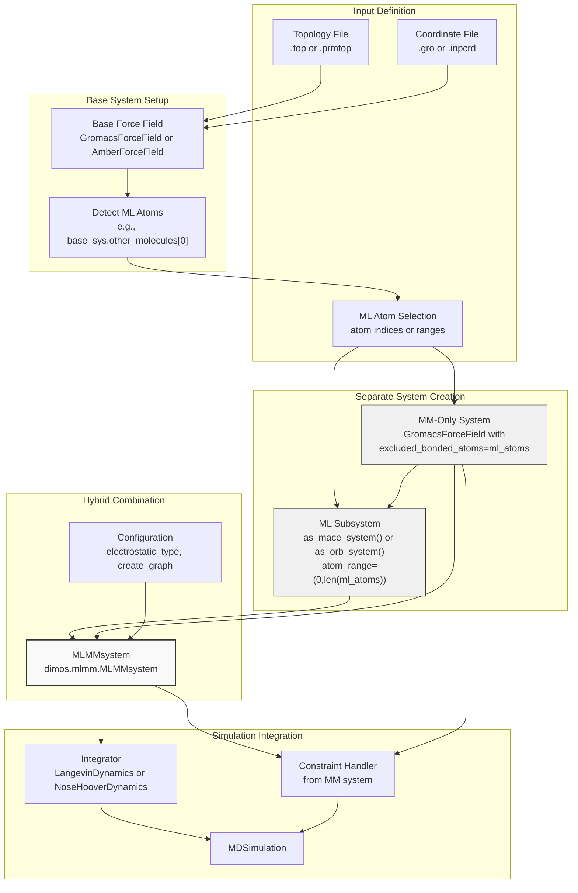
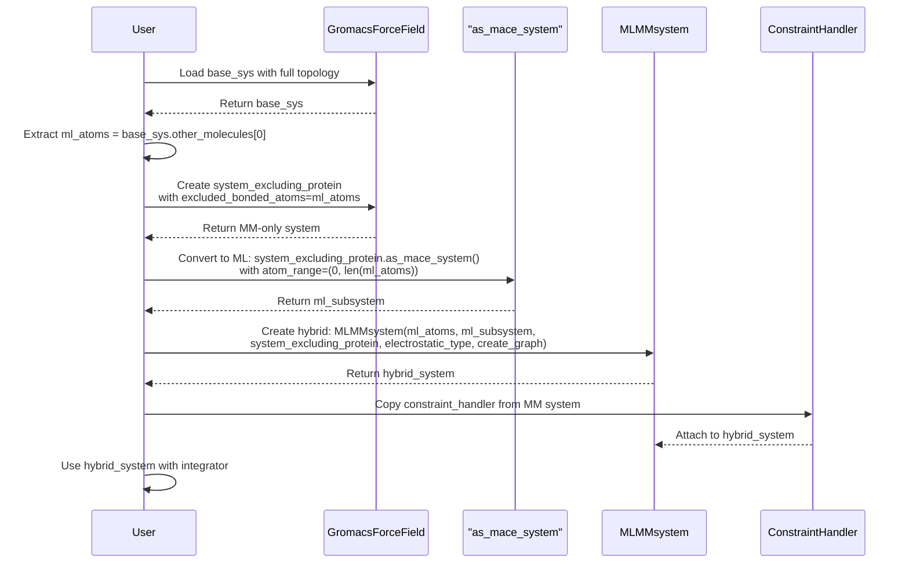
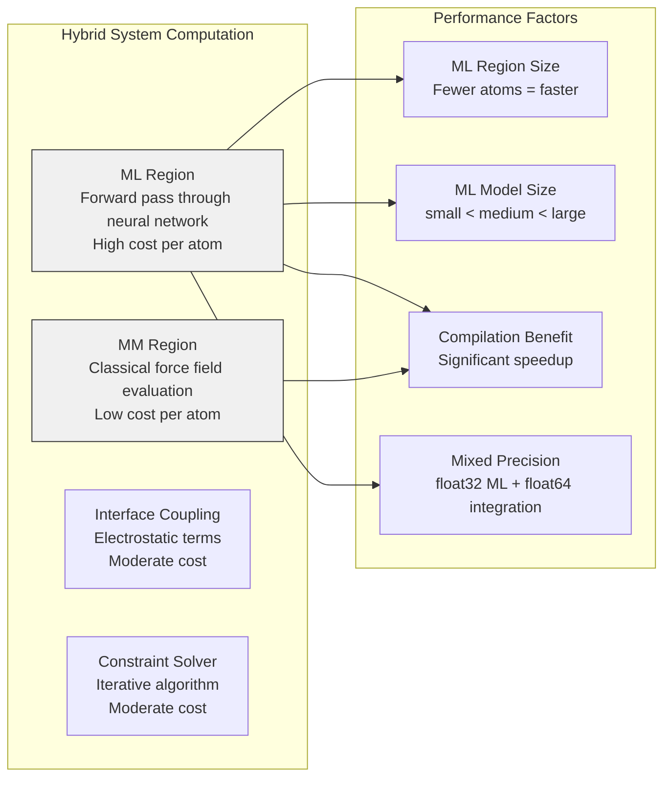

# Hybrid ML/MM Systems

<details>
<summary>Relevant source files</summary>

The following files were used as context for generating this wiki page:

- [benchmark/proteins/benchmark_proteins.py](benchmark/proteins/benchmark_proteins.py)
- [benchmark/water/dimos_water_ml.py](benchmark/water/dimos_water_ml.py)

</details>


## Purpose and Scope

This document describes how to create and configure hybrid ML/MM (Machine Learning / Molecular Mechanics) systems in DIMOS, where different regions of a molecular system are treated with different levels of theory. Typically, a region of interest (e.g., a protein or active site) is modeled with a high-accuracy machine learning potential, while the surrounding environment (e.g., solvent) is treated with classical molecular mechanics force fields.

For information about pure classical force fields, see [Classical Force Fields](#4.1). For pure ML potential systems, see [Machine Learning Potentials](#4.2). For advanced sampling techniques that can be combined with hybrid systems, see [Advanced Sampling Methods](#5).

## Conceptual Overview

Hybrid ML/MM simulations enable multi-scale modeling by partitioning the system into distinct regions:

| Region | Description | Treatment | Typical Use Cases |
|--------|-------------|-----------|-------------------|
| **ML Region** | High-accuracy zone | Machine learning potential (MACE, ORB) | Protein, active site, solute of interest |
| **MM Region** | Environment | Classical force field (Amber, GROMACS) | Solvent molecules, ions, membrane |
| **Interface** | Boundary between regions | Electrostatic coupling, constraint handling | Ensuring physical interactions across boundary |

The hybrid approach provides several advantages:
- **Computational efficiency**: Only the region of interest uses expensive ML calculations
- **Physical accuracy**: ML potentials capture quantum mechanical effects where needed
- **System size scalability**: Classical treatment of large solvent regions remains fast
- **Flexibility**: Different ML models can be tested without re-parameterizing the entire system

**Sources:** [benchmark/proteins/benchmark_proteins.py:31-44]()

## System Architecture

The hybrid ML/MM implementation in DIMOS follows a modular architecture where ML and MM subsystems are combined through the `MLMMsystem` class:



**Sources:** [benchmark/proteins/benchmark_proteins.py:31-44]()

## Creating a Hybrid ML/MM System

### Step-by-Step Construction

The following procedure demonstrates how to construct a hybrid system, as implemented in the protein benchmarking suite:

#### Step 1: Load Base Force Field and Identify ML Region

```python
# Load the complete system with classical force field
base_sys = dimos.GromacsForceField(
    "system.top", 
    "system.gro",
    cutoff=10, 
    switch_distance=7.5, 
    nonbonded_type="PME", 
    constraint_option=constraint_option,
    create_graph=c_graph
)

# Identify atoms to be treated with ML potential
# Typically the first molecule (protein) in the topology
ml_atoms = base_sys.other_molecules[0]
```

**Sources:** [benchmark/proteins/benchmark_proteins.py:31-36]()

#### Step 2: Create MM-Only System (Excluding ML Region)

The MM subsystem handles all non-ML atoms and excludes bonded interactions within the ML region:

```python
system_excluding_protein = dimos.GromacsForceField(
    "system.top", 
    "system.gro", 
    cutoff=10, 
    switch_distance=7.5, 
    nonbonded_type=None,  # No nonbonded terms (handled by hybrid coupling)
    constraint_option=constraint_option, 
    excluded_bonded_atoms=ml_atoms,  # Exclude ML region from bonded terms
    create_graph=c_graph
)
```

Key parameters:
- `nonbonded_type=None`: Nonbonded interactions will be managed by the hybrid system
- `excluded_bonded_atoms=ml_atoms`: Prevents double-counting of bonded terms within ML region
- Constraints are applied to both ML and MM regions

**Sources:** [benchmark/proteins/benchmark_proteins.py:38]()

#### Step 3: Create ML Subsystem

Convert the classical system to an ML-based system, specifying the atom range corresponding to the ML region:

```python
ml_subsystem = system_excluding_protein.as_mace_system(
    "mace-mp-large",  # or "mace-mp-small", "mace-mp-medium"
    atom_range=(0, len(ml_atoms))
)
```

The `atom_range` parameter ensures the ML potential only acts on the specified atoms, even though the full system topology is passed to the conversion function.

**Sources:** [benchmark/proteins/benchmark_proteins.py:39]()

#### Step 4: Combine into Hybrid System

```python
hybrid_system = dimos.mlmm.MLMMsystem(
    ml_atoms,                    # Atom indices for ML region
    ml_subsystem,                # ML potential subsystem
    system_excluding_protein,    # MM subsystem
    electrostatic_type=None,     # Coupling configuration
    create_graph=c_graph         # Enable gradient computation if needed
)

# Transfer constraint handler from MM system
hybrid_system.constraint_handler = system_excluding_protein.constraint_handler
```

**Sources:** [benchmark/proteins/benchmark_proteins.py:40-41]()

### Complete Construction Flow



**Sources:** [benchmark/proteins/benchmark_proteins.py:31-44]()

## Configuration Options

### ML Potential Selection

The hybrid system supports multiple ML backends through the conversion methods:

| Method | ML Backend | Model Options | Use Case |
|--------|-----------|---------------|----------|
| `as_mace_system()` | MACE | "mace-mp-small", "mace-mp-medium", "mace-mp-large" | General-purpose materials, proteins |
| `as_orb_system()` | ORB v2 | Default model | Alternative ML potential |

**Example:**
```python
# Using MACE medium model
ml_subsystem = system_excluding_protein.as_mace_system(
    "mace-mp-medium",
    atom_range=(0, len(ml_atoms))
)

# Using ORB model
ml_subsystem = system_excluding_protein.as_orb_system()
```

**Sources:** [benchmark/proteins/benchmark_proteins.py:39](), [benchmark/water/dimos_water_ml.py:72-84]()

### Electrostatic Coupling

The `electrostatic_type` parameter in `MLMMsystem` controls how electrostatic interactions are handled across the ML/MM boundary:

```python
hybrid_system = dimos.mlmm.MLMMsystem(
    ml_atoms,
    ml_subsystem,
    system_excluding_protein,
    electrostatic_type=None,  # or other coupling schemes
    create_graph=c_graph
)
```

Setting `electrostatic_type=None` means no explicit electrostatic coupling is added beyond what the ML potential and MM force field naturally provide. Other coupling schemes may be implemented depending on the specific `MLMMsystem` implementation.

**Sources:** [benchmark/proteins/benchmark_proteins.py:40]()

### Constraint Handling

Constraints must be properly transferred from the MM system to the hybrid system:

```python
# After creating the hybrid system
hybrid_system.constraint_handler = system_excluding_protein.constraint_handler
```

This ensures that constraints (e.g., bond length constraints for hydrogen atoms) are applied consistently across both ML and MM regions. The constraint handler respects the boundary and applies appropriate algorithms (CCMA, SETTLE) to the relevant atoms.

**Sources:** [benchmark/proteins/benchmark_proteins.py:41]()

### Graph Creation for Differentiability

The `create_graph` parameter enables gradient computation through the force calculations, which is essential for certain ML training workflows:

```python
# Enable gradient tracking
base_sys = dimos.GromacsForceField(..., create_graph=True)
hybrid_system = dimos.mlmm.MLMMsystem(..., create_graph=True)
```

When `create_graph=False` (default for production simulations), backpropagation through force calculations is disabled, improving performance.

**Sources:** [benchmark/proteins/benchmark_proteins.py:31, 38, 40]()

## Integration with Simulation Engine

### Integrator Setup

Hybrid systems work with standard DIMOS integrators. The benchmarking suite uses `NoseHooverDynamics` with mixed precision:

```python
integrator = dimos.NoseHooverDynamics(
    timestep=2.0,           # or 0.5 without constraints
    temperature=300.0,
    collision_rate=0.05,
    system=hybrid_system,
    dtype=torch.float64     # Integration precision
)
```

**Key considerations:**
- **Timestep selection**: With constraints (`constraint_option="h_angles"`), use 2.0 fs timestep; without constraints, use 0.5 fs
- **Integration precision**: Often set to `torch.float64` for numerical stability, even if ML calculations use `torch.float32`

**Sources:** [benchmark/proteins/benchmark_proteins.py:24-29, 46]()

### Simulation Setup

```python
sim = dimos.MDSimulation(
    hybrid_system,
    integrator,
    initial_pos=positions,
    temperature=300.0
)
```

The simulation object handles the hybrid system transparently, calling appropriate energy and force calculations for each region.

**Sources:** [benchmark/proteins/benchmark_proteins.py:47]()

### Compilation and Optimization

Hybrid systems benefit from `torch.compile()` optimization:

```python
torch.compiler.reset()
torch._dynamo.reset()
sim_step = torch.compile(sim.step, mode="max-autotune-no-cudagraphs")

# Warmup phase to trigger compilation
for _ in range(warmup_iterations):
    sim_step(steps_per_warmup)
```

The compilation process optimizes the entire simulation step, including both ML and MM calculations, into a fused kernel.

**Sources:** [benchmark/proteins/benchmark_proteins.py:49-55]()

## Performance Considerations

### Computational Cost Distribution



**Sources:** [benchmark/proteins/benchmark_proteins.py:1-73]()

### Benchmark Test Cases

The DIMOS benchmarking suite includes hybrid ML/MM tests for several protein systems:

| System | Topology Files | ML Region | MM Region | Purpose |
|--------|---------------|-----------|-----------|---------|
| `ala2_tip3p` | ala2_tip3p.gro/.top | Alanine dipeptide (22 atoms) | TIP3P water (749 molecules) | Small test case |
| `dhfr` | dhfr.gro/.top | DHFR protein (~160 residues) | Water + ions | Medium complexity |
| `trp-cage_sol` | trp-cage_sol.gro/.top | Trp-cage (20 residues) | Water | Fast-folding protein |

Run benchmark configurations:
- `constraints_mlmm`: Hybrid with H-bond constraints, 2.0 fs timestep
- `no_constraints_mlmm`: Hybrid without constraints, 0.5 fs timestep

**Sources:** [benchmark/proteins/benchmark_proteins.py:16-21]()

### Optimization Strategies

1. **Region Size Optimization**
   - Keep ML region as small as possible while capturing necessary physics
   - Use ML for protein/active site, MM for bulk solvent

2. **Model Selection**
   - Start with "mace-mp-small" for initial testing
   - Use "mace-mp-large" only when higher accuracy is required

3. **Precision Strategy**
   - Use `torch.float32` for ML force field calculations (faster)
   - Use `torch.float64` for integration (more stable)

4. **Compilation Benefits**
   - Always use `torch.compile()` for production runs
   - Expect 2-5x speedup after warmup phase

**Sources:** [benchmark/proteins/benchmark_proteins.py:1-73](), [benchmark/water/dimos_water_ml.py:38-48]()

## Best Practices

### 1. Region Selection

Choose the ML region to include:
- **Essential atoms**: All atoms whose interactions require quantum accuracy
- **Complete residues**: Avoid splitting residues across ML/MM boundary
- **Buffer consideration**: Consider whether nearby residues should be included

### 2. System Preparation

```python
# Load and inspect the system first
base_sys = dimos.GromacsForceField("system.top", "system.gro")

# Verify ML atom selection
ml_atoms = base_sys.other_molecules[0]  # Usually the protein
print(f"ML region contains {len(ml_atoms)} atoms")

# Check that it's the expected molecule
# ... validate before proceeding
```

### 3. Constraint Management

Constraints should be consistent across regions:
- Use `constraint_option="h_angles"` for both base system and MM-only system
- Transfer constraint handler explicitly: `hybrid_system.constraint_handler = mm_system.constraint_handler`
- Adjust timestep accordingly (2.0 fs with constraints, 0.5 fs without)

**Sources:** [benchmark/proteins/benchmark_proteins.py:24-29, 41]()

### 4. Validation Protocol

Before production runs:
1. Run short simulation with `constraints_mm` (pure classical)
2. Run short simulation with `constraints_mlmm` (hybrid)
3. Compare energy conservation and structural stability
4. Verify expected performance improvement

### 5. Memory Management

For large systems:
- ML calculations require significant GPU memory
- Monitor memory usage during warmup phase
- Consider reducing ML region size if memory-limited

## System Comparison Matrix

| Configuration | Force Field | ML Region | MM Region | Use Case |
|--------------|-------------|-----------|-----------|----------|
| `constraints_mm` | Pure classical | None | All atoms | Baseline comparison |
| `constraints_mlmm` | Hybrid ML/MM | Protein/solute | Solvent | Production hybrid |
| `constraints_ml` | Pure ML | All atoms | None | Maximum accuracy |

**Sources:** [benchmark/proteins/benchmark_proteins.py:20-21, 33-44]()

---

Hybrid ML/MM systems in DIMOS provide a powerful approach for multi-scale molecular simulation, enabling quantum-accurate treatment of critical regions while maintaining computational efficiency for large systems. The modular architecture allows flexible combination of different ML potentials with classical force fields, with full support for constraints, advanced sampling, and performance optimization through compilation.

---