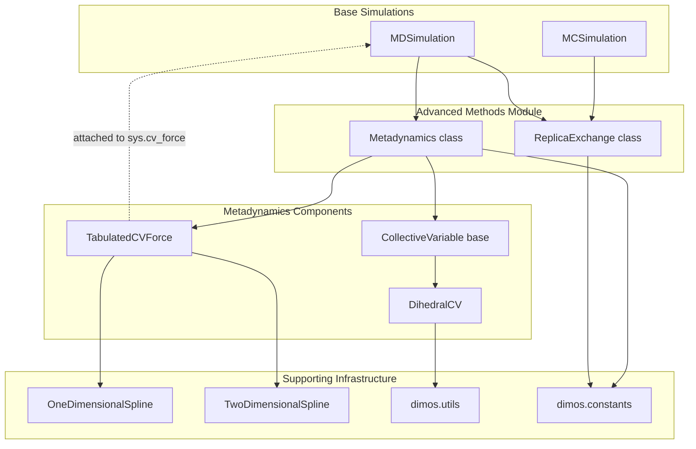
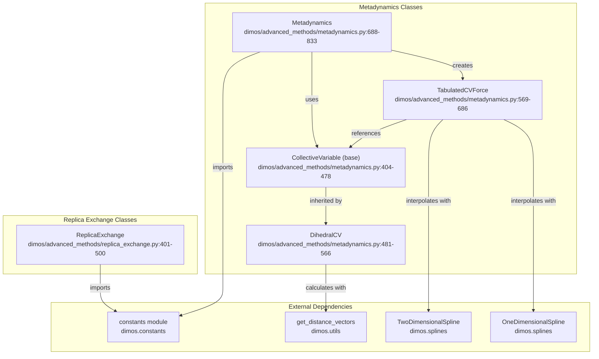
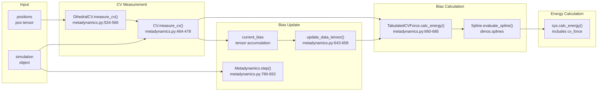

# Advanced Sampling Methods

<details>
<summary>Relevant source files</summary>

The following files were used as context for generating this wiki page:

- [dimos/advanced_methods/__init__.py](dimos/advanced_methods/__init__.py)
- [dimos/advanced_methods/metadynamics.py](dimos/advanced_methods/metadynamics.py)
- [dimos/advanced_methods/replica_exchange.py](dimos/advanced_methods/replica_exchange.py)

</details>


## Purpose and Scope

This page provides an overview of advanced sampling methods available in DIMOS for enhanced exploration of molecular configuration space and free energy calculations. These methods enable simulations to overcome energy barriers and sample rare events that would be difficult to observe in standard molecular dynamics or Monte Carlo simulations.

For detailed implementation guides, see:
- Metadynamics implementation: [5.1](#5.1)
- Replica Exchange implementation: [5.2](#5.2)
- Probability distributions used in sampling: [5.3](#5.3)

**Sources:** [dimos/advanced_methods/__init__.py:374-389]()

---

## Enhanced Sampling in DIMOS

Enhanced sampling techniques accelerate the exploration of configuration space by adding bias potentials or by running parallel simulations at different thermodynamic conditions. DIMOS provides two primary enhanced sampling methods:

| Method | Purpose | Key Application |
|--------|---------|-----------------|
| **Metadynamics** | Add history-dependent bias along collective variables | Free energy surface calculation |
| **Replica Exchange** | Exchange configurations between replicas at different temperatures/Hamiltonians | Overcome energy barriers via parallel tempering |

Both methods are implemented as experimental features that integrate with DIMOS's base simulation classes. They are functionally correct but require validation against established implementations before production use.

**Sources:** [dimos/advanced_methods/__init__.py:374-389](), [dimos/advanced_methods/metadynamics.py:374-394](), [dimos/advanced_methods/replica_exchange.py:374-393]()

---

## Integration with Simulation Engine

The following diagram shows how advanced sampling methods integrate with DIMOS's core simulation components:

**Advanced Sampling Integration Architecture**



**Sources:** [dimos/advanced_methods/metadynamics.py:688-767](), [dimos/advanced_methods/replica_exchange.py:401-447](), [dimos/advanced_methods/__init__.py:374-389]()

---

## Method Implementations

### Metadynamics

Metadynamics enhances sampling by adding Gaussian-shaped bias potentials along one or two collective variables (CVs). The bias accumulates over time, filling free energy basins and driving the system to explore new regions of configuration space. DIMOS implements well-tempered metadynamics to control bias growth.

**Key components:**
- `Metadynamics` class: Main controller implementing well-tempered metadynamics algorithm
- `CollectiveVariable`: Abstract base class for defining CVs
- `DihedralCV`: Concrete implementation for dihedral angle CVs
- `TabulatedCVForce`: Manages bias forces using spline interpolation

**File locations:**
- Implementation: [dimos/advanced_methods/metadynamics.py:688-833]()
- Base CV class: [dimos/advanced_methods/metadynamics.py:404-478]()
- Dihedral CV: [dimos/advanced_methods/metadynamics.py:481-566]()
- Tabulated force handler: [dimos/advanced_methods/metadynamics.py:569-686]()

**Sources:** [dimos/advanced_methods/metadynamics.py:374-394](), [dimos/advanced_methods/metadynamics.py:404-833]()

### Replica Exchange

Replica exchange (parallel tempering) runs multiple replicas of a system at different temperatures or with different Hamiltonians. The method periodically attempts to exchange configurations between replicas using the Metropolis criterion, allowing systems to escape local minima via high-temperature excursions.

**Key components:**
- `ReplicaExchange` class: Main controller for replica exchange algorithm
- Exchange mechanism using Metropolis criterion
- Temperature scaling for velocity exchanges

**File location:**
- Implementation: [dimos/advanced_methods/replica_exchange.py:401-500]()

**Sources:** [dimos/advanced_methods/replica_exchange.py:374-393](), [dimos/advanced_methods/replica_exchange.py:401-500]()

---

## Class Architecture

The following diagram shows the key classes and their relationships in code:

**Advanced Sampling Class Structure**



**Sources:** [dimos/advanced_methods/metadynamics.py:396-402](), [dimos/advanced_methods/replica_exchange.py:395-398]()

---

## Key Implementation Details

### Metadynamics Workflow

The metadynamics implementation follows this workflow:

1. **Initialization** [metadynamics.py:729-767]():
   - Create collective variable objects (`CollectiveVariable` subclasses)
   - Initialize bias accumulation tensor (`current_bias`)
   - Attach `TabulatedCVForce` to simulation system as `sys.cv_force`

2. **Simulation Step** [metadynamics.py:780-832]():
   - Run simulation for `update_frequency` steps
   - Measure CV value(s) from current positions
   - Calculate well-tempered bias height
   - Add Gaussian hill to accumulated bias
   - Update spline interpolation of bias forces

3. **Free Energy Calculation** [metadynamics.py:769-778]():
   - Estimate free energy surface from accumulated bias
   - Apply well-tempered scaling factor

**Sources:** [dimos/advanced_methods/metadynamics.py:688-833]()

### Replica Exchange Workflow

The replica exchange implementation executes these steps:

1. **Initialization** [replica_exchange.py:430-447]():
   - Store list of simulation objects at different temperatures/Hamiltonians
   - Set exchange attempt frequency
   - Configure number of exchange attempts per cycle

2. **Exchange Step** [replica_exchange.py:449-499]():
   - Run all replicas for `steps_before_exchange` steps
   - Randomly select replica pairs for exchange attempts
   - Calculate acceptance probability using Metropolis criterion with energy differences
   - If accepted: swap positions and scale/swap velocities appropriately

**Acceptance criterion** [replica_exchange.py:489-499]():
```
exp[(E_00 - E_01)/(k_B * T_0) + (E_11 - E_10)/(k_B * T_1)]
```
where `E_ij` is the energy of replica `i`'s positions evaluated with replica `j`'s Hamiltonian.

**Sources:** [dimos/advanced_methods/replica_exchange.py:401-500]()

---

## Collective Variables

Collective variables define the degrees of freedom along which metadynamics biasing is applied. The base `CollectiveVariable` class provides the framework for discretizing CV space and managing Gaussian hill parameters.

### Base CollectiveVariable

**Attributes** [metadynamics.py:422-437]():
- `min_value`, `max_value`: CV range bounds
- `num_bins`: Discretization resolution
- `bin_width`: Bin size in CV space
- `scaled_sigma`: Gaussian width parameter
- `scaled_grid_points`: Normalized grid for bias evaluation

**Methods:**
- `measure_cv(simulation)`: Abstract method to calculate CV value (must be implemented by subclasses)

### DihedralCV Implementation

The `DihedralCV` class implements a dihedral angle collective variable defined by four atoms.

**Initialization** [metadynamics.py:511-532]():
- `four_pair_atoms`: List of four atom indices
- Inherits CV discretization from `CollectiveVariable`
- Stores reference to system object for periodic boundary conditions

**CV Calculation** [metadynamics.py:534-566]():
- Computes dihedral angle using cross products of bond vectors
- Applies periodic boundary conditions via `get_distance_vectors`
- Returns angle in range [-π, π]

**Sources:** [dimos/advanced_methods/metadynamics.py:404-566]()

---

## Experimental Status Warning

All advanced sampling methods in DIMOS are marked as **experimental features**. Warning messages are emitted during initialization:

```python
warn("Metadynamics is currently an experimental feature. While it should work mostly correct, 
     it has not been thoroughly tested. Please be careful when using it and compare to 
     established implementations.", stacklevel=2)
```

**Warnings issued at:**
- `CollectiveVariable.__init__()` [metadynamics.py:455]()
- `TabulatedCVForce.__init__()` [metadynamics.py:612]()
- `Metadynamics.__init__()` [metadynamics.py:749]()
- `ReplicaExchange.__init__()` [replica_exchange.py:443]()

**Validation recommendations:**
- Compare results against established implementations (PLUMED, GROMACS, OpenMM)
- Verify free energy surface convergence
- Check exchange acceptance rates for replica exchange
- Test with simple, well-characterized systems first

**Sources:** [dimos/advanced_methods/metadynamics.py:455](), [dimos/advanced_methods/metadynamics.py:612](), [dimos/advanced_methods/metadynamics.py:749](), [dimos/advanced_methods/replica_exchange.py:443]()

---

## Data Flow and Dependencies

**Metadynamics Data Flow**



**Sources:** [dimos/advanced_methods/metadynamics.py:404-833]()

---

## Configuration Parameters

### Metadynamics Parameters

The `Metadynamics` class accepts the following configuration:

| Parameter | Type | Default | Description |
|-----------|------|---------|-------------|
| `simulation` | object | required | MD or MC simulation instance |
| `cvs` | list | required | List of 1-2 `CollectiveVariable` objects |
| `delta_temperature` | float | required | Temperature offset for well-tempered metadynamics (K) |
| `initial_height` | float | 1.0 | Initial Gaussian hill height (energy units) |
| `update_frequency` | int | 1 | Number of simulation steps between bias updates |
| `periodic_cvs` | bool | True | Whether CVs have periodic boundary conditions |

**Source:** [dimos/advanced_methods/metadynamics.py:729-767]()

### Replica Exchange Parameters

The `ReplicaExchange` class accepts the following configuration:

| Parameter | Type | Default | Description |
|-----------|------|---------|-------------|
| `simulations` | list | required | List of simulation objects at different conditions |
| `steps_before_exchange` | int | 1 | Number of steps between exchange attempts |
| `num_exchange_attempts` | int | 50 | Number of exchange attempts per exchange cycle |

**Source:** [dimos/advanced_methods/replica_exchange.py:430-447]()

---

## Module Imports and Dependencies

The advanced sampling module dependencies:

**Metadynamics** [metadynamics.py:396-401]():
```python
import torch
from warnings import warn
from dimos.splines import OneDimensionalSpline, TwoDimensionalSpline
from dimos.utils import get_distance_vectors
from dimos import constants
```

**Replica Exchange** [replica_exchange.py:395-398]():
```python
import torch
from warnings import warn
from dimos import constants
```

The module is exposed through the package-level import:
```python
from dimos.advanced_methods import Metadynamics, ReplicaExchange
```

**Sources:** [dimos/advanced_methods/__init__.py:1-390](), [dimos/advanced_methods/metadynamics.py:396-401](), [dimos/advanced_methods/replica_exchange.py:395-398]()

---