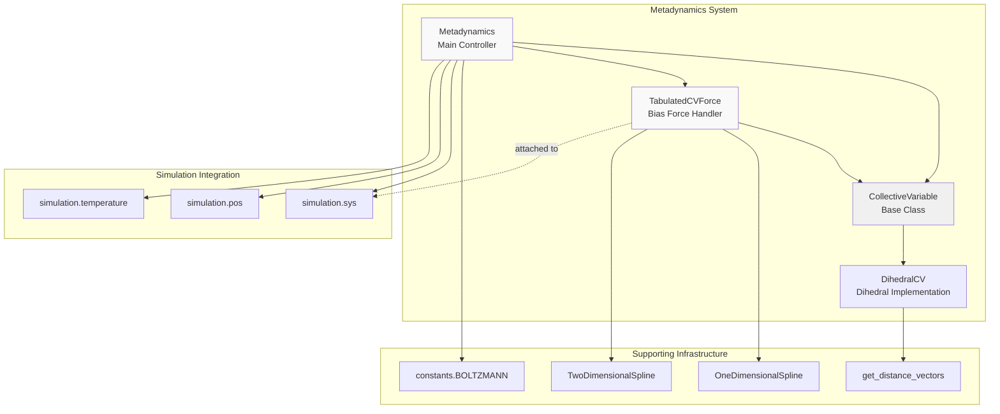
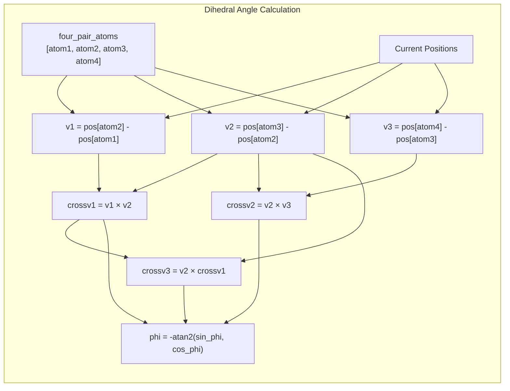
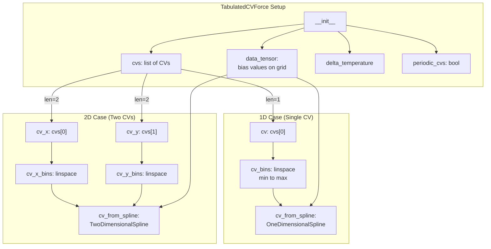
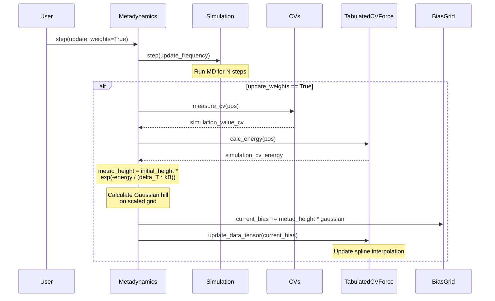
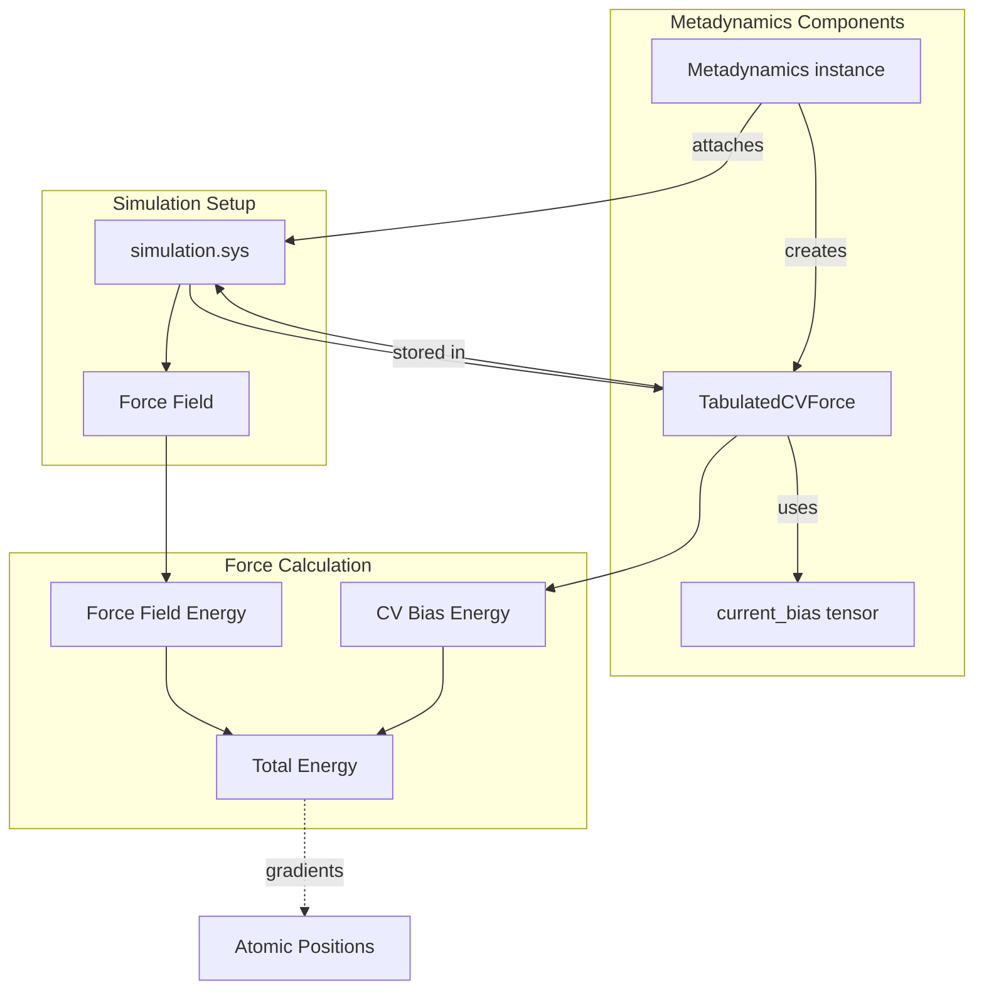

# Metadynamics

<details>
<summary>Relevant source files</summary>

The following files were used as context for generating this wiki page:

- [dimos/advanced_methods/__init__.py](dimos/advanced_methods/__init__.py)
- [dimos/advanced_methods/metadynamics.py](dimos/advanced_methods/metadynamics.py)
- [dimos/distribution.py](dimos/distribution.py)

</details>


## Purpose and Scope

This page documents the metadynamics enhanced sampling implementation in DIMOS. Metadynamics is an advanced sampling technique that adds history-dependent bias potentials along selected collective variables (CVs) to help molecular systems escape from local free energy minima and explore broader regions of configuration space. The implementation supports one or two collective variables, with both periodic and non-periodic boundary conditions, and includes well-tempered metadynamics to control bias growth.

For information about replica exchange methods, see [Replica Exchange and Parallel Tempering](#5.2). For details on probability distributions used in sampling, see [Probability Distributions for Sampling](#5.3).

**Important**: Metadynamics is currently marked as an experimental feature. While functionally correct, thorough validation against established implementations is recommended before production use.

**Sources**: [dimos/advanced_methods/__init__.py:374-389](), [dimos/advanced_methods/metadynamics.py:374-394]()

---

## System Architecture

The metadynamics system consists of four main components that work together to implement enhanced sampling along collective variables.



**Diagram: Metadynamics System Components and Dependencies**

**Sources**: [dimos/advanced_methods/metadynamics.py:396-401](), [dimos/advanced_methods/metadynamics.py:688-768]()

---

## Collective Variables

Collective variables define the degrees of freedom along which enhanced sampling is performed. The system provides a base class and specific implementations.

### CollectiveVariable Base Class

The `CollectiveVariable` class provides the foundation for implementing custom collective variables.

| Attribute | Type | Description |
|-----------|------|-------------|
| `min_value` | float | Minimum value of the CV range |
| `max_value` | float | Maximum value of the CV range |
| `num_bins` | int | Number of bins for discretizing CV space |
| `bin_width` | float | Width of each bin (computed) |
| `box` | float | Total CV range (max - min) |
| `scaled_sigma` | float | Squared sigma parameter scaled by box size |
| `scaled_grid_points` | torch.Tensor | Evenly spaced grid points [0, 1] |

**Key Methods**:
- `measure_cv(simulation)`: Calculate CV value for current configuration (must be implemented by subclasses)

**Sources**: [dimos/advanced_methods/metadynamics.py:404-478]()

### DihedralCV Implementation

The `DihedralCV` class implements collective variables based on dihedral angles defined by four atoms.



**Diagram: Dihedral Angle Collective Variable Calculation**

**Constructor Parameters**:
- `four_pair_atoms`: List of 4 atom indices defining the dihedral
- `min_value`, `max_value`, `num_bins`, `sigma`: CV discretization parameters
- `system`: System object containing periodic boundary conditions

**Sources**: [dimos/advanced_methods/metadynamics.py:481-566]()

---

## Bias Potential Management

The `TabulatedCVForce` class manages the biasing forces applied along collective variables using spline interpolation.

### Initialization and Data Structures



**Diagram: TabulatedCVForce Initialization Based on CV Dimensionality**

**Key Methods**:

| Method | Parameters | Returns | Description |
|--------|-----------|---------|-------------|
| `calc_energy(pos)` | pos: torch.Tensor | torch.Tensor | Calculate bias energy at current position |
| `update_data_tensor(data_tensor)` | data_tensor: torch.Tensor | None | Update the tabulated bias values |

**Sources**: [dimos/advanced_methods/metadynamics.py:569-686]()

---

## Metadynamics Simulation

The `Metadynamics` class implements well-tempered metadynamics, coordinating CV measurement, Gaussian hill deposition, and bias updates.

### Well-Tempered Metadynamics Parameters

| Parameter | Type | Default | Description |
|-----------|------|---------|-------------|
| `simulation` | object | required | The MD simulation object |
| `cvs` | list | required | List of 1 or 2 CollectiveVariable objects |
| `delta_temperature` | float | required | Temperature offset for well-tempering |
| `initial_height` | float | 1.0 | Initial height of Gaussian hills |
| `update_frequency` | int | 1 | Frequency of bias updates (in steps) |
| `periodic_cvs` | bool | True | Whether CVs are periodic |

**Sources**: [dimos/advanced_methods/metadynamics.py:688-768]()

### Metadynamics Step Workflow



**Diagram: Metadynamics Step Execution Flow**

**Sources**: [dimos/advanced_methods/metadynamics.py:780-832]()

### Gaussian Hill Deposition

The bias is updated by adding Gaussian hills at the current CV value. The implementation differs for 1D and 2D cases.

#### 1D Collective Variable

[dimos/advanced_methods/metadynamics.py:792-807]()

```
1. Measure CV value: simulation_value_cv = cv.measure_cv(pos)
2. Calculate current bias energy: simulation_cv_energy
3. Compute well-tempered height:
   metad_height = initial_height * exp(-simulation_cv_energy / (delta_T * kB))
4. Scale CV to [0, 1]: scaled_value_cv = (value - min) / box
5. Calculate distances to all grid points with periodic handling
6. Add Gaussian: current_bias += metad_height * exp(-0.5 * dist^2 / sigma^2)
```

#### 2D Collective Variables

[dimos/advanced_methods/metadynamics.py:809-828]()

```
1. Measure both CVs: simulation_value_cv_x, simulation_value_cv_y
2. Calculate current bias energy: simulation_cv_energy
3. Compute well-tempered height (same as 1D)
4. For each CV dimension:
   - Scale to [0, 1]
   - Calculate distances to grid points
   - Compute 1D Gaussian: exp(-0.5 * dist^2 / sigma^2)
5. Create 2D Gaussian: outer product of 1D Gaussians
6. Add to bias: current_bias += metad_height * gaussian_2d
```

**Sources**: [dimos/advanced_methods/metadynamics.py:780-832]()

---

## Free Energy Estimation

The accumulated bias potential provides an estimate of the free energy surface along the collective variables.

### Free Energy Calculation

The `get_free_energy()` method estimates the free energy surface using the well-tempered metadynamics formula:

```
F(s) = -((T + ΔT) / ΔT) * V(s)
```

Where:
- `F(s)` is the estimated free energy at CV value s
- `T` is the simulation temperature
- `ΔT` is the delta_temperature parameter
- `V(s)` is the accumulated bias (current_bias)

**Sources**: [dimos/advanced_methods/metadynamics.py:769-778]()

---

## Integration with Simulation Engine



**Diagram: Integration of Metadynamics Bias with Force Field**

During initialization, the `Metadynamics` class creates a `TabulatedCVForce` object and attaches it to the simulation system via `simulation.sys.cv_force`. The force field energy calculation then includes the CV bias contribution automatically.

**Sources**: [dimos/advanced_methods/metadynamics.py:766-767]()

---

## Usage Pattern

### Basic Setup Example

```python
# Assuming simulation is already initialized with force field

# 1. Define collective variable(s)
from dimos.advanced_methods.metadynamics import DihedralCV

cv1 = DihedralCV(
    four_pair_atoms=[4, 6, 8, 14],  # Phi dihedral atoms
    min_value=-3.14159,
    max_value=3.14159,
    num_bins=100,
    sigma=0.2,
    system=simulation.sys
)

# 2. Initialize metadynamics
from dimos.advanced_methods.metadynamics import Metadynamics

metad = Metadynamics(
    simulation=simulation,
    cvs=[cv1],
    delta_temperature=1000.0,  # K
    initial_height=1.0,        # Energy units
    update_frequency=100,       # Update every 100 steps
    periodic_cvs=True
)

# 3. Run metadynamics simulation
for i in range(1000):
    metad.step(update_weights=True)
    
    # Periodically save free energy estimate
    if i % 100 == 0:
        free_energy = metad.get_free_energy()
        # Save or analyze free_energy
```

**Configuration Notes**:
- Set `delta_temperature` higher for faster exploration but less accurate free energy
- Use `periodic_cvs=True` for angles and other periodic quantities
- The `initial_height` controls the strength of bias deposition
- `update_frequency` trades off between computational cost and bias granularity

**Sources**: [dimos/advanced_methods/metadynamics.py:729-768]()

---

## Implementation Details

### Periodic Boundary Handling

For periodic CVs (e.g., dihedral angles), special handling ensures proper distance calculations on the grid:

[dimos/advanced_methods/metadynamics.py:799-805]()

```python
if self.periodic_cvs:
    scaled_value_cv = scaled_value_cv % 1.0
# Calculate distances
dist = torch.abs(self.cv.scaled_grid_points - scaled_value_cv)
if self.periodic_cvs:
    temp_dist = torch.stack((dist, torch.abs(dist - 1)))
    dist = torch.min(temp_dist, dim=0).values
    dist[-1] = dist[0]  # Ensure continuity
```

This ensures that a CV value near 2π is treated as close to 0 for periodic variables.

**Sources**: [dimos/advanced_methods/metadynamics.py:799-805]()

### Spline Interpolation

The bias force is stored on a discrete grid but evaluated at arbitrary CV values using spline interpolation:

- **1D case**: `OneDimensionalSpline` with cubic spline interpolation
- **2D case**: `TwoDimensionalSpline` with bicubic interpolation

Both support periodic boundary conditions when `periodic=True` is specified during initialization.

**Sources**: [dimos/advanced_methods/metadynamics.py:616-630](), [dimos/splines.py]()

### Gradient Computation

The bias energy from `TabulatedCVForce.calc_energy(pos)` is fully differentiable. PyTorch's autograd automatically computes forces as:

```
F = -∇V_bias(pos)
```

where `V_bias` is the spline-interpolated bias potential. This integrates seamlessly with the force field's gradient calculations.

**Sources**: [dimos/advanced_methods/metadynamics.py:660-685]()

### Memory Management

The implementation includes explicit gradient detachment to prevent memory accumulation:

[dimos/advanced_methods/metadynamics.py:831-832]()

```python
self.simulation.sys.cv_force.update_data_tensor(self.current_bias.detach())
self.current_bias.detach_()
```

This is essential for long metadynamics runs to avoid storing the entire computational graph history.

**Sources**: [dimos/advanced_methods/metadynamics.py:831-832]()

---

## Limitations and Considerations

### Current Limitations

| Limitation | Details |
|------------|---------|
| Maximum CVs | Currently limited to 2 collective variables |
| CV Types | Only `DihedralCV` provided; custom CVs require subclassing |
| Validation Status | Experimental - requires validation vs. established codes |
| Computational Cost | 2D metadynamics significantly more expensive than 1D |

### Performance Considerations

1. **Grid Resolution**: Higher `num_bins` increases memory and spline evaluation cost
2. **Update Frequency**: Lower `update_frequency` reduces overhead but coarsens bias granularity
3. **JIT Compilation**: The metadynamics step is not currently JIT-compiled
4. **Spline Evaluation**: Most expensive operation; scales with CV dimensionality

**Sources**: [dimos/advanced_methods/metadynamics.py:455](), [dimos/advanced_methods/metadynamics.py:612](), [dimos/advanced_methods/metadynamics.py:749]()

---

## Related Systems

- **Collective Variable Implementations**: Extend `CollectiveVariable` for custom CVs
- **Spline Infrastructure**: See [dimos/splines.py]() for interpolation details
- **Replica Exchange**: Alternative enhanced sampling method (page [5.2](#5.2))
- **Distribution Classes**: Used in STHMC but not directly in metadynamics (page [5.3](#5.3))

**Sources**: [dimos/advanced_methods/__init__.py:374-389]()

---