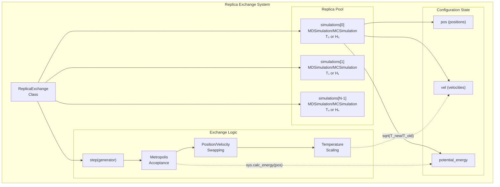
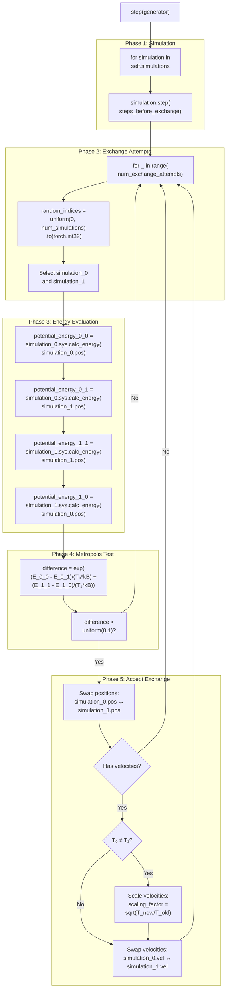
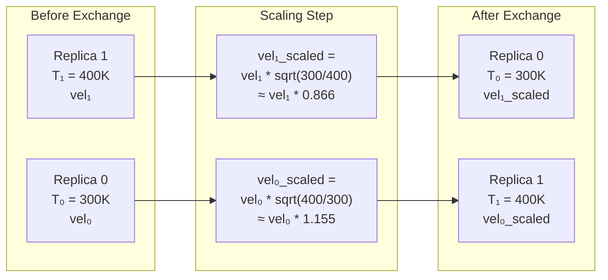
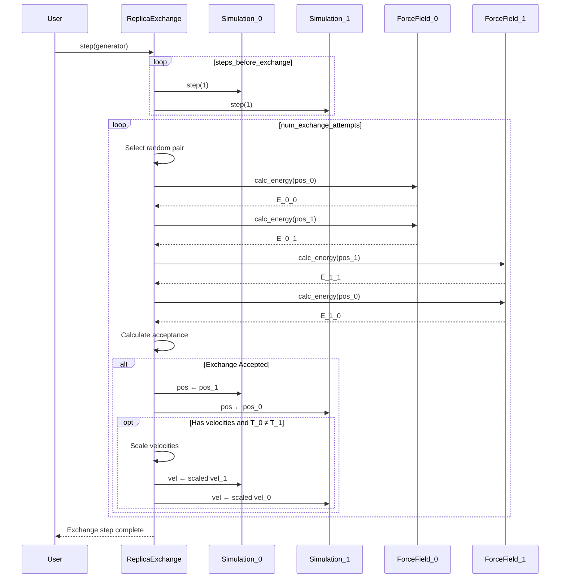

# Replica Exchange and Parallel Tempering

<details>
<summary>Relevant source files</summary>

The following files were used as context for generating this wiki page:

- [dimos/advanced_methods/__init__.py](dimos/advanced_methods/__init__.py)
- [dimos/advanced_methods/replica_exchange.py](dimos/advanced_methods/replica_exchange.py)

</details>


## Purpose and Scope

This page describes the replica exchange molecular dynamics (REMD) implementation in DIMOS, also known as parallel tempering. This enhanced sampling technique runs multiple replicas of a system at different temperatures or with different Hamiltonians and periodically exchanges configurations between them to improve conformational exploration.

For information about metadynamics and collective variable-based sampling, see [Metadynamics](#5.1). For probability distributions used in advanced sampling, see [Probability Distributions for Sampling](#5.3).

**Note**: Replica exchange is currently an experimental feature in DIMOS and requires careful validation against established implementations before production use.

---

## Replica Exchange Method Overview

Replica exchange molecular dynamics (REMD), also known as parallel tempering, is an enhanced sampling technique that addresses the problem of systems becoming trapped in local energy minima. The method works by:

1. Running multiple copies (replicas) of a system simultaneously, each at a different temperature or with a different Hamiltonian
2. Periodically attempting to exchange configurations between replicas using the Metropolis criterion
3. Allowing configurations from high-temperature replicas (which sample more broadly) to influence low-temperature replicas (which sample local minima more thoroughly)

The exchange probability between replicas *i* and *j* with temperatures *Tᵢ* and *Tⱼ* is determined by:

```
P_exchange = min(1, exp(ΔE_i/kB*Ti + ΔE_j/kB*Tj))
```

where ΔE_i = E_i(x_i) - E_i(x_j) is the energy difference for replica *i* when evaluated at configurations *x_i* and *x_j*.

**Sources**: [dimos/advanced_methods/__init__.py:374-389](), [dimos/advanced_methods/replica_exchange.py:374-393]()

---

## Implementation Architecture

### ReplicaExchange Class

The `ReplicaExchange` class is the main entry point for running replica exchange simulations. It manages multiple simulation objects and orchestrates exchange attempts between them.



**Diagram: Replica Exchange Architecture and Component Relationships**

**Sources**: [dimos/advanced_methods/replica_exchange.py:401-428]()

---

## Configuration Parameters

The `ReplicaExchange` class accepts the following configuration parameters:

| Parameter | Type | Default | Description |
|-----------|------|---------|-------------|
| `simulations` | list | Required | List of `MDSimulation` or `MCSimulation` objects with different temperatures or Hamiltonians |
| `steps_before_exchange` | int | 1 | Number of simulation steps to run before attempting exchanges |
| `num_exchange_attempts` | int | 50 | Number of exchange attempts per replica exchange step |

### Parameter Details

**simulations**: Each simulation object in the list should have:
- A unique temperature (for temperature replica exchange)
- A unique Hamiltonian (for Hamiltonian replica exchange)
- The `sys` attribute providing a `calc_energy(pos)` method
- Position (`pos`) and optionally velocity (`vel`) attributes
- A `temperature` attribute (in internal units)

**steps_before_exchange**: Controls the frequency of exchange attempts. Larger values reduce exchange overhead but may slow convergence. Typical values range from 1 to 1000 steps depending on system size and timestep.

**num_exchange_attempts**: The number of random replica pairs to attempt exchanges between during each exchange step. With N replicas, N exchange attempts ensures each replica has approximately one chance to exchange.

**Sources**: [dimos/advanced_methods/replica_exchange.py:409-442]()

---

## Exchange Algorithm

### Complete Exchange Step

The `step()` method implements the complete replica exchange procedure:



**Diagram: Replica Exchange Step Algorithm Flow**

**Sources**: [dimos/advanced_methods/replica_exchange.py:449-499]()

---

## Metropolis Acceptance Criterion

The acceptance probability for exchanging configurations between replicas *i* and *j* is calculated using the generalized Metropolis criterion:

```
Δ = exp[(E_i(x_i) - E_i(x_j))/(k_B T_i) + (E_j(x_j) - E_j(x_i))/(k_B T_j)]
```

The exchange is accepted if `Δ > uniform(0,1)`.

### Energy Calculations

For each exchange attempt, four energy evaluations are performed:

| Quantity | Description | Code Reference |
|----------|-------------|----------------|
| `potential_energy_0_0` | Energy of replica 0's configuration using replica 0's Hamiltonian | `simulation_0.sys.calc_energy(simulation_0.pos)` |
| `potential_energy_0_1` | Energy of replica 1's configuration using replica 0's Hamiltonian | `simulation_0.sys.calc_energy(simulation_1.pos)` |
| `potential_energy_1_1` | Energy of replica 1's configuration using replica 1's Hamiltonian | `simulation_1.sys.calc_energy(simulation_1.pos)` |
| `potential_energy_1_0` | Energy of replica 0's configuration using replica 1's Hamiltonian | `simulation_1.sys.calc_energy(simulation_0.pos)` |

These calculations allow for exchanges between replicas with different Hamiltonians, not just different temperatures.

**Sources**: [dimos/advanced_methods/replica_exchange.py:483-490]()

---

## Temperature Scaling and Velocity Handling

### Position Exchange

When an exchange is accepted, positions are always swapped between the two replicas:

```python
simulation_0.pos, simulation_1.pos = simulation_1.pos, simulation_0.pos
```

This swap ensures that replica 0 now explores the configuration space that replica 1 was exploring, and vice versa.

### Velocity Scaling for Temperature Replicas

When exchanging between replicas at different temperatures, velocities must be scaled to maintain the proper kinetic energy distribution at each temperature. The scaling factor is:

```
scaling_factor = sqrt(T_new / T_old)
```

The velocity exchange procedure:

1. Check if both simulations have velocities (MD simulations)
2. Check if temperatures differ
3. If yes, scale velocities:
   - `simulation_0.vel *= sqrt(T_1/T_0)` (moving to higher/lower temperature)
   - `simulation_1.vel *= sqrt(T_0/T_1)` (moving to lower/higher temperature)
4. Swap the scaled velocities

This ensures that the kinetic energy distribution matches the target temperature after the exchange.



**Diagram: Velocity Scaling During Temperature Replica Exchange**

**Sources**: [dimos/advanced_methods/replica_exchange.py:492-499]()

---

## Random Number Generation

The replica exchange algorithm uses a PyTorch random number generator for:

1. **Replica selection**: Randomly selecting two replicas for each exchange attempt
2. **Metropolis test**: Generating uniform random numbers for acceptance/rejection

The generator can be passed as an optional parameter to the `step()` method for reproducible simulations:

```python
generator = torch.Generator()
generator.manual_seed(42)
replica_exchange.step(generator=generator)
```

If no generator is provided, PyTorch's default random number generator is used.

**Sources**: [dimos/advanced_methods/replica_exchange.py:449-478]()

---

## Experimental Status Warning

The `ReplicaExchange` class issues a warning on initialization:

> "Replica Exchange is currently an experimental feature. While it should work mostly correct, it has not been thoroughly tested. Please be careful when using it and compare to established implementations."

Users should:
- Validate results against established REMD implementations (GROMACS, AMBER, OpenMM)
- Verify exchange acceptance rates are reasonable (typically 20-40%)
- Check that temperature distributions remain stable
- Ensure energy conservation when expected
- Monitor for unexpected behavior in long simulations

**Sources**: [dimos/advanced_methods/replica_exchange.py:443]()

---

## Temperature Selection Guidelines

While DIMOS does not enforce temperature selection, proper temperature ladder design is critical for effective replica exchange:

### Overlap Criterion

Neighboring temperatures should be selected such that:
- Exchange acceptance rates between neighbors are typically 20-40%
- Energy distributions of neighboring replicas have sufficient overlap
- The temperature ratio between neighbors is typically 1.05-1.20

### Geometric Spacing

For a system with N replicas spanning temperatures from T_min to T_max:

```
T_i = T_min * (T_max/T_min)^(i/(N-1))
```

where i = 0, 1, ..., N-1.

### System-Dependent Considerations

Temperature spacing depends on:
- System size (larger systems need smaller temperature ratios)
- Heat capacity (systems with phase transitions need denser spacing near transition)
- Degree of freedom (more DOF requires smaller temperature ratios)

---

## Integration with DIMOS Simulation Classes

The `ReplicaExchange` class works with any simulation object that provides:

| Required Attribute/Method | Type | Description |
|---------------------------|------|-------------|
| `sys` | Force field object | Must provide `calc_energy(pos)` method |
| `pos` | torch.Tensor | Current atomic positions |
| `temperature` | float | Replica temperature in internal units |
| `step(n)` | method | Run n simulation steps |
| `vel` (optional) | torch.Tensor | Current velocities (for MD simulations) |

This design allows replica exchange to work with:
- `MDSimulation` objects using different integrators (Langevin, Nose-Hoover)
- `MCSimulation` objects (no velocity handling)
- Different force fields (Amber, GROMACS, ML potentials, hybrid ML/MM)
- Mixed replica types (though this is uncommon)

**Sources**: [dimos/advanced_methods/replica_exchange.py:444-447](), [dimos/advanced_methods/replica_exchange.py:480-499]()

---

## Data Flow During Exchange



**Diagram: Sequence of Operations During Replica Exchange Step**

**Sources**: [dimos/advanced_methods/replica_exchange.py:449-499]()

---

## Relationship to Other Advanced Sampling Methods

Replica exchange differs from metadynamics in several key ways:

| Aspect | Replica Exchange | Metadynamics |
|--------|------------------|--------------|
| **Sampling Strategy** | Multiple parallel simulations | Single simulation with bias |
| **Enhanced Sampling** | Temperature/Hamiltonian diversity | History-dependent bias potential |
| **Overhead** | Multiple full simulations | Single simulation + bias calculation |
| **Collective Variables** | Not required | Central to method |
| **Parallelization** | Naturally parallel | Limited parallelization |
| **Best For** | Crossing high barriers, global exploration | Free energy along specific CVs |

These methods can potentially be combined, running metadynamics on each replica in a replica exchange simulation, though this is not currently implemented in DIMOS.

**Sources**: [dimos/advanced_methods/__init__.py:374-389]()

---

## Constants and Units

The replica exchange implementation uses the `BOLTZMANN` constant from the `dimos.constants` module:

```python
from dimos import constants
# Used in acceptance calculation:
# exp((E_0_0 - E_0_1) / (T_0 * constants.BOLTZMANN) + ...)
```

The value of `BOLTZMANN` depends on the unit system chosen (Amber, GROMACS, or reduced units). See [Unit Systems and Physical Constants](#2.3) for details on unit system configuration.

**Sources**: [dimos/advanced_methods/replica_exchange.py:398](), [dimos/advanced_methods/replica_exchange.py:489-490]()

---