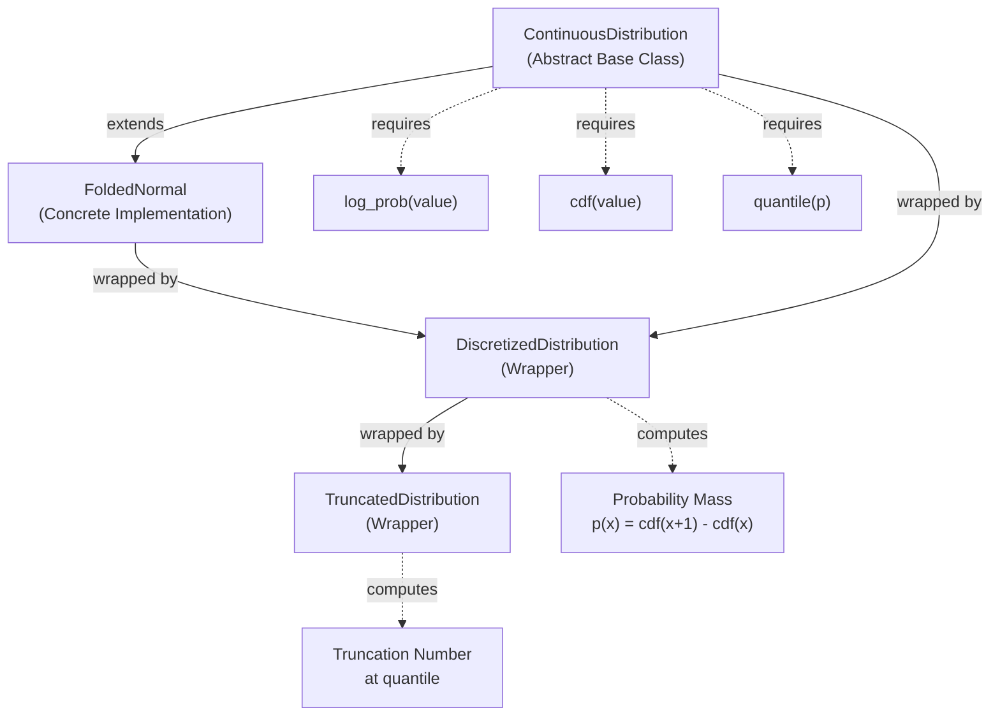
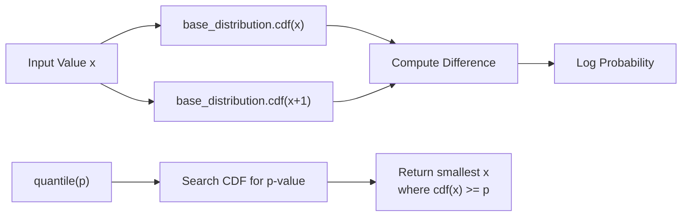
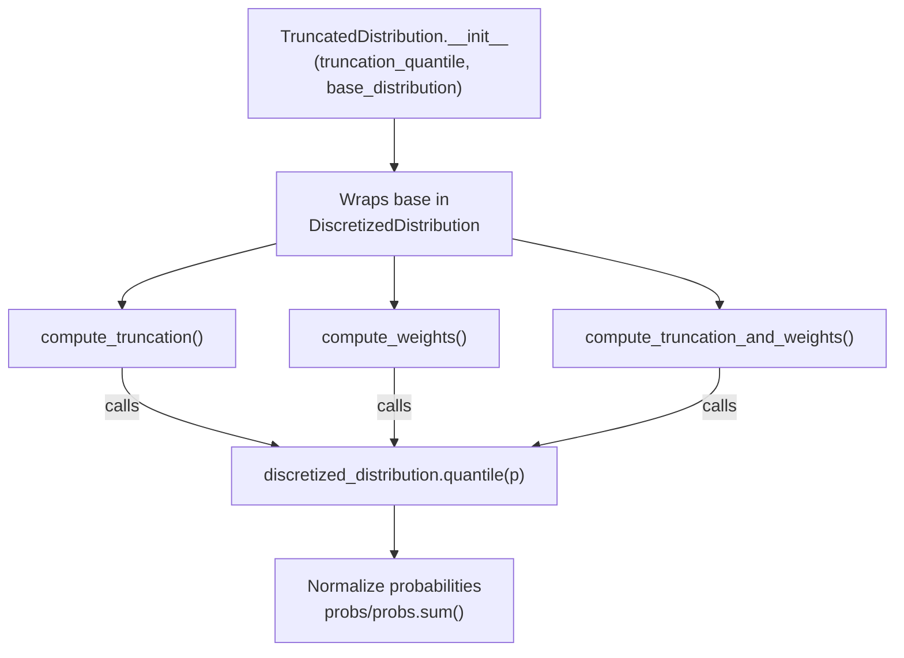
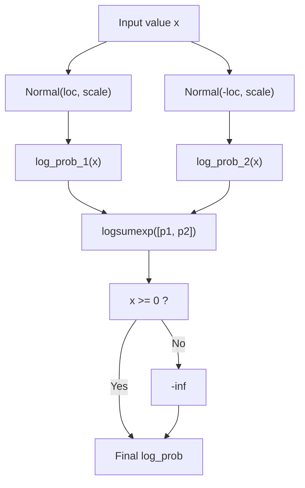

# Probability Distributions for Sampling

<details>
<summary>Relevant source files</summary>

The following files were used as context for generating this wiki page:

- [dimos/distribution.py](dimos/distribution.py)

</details>


## Purpose and Scope

This page documents the probability distribution classes provided by DIMOS for advanced sampling methods. These distributions are primarily used in enhanced sampling techniques and Monte Carlo simulations. The module provides a hierarchy of distribution types: continuous base distributions, discretized versions for discrete sampling, truncated distributions with bounded support, and specific implementations like the folded normal distribution.

For information about how these distributions are used in metadynamics, see [Metadynamics](#5.1). For replica exchange sampling, see [Replica Exchange and Parallel Tempering](#5.2).

**Sources:** [dimos/distribution.py:374-389]()

---

## Distribution Class Hierarchy

The distribution system follows a hierarchical design where continuous distributions form the base, which can then be discretized and truncated as needed. This architecture allows flexible composition of distribution types for different sampling requirements.



**Sources:** [dimos/distribution.py:395-850]()

---

## ContinuousDistribution Base Class

The `ContinuousDistribution` class defines the interface that all continuous distributions must implement. It serves as an abstract base class extending `torch.nn.Module` for PyTorch integration.

### Required Interface

| Method | Input | Output | Description |
|--------|-------|--------|-------------|
| `log_prob(value)` | `torch.Tensor` (N,1) | `torch.Tensor` (N,1) | Log probability density function |
| `cdf(value)` | `torch.Tensor` (N,1) | `torch.Tensor` (N,1) | Cumulative distribution function |
| `quantile(p)` | `float` (default 0.99) | `tuple` | Lower and upper bounds for p-quantile |

### Implementation Requirements

All subclasses must implement these three methods to provide the mathematical foundation for discretization and truncation operations. The base class provides no default implementations.

**Sources:** [dimos/distribution.py:395-459]()

---

## DiscretizedDistribution

The `DiscretizedDistribution` class converts a continuous distribution into a discrete one by defining the probability mass function as the difference between cumulative distribution function values.

### Mathematical Formulation

For a continuous distribution with CDF φ(x), the discretized probability mass function is:

```
p(x) = φ(x+1) - φ(x)
```

This ensures that the discrete probabilities integrate to the continuous distribution's properties.

### Key Methods



### Implementation Details

The `log_prob` method adds a small epsilon (1e-6) to prevent numerical issues when the base distribution has identical CDF values at consecutive points:

```python
log_prob = log(cdf(value + 1.0) - cdf(value) + 1e-6)
```

The `quantile` method uses binary search (`torch.searchsorted`) over the cumulative sum of probabilities to find the p-quantile efficiently.

**Sources:** [dimos/distribution.py:461-588]()

---

## TruncatedDistribution

The `TruncatedDistribution` class truncates a discretized distribution at a specified quantile and renormalizes the probabilities. This is useful for limiting the computational support of distributions with infinite tails.

### Architecture



### Truncation Process

1. **Compute Truncation Number**: Determines the integer cutoff where CDF ≥ truncation_quantile
2. **Extract Probabilities**: Gets probability mass up to truncation point
3. **Renormalize**: Divides probabilities by their sum to ensure they sum to 1.0

The truncation number is detached from the gradient computation to prevent backpropagation through this discrete decision.

**Sources:** [dimos/distribution.py:590-676]()

---

## FoldedNormal Distribution

The `FoldedNormal` class implements the folded normal distribution, which arises from taking the absolute value of a normal random variable: if X ~ Normal(μ, σ), then Y = |X| ~ FoldedNormal(μ, σ).

### Parameters and Properties

| Parameter | Type | Constraint | Description |
|-----------|------|------------|-------------|
| `loc` | `float` | ≥ 0 | Location parameter (μ) |
| `scale` | `float` | > 0 | Scale parameter (σ) with softplus transformation |

The scale parameter uses a softplus transformation plus constant to ensure positivity:
```
base_scale = softplus(_base_scale) + 0.5
```

### Statistical Properties

**Mean:**
```
μ_FN = σ√(2/π) exp(-μ²/2σ²) + μ(1 - [1 + erf(-μ/σ)])
```

**Variance:**
```
σ²_FN = μ² + σ² - μ²_FN
```

### Probability Computations



The log probability sums contributions from both the positive and negative sides of the underlying normal distribution, then enforces that probabilities are zero for negative values.

### Quantile Bounds

The implementation provides both lower and upper bounds for quantiles:

- **Lower Bound**: Uses the quantile of the underlying Normal distribution, since Normal CDF ≥ FoldedNormal CDF
- **Upper Bound**: Uses Chernoff's bound for a tighter estimate

**Sources:** [dimos/distribution.py:678-850]()

---

## Method Interface Summary

The following table summarizes the key methods available across all distribution classes:

| Method | ContinuousDistribution | DiscretizedDistribution | TruncatedDistribution | FoldedNormal |
|--------|------------------------|-------------------------|----------------------|--------------|
| `log_prob(value)` | Abstract | Implemented | Inherited | Implemented |
| `cdf(value)` | Abstract | Implemented | Inherited | Implemented |
| `quantile(p)` | Abstract | Implemented | Inherited | Bounds only |
| `mean` | - | Property | Property | Property |
| `variance` | - | Property | Property | Property |
| `get_parameters()` | - | Pass-through | Pass-through | Returns [loc, scale] |
| `compute_truncation()` | - | - | Yes | - |
| `compute_weights()` | - | - | Yes | - |
| `to(device)` | - | Yes | Yes | - |

**Sources:** [dimos/distribution.py:395-850]()

---

## Usage Patterns

### Basic Usage: Creating Distributions

```python
# Create a folded normal distribution
from dimos.distribution import FoldedNormal
base_dist = FoldedNormal(loc=2.0, scale=1.0)

# Create a discretized version
from dimos.distribution import DiscretizedDistribution
discrete_dist = DiscretizedDistribution(base_dist)

# Create a truncated version at 99th percentile
from dimos.distribution import TruncatedDistribution
truncated_dist = TruncatedDistribution(
    truncation_quantile=0.99,
    base_distribution=base_dist
)
```

### Computing Probabilities

```python
# Log probabilities for continuous values
x = torch.tensor([[1.5], [2.0], [2.5]])
log_probs = base_dist.log_prob(x)  # Shape: (3, 1)

# Probability mass for discrete values
discrete_values = torch.tensor([[1], [2], [3]])
log_masses = discrete_dist.log_prob(discrete_values)
```

### Truncation and Sampling

```python
# Get truncation cutoff and normalized weights
cutoff, weights = truncated_dist.compute_truncation_and_weights()

# Sample from truncated distribution
samples = torch.multinomial(weights, num_samples=1000, replacement=True)
```

### Device Management

All distribution classes support moving to GPU devices:

```python
device = torch.device('cuda')
discrete_dist.to(device)
truncated_dist.to(device)
```

**Sources:** [dimos/distribution.py:461-676]()

---

## Integration with Sampling Methods

These distribution classes are designed to integrate with advanced sampling techniques in DIMOS. The module docstring notes they are "currently mostly used for STHMC" (Self-Tuning Hamiltonian Monte Carlo), though they can be used in other contexts.

### Common Use Cases

1. **Proposal Distributions**: Generate candidate moves in Monte Carlo sampling
2. **Bias Potentials**: Define probability distributions for enhanced sampling
3. **Adaptive Sampling**: Adjust distribution parameters during simulation
4. **Discrete State Spaces**: Use discretized distributions for discrete variables

### Numerical Stability Features

The implementation includes several numerical stability measures:

- Epsilon addition (1e-6) in discretized log_prob to avoid log(0)
- Softplus transformation for scale parameters to ensure positivity
- LogSumExp for combining probabilities to avoid underflow
- Gradient detachment for discrete truncation decisions

**Sources:** [dimos/distribution.py:374-389](), [dimos/distribution.py:493-514](), [dimos/distribution.py:741-765]()

---