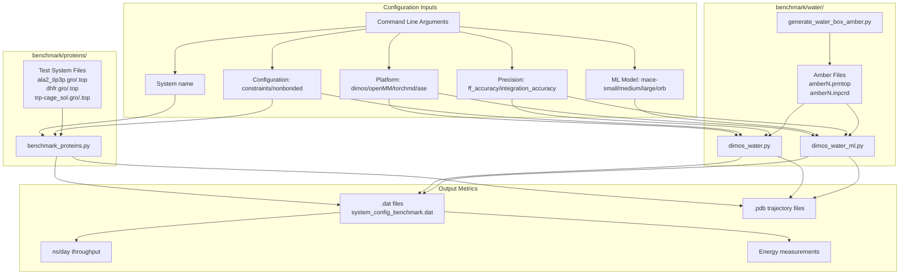
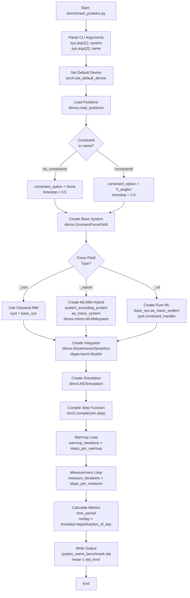
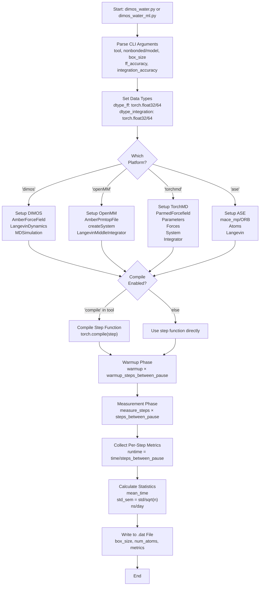
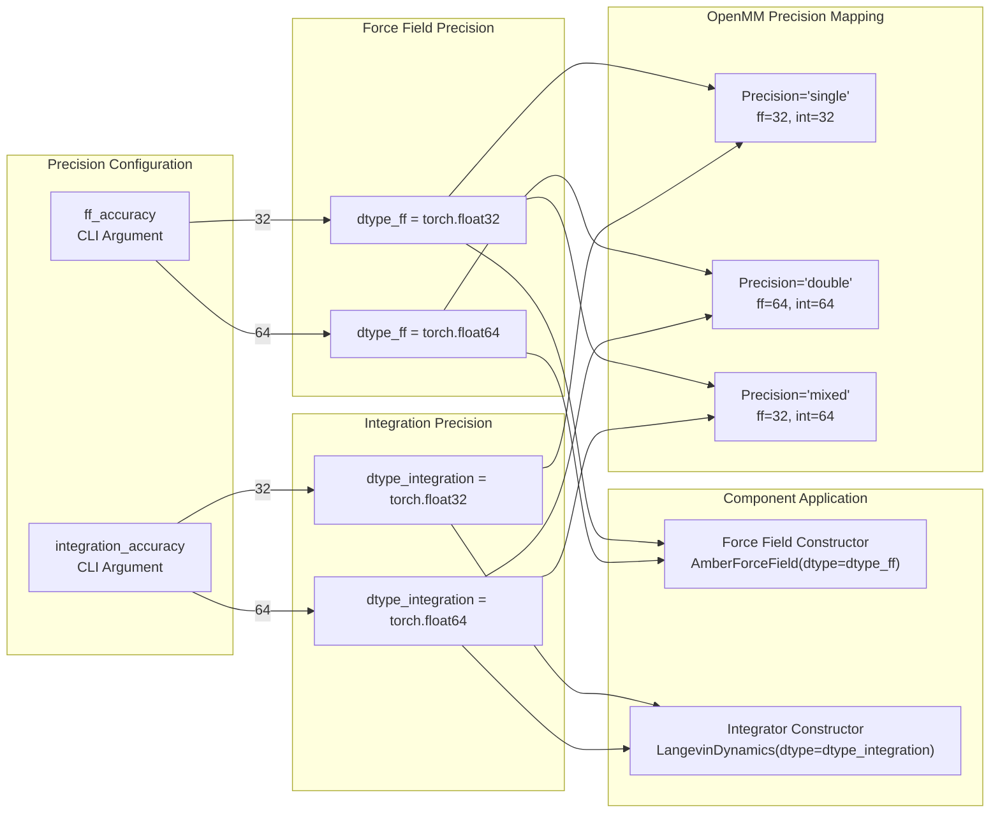
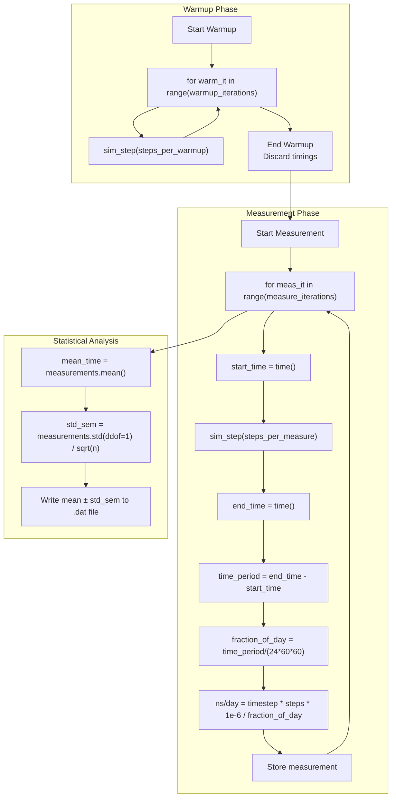
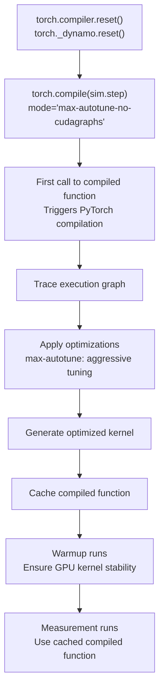
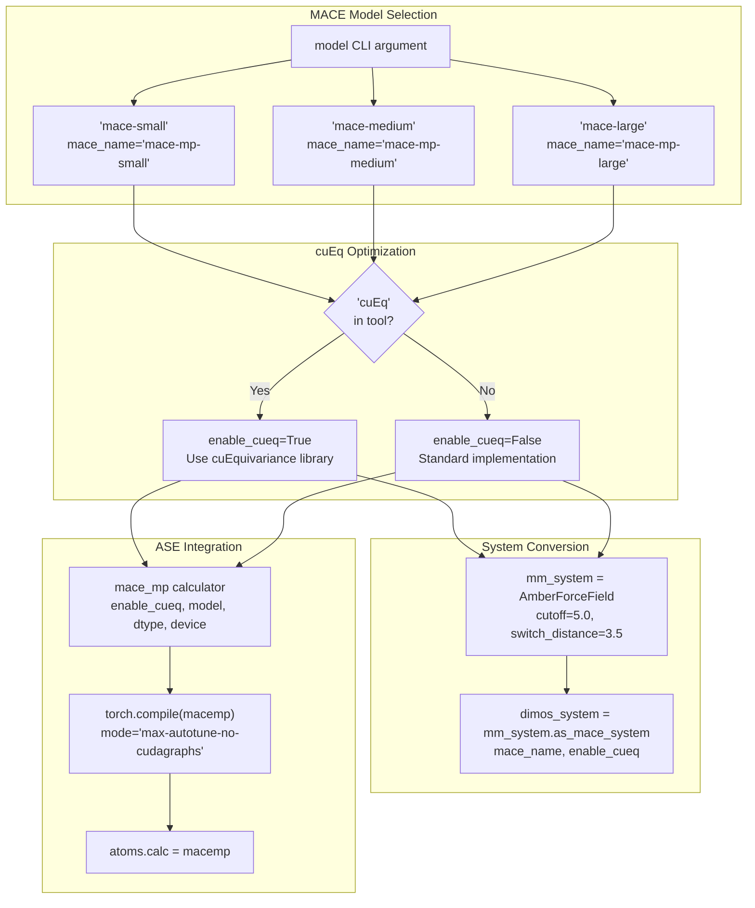

# Benchmarking Suite

<details>
<summary>Relevant source files</summary>

The following files were used as context for generating this wiki page:

- [benchmark/proteins/benchmark_proteins.py](benchmark/proteins/benchmark_proteins.py)
- [benchmark/water/dimos_water.py](benchmark/water/dimos_water.py)
- [benchmark/water/dimos_water_ml.py](benchmark/water/dimos_water_ml.py)

</details>


The DIMOS benchmarking suite is a collection of scripts and test systems designed to systematically evaluate the performance and accuracy of the DIMOS simulation engine. The suite compares DIMOS against established molecular dynamics platforms (OpenMM, TorchMD, ASE) across multiple dimensions: force field types (classical, ML, hybrid), system sizes, precision configurations, and compilation strategies.

The benchmarking infrastructure serves two primary purposes:
1. **Validation**: Ensuring DIMOS produces physically correct results comparable to reference implementations
2. **Performance Profiling**: Measuring throughput (nanoseconds per day) and identifying optimization opportunities

For information about the specific test systems used, see [Protein Benchmark Systems](#6.1) and [Water System Benchmarks](#6.2). For detailed performance analysis and platform comparisons, see [Platform Comparison and Performance](#6.3).

**Sources**: [benchmark/proteins/benchmark_proteins.py:1-73](), [benchmark/water/dimos_water.py:1-223](), [benchmark/water/dimos_water_ml.py:1-207]()

## Benchmark Architecture

The benchmarking suite is organized into two main directories: `benchmark/proteins/` for protein system tests and `benchmark/water/` for water box tests. Each directory contains benchmark scripts that can run simulations with different configurations and collect performance metrics.

### Benchmark Script Organization



**Sources**: [benchmark/proteins/benchmark_proteins.py:16-21](), [benchmark/water/dimos_water.py:24-31](), [benchmark/water/dimos_water_ml.py:34-39]()

### Force Field Configuration Matrix

The protein benchmark script supports six distinct force field configurations, controlled by the `name` command-line argument:

| Configuration | Force Field Type | Constraints | Timestep | Implementation |
|---------------|------------------|-------------|----------|----------------|
| `no_constraints_mm` | Classical MM | None | 0.5 fs | `GromacsForceField` |
| `constraints_mm` | Classical MM | H-angles | 2.0 fs | `GromacsForceField` |
| `no_constraints_mlmm` | Hybrid ML/MM | None | 0.5 fs | `MLMMsystem` |
| `constraints_mlmm` | Hybrid ML/MM | H-angles | 2.0 fs | `MLMMsystem` |
| `no_constraints_ml` | Pure ML | None | 0.5 fs | `as_mace_system` |
| `constraints_ml` | Pure ML | H-angles | 2.0 fs | `as_mace_system` |

The constraint option `h_angles` constrains hydrogen bonds and angles, allowing for a 4x larger timestep (2.0 fs vs 0.5 fs) while maintaining stability.

**Sources**: [benchmark/proteins/benchmark_proteins.py:24-44]()

## Benchmark Execution Workflow

### Protein Benchmark Workflow



**Sources**: [benchmark/proteins/benchmark_proteins.py:1-73]()

### Water Benchmark Workflow

The water benchmarks follow a similar pattern but support multiple platforms and configuration options:



**Sources**: [benchmark/water/dimos_water.py:1-223](), [benchmark/water/dimos_water_ml.py:1-207]()

## Benchmark Configuration Options

### Precision Control

DIMOS benchmarks support independent precision control for force field calculations and integration steps, enabling mixed-precision workflows:



**Sources**: [benchmark/water/dimos_water.py:30-40](), [benchmark/water/dimos_water.py:95-100]()

### Platform-Specific Setup

The benchmark scripts implement platform-specific initialization to ensure fair comparisons:

| Platform | Device Control | Compilation | Threading |
|----------|----------------|-------------|-----------|
| DIMOS CPU | `torch.set_default_device("cpu")` | `torch.compile(..., mode="max-autotune-no-cudagraphs")` | `OMP_NUM_THREADS` |
| DIMOS CUDA | `torch.set_default_device("cuda:0")` | `torch.compile(..., mode="max-autotune-no-cudagraphs")` | N/A |
| OpenMM Reference | `Platform.getPlatformByName('Reference')` | N/A | N/A |
| OpenMM CPU | `Platform.getPlatformByName('CPU')` | N/A | `OPENMM_CPU_THREADS` |
| OpenMM CUDA | `Platform.getPlatformByName('CUDA')`, `properties["DeviceIndex"]` | N/A | N/A |
| TorchMD | `device="cpu"` or `"cuda:0"` | `torch.compile(integrator.step)` | N/A |
| ASE | `device="cpu"` or `"cuda:0"` | `torch.compile(calculator)` | N/A |

**Sources**: [benchmark/water/dimos_water.py:50-108](), [benchmark/water/dimos_water_ml.py:58-176]()

## Performance Metrics Collection

### Timing and Throughput Calculation



The warmup phase ensures that:
1. JIT compilation is completed (for `torch.compile` runs)
2. GPU kernels are loaded and cached
3. Memory allocations are stable
4. CPU/GPU frequency scaling reaches steady state

Only measurements from the measurement phase are used for performance statistics.

**Sources**: [benchmark/proteins/benchmark_proteins.py:49-72](), [benchmark/water/dimos_water.py:193-218]()

### Output File Format

Benchmark results are written to `.dat` files with tab-separated values:

**Protein Benchmarks** (`{system}_{config}_benchmark.dat`):
```
ns_per_day_mean    ns_per_day_std_error
```

**Water Benchmarks** (`{tool}_nonbonded{method}_dtype*.dat` or `{tool}model{name}_dtype*.dat`):
```
box_size    num_atoms    total_time    time_per_step    ns_per_day    mean_time    std_sem
```

**Sources**: [benchmark/proteins/benchmark_proteins.py:57-72](), [benchmark/water/dimos_water.py:218]()

## Compilation Strategy

Both protein and water benchmarks utilize `torch.compile` to optimize the simulation step function. The compilation process is distinct from the warmup phase:



The `max-autotune-no-cudagraphs` mode:
- **max-autotune**: Aggressively tunes kernel launches and memory layouts for maximum performance
- **no-cudagraphs**: Disables CUDA graphs to avoid compatibility issues with dynamic operations

**Sources**: [benchmark/proteins/benchmark_proteins.py:49-51](), [benchmark/water/dimos_water.py:67-70](), [benchmark/water/dimos_water_ml.py:90-94]()

## ML Potential Benchmark Configuration

The ML water benchmarks support multiple ML potentials and optimization strategies:

### MACE Model Variants



The cuEquivariance (`enable_cueq=True`) option uses optimized CUDA kernels for equivariant operations, potentially improving MACE performance on GPUs.

**Sources**: [benchmark/water/dimos_water_ml.py:72-84](), [benchmark/water/dimos_water_ml.py:112-141]()

### ORB Potential Integration

For ORB (Orbital) potentials, the benchmarks support both DIMOS and ASE implementations:

**DIMOS Integration**:
```python
dimos_system = mm_system.as_orb_system()
```

**ASE Integration**:
```python
from orb_models.forcefield import atomic_system, pretrained
from orb_models.forcefield.calculator import ORBCalculator

orbff = pretrained.orb_v2(device=device_str)
system_config = atomic_system.SystemConfig(radius=6.0, max_num_neighbors=150)
calc = ORBCalculator(orbff, system_config=system_config, device=device_str)
atoms.calc = calc
```

**Sources**: [benchmark/water/dimos_water_ml.py:83-84](), [benchmark/water/dimos_water_ml.py:149-167]()

## Benchmark Execution Examples

### Running Protein Benchmarks

```bash
# Classical MM with constraints
python benchmark_proteins.py ala2_tip3p constraints_mm

# Pure ML without constraints
python benchmark_proteins.py dhfr no_constraints_ml

# Hybrid ML/MM with constraints
python benchmark_proteins.py trp-cage_sol constraints_mlmm
```

**Sources**: [benchmark/proteins/benchmark_proteins.py:16-21]()

### Running Water Benchmarks

```bash
# DIMOS with PME, float32 force field, float64 integration
python dimos_water.py dimosCUDAcompile PME 40 32 64

# OpenMM with Cutoff, double precision
python dimos_water.py openMMCUDA Cutoff 60 64 64

# TorchMD with PME, mixed precision
python dimos_water.py torchmdCUDAcompile PME 50 32 64
```

**Sources**: [benchmark/water/dimos_water.py:26-31]()

### Running ML Water Benchmarks

```bash
# DIMOS with MACE-large, float32
python dimos_water_ml.py dimosCUDAcompile mace-large 40 32 32

# DIMOS with MACE-medium + cuEq, float64
python dimos_water_ml.py dimosCUDAcuEqcompile mace-medium 50 64 64

# ASE with ORB, float32
python dimos_water_ml.py aseCUDA orb 30 32 32
```

**Sources**: [benchmark/water/dimos_water_ml.py:34-39]()

## Thread Control and Environment Variables

The benchmarks respect standard threading environment variables for CPU runs:

- **`OMP_NUM_THREADS`**: Controls OpenMP threading for PyTorch CPU operations
- **`OPENMM_CPU_THREADS`**: Controls threading for OpenMM CPU platform (automatically set from `OMP_NUM_THREADS`)

This ensures consistent threading behavior across platforms for fair CPU comparisons.

**Sources**: [benchmark/water/dimos_water.py:42-43]()

## Key Benchmarking Parameters

### Protein Benchmark Parameters

| Parameter | Value | Description |
|-----------|-------|-------------|
| `c_graph` | `False` | Disable computation graph creation |
| `warmup_iterations` | `50` | Number of warmup cycles |
| `steps_per_warmup` | `25` | Simulation steps per warmup cycle |
| `measure_iterations` | `50` | Number of measurement cycles |
| `steps_per_measure` | `50` | Simulation steps per measurement cycle |
| `timestep` | `0.5` or `2.0` fs | Integration timestep (depends on constraints) |
| `temperature` | `300.0` K | Simulation temperature |
| `integrator_dtype` | `torch.float64` | Integrator precision |

**Sources**: [benchmark/proteins/benchmark_proteins.py:8-15](), [benchmark/proteins/benchmark_proteins.py:26-29](), [benchmark/proteins/benchmark_proteins.py:46]()

### Water Benchmark Parameters

| Parameter | Value | Description |
|-----------|-------|-------------|
| `warmup` | `5` | Number of warmup cycles |
| `warmup_steps_between_pause` | `25` | Steps per warmup cycle |
| `steps_between_pause` | `35` | Steps per measurement cycle |
| `measure_steps` | `40` | Number of measurement cycles |
| `stepsize` | `0.5` fs | Integration timestep |
| `temperature` | `300` K | Simulation temperature |
| `cutoff` | `10.0` Å | Nonbonded cutoff distance |
| `switch_distance` | `7.5` Å | Switching function start distance |
| `langevin_gamma` | `1.0` or `0.1` ps⁻¹ | Friction coefficient (classical/ML) |

**Sources**: [benchmark/water/dimos_water.py:18-22](), [benchmark/water/dimos_water.py:61-63](), [benchmark/water/dimos_water_ml.py:26-30](), [benchmark/water/dimos_water_ml.py:69-86]()

## Trajectory Output

Both benchmark scripts support trajectory output for validation purposes:

- **Protein benchmarks**: Not written during benchmark runs
- **Classical water benchmarks**: Optional, written to `dimos{box_size}.pdb`
- **ML water benchmarks**: Written to `water{box_size}_ml.pdb`

The trajectory files can be used for visual inspection and trajectory analysis to verify simulation stability and correctness.

**Sources**: [benchmark/water/dimos_water.py:201-211](), [benchmark/water/dimos_water_ml.py:183-196]()

---